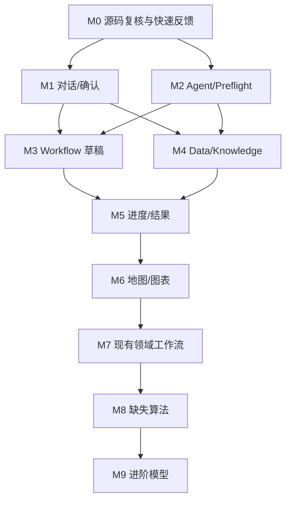

# 00 总计划：以源码为准完善 Groundwater V6

## 1. 目标

让现有地下水 V6 成为更完整、可用、易理解的科研分析原型。AI 编码助手必须在当前代码上完成真实功能，不是重写系统，不是单纯增加算子数量。

本计划按“修复最后一公里 → 完善用户工作流 → 扩展地下水分析”推进。

## 2. 源码根路径和主要事实

仓库是 `gaoyegis99-source/groundwater-agent`，实际项目代码根目录为 `source/`。所有任务路径均相对于仓库根目录书写。

主要目录：
- `source/web/` 主会话 Web
- `source/kernel/` Agent、Session、Confirmation、Task、Workflow 编排
- `source/services/data/` 数据目录、版本、语义、查询、预览、质量、ML Ops
- `source/services/knowledge-next/` 知识单元、检索、证据读取与生命周期
- `source/services/executor/` Job、节点执行、租约、结果发布
- `source/packages/workflow-compiler/` Workflow v6 编译器
- `source/packages/operator-pack/` 106 个算子及 Native/QGIS/remote runtime
- `source/domains/groundwater/6.0.0/` 地下水领域包
- `source/products/groundwater/` 产品清单、UI profile、公开合同

当前 main commit：`3354fc2d959219f399ed667b993dcbdf3d0db89e`。执行时必须重新检查 HEAD。

## 3. 本轮不做的内容

部署架构、安全专项、鉴权拆分、多租户、版本兼容迁移、Capability Registry、CI 平台治理不属于本轮功能完善范围。不要把旧平台蓝图中的这些工作重新塞进任务列表。

## 4. 阶段计划

| 阶段 | 重点 | 交付 |
|---|---|---|
| M0 源码复核与本地反馈 | 测试入口、operator/workflow 快速验证、golden | 可快速验证小改动 |
| M1 对话和确认体验 | 表单校验、字段选择、原值、加载失败、重试 | 确认卡可信可用 |
| M2 Agent 和 Preflight | 路由金标、字段存在性、类型/单位语义、错误修复 | 提案更准确 |
| M3 工作流草稿 | fan-out 语义、缺项补齐、DAG 视图、导出与校验 | 草稿可读、可修订 |
| M4 数据与知识 | 数据画像、发现、版本比较、证据回溯 | 用户能判断数据与证据质量 |
| M5 任务进度与结果 | Activity、Task、WorkflowRun、结果刷新、复用 | 执行过程和成果可信 |
| M6 地图与图表 | OpenLayers 生命周期、物理值探针、多图层、ChartView | 结果可解释 |
| M7 现有地下水工作流 | trend、flow-field、coverage、render-map 等 | 现有模型完整化 |
| M8 缺失算法 | Kriging、table.classify、DRASTIC | 新增真实能力 |
| M9 进阶模型 | Pastas、MODFLOW 6 | 研究级扩展原型 |

## 5. 关键依赖

## 6. 每张任务卡执行顺序

1. 记录当前 HEAD 与 `git status`。
2. 阅读任务卡列出的真实源码和测试。
3. 确认缺陷仍存在；若已修复，改为验证并关闭任务。
4. 先增加失败测试。
5. 做最小修改，复用已有服务、组件和算子。
6. 运行任务卡规定的测试和范围检查。
7. 记录真实结果，不把未运行写成通过。
8. 更新 `90_PROGRESS.md`。

## 7. 全局科学与交互不变量

- Data version / semantic / object / checksum 身份必须准确。
- UNKNOWN 不等于 PASS；样本检查不等于全量质量结论。
- 未经确认不能创建实际 WorkflowRun / Job。
- Draft 仅是草稿，不能伪装成已发布模型。
- 结果必须能回到真实 Data version 与 WorkflowRun。
- 空间覆盖、凸包、缓冲、插值面不能被描述为观测到的水文地质边界。
- 水位高程与地下水埋深不能混用。
- 物理量显示原单位与原始值，不能把归一化渲染值当作科学数值。
- 标准阈值没有原文依据时不得作为正式规则。
- 算法输出必须有独立数值测试，不能只以 exit code=0 验收。

## 8. 总体验收目标

用户能够完成一条完整路径：上传/选择数据 → 识别字段 → 理解方法 → 形成分析草稿/模型提案 → 修正参数 → 确认执行 → 查看节点进度 → 查看地图/表格/图表 → 打开依据 → 比较或复用结果。
