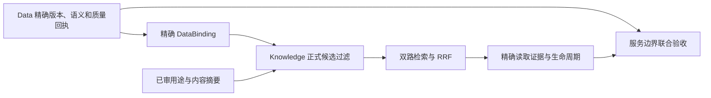

# Data + Knowledge 第一批最小增量设计

2026-11-16，源码基线 `e6d8512797a128887cf2bab41a92629ddb06b668`。已按本目录八份输入核对。设计待审批。首批使用 Data v3 / 存储 v8 和 Knowledge Next v3 / 存储 v7。监测 Profile 先采用现有语义合同和登记约定。质量证明复用 QualityRun，Knowledge 复用版本及检索投影。首选方案需要零 DDL，条件性接口扩展见第 6 节。 [原提示词](/home/mtd/liweigis/workflow/groundwater-v6/plans/data-knowledge-design/07_CODEX_DESIGN_PROMPT.md) · [源代码规范](/home/mtd/liweigis/workflow/groundwater-v6/source/AGENTS.md)

## 1. Data 现有合同与缺口

| 对象 | 已核对的字段、合同和调用 | 需求与最小增量 |
| --- | --- | --- |
| Dataset | `datasets(project,id,current_version)` 持有稳定身份与当前版本指针。Data v3 目录与发现按项目授权 | 以稳定 ID 定位资料，发现是候选。历史分析固定版本和语义。保留目录合同 |
| DatasetVersion | `versions(dataset_id,publication_id,descriptor,semantic_id)`。字节版本持久，当前语义指针可变 | 读到 `versionId` 仍须固定 `semanticId`。报告和绑定要求两者 |
| DataObject | `objects(version_id,descriptor)` 持有原件和查询对象的格式、大小、角色、checksum。`DataVersionRefV2` 记录版本、语义、对象及字节身份 | 质量检查选定真实使用的对象。原件和转换表保留各自身份，结果以检查的字节为准 |
| Field | 列 descriptor 提供准确 `fN`、原始列名、物理类型和画像。`FieldMeaning` 挂在该版本语义的 `fields[fN]` | 复用字段键。显示名来自 descriptor，字段意义来自人工来源。同名、同列位跨版本需要重验 |
| SemanticRevision | `semantic_revisions.body` 为 JSONB。`POST .../semantics` 以 `expectedSemanticId` 做 CAS，`GET .../semantics/{semanticId}` 可精确历史读 | 把 Profile 附着到同一修订。第一种表达无新字段。证据缺口实测后才审查可选扩展 |
| QualitySuite / QualityRun | 套件版本带 `body_digest`，绑定有 revision。`quality_runs` 固定 dataset/version/semantic、suiteVersion/bindingRevision、算子身份与结果，关联 `quality_rule_results` | 追加服务核验记录，明确声明与执行证据。规则结果和适用性分开。见第 3 节 |
| Publication / Lineage | `publication.service.commit` 原子发布版本、语义、对象、输入版本血缘及回执。现有血缘边按版本记录 | 质量产物可复用 Data 版本与血缘。仅血缘与输出名称不足以证明所用语义或规则执行 |
| Query / Preview | Query 可固定 `semantic_ids`，预览受格式及限制约束。`TableInspector` 仅检查至多 5 行 | 样本检查不替代全表质量。以 descriptor 和精确读复用元数据，样本按需获取。跨轮或跨语义重新确认 |

[Data 基础 DDL](/home/mtd/liweigis/workflow/groundwater-v6/source/services/data/src/platform_data_service/migrations/001.sql) · [质量 DDL](/home/mtd/liweigis/workflow/groundwater-v6/source/services/data/src/platform_data_service/migrations/003.sql) · [语义写入](/home/mtd/liweigis/workflow/groundwater-v6/source/services/data/src/platform_data_service/semantics/service.py:8) · [DataVersionRefV2](/home/mtd/liweigis/workflow/groundwater-v6/source/packages/protocol-contracts/src/platform_protocol_contracts/execution_v6.py:27) · [Data OpenAPI](/home/mtd/liweigis/workflow/groundwater-v6/source/services/data/contracts/openapi-v3.json) · [观察工具 v4](/home/mtd/liweigis/workflow/groundwater-v6/source/services/data/contracts/observation-tools.v4.json)

## 2. 地下水最小监测 Profile

首版只登记一张监测观测表。最小可用记录由监测井或点标识、观测时刻、观测变量与观测值组成，变量单位来源需要可核对。介质层位、筛管、井构造、抽水试验和水质样品留待后续专题。井号作为值或字段角色保存在表和 SemanticRevision。使用 `datasetId/versionId/semanticId/fieldId` 识别字段，`projectId` 来自当前授权上下文。派生到新版本时可以人工采用旧映射作为候选，核验状态随新证据重新建立。

| 建议语义 | 现有实现与合同 | 本期最小设计 |
| --- | --- | --- |
| `fieldId`、`displayName` | descriptor 的 `id`/原名 | 按 `fN` 绑定，显示仍用原列名，不新增字段注册 |
| `concept`、`definition` | `FieldMeaning.quantityKind`、`meaning` | 用前者登记受控变量概念，后者保存真实定义。避免重复 `concept` 单列。字段只有标题时状态仍未知 |
| 井或点 ID、观测时间、观测变量、观测值 | `FieldMeaning.role` 与 `Semantics.grain` | 角色约定 `monitoring_point_id`、`observed_at`、`observed_variable`、`observed_value`。单变量宽表由观测值的 `quantityKind` 表达变量。长表可登记变量列，只有统一单位和物理解释时可使用数据集或列级声明，否则按同变量或已有行限定分组，保留未知 |
| 单位、量值方向 | `FieldMeaning.unit/quantityKind/meaning/applicability` | 单位与物理量分开。水位高程、地下水埋深、水头各自的 `quantityKind`。埋深的测量零点、正方向明确登记，缺项不得默认 |
| 时间覆盖和时区 | `Semantics.timeRange/timezone` 与实测时间列 | 表示登记范围和 IANA 时区。重复时刻、换表及 DST 在质量检查记录，不从样本推断 |
| 位置与水平 CRS | `FieldMeaning.role`,`Semantics.crs/spatialExtent` | 位置可选，用 `x/y` 或位置引用角色。CRS 未知时依赖坐标系的距离、面积和插值不可评价。bbox 不能证明点位真实或井网代表性 |
| 垂向基准和测量参考 | `Semantics.verticalDatum`, `FieldMeaning.applicability/source` | 按变量登记。统一基准与井口/地面/测点角色分别描述。多井多期参考不同须有实际依据和显式转换，首期遇到混合口径保持未知。共同测点、方向和单位都成立才评价高程减埋深。缺基准的结果不能作为绝对水头 |
| 来源、测量方法、`sourceRef` | `Semantics.source/limitations`，`FieldMeaning.source/applicability`，修订的 actor/创建时间 | 先登记采集记录、报告版本、方法和出处。actor/时间只能证明登记事件。结构化可验证来源确有缺口时才启用可选扩展 |
| `verification` | 现无受控核验状态和逐字段审阅凭据 | 首批以证据记录及审阅表呈现。状态设计为 `DECLARED/INFERRED/USER_CONFIRMED/SOURCE_VERIFIED/UNKNOWN/CONFLICTED`。依状态附来源和时间。用户确认只证明确认，核验原资料才可列 `SOURCE_VERIFIED`。同义列名和模型默认值只能提示待核 |

单位相同或明确可转换时才比较，同一长度量纲也不能把高程当埋深。检测到硬矛盾记录 `CONFLICTED`，缺资料记录 `UNKNOWN`。仅检查阻断某一用途时，将原因附到该用途。对可信样本先验证现有字段表达是否足够。可表示的内容不重复进入扩展。结构化逐字段审阅或参考方向确有消费需求时，才走第 6 节可选提案。

以下合成示例只用当前 Data v3 语义写入合同。假定原表的 `f0/f1/f2` 分别是点号、观测时刻和埋深，所列出处是测试用说明。缺垂向基准时省略该项，埋深登记可成立，绝对高程仍不得推断。

```json
{
  "expectedSemanticId": "previous-semantic",
  "semantics": {
    "grain": "one_monitoring_point_per_observation_time",
    "timezone": "Asia/Shanghai",
    "source": "synthetic test fixture",
    "fields": {
      "f0": {"role": "monitoring_point_id"},
      "f1": {"role": "observed_at"},
      "f2": {
        "role": "observed_value",
        "quantityKind": "depth_to_water",
        "meaning": "从该井固定测量点向下的地下水埋深",
        "unit": "m",
        "source": "synthetic measurement record"
      }
    }
  }
}
```

[FieldMeaning/Semantics](/home/mtd/liweigis/workflow/groundwater-v6/source/services/data/src/platform_data_service/models.py:29) · [修订 API](/home/mtd/liweigis/workflow/groundwater-v6/source/services/data/src/platform_data_service/api/routers/semantics.py) · [字段词表](/home/mtd/liweigis/workflow/groundwater-v6/plans/knowledge-data-foundation/groundwater-field-dictionary.md) · [流场模型声明](/home/mtd/liweigis/workflow/groundwater-v6/source/domains/groundwater/6.2.0/models/flow-field.model.json)

## 3. QualityRun 的执行证据

| 层次 | 证据和返回口径 |
| --- | --- |
| 文件质量 | 原对象 checksum、入库解析、物理类型、全表画像或有界预览。明确全表、样本及文件头的覆盖范围 |
| 数据规则 | 精确字节、语义修订和规则套件下的逐规则结果。可记录缺失、范围、重复、格式和坐标值域。规则质量的 PASS 只说明指定规则结果 |
| 研究适用性 | 逐任务检查条件和缺项。趋势可检查时间、变量和有效样本。规则质量通过的同一数据还可能因垂向基准未知而无法评价流场。插值还要检查真实点位和空间覆盖。模拟要求概念模型与边界等输入，留在业务方法层 |

`submit_run` 校验精确输入身份、当前套件绑定和结果集合。`operatorRunId`、`implementationDigest` 和 `evidence` 由调用方提交。现有 Executor 发布内容包含模型、Workflow 和算子目录摘要及 Data 输入版本血缘，未形成 Data 可核验的通用逐节点证据，无法仅靠引用证明使用了具体语义、规则、字节和实现。`table.validate@1.0.0` 返回 valid/invalid/violations 三件 Arrow/Parquet 产物及 summary，violation 表记录规则 ID 和行号，不能从 summary 三个总值反推各规则的完整执行。其 `requiredField`/`type` 分支通过数据行报违规，空表需要独立记录，避免零违规冒充结构已验。 [QualityRun 接收](/home/mtd/liweigis/workflow/groundwater-v6/source/services/data/src/platform_data_service/quality.py:200) · [table.validate 合同](/home/mtd/liweigis/workflow/groundwater-v6/source/packages/operator-pack/catalog/operators/table.validate/1.0.0/manifest.json) · [算子执行](/home/mtd/liweigis/workflow/groundwater-v6/source/packages/operator-pack/src/moperators/operators/table_validate.py:18) · [Executor 发布事实](/home/mtd/liweigis/workflow/groundwater-v6/source/services/executor/src/platform_executor_service/result_publication.py:30)

### 证明入口与处理流程

1. **锁定输入**。按 Data 授权读取确切的 `projectId/datasetId/versionId/semanticId/objectId/checksum`，可用 `DataVersionRefV2` 表达字节对象。冻结 `bindingRevision/suiteVersionId/bodyDigest`，将规则按现有规范映射为 `table-validation-rules.v1`，再记录实际传入规则字节摘要。列 ID 与算子使用的真实列名或规范查询列之间要保留映射。无法拆分的重名/类型冲突报错，不能靠临时选列。
2. **交换证据**。现有结果若有可核来源，收据至少固定输入和规则摘要、实现摘要、可信运行 ID、起止时间、终态、发布产物精确引用及逐规则结果摘要。Data 核对已提交对象 checksum、项目和权限、绑定、套件/规则、运行来源。重读 violation 结果时按 `constraint_id` 汇总，并核对行数、空表、规则全集和错误边界。没有可信运行出处的一律降低为产物关联或声明。
3. **最低可交付的真实执行**。若现有 Executor 产物依旧缺所需证明，后续批准后由 Data 维护入口在受控、隔离的 Native 环境调用既有 `table.validate`。维护入口核对运行包摘要、读取并校验 Data 精确对象，由执行进程自行生成运行 ID、终态、输入输出摘要和逐规则结果，调用同一 QualityRun 持久化归约。优先复用检查和持久化函数。受控入口使用不可由公开请求赋予的身份，并核对读写权限。可从已发布产物再次读取和复跑。该手动方式先覆盖代表性表，无需调度器或修改 Executor。若无法满足 Native 运行隔离、出站/文件限制及资源预算，阶段验收保留为未验证。
4. **追加回执**。建议服务生成的 `summary.executionEvidence` 记录 `schemaVersion`、`origin`、`verificationLevel`、输入身份、规则摘要、执行/实现身份、时间、输出引用及结果摘要。`results[].evidence` 可承载规则级引用。继续使用 QualityRun、suite、binding 与规则结果的事务及幂等性。规则检查与证据核验都通过后方可写 `VERIFIED_EXECUTION`。外部普通提交只能是 `DECLARED`，产物能核对但无可信执行时记录 `ARTIFACT_LINKED`。字段保存在现有 JSONB。服务控制字段不能由客户端声明覆盖。不可读引用按原资源策略处理，绑定并发改变或对象不匹配则按冲突结束。旧记录缺字段时解释为 `DECLARED`，无需回填。旧幂等键的摘要不受可选字段默认值影响。

发现质量摘要继续匹配当前 dataset/version/semantic 和启用的绑定。证据等级与规则 `status` 正交。对于已冻结历史运行，规则和语义保存在原快照，后续更新不会自动从旧质量结果推论新版本适用。报告只记录此次核对范围，不把外部结果的来源不确定性隐藏掉。 [发现投影](/home/mtd/liweigis/workflow/groundwater-v6/source/services/data/src/platform_data_service/catalog/service.py:165) · [质量 HTTP](/home/mtd/liweigis/workflow/groundwater-v6/source/services/data/src/platform_data_service/api/routers/quality.py) · [命名产物读取](/home/mtd/liweigis/workflow/groundwater-v6/source/services/data/src/platform_data_service/repositories/http_queries.py:57)

## 4. Knowledge 分类、出处和职责

当前 Domain 6.2.0 有 9 个知识资产、121 篇文档、321 个单元、44 个唯一来源。完整登记带文档和单元摘要、重复矩阵、45 项优先来源/locator 核验及全部 273 个缺 locator 标记。53 个带 Demo/模板来源的单元仅是索引线索。正式判定还要逐单元检查正文、标题摘要和上下文。 [资产登记与治理清单](/home/mtd/liweigis/workflow/groundwater-v6/plans/data-knowledge-design/09_KNOWLEDGE_ASSET_REGISTER.md)

| 用途 | 现有表达与缺口 | 最小治理方式 |
| --- | --- | --- |
| METHOD | `kind=method` 或有实质方法的既有 `knowledge`/`definition`。`kind` 只描述文档形态 | 通过版本化治理清单登记原理、假设、步骤、解释、限制。公式、变量、单位保持同单元或现有 `requiredUnits` 可追溯 |
| MODEL_CARD | `modelId/modelVersion/modelChecksum` 已有，缺独立用途字段 | 以现有模型身份映射。机器默认值、版本、参数、端口归 Manifest/Operator Contract。模型卡解释用途、操作条件和结果限制，引用方法，不整份复制 |
| STANDARD | `kind=rule`、`Source.version/validThrough`、`Unit.locator`。有官方来源类型不足以证明条款正确 | 录真实版本、条款、效力范围和适用地区。未复核法定用途不当已证实 |
| DATA_DICTIONARY | `DataBinding` 与 `definition/knowledge`。通用模板本身没有实际数据绑定 | 项目字典固定 project/dataset/version/semantic/field。模板采用 DEMO_TEMPLATE。数据字典解释和引用 Data，原值和语义主权仍归 Data |
| CASE_STUDY | `kind=case` 可能是现场也可能是合成 | 核对来源、授权、数据/方法范围。正式合成方法案例需明确条件，教学示例标 DEMO_TEMPLATE |
| TROUBLESHOOTING | 现有 `knowledge` 文档与 unit 可表达症状、诊断和限制 | 以治理清单用途映射，留能复现的症状、核实依据和处理条件 |
| DEMO_TEMPLATE | `DEMO_ASSUMPTION`/`PROJECT_TEMPLATE` 是来源类型。混合文档不能只看 sourceKind 或文件名 | 单元级分流。对混合段落或共享元数据造成的歧义，先标待核，内容审批后才通过新版本拆分 |

`Source` 已保存题名、发布方、URL、版次、出版/访问/复核/有效日期。`Unit.locator` 可记录章节、页码或条款，内部卡片的 section 不自动等同外部出处。外部原件 checksum、逐主张核验材料和管理时间优先进入受版本控制的治理记录。`VERIFIED` 需要对应来源与核验记录。无来源或定位时用 `UNVERIFIED`，只核对部分用 `PARTIALLY_VERIFIED`，被明确替代用 `SUPERSEDED`；出处核验状态与用途、知识生命周期独立。`USGS Circular 1139` 的题名差异为第一批问题，出处改正和重新发布属另行审批。

Domain 包转换器映射 kind、模型三元组、来源、locator、上下文与 provenance。Assembler 对 `domain-knowledge.v2` 文档和单元键严格验收。Governance 清单独立于旧资产形状，不往 6.2.0 的锁定 Manifest 或知识 JSON 塞字段。现在的 Bootstrap 会在预检发现内容区别时用 CAS 导入，未经部署版本治理向同一知识 ID 单独导入可能被再次覆盖。后续内容更新需通过批准的新发布身份、锁和受控 CAS；本设计只登记增量。 [原生知识模型](/home/mtd/liweigis/workflow/groundwater-v6/source/services/knowledge-next/src/platform_knowledge_next/models.py:19) · [包转换](/home/mtd/liweigis/workflow/groundwater-v6/source/services/knowledge-next/src/platform_knowledge_next/package_conversion.py:7) · [Assembler 检验](/home/mtd/liweigis/workflow/groundwater-v6/source/platform/assembler/assembler_manifests.py:184) · [Bootstrap CAS](/home/mtd/liweigis/workflow/groundwater-v6/source/services/knowledge-next/src/platform_knowledge_next/cli.py:97)

## 5. Retrieval Policy

**现状。** Retrieval 支持 `scope=general/bound/combined`、`kind`、`binding`、`metadataFilters.sourceKinds/language/reviewDue` 和 top-K、预算。`GENERAL` 表示无数据绑定，不能标识正式知识。`sourceKinds` 在文档全部来源上判断，有官方来源的混合文档仍可能命中 Demo 单元。Lookup 支持精确 key、model ID 和 binding，现无用途字段。续用 `Embedding`、词法检索、向量检索、RRF 60、现有候选上限及预算。 [检索请求模型](/home/mtd/liweigis/workflow/groundwater-v6/source/services/knowledge-next/src/platform_knowledge_next/models.py:128) · [检索实现](/home/mtd/liweigis/workflow/groundwater-v6/source/services/knowledge-next/src/platform_knowledge_next/retrieval.py:44) · [工具 v5](/home/mtd/liweigis/workflow/groundwater-v6/source/services/knowledge-next/src/platform_knowledge_next/contracts/observation-tools.v5.json)

**拟议过滤。** 使用经审阅、随 Knowledge 服务加载的带版本清单，记录 `knowledgeId/unitId/documentChecksum/unitChecksum`、用途和核验状态。与 `versions.checksum` 和 `units.checksum` 实值匹配。域资产 checksum 只作溯源。无匹配或治理待审的内容不进入受治理的正式范围。项目绑定的导入材料同样需要经项目负责人明确归类，绑定校验只证明对象存在，不升级用途。在词法、向量、lookup 三个入口以同一条件和原有 ACL、绑定、有效期取交集，先于候选限额/RRF。正式单元要求递归上下文闭合于同一允许集合，标题、摘要和别名也经过审阅。对过滤后的空结果使用现有 `NO_MATCH`，避免降级到 Demo 或未经复核内容。清单切换需可核对覆盖率与策略摘要。

| 调用情境 | 范围与顺序 | 兼容约束 |
| --- | --- | --- |
| 默认科研 | 当前目录、权限和有效知识中选正式用途，排除 Demo、待审、撤回、过期、替代。RRF 保持现有双路融合 | 旧请求字段继续可用，默认结果范围预期收缩。未首轮登记的项目知识经复核才能纳入科研默认子集 |
| 精确项目资料 | 已知 Data 身份优先请求 `bound`，补通用方法时明确 `combined`。默认 `combined` 仍遵循全局 RRF | 不在排序中凭空给绑定加权。错误项目拒绝，错版本/semantic/field 不自动回落为匹配 |
| 模型规划 | 以准确 model ID lookup 卡片，校验卡片身份与当前声明，再检索 METHOD | 当前 lookup 只支持候选导航，三元组在内容读取后核验。此调用策略由 Data/Knowledge 验收工具验证，用户侧 Agent 接入另排 |
| 显式示例 | 候选可选 `audience=demo`，只选该范围。工具 v5 仍走原请求体和默认科研过滤 | 如启用显式选择，仅在 Knowledge HTTP retrieval/lookup 增加经审查的可选字段。保留旧 `scope` 和 `kind`。管理目录与历史审计仍由原接口访问 |
| 历史审计 | 用有权访问的 `GET /versions/{versionId}` 和 lifecycle 历史接口。精确 read/validate 仍核对状态与 checksum | `read` 对已撤回/过期返回相应状态，历史正文不通过当前证据状态降级读取。被替代但仍 ACTIVE 的版本可能精确读 `OK`，默认候选只检索当前版本，研究引用须核对当前性或明确历史范围 |

`retrieve/lookup → read(versionId,unitId,checksum)`。只有完整 `OK` 正文、同样作用域和正确身份可用于本轮依据。`validate` 只返回状态，预算不足按 `NEEDS_EXPANSION` 处理。若新研究结果须证明确切绑定，由检索回执与版本身份核对，精确 read 仍按原合同保持 `NOT_CHECKED` 的绑定核验语义。Data 的资料、字段和单位事实来自 Data。Knowledge 的方法和定位来自其证据。双方通过现有 DataBinding 关联，不将知识索引当成资料目录。

首次联调将检索收据、精确读取结果和当前文档版本一同校验。检索后若当前版本或策略摘要发生变化，重新检索后才能把证据标为当前正式用途。明确历史查证时可引用旧版本作为历史材料，并注明版本和生命周期。建议将 `policyVersion/policyChecksum/audience` 记入新检索回执的现有 `body`，旧回执没有该字段时保持未知。此证据口径可在两服务边界验证。用户交互和 Agent 对旧缓存引用的行为另行审批。



[检索与读取](/home/mtd/liweigis/workflow/groundwater-v6/source/services/knowledge-next/src/platform_knowledge_next/retrieval.py:129) · [匹配方向](/home/mtd/liweigis/workflow/groundwater-v6/source/services/knowledge-next/src/platform_knowledge_next/retrieval.py:20) · [DataAdapter](/home/mtd/liweigis/workflow/groundwater-v6/source/services/knowledge-next/src/platform_knowledge_next/data_adapter.py:109) · [历史文档路由](/home/mtd/liweigis/workflow/groundwater-v6/source/services/knowledge-next/src/platform_knowledge_next/routers/documents.py:119)

## 6. Schema/API 提案、部署与回滚

| 变化 | 最小提案及启用依据 | 兼容、迁移与回滚 | 验收 |
| --- | --- | --- | --- |
| D2 Profile | 优先复用既有字段。代表样本证明结构化字段审阅必需时，在 SemanticUpdate 追加可选 `monitoringProfile`，内含 `schemaVersion` 与按 `fieldId` 的 `verification`、参考/方向等确无替代的事实。BASE `Semantics` 保持现有类型与摘要。精确修订读可加可选 `includeMonitoringProfile`，按需在既有 body 内返回扩展 | 同一 `semantic_revisions.body` 保存扩展。先发布能读写兼容投影的版本，再开启新写入。旧客户端默认看到基础形状。旧写省略扩展且关联字段、单位/时区/CRS/基准等未变时可按 CAS 复制。依赖变化降为待核，新版本不自动继承。若已写新键，原二进制严格版本响应可能拒绝，回滚保留兼容读取版本并关闭新写。必须支持原二进制直接回切时，优先停在纯复用阶段，另提 additive ADR。无旧行改写 | D-01～D-04、I-02 |
| D3 QualityRun | 服务 `summary` 增加可选核验子项，继续复用 `evidence`。默认输出不增加必填字段。外部可选 `executionReceiptRef` 仅在现有受信证据可复用时经单独合同审查，缺省不参与旧请求摘要 | 新旧行都可读取。旧调用保持原入参、状态和结果格式。既有 `summary` 是自由对象，旧消费者兼容性先以 fixture 证明。若消费者假定固定键，用精确读的显式 opt-in 投影。禁用新增核验入口时保留历史收据。无重算历史质量、无 DDL | D-05、D-06、I-02 |
| K3 用途过滤 | 服务加载不可变清单。首批在 `filters` 和 `bundle` 使用只读过滤。HTTP 显式示例选项按需追加 `audience=demo`，Lookup 和 Retrieval 的默认 HTTP 请求保持有效 | 不回填文档、索引或历史回执。上线先以兼容模式对照旧策略，再经覆盖率和扩展集验收切换正式默认。回滚用前一通过审阅的清单与同一过滤机制。若旧产物不支持过滤，兼容模式只用于明确标识的旧策略回归环境。工具 v5 wire 使用原模型或原分支，防止新增 HTTP 字段漏进内部工具 | K-01、K-04～K-06、I-02 |
| K2 内容版本 | 先人工整理现有知识、来源、定位、职责和冲突，后续经审批使用现有导入/CAS 生命周期发布 | 对版本和 checksum 做只增发布。修复通过受控前向版本，保留既有精确身份。动态刷新前核对默认治理清单对新摘要的分类。旧知识依旧可按历史授权审计 | K-02、K-03、K-05 |

Data 的 `Database.check` 精确接受 v8，Knowledge 的 `check` 精确接受 v7，Knowledge 同时核对项目与 Embedding profile。零 DDL 优先，数据库版本号不主动修改。若样本或实测性能证明不足，再单列 ADR 设计 nullable 列、默认值或索引。准备独立快照和恢复演练，验证至少当前旧库→新增结构→同一旧身份可读的前向链，提供能读新增结构的回滚镜像。版本检查必须显式纳入方案。兼容回滚按读取旧数据、保留新数据、恢复服务能力三项验收，不能单靠删除列或降版本标记。 [Data 版本检查](/home/mtd/liweigis/workflow/groundwater-v6/source/services/data/src/platform_data_service/adapters/database.py:110) · [Knowledge 版本检查](/home/mtd/liweigis/workflow/groundwater-v6/source/services/knowledge-next/src/platform_knowledge_next/database.py:113) · [聚合 HTTP 合同测试](/home/mtd/liweigis/workflow/groundwater-v6/source/tests/contracts/test_public_api_contract.py)

## 7. 实施顺序与风险

| 顺序 | 设计后的验收出口 | 风险与控制 |
| --- | --- | --- |
| 1 · D1/D2 + K1 | 样本证明现有语义约定可覆盖最小 Profile，现有全量资产和来源登记冻结 | 避免猜测变量并误传核验。核对字段、语义和来源记录，缺项维持未知 |
| 2 · D3 + K2 | QualityRun 可区分声明与可验证执行。治理清单作用于精确可复核内容 | 产物血缘与实际执行归因容易混淆。使用可信证据及严格降级。内容和来源先审再治理 |
| 3 · K3 | 新旧检索对照，正式候选和上下文的 Demo 泄漏为零。Demo 显式入口可用 | 固定评测含 Demo 目标。保护原评分门槛，用独立扩展集测新行为。权限与漏召回分开分析 |
| 4 · I1/A1 | 两服务使用授权监测样本，完整演示版本正确、质量可追踪和方法证据可读取，回滚可演练 | 旧客户端、旧语义、未分类项目知识和 bootstrap 重启是高风险边界。保留独立报告和复现记录 |

实施提议只包含 Data 与 Knowledge及对应合同、测试和内容治理记录。生产变更需从本设计验收之后单独审批。第一批实际测试的端点、覆盖和通过条件见测试计划。 [测试及验收映射](/home/mtd/liweigis/workflow/groundwater-v6/plans/data-knowledge-design/10_TEST_PLAN.md)
