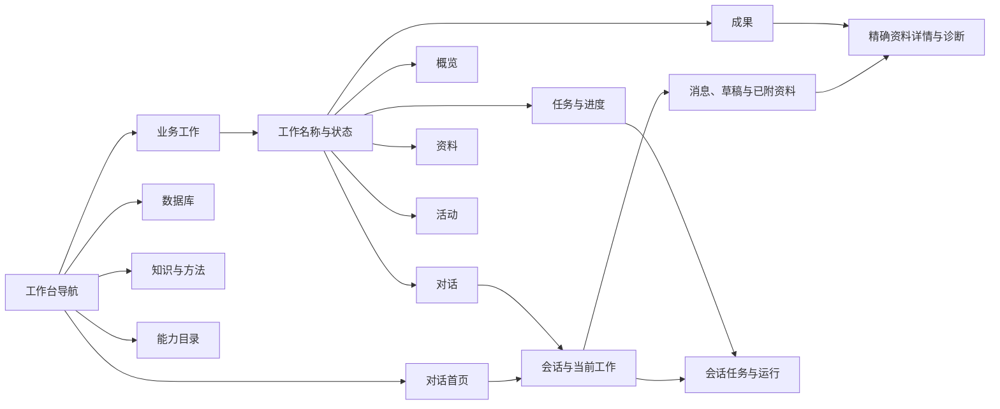

# Groundwater Agent V2.1 — 实施状态

当前结论见[阶段 8 本地自动验收结项](#阶段-8-本地自动验收结项)。

## 阶段 0 本地基线

- 核查日期为 2026-11-20。分支为 `main`，HEAD 为 `90be0475fb257157d62c2ca9593c56559dfa24b9`。
- 开始时暂存区为空。`git status --short` 显示 `plans/groundwater-agent-v2/` 下旧阶段文档和脚本的删除、总控与索引改动以及 V2.1 提示词和状态模板的新增。`source/` 无 Git 改动。本报告按 [阶段 0 提示词](../groundwater-agent-v2/prompts/01_BASELINE_AND_STATUS.md) 指定路径创建，保留原有计划改动。
- 产品为 `groundwater`，清单默认项目为 `groundwater-demo`。领域包为 `groundwater@6.2.0`，公共合同为 v12，Kernel SQLite 为 v38，Executor SQLite 为 v9。Data 与 Knowledge 的公共服务路由为 v3。[产品清单](../../source/products/groundwater/product-manifest.json) · [架构概览](../../source/docs/architecture/architecture-overview.md)
- 验证使用已有 Python 3.12.8、Node.js 22.23.1、依赖缓存和 PostgreSQL 16.10 镜像。合成用例使用独立数据库与运行目录、脚本 Provider 和原生执行路径。测试命令、边界与日志见文末。

## 完成度矩阵

`ABSENT` 表示受审路径缺失，`PARTIAL` 表示只有部分场景或实现，`IMPLEMENTED` 表示调用路径存在，`VERIFIED` 表示该列对应范围有本轮通过的本地验证。产品列的 `ACCEPTED` 需要真实用户或领域验收证据。本轮无 `ACCEPTED` 项。

| 能力 | Backend | API | Frontend | E2E | Product | 证据与取舍 |
| --- | --- | --- | --- | --- | --- | --- |
| WorkItem 列表、创建、详情与归档 | VERIFIED | VERIFIED | ABSENT | PARTIAL | PARTIAL | Kernel 有分页、创建、详情、元数据更新和归档，合成闭环覆盖创建、详情及归档。页面入口属 **NEW**。[路由](../../source/kernel/src/platform_kernel/api/routes/work_items.py) · [API 集成测试](../../source/kernel/tests/test_work_items.py) |
| WorkItem 导航与当前范围 | IMPLEMENTED | VERIFIED | ABSENT | ABSENT | PARTIAL | 服务端已有项目和所有者范围。主页、URL、身份切换的 WorkItem 范围属 **NEW**。[所有者](../../source/kernel/src/platform_kernel/work_items/owner.py#L411) · [App](../../source/web/src/App.tsx#L649) |
| WorkItem 与多 Session | VERIFIED | VERIFIED | PARTIAL | VERIFIED | PARTIAL | 同项目同所有者下一个 WorkItem 可关联多个 Session，每个 Session 至多归属一个 WorkItem。现有界面可恢复单个 Session；创建、关联和回到同一 WorkItem 的体验需 **EXTEND**。[关联逻辑](../../source/kernel/src/platform_kernel/work_items/owner.py#L441) · [多会话用例](../../source/tests/e2e/test_monitoring_work_item.py#L143) |
| Agent WorkItem 业务上下文 | PARTIAL | ABSENT | ABSENT | ABSENT | PARTIAL | Agent 具备 Session 级上下文和预算约束。WorkItem 来源、选择和授权投影缺失，属 **EXTEND / DECISION**。[消息合同](../../source/kernel/src/platform_kernel/api/schemas.py#L73) · [上下文读取](../../source/kernel/src/platform_kernel/agent_runtime/persistence/context.py#L37) |
| Data / Knowledge 引用 | VERIFIED | VERIFIED | PARTIAL | PARTIAL | PARTIAL | WorkItem 可挂载并重新读取精确版本。Data 撤权有 E2E，Knowledge 精确版本及失权有定向用例。现有资料入口可复用，WorkItem 关联管理需 **EXTEND**。[引用权威](../../source/kernel/src/platform_kernel/work_items/references.py) · [引用测试](../../source/kernel/tests/test_work_item_references.py) |
| 地下水业务对象引用 | VERIFIED | VERIFIED | ABSENT | PARTIAL | PARTIAL | 可关联 WELL、REGION、AQUIFER 的资料字段引用，试点覆盖井的往返与撤权。业务实体的权威身份、去重和属性仍属 **DECISION**。[对象合同](../../source/kernel/src/platform_kernel/api/work_item_schemas.py#L81) · [对象撤权用例](../../source/tests/e2e/test_monitoring_work_item.py#L368) |
| 数据目录、版本、质量检查 | IMPLEMENTED | IMPLEMENTED | PARTIAL | PARTIAL | PARTIAL | Data 有目录、历史语义、质量套件、运行和告警接口。合成链路覆盖上传和所需资料核验，门户的专门质量流程及与 WorkItem 的联动需 **EXTEND**。[Data 目录](../../source/services/data/src/platform_data_service/api/routers/catalog.py) · [质量 API](../../source/services/data/src/platform_data_service/api/routers/quality.py) |
| Preparation 与澄清 | VERIFIED | VERIFIED | PARTIAL | PARTIAL | PARTIAL | 定向用例覆盖缺资料、字段与单位、显式科学参数、歧义及同一会话补齐。WorkItem 层目前只汇总相关轨迹和原因。**EXISTING / EXTEND**。[准备工具](../../source/kernel/src/platform_kernel/agent_runtime/preparation_tool.py) · [准备测试](../../source/kernel/tests/test_business_capability_preparation.py) |
| 确认与执行进度 | VERIFIED | VERIFIED | IMPLEMENTED | VERIFIED | PARTIAL | 合成试点验证确认前无作业，确认后进入执行。既有 Session 时间线展示确认与进度，WorkItem 页面待接入。**EXISTING / EXTEND**。[时间线](../../source/web/src/TurnTimeline.tsx) · [试点](../../source/tests/e2e/test_monitoring_work_item.py#L217) |
| 成果发布 | VERIFIED | VERIFIED | PARTIAL | VERIFIED | PARTIAL | Executor 终结流程将发布交回 Data，Kernel 校验后回读。Session 可见成果，WorkItem 待接入。**EXISTING / EXTEND**。[发布终结](../../source/services/executor/src/platform_executor_service/result_finalization.py) · [Data 发布](../../source/services/data/src/platform_data_service/publication/service.py) |
| 成果查看、比较与审核 | VERIFIED | VERIFIED | PARTIAL | VERIFIED | PARTIAL | 既有 Session 成果区有预览、版本比较与继续入口。WorkItem 审核 API 已验证，合成 E2E 是直接调用，没有 WorkItem 成果页和审核按钮。**EXTEND**。[成果工作区](../../source/web/src/WorkspacePanel.tsx#L576) · [审核用例](../../source/tests/e2e/test_monitoring_work_item.py#L252) |
| 跨 Session 成果复用 | IMPLEMENTED | IMPLEMENTED | IMPLEMENTED | PARTIAL | PARTIAL | Web 已可显式把已发布成果带入新会话。试点另一个已关联会话访问与审核状态保留有证据；本轮未验证该 Web 入口执行新一轮分析。按 WorkItem 发现和授权引用需 **EXTEND**。[App 成果动作](../../source/web/src/App.tsx#L730) |
| Business Capability | VERIFIED | PARTIAL | VERIFIED | PARTIAL | PARTIAL | 仅一项监测趋势试点及一个 Profile。界面从产品配置展示，消息入口承接选择，数据库浏览等直接能力各走现有服务。更多场景属 **EXTEND / DEFER**。[产品能力配置](../../source/products/groundwater/capabilities/business-capabilities.v1.json) · [匹配测试](../../source/kernel/tests/test_business_capability_selection.py) |
| Workflow、Profile、Result Contract 与算子治理 | VERIFIED | PARTIAL | PARTIAL | PARTIAL | PARTIAL | 编译和技术治理已装配，试点走真实原生算子。已验证范围为装配合同和该试点。其他算子、运行时和科学应用的验证保留专项，属 **EXISTING / DEFER**。[编译器](../../source/packages/workflow-compiler/src/platform_workflow_compiler/graph.py) · [Profile 与成果合同](../../source/products/groundwater/workflows/workflow-platform.v1.json) · [Validation V2](../../source/products/groundwater/operator-validation.v2.json) |
| 工作台信息架构 | IMPLEMENTED | IMPLEMENTED | PARTIAL | ABSENT | PARTIAL | 正式导航以会话、历史和工作台标签为主，产品已有独立 Data、Knowledge 入口。WorkItem 的主页入口、恢复路由和跨模块导航需 **EXTEND**。[会话导航](../../source/web/src/SessionNavigation.tsx) · [项目历史](../../source/web/src/ProjectTaskHistory.tsx) |
| 权限与协作 | VERIFIED | VERIFIED | PARTIAL | PARTIAL | PARTIAL | 角色和项目/所有者隔离、引用撤权已验证。WorkItem 共享、移交、跨所有者关联或委托审核需 **DECISION**。[身份依赖](../../source/kernel/src/platform_kernel/api/dependencies.py) · [项目边界测试](../../source/kernel/tests/test_project_boundary.py) |
| 恢复与可观察性 | VERIFIED | VERIFIED | PARTIAL | VERIFIED | PARTIAL | Kernel 活动回放、还原 reset、快照和审核重放有证据，现有 Session 恢复代码可复用。WorkItem SSE 当前仅客户端模块，页面挂载及身份切换有待 **EXTEND**。[SSE 服务端](../../source/kernel/src/platform_kernel/api/routes/work_item_stream.py) · [Web 流客户端](../../source/web/src/work-item-stream.ts) |

## 实际调用链与边界

### WorkItem、Web 与多会话

1. Kernel 将 WorkItem 路由装入 v12，并以经过验证的项目、身份和角色进入 `WorkItemOwner`。创建使用 `requestId` 幂等重放。修改以 `expectedRevision` 校验，SQLite 写事务保证修订、命令和活动一致。v36→v37 建立工作容器和引用，v37→v38 补齐命令、活动及回填。Task 的交付事实继续由原有 Kernel 路径持有。[路由](../../source/kernel/src/platform_kernel/api/routes/work_items.py) · [数据库升级](../../source/kernel/src/platform_kernel/database.py#L285)
2. WorkItem 有 13 个操作。只读操作为列表、详情、审计、快照、活动分页和 SSE。写操作为创建、关联 Session、关联对象、关联资产、改元数据、审核和归档。Kernel OpenAPI、产品合同、Python SDK 和 TS 操作清单一致。12 个 JSON 响应有生成的响应验证器，SSE 帧由流客户端解析并校验活动负载。[Kernel OpenAPI](../../source/kernel/contracts/openapi-v12.json) · [产品 OpenAPI](../../source/products/groundwater/contracts/public-api-v12.json) · [SDK](../../source/packages/groundwater-api-client/src/groundwater_api_client/generated/operations.py)
3. Web 手写模块有快照、活动、更新和审核四个 JSON 客户端，以及 SSE 订阅。生产 React 页面没有导入这些模块，也没有直接调用其余 WorkItem API。列表、创建、详情、关联、归档和审核均无可达页面流程。当前 `App` 以 Session hash 路由加载 `SessionNavigation`、`ProjectTaskHistory`、`TurnTimeline` 和 `WorkspacePanel`，会话续开可用。详情已有 Session、Task、Attempt、WorkflowRun、对象与资产的相关投影，可供新页面使用。[客户端](../../source/web/src/work-item-api.ts) · [App 会话入口](../../source/web/src/App.tsx#L649) · [会话路由](../../source/web/src/use-project-sessions.ts) · [详情 Schema](../../source/kernel/src/platform_kernel/api/work_item_schemas.py#L212)
4. 快照在 SQLite 读事务中取当前 WorkItem 修订、活动头和关联 Session 事实，随后解析外部发布或可读性。活动序号可随 Session 事实前进，即使 WorkItem 修订未变。SSE 首次用 `afterEventId`，浏览器续连的 `Last-Event-ID` 优先，服务端按已提交活动重放，周期 refresh 补读外部事实，游标超头或还原丢失时发送 reset。Web 片段先取快照，从其 `eventCursor` 开流，去重校验事件并重拉快照，回退时等待 reset 重新建立视图。历史活动仍按活动 API 分页。网关 SSE 路由关闭缓冲。组件接入时需在身份、项目或 WorkItem 切换时关闭旧订阅和清除旧快照。[所有者](../../source/kernel/src/platform_kernel/work_items/owner.py#L131) · [SSE](../../source/kernel/src/platform_kernel/api/routes/work_item_stream.py) · [Web 续连](../../source/web/src/work-item-stream.ts) · [Gateway](../../source/platform/assembler/assembler_gateway.py#L133)
5. (WorkItem, project, owner) 与 Session 的项目、所有者都由 Kernel 校验。路由要求 researcher 或 admin，所有者条件对 admin 仍成立。同项目其他用户无法用角色替代所有权。只读 WorkItem、多人协作、移交和审核委派需定义角色与资源的组合授权，阶段 1 沿用现有边界。[角色与路由](../../source/kernel/src/platform_kernel/api/routes/work_items.py#L40) · [关联约束](../../source/kernel/src/platform_kernel/application/work_item_links.py) · [API 负例](../../source/kernel/tests/test_work_item_lifecycle_api.py#L156)

### Agent 与当前业务工作

- 消息入口接受明确的资料引用、运行模式及可选工作流选择。`create_message_request` 在当前 Session 内绑定精确选择并记录路由状态；上下文加载器按 `session_id` 与目标修订读历史、记忆、Task、最新工作流事实等。上下文预算对原文和摘要实行压缩和限额，视图记录支持追溯。消息、启动和上下文构造路径没有按 WorkItem 查找关联，也没有把对象、关联资料、别的 Session 的缺项或审核自动交给 Agent。[请求保存](../../source/kernel/src/platform_kernel/interaction/message_requests.py) · [上下文预算](../../source/kernel/src/platform_kernel/agent_runtime/context_policy.py) · [上下文视图测试](../../source/kernel/tests/test_context_views.py)
- 已有跨会话能力是同一 WorkItem 汇总多个 Session 轨迹，以及显式传递已发布成果。每个会话继续保有自己的历史、Task、Preparation、待确认和目标修订。补答被限定在当前会话的新鲜阻塞准备状态。后续应先定义服务器解析的 WorkItem 范围和冲突策略，按需取有限事实、附来源，保留对引用的权限和版本复核。[事实投影](../../source/kernel/src/platform_kernel/application/work_item_lifecycle_facts.py) · [同会话补答](../../source/kernel/src/platform_kernel/interaction/message_requests.py#L221)

### 资料、执行、结果与验收

- Data 的目录、上传、查询、版本、语义和质量 API 可直接用于浏览和检查。Knowledge 维护文档版本、证据单元和检索记录。WorkItem 可记录 DATA、KNOWLEDGE、WORKFLOW、RESULT 引用，挂载及详情复核可见性，旧语义可按固定版本重读。对象引用验证资料身份和字段存在，`externalId` 的井、区或含水层实体归属与行值尚无独立权威验证。质量与知识事实继续来自各自服务。[Data](../../source/services/data/src/platform_data_service/api/routers/catalog.py) · [Knowledge 检索](../../source/services/knowledge-next/src/platform_knowledge_next/routers/retrieval.py) · [引用归属](../../source/kernel/src/platform_kernel/work_items/references.py#L40)
- Preparation 校验当前显式采用的精确资料与科学参数，Confirmation 绑定不可变执行方案，Executor 拥有运行、节点和检查点。WorkItem 生命周期按关联会话和当前 Task 修订收集当前 Preparation、待确认、AgentRun、WorkflowRun 最新尝试、停止请求及 Task 交付检查。已关联资料、实际采用、执行成功、发布成功、验收分别有自己的事实。执行成功后需要可核验的 Data 发布、成果证据和相应审核；命名成果绑定运行、输出名、发布 ID 和 DataVersion 身份。存在新的活动轨迹时整体状态由各轨迹优先级汇总。[Preparation](../../source/kernel/src/platform_kernel/agent_runtime/preparation_tool.py) · [生命周期事实](../../source/kernel/src/platform_kernel/application/work_item_lifecycle_facts.py#L37) · [状态推导](../../source/kernel/src/platform_kernel/work_items/lifecycle.py#L121)
- 监测试点绑定 Workflow 1.1.0、Model 3.1.0 及各为 1.0.0 的 Profile 和 Result Contract。成果合同定义 21 个命名输出角色、类型、单位、适用 Viewer 和质量来源。Assembler 校验工作流与清单约束，并把业务能力预览投影到 Product UI。Session 成果面向已发布 Data 资源展示表格、地图、栅格和图表，也可跳转版本比较、附加资料或带成果新开会话。WorkItem 审核依据当前任务交付和精确结果链接重算审核 token，并在提交时复核。成果契约已有装配约束，统一的 WorkItem 成果中心和跨工作成果目录仍待产品化。[成果合同](../../source/products/groundwater/workflows/workflow-platform.v1.json) · [装配检查](../../source/platform/assembler/assembler_workflow_platform.py) · [审核](../../source/kernel/src/platform_kernel/work_items/owner.py#L252) · [Viewer](../../source/web/src/ArtifactViewer.tsx)
- 合成监测旅程先确认再执行，真实发布 21 个成果，Task 完成后 WorkItem 进入 `RESULT_REVIEW`，明确审核后才进入 `COMPLETED`。第二会话咨询保留审核状态，重启可回读权威快照及活动；另一用例检查 Data 访问撤销后隐藏对象和资产详情。验证覆盖本地服务链路，Provider 理解、浏览器操作和真实水文科学验收仍需独立证据。[两个端到端用例](../../source/tests/e2e/test_monitoring_work_item.py)

### 专业能力覆盖

- Assembler 从 manifest 加载 Operator Validation V2，按算子版本、实现修订、Manifest 摘要和证据文件校验。显式 V2 清单登记 5 个算子版本记录，产品组合白名单有 62 个条目，历史技术证据另行引用。静态 Operator Pack 与 Workflow Compiler、装配清单继续复用。组合白名单与科学适用性需要各自的证据。[Validation V2](../../source/products/groundwater/operator-validation.v2.json) · [证据校验](../../source/platform/assembler/operator_metadata.py) · [组合编译](../../source/packages/workflow-compiler/src/platform_workflow_compiler/composition/execution.py)
- 产品仅挂载 `groundwater.monitoring-trend@1.0.0`，其一个 Profile 覆盖监测趋势、季节变化和阈值事件。AUTO 按当前角色、可见性、技术验证状态、必需词组和排除词筛选。零匹配或多匹配保守交回路由，缺资料、未定或否定的参数、冲突单位进入阻塞准备。已装配 Profile/Model/Workflow 固定身份和确认仍适用。产品中其他模型、数据浏览与知识查询的存在不扩大该业务能力覆盖。[装配](../../source/platform/assembler/assembler.py#L210) · [能力筛选](../../source/kernel/src/platform_kernel/business_capabilities.py#L162) · [单位和字段检查](../../source/kernel/src/platform_kernel/agent_runtime/preparation_tool.py#L412)

## 优先级与风险

| 优先级 | 用户问题 | 后续动作与边界 |
| --- | --- | --- |
| P0 · 阶段 1 | 首页无法发现、创建或恢复一个业务工作，用户只能按会话查找 | 使用现有 13 个 API 中的必要操作把 WorkItem 接到主导航和详情。优先复用快照、活动分页与 SSE，保留原有 Session 路由 |
| P0 · 阶段 1 | 旧身份的详情或晚到快照可能串入切换后的页面。归档、冲突、资源撤权要可感知 | 按 product/project/subject 隔离并清除旧请求、订阅和缓存。409 刷新服务端修订，资源失权隐藏引用。回退由 reset 和新快照恢复 |
| P1 · 阶段 2–3 | 用户新开关联会话后需重复交代范围和资料 | 分开实现显式的关联/恢复与 Agent 的 WorkItem 上下文。先评审授权、有限上下文与来源，再实现 |
| P1 · 阶段 4–5 | 质量、对象和成果分散在会话与服务门户 | 为对象权威及标识冲突形成 ADR，评估 Data 深链与精确资产引用。后续交付页承接现有发布和审核 |
| P2 · 阶段 6–8 | 专业覆盖和真实用户验收仍只有试点证据 | 以业务需求决定新能力，保留装配身份；分别补浏览器旅程、角色、断线、真实数据及领域验收。共享或委派另行决策 |

## 阶段 1 最小可验收计划

目标旅程为从首页打开工作列表，创建业务工作，查看权威状态及资料，进入一个已关联会话，刷新页面后回到同一个工作。已有会话入口继续可访问。

1. 在 `source/web/src/` 新建 WorkItem 列表、详情和 controller。扩展 `work-item-api.ts` 接入生成合同的 list、create、detail、archive，复用现有 update、review、activity 和 stream。主应用只增加入口、独立 hash 路由分支和回到工作链接。可用的审核动作以当前快照的审核 token 为准；多会话关联、批量组织和 Agent 继承分别按后续阶段实施。
2. 列表使用 `nextAfter` 分页，展示标题、说明、更新时间和归档状态。当前列表合同按 WorkItem ID 排序，`status` 表示 active/archived，业务状态与 Session 数由快照 state/tracks 提供。只给可见行发有界的补读请求，保留加载、不可用和过期状态。若真实数据下读放大妨碍验收，单独测量并评审聚合 API。详情分别读取 detail、snapshot 和活动，展示进度、会话、资料与对象、成果和当前可用动作。
3. 创建为每次用户动作固定 `requestId`，按回执导航。网络超时用原命令幂等恢复。归档、编辑和审核携带当前 `expectedRevision`，过期时刷新并展示冲突。请求支持 AbortSignal，作用域切换关闭订阅，SSE 以重拉权威快照确认进度。处理未授权、禁止、不可见、冲突、输入无效、限流和服务故障。
4. 预计影响 `App.tsx`、`work-item-api.ts`、新页面与其 controller/测试，以及必要的导航、样式和可访问性文案。优先复用 `work-item-stream.ts`、`SessionNavigation.tsx` 和既有 Viewer。当前方案无需 API、Schema 或 SQLite 改动。
5. 验收需覆盖列表分页、创建超时及重复提交、回执跳转、详情中的多会话和不可用引用、归档和 revision 冲突、项目与用户切换、事件重复及乱序、游标回退与 reset、刷新恢复、键盘焦点和无权限时的操作可见性。先跑新增组件/客户端测试与现有 WorkItem API/SSE 回归，再执行 `../bin/dev check --scope web`，并在隔离本地实例验证从入口到恢复的浏览器旅程。若需要新的服务端合同，先评审并追加 `kernel`、`contracts` 检查及兼容性验证。

## 阶段 0 本轮验证

以下 Python 命令在 `source/` 使用已有工具链并在无外网的命名空间执行。Web 命令在 `source/web/` 使用本地 Vitest。避免与运行实例共用数据库。

| 类型 | 命令及范围 | 结果 |
| --- | --- | --- |
| 单元、API 集成、Schema 迁移、装配和公开合同 | `python -B -m pytest -q -p no:cacheprovider kernel/tests/test_work_items.py kernel/tests/test_work_item_{lifecycle,lifecycle_api,lifecycle_facts,references}.py kernel/tests/test_{schema_contract,project_boundary,business_capability_selection,business_capability_preparation}.py tests/assembler/test_{business_capabilities,operator_validation,workflow_platform}.py tests/contracts/test_public_api_contract.py` | 187 通过，0 失败。[日志](../../.pytest_cache/gw-v21-phase0-m0br2Ugv/python.log) |
| 上下文与结果回读回归 | `python -B -m pytest -q -p no:cacheprovider kernel/tests/test_{context_compiler,context_views,session_results,confirmation_recovery}.py` | 29 通过，0 失败。[日志](../../.pytest_cache/gw-v21-phase0-m0br2Ugv/context.log) |
| Web 客户端、组件与合同 | `../node_modules/.bin/vitest run src/work-item-api.test.ts src/work-item-stream.test.ts src/business-capability.test.tsx src/SessionNavigation.test.tsx src/WorkspacePanel.test.tsx src/ArtifactViewer.test.tsx src/api-contract.test.ts` | 7 个文件，55 通过，0 失败。WorkItem HTTP/SSE 覆盖为夹具测试。[日志](../../.pytest_cache/gw-v21-phase0-m0br2Ugv/web.log) |
| 合成服务链路 E2E | `python -B -m pytest -q -p no:cacheprovider tests/e2e/test_monitoring_work_item.py`，使用缓存镜像、仅 Unix socket 的隔离 PostgreSQL、脚本 Provider 和原生算子 | 2 通过，0 失败，临时数据库已退出。[命令](../../.pytest_cache/gw-v21-phase0-m0br2Ugv/run-monitoring.sh) · [日志](../../.pytest_cache/gw-v21-phase0-m0br2Ugv/monitoring.log) |
| 静态核对 | 对比 Kernel OpenAPI、产品合同、生成 SDK、TS 与 12 个 JSON 响应验证器，并追查 WorkItem 模块的生产引入路径 | 13 个操作对应，SSE 走帧验证路径。现有生产组件无 WorkItem 客户端接入 |

全量发布门禁、正式浏览器旅程、真实 Provider、远程 Worker、领域科学验收和共享权限场景未运行。阶段 0 只新增本报告，生产代码、接口、数据库和部署未改动。已完成要求的基线、调用链、完成度矩阵、风险、优先级和阶段 1 验收计划。

## 阶段 1 WorkItem 前端产品化

阶段 1 已通过本地技术验收。基线为 `main@90be0475fb257157d62c2ca9593c56559dfa24b9` 和阶段 0 报告，原有 V2.1 提示词改动保留。

- Groundwater 首页现有「业务工作」入口。列表按服务器游标分页，工作状态、会话数和下一步来自快照，补读并发上限为 4。支持查看已归档工作、刷新及重试。
- 创建根据服务器回执进入详情。当前标签页按 product/project/subject 保留待确认创建请求，响应丢失后可跨刷新重放同一命令。作用域切换中止请求、订阅，并丢弃晚到旧响应。
- 详情展示进展、关联会话、资料对象、可读成果、活动和操作。会话 URL 携带返回工作的导航目标，现有会话与工作台路由仍可使用。活动由 API 分页，SSE 触发权威快照及详情重新读取。访问不可用时隐藏引用详情。
- 编辑、归档和验收使用现有请求 ID、修订和审核 token。审核确认期间若交付身份变化，需要用户重新核对。列表状态随实际读取或刷新更新，详情随 SSE 更新。
- 改动集中在 Web。入口及会话路由接入涉及 `App.tsx`、`use-project-sessions.ts`、`use-workspace-controller.ts`。新增页面、命令和读取逻辑在 `WorkItemWorkspace.tsx`、`WorkItemDetails.tsx`、`WorkItemForms.tsx`、`use-work-item-command.ts`、`use-work-item-queries.ts` 及同目录路由、创建缓存、展示和样式文件。合同客户端扩展在 `work-item-api.ts`、`types.ts`，回归在 `work-item-workspace.test.tsx`。服务端 API、合同与数据库沿用现有版本。

| 验证 | 本轮结果 |
| --- | --- |
| `../bin/dev check --scope web` | 45 个测试文件，453 个用例通过。TypeScript、生产构建、Ruff 和空白检查通过。[日志](../../.pytest_cache/gw-v21-phase1-IrGQDN8O/web-final.log) |
| `python -B -m pytest -q -p no:cacheprovider kernel/tests/test_work_items.py kernel/tests/test_work_item_{lifecycle_api,references}.py` | 26 个用例通过，覆盖边界、并发、精确引用和 SSE。[日志](../../.pytest_cache/gw-v21-phase1-IrGQDN8O/kernel-final.log) |
| 隔离真实 Kernel 与 Chromium | 用生产 Web 构建、独立 SQLite 和无外网的回环接口测试。首次创建服务端实际提交，浏览器丢弃回复，刷新后重放并确认库里仅一个工作。核对双会话、实际 SSE、会话返回、详情刷新、归档、焦点及 1440/768/390 像素宽度。使用已有 Chromium 可执行文件。[脚本](../../.pytest_cache/gw-v21-phase1-IrGQDN8O/run-browser.sh) · [结果](../../.pytest_cache/gw-v21-phase1-IrGQDN8O/browser.log) |
| VCS 检查 | `git diff --check` 通过，既有暂存内容和计划文件的跟踪改动保持一致。 |

浏览器用例通过现有 API 写入两条测试关联。阶段 2 需要交付关联操作、新会话与同一业务工作的持续恢复，并验证冲突以及跨 owner 的拒绝。真实领域验收和部署属于后续范围。

阶段 2 前置核查发现，当前「新建 Session」和「关联到 WorkItem」由两个命令完成。Session 创建合同只有 `projectId`，关联合同具备 `requestId` 和 `expectedRevision`。阶段 2 需明确创建已提交但回执丢失，以及创建成功但关联冲突时的恢复语义，再确定实现与同步合同范围。[Session 命令](../../source/kernel/src/platform_kernel/api/routes/session_commands.py#L44) · [关联命令](../../source/kernel/src/platform_kernel/api/routes/work_items.py#L99)

## 阶段 2 WorkItem 与 Session 连续工作

### 实施方案

- **EXISTING**。WorkItem 详情与活动、成对的主体和项目校验、Session 唯一关联以及会话流已经具备。继续复用已有 Session 的历史、准备、确认、草稿、成果及 SSE。
- **EXTEND**。WorkItem 详情提供新建会话与加入已有会话。关联冲突时显示可理解的原因，并保留在工作内新建会话的路径。受认证的会话入口按服务端关联恢复工作的背景和往返链接。
- **NEW**。Kernel 增加受控的新建并关联命令，以及面向当前 Session 的只读背景投影。创建、关联、修订和命令回执采用同一个现有 SQLite 事务。区分普通关联与原子创建的请求指纹，保留既有 `LINK_SESSION` 关联审计语义。只读投影以精确、可见引用及有来源的任务和审批证据为边界。
- **DEFER**。自动把业务上下文装配到 Agent 交由阶段 3。阶段 2 在会话内提供可见工作背景，并允许用户明确采用可用的资料。执行授权及确认流程依照当前 Session。
- 影响 Kernel WorkItem 和 Interaction owner、WorkItem/Session HTTP 路由及合同、OpenAPI/SDK/Web 类型和校验器、Web 会话工作区、文档与测试。复用现有存储结构。核心风险为请求回执丢失、关联并发、权限撤销和晚到旧响应。
- 先做 Kernel 否定用例及 Web集成，再运行 `../bin/dev check --scope kernel`、`contracts`、`web`，并以隔离 Kernel 与 Chromium 走双会话链接、重放、恢复和原有会话兼容验收。

### 实现与边界

- 从工作详情可新建并关联会话，也可搜索、分页选择本人已有会话。重复提交同一新建命令返回原会话，回执丢失后刷新可继续重放。跨 WorkItem 的关联冲突显示原归属受保护，并提供改选或在当前工作新建会话的路径。
- 新增两个 v12 操作。WorkItem 创建子会话时，Session、Session 事件、关联、WorkItem 修订和回执在同一事务提交。只读背景按当前 Session 的服务端关联恢复，登录身份或项目变化时重新验证。旧 API 操作、既有 DTO 和 SQLite schema 经对照保持原样。
- 背景展示业务工作标题与说明、可读对象和版本、待继续任务、精确发布成果及有确认事件和可读冻结输入的方案参数。资料限最近 24 条，任务和已确认动作各限 8 条。来源会话及版本可追踪。用户通过现有资料查看器选择是否用于当前会话。Agent 自动读取背景、权限撤销时的装配级剔除及上下文预算属于阶段 3。
- 影响文件包括 Kernel 的 `work_items/owner.py`、`work_items/handoff.py`、两个 WorkItem 应用事实投影、Interaction 持久化与装配、两个 HTTP 路由及 Schema。更新运行时 OpenAPI、产品合同、Python SDK、前端 TS/Ajv、《HTTP API》和《Contracts》。Web 新增 `WorkItemSessions.tsx`、`SessionWorkContext.tsx`，并扩展详情、工作区、请求恢复和路由入口。测试扩展 `test_work_items.py` 与 `work-item-workspace.test.tsx`。
- 架构检查指出 Task 和确认事实应由现有的只读生命周期投影读取。查询已移到该投影，存储所有权规则沿用原有约束。Web 入口改用已装配的研究工作台布局配置，保持产品中性。移动端验证发现会话侧栏挤出页面，已针对带续作背景的窄屏会话将导航、对话和工作台纵向排布。

### 本轮验证

| 检查 | 结果 |
| --- | --- |
| `../bin/dev check --scope kernel` 与 `bash scripts/checks/check-boundaries.sh` | 1006 个 Kernel 用例、类型、Ruff、空白及核心导入检查通过。全量命令末尾发现 Web 入口硬编码产品身份，修正后独立架构检查通过。[Kernel 日志](../../.pytest_cache/gw-v21-phase2-Fuz665K3/kernel-final.log) · [架构复验](../../.pytest_cache/gw-v21-phase2-Fuz665K3/architecture-final.log) |
| `../bin/dev check --scope contracts` | 191 个合同用例通过。运行时 OpenAPI、Python SDK、TS/Ajv 生成一致。首次运行的 3 个 HTTP 夹具因隔离命名空间的回环未启用而失败，启用回环后重跑通过，外网仍隔离。[重跑日志](../../.pytest_cache/gw-v21-phase2-Fuz665K3/contracts-loopback.log) |
| `../bin/dev check --scope web` | 45 个测试文件共 455 个用例通过，类型、生产构建、Ruff 与空白检查通过。[日志](../../.pytest_cache/gw-v21-phase2-Fuz665K3/web-exit.log) |
| 真实本地 Kernel 和已缓存的 Chromium | 用独立 SQLite、两个测试账号及生产 Web 构建验证加入已有、归属冲突、新建回执丢失后的原命令重放、直接链接恢复、退出再登录、不同主体隔离、会话草稿恢复、SSE 断线重连、390 像素布局及标准布局兼容。[脚本](../../.pytest_cache/gw-v21-phase2-Fuz665K3/run-browser.sh) · [日志](../../.pytest_cache/gw-v21-phase2-Fuz665K3/browser-standard.log) |
| `python -B -m pytest -q -p no:cacheprovider tests/e2e/test_monitoring_work_item.py` | 2 个端到端回归通过，覆盖原有会话、Task、运行、发布和访问撤销事实。临时 PostgreSQL 已退出。[日志](../../.pytest_cache/gw-v21-phase2-Fuz665K3/monitoring.log) |

阶段 2 已达到本地技术退出条件。后续进入阶段 3 时，需复用当前会话的权威关联，用限量、带来源的投影装配 Agent 上下文，专项验证权限撤销、跨会话隔离和工具范围。

## 阶段 3 Agent 业务上下文与安全装配

### 实施方案

- **EXISTING**。Kernel 已拥有 Session/WorkItem 归属、持久消息身份、当前 Task 与 Preparation 投影、审批和执行发布事实。Data、Knowledge、Executor 为底层资源权威。Agent 已有模型输入计数与无正文的 context manifest。
- **EXTEND**。在模型调度前逐次读取有效的 Session、项目、当前用户和关联工作。意图分类继续只以当前请求及原有 Session 上下文为输入。当前意图与授权范围确定后，补入带来源的 WorkItem 背景。调用完成、暂停或重试后重新读取，输入正文留在当前模型调用。
- **NEW**。内部 `work-item-agent-context.v1` 只读分层。L0 记录持久请求及受校验的执行范围。L1 分开表达整个工作与当前会话的状态，并带当前 Task、准备问题、确认和发布事实。L2 按当前任务核对关联的精确可读版本及已选业务能力。L3 在需要续作或复盘时读取少量已关联会话的事实摘要，带时间、版本和类别。原会话的内存摘要和完整消息保持自身作用域。
- 背景以 JSON 数据消息送入模型，固定说明把用户资料字段与工具授权分开。用现有 tokenizer 和请求容量检测限制附加包，最高 1,200 token 与 4,096 UTF-8 字节。可选资料和历史按优先级省略，保留当前用户请求。资源校验不可用时省略相应背景。流程沿用旧的 public API 与 SQLite。
- 影响 WorkItem owner、会话身份查询、Agent Runtime 的模型输入过滤、工具权限、上下文 manifest 及测试。主要风险是晚到的撤权、恢复重放旧材料、自由文本越权和模型输入超限。验证包含实际 provider 调用、同次重试、跨 Session/主体/项目、资源失效、老会话、只读任务、预算和 trace 检查。阶段内运行 Kernel、合同与隔离链路回归。

### 实现与行为

- 本阶段基线为本地 `main@7a6e621162a51c55340e44167df42c334290f1c9`。交付在 Kernel 当前 Session 的 Agent 调用路径。通过持久 AgentRun、当前或待启动运行指针、项目、目标修订和成员角色找回关联 WorkItem。异步校验完成后再检查工作修订、当前运行与成员身份。
- `work-item-agent-context.v1` 用来源分块表达四层内容。WorkItem 汇总和当前 Session/Task 的进度分开。关联资料按当前请求选取，并由 Data、Knowledge 及 Kernel 的成果绑定校验精确版本。已选能力复用本轮解析好的版本身份。续作和复盘按需读取至多四条带时间和修订的其他会话事实摘要。
- SDK 在每次主模型调度前装配独立数据消息。协议重试和确认恢复重新装配。模型收到的附加包保留原始用户消息，限制为 4,096 字节和 1,200 token，同时受完整请求容量及可用输入预算八分之一约束。单个资源慢时省略该项，整次装配超过 2.5 秒时继续处理原请求。清单和追踪只记录来源、哈希、处置和用量。
- 公开持久请求的只读工具清单去掉 `update_task`。任务登记和证据续作走自动意图路由，只有相应业务意图及任务动作才开放写工具。历史内部调用兼容既有行为。意图路由没有接收 WorkItem 数据；原确认审批和执行绑定继续由 Kernel 校验。
- 公开 API/OpenAPI、生成客户端和数据库结构沿用当前版本。内部存储清单只增加受白名单约束的来源、分层与省略原因。新数据消息不进入 SDK 检查点和跨轮记忆编译。
- 复核后统一了只读提示词与工具准入。L3 记录快照时间与 WorkItem 事件游标，并区分 Session 当前目标修订和被保留业务事实的来源修订。能力和档位的冻结版本在发送模型请求前按当前角色重新授权。Knowledge 撤回、过期或失去读取权限时从模型引用中剔除。

| 影响范围 | 文件 |
| --- | --- |
| 新增 Kernel 源码和专项测试 | `application/work_item_context.py`、`work_items/agent_context.py`、`agent_runtime/sdk_execution/work_item_context.py`、`kernel/tests/test_agent_work_item_context.py` |
| WorkItem、身份与装配 | `work_items/{owner,references}.py`、`application/work_item_lifecycle_facts.py`、`access/research_auth.py`、`interaction/access.py`、`business_capabilities.py`、`composition.py`、`scripts/checks/import_boundaries/rules.py` |
| Agent 请求与工具策略 | `agent_runtime/{mode,prompts}.py`、`persistence/{context,run_queries}.py`、`tooling/{factory,task_tools}.py`、`sdk_execution/{types,execution_builders,initial_execution,resumed_execution}.py` |
| 上下文清单与追踪 | `agent_runtime/persistence/context_views.py`、`sdk_execution/{usage_capture,usage_context_views,usage_model_start}.py`、`agent_runtime/tracing.py` |
| 回归和文档 | `kernel/tests/{test_kernel_lifecycle,test_workflow_task_runtime_probe}.py`、`tests/contracts/test_domain_package_simulation.py`、`tests/e2e/test_monitoring_work_item.py`、`docs/capabilities/agent-discovery.md`、本报告 |

### 验证与风险

| 检查 | 结果 |
| --- | --- |
| `../bin/dev check --scope kernel` | 1,017 个 Kernel 用例通过，类型检查、Ruff、空白、核心导入和架构边界检查通过。[日志](../../.pytest_cache/gw-v21-phase3-arsgEXUc/kernel-reviewed.log) |
| `../bin/dev check --scope contracts` | 191 个合同用例通过，运行时 OpenAPI、Python SDK、TS/Ajv 生成一致。[日志](../../.pytest_cache/gw-v21-phase3-arsgEXUc/contracts-reviewed.log) |
| `python -B -m pytest -q -p no:cacheprovider kernel/tests/test_agent_work_item_context.py kernel/tests/test_agent_context_efficiency.py kernel/tests/test_work_item_references.py kernel/tests/test_workflow_task_runtime_probe.py` | 33 个用例通过。覆盖主体/项目/会话隔离、只读工具和提示词、历史来源、归档、角色撤销、过期或撤回知识、历史语义修订、重试、恢复、预算和日志正文隔离。[日志](../../.pytest_cache/gw-v21-phase3-arsgEXUc/focus-reviewed.log) |
| `python -B -m pytest -q -p no:cacheprovider tests/e2e/test_monitoring_work_item.py` | 2 个用例通过。隔离的 PostgreSQL、Data、Executor 和本地 Worker 验证已选能力、真实监测流程产物、精确发布身份、跨会话状态及读取权限撤销。临时数据库容器已停止。[日志](../../.pytest_cache/gw-v21-phase3-arsgEXUc/monitoring-reviewed.log) |
| 本地 Chat Completions 适配器与新增模块类型检查 | DeepSeek 和 MiniMax 转换器保留原用户消息与单独的数据消息。三个新增生产模块的专项类型检查通过。[适配器日志](../../.pytest_cache/gw-v21-phase3-arsgEXUc/adapter-roles.log) · [类型检查](../../.pytest_cache/gw-v21-phase3-arsgEXUc/context-types.log) |
| 架构复核、文档及变更检查 | 独立复核确认所提权限、Knowledge 生命周期、只读提示词和 L3 来源问题已修正。文档校验与 `git diff --check` 通过。 |

红灯用例确认原调用没有 WorkItem 数据。首次回归发现监测和任务探针使用只读对话写 Task，旧合同用例也期望该工具。已让登记和证据续作走现有的任务意图入口，并按新规则检查只读工具清单。阶段最终验收使用本地脚本模型和已物化工具链。真实模型供应商、生产数据与部署留待后续独立验证。

大型 WorkItem 的汇总仍需读取完整生命周期。整体装配超时会省略背景，追踪保留省略原因。跨会话只装配有来源的状态事实。之前会话的完整用户陈述和模型推断继续留在各自会话。

阶段 3 达到本地技术退出条件。当前工作区包含经核验的改动，供后续阶段继续使用。

## 阶段 4 数据工作空间与业务对象关联体验

### 实施方案

- **EXISTING**。Data 拥有资料、精确版本、字段画像、语义修订、质量记录与上传发布。Knowledge 拥有文档及版本。Kernel 的 WorkItem 关联命令已校验项目、主体、工作修订、精确资料以及历史语义。会话已有按输入角色绑定、结构化准备问题及冻结确认。
- **EXTEND**。工作详情展示关系与来源身份，支持选择精确资料、新上传后核对、知识版本、运行及发布成果。井、区和含水层使用三个既有对象种类，由用户选择来源字段并填写业务键。已有对象只按该来源解释。工作资料与会话的待发送输入、准备校验和确认采用分别呈现。
- **NEW**。复用数据库查看器承接工作资料检查和选择。在工作资料入口加载选中版本的质量与语义页，显示 Data 返回的缺失、异常、覆盖范围、CRS、垂向基准和已有质量运行。只采用匹配资料版本与语义版本的质量运行，未知保持待核验。会话选择输入角色时提供当前工作的可读资料，提交与重新准备继续使用现有 Session 命令。
- **DECISION**。使用现有公共合同和生成校验器。工作资料选择保留精确版本并沿用 WorkItem 修订及幂等请求 ID；跨项目、撤权、未完成发布和不可用服务均由原所有者复核。状态标签与字段事实来自服务，当前工作不建立主数据或全局业务键。
- 分项实施与验证。在 `DatabaseWorkbench.tsx` 与新增质量组件先验证精确版本、历史语义、检查状态及分页。在 `WorkItemMaterials.tsx`、引用选择组件与 `work-item-api.ts` 验证绑定、来源、对象表单、不可用和幂等恢复。通过 `App.tsx`、`SessionWorkContext.tsx` 接入角色选择与现有准备流程。覆盖撤权、跨项目、资料缺失、单位/坐标检查与窄屏浏览，并执行 Web、合同和本地集成回归。

### 实现与影响

- 基线为本地 `main@7a6e621162a51c55340e44167df42c334290f1c9` 加阶段 3 已验收的工作区改动。工作详情复用 Data 目录和上传发布。选择后先核对资料和质量，再提交 WorkItem 关联。回执不确定时重放相同的请求 ID、修订及载荷。关联列表分页展示，逐份查看才加载详细资料，不会为列表中的每个对象请求质量历史。
- 业务对象表单使用 WELL、REGION、AQUIFER，由用户指定来源字段与业务键。显示来源数据集、资料版本、语义修订、对象和校验和。知识目录和历史版本按页读取，撤回、过期或不可访问的知识显示安全状态。运行和命名成果关联走原有 Kernel 命令，成果选择同时核对发布及 Data 精确身份。
- 角色选择器提供本工作的可读资料。现有 Kernel 准备和 Executor 读入合同要求该资料版本的当前语义与唯一原始对象。历史关联可以检查和追溯，计算时用户须主动查看并选择当前可校验的候选。原关联保留精确历史身份。工作关联、会话草稿、准备校验及确认采用分别显示，当前角色和精确输入随现有消息合同提交。
- 独立复核定位了会话切换、撤权、模态框焦点和历史较深时的容量问题。选择器生命周期绑定当前会话与身份，回到页面时重新校验候选。质量查找一次读取最多两页，并允许继续向前查找，未知状态保持待核验。批量候选的附加使用 Data 对象唯一键，已绑定的历史语义优先保留供用户核对。
- 公开 API、OpenAPI、生成类型和数据库结构沿用现有版本。本阶段不增加 Data、Knowledge、Kernel 或 Executor 的资源所有权。能力校验和字段科学语义复用原准备合同。

| 修改范围 | 文件 |
| --- | --- |
| 新增资料工作区及检查组件 | `WorkItemMaterials.tsx`、`WorkItemOtherAssets.tsx`、`DataSemanticHistory.tsx`、`DataVersionQuality.tsx`、`LinkedWorkData.tsx` |
| 既有资料界面与精确读取 | `DatabaseWorkbench.tsx`、`UploadDialog.tsx`、`api.ts`、`resource-item.ts`、`types.ts` |
| WorkItem、Session 和交互 | `App.tsx`、`WorkItemDetails.tsx`、`WorkItemWorkspace.tsx`、`WorkItemSessions.tsx`、`SessionWorkContext.tsx`、`work-item-api.ts`、`use-drawer-controller.ts`、`workbench-focus.ts`、`work-item-workspace.css` |
| 测试与文档 | `DatabaseWorkbench.test.tsx`、`work-item-workspace.test.tsx`、`data-version-quality.test.tsx`、`work-item-other-assets.test.tsx`、《Agent 发现、理解与任务准备》及本报告 |

### 验证与退出条件

| 检查 | 结果 |
| --- | --- |
| `../bin/dev check --scope web` | 47 个测试文件、486 个用例通过。TypeScript、生产构建、Ruff 和差异空白检查通过。 |
| `../bin/dev check --scope contracts` | 191 个合同用例通过。运行时 OpenAPI 和 Python、TypeScript/Ajv 生成校验通过。 |
| `python -B -m pytest -q -p no:cacheprovider kernel/tests/test_internal_modules.py kernel/tests/test_work_item_references.py kernel/tests/test_work_items.py kernel/tests/test_business_capability_preparation.py` | 116 个 Kernel 用例通过，覆盖工作引用、权限、输入角色、字段、单位和空间条件。 |
| `python -B -m pytest -q -p no:cacheprovider tests/e2e/test_monitoring_work_item.py tests/e2e/test_composed_workflow.py::test_monitoring_trend_publishes_exact_results tests/e2e/test_composed_workflow.py::test_monitoring_trend_capability_requires_user_threshold` | 6 个端到端用例通过。使用隔离的 PostgreSQL、Data、Executor、本地 Worker 和脚本模型，覆盖准备阻塞、补参、确认和精确成果发布。 |
| 本地 Chromium 与生产构建 | 用真实 Kernel 会话与 Data 测试响应核对历史语义、质量及未知状态、业务对象来源、精确角色请求、390 像素窄屏和撤权。无 JavaScript 页面异常。真实服务的准备与发布由上述端到端用例核对。 |
| `python -B -m scripts.checks.check_documentation`、`git diff --check` | 文档与变更检查通过。 |

首轮回归确认旧界面缺少资料选择入口。最终回归覆盖切换会话时清除旧选择、重新聚焦后重新核验候选、质量历史的有限自动读取，以及同格式对象中明确选择原始对象。

历史语义和其他对象仍可按原身份追溯。用于计算时，需显式选择该数据版本的当前语义和唯一原始对象。未取得匹配质量记录时保持待核验。真实业务数据、外部模型供应商和生产环境留待独立发布验证。

阶段 4 达到本地技术退出条件。

## 阶段 5 成果中心、业务审核与成果复用

### 实施方案

- **EXISTING**。基线为本地 `main@abaa1bebbc4adf5823a097c7cf039bf1acbf4443`。WorkItem 提供关联会话、运行、资产、生命周期快照及审核候选。Kernel 提供运行、发布、历史确认和 Task 证据。Data 提供精确发布数据的版本、语义和质量。Web 已有 Viewer、业务档位展示以及会话草稿附件合同。
- **EXTEND**。WorkItem 成果中心归集关联会话中的运行和具名输出。运行、发布、工作验收分别展示权威状态。按需读取单次运行和单个成果，核对已冻结输入、执行版本、参数、Data 对象与质量；历史身份仍可追溯。已有未完成或不可读的记录给出状态和下一步。
- **NEW**。在成果中心打开精确 Viewer，查看用途、输出角色、质量和适用限制。所选运行的业务档位来源与装配投影一致时展示对应档位和成果合同，并标示缺项或冲突。其余历史运行按实际来源展示已知事实。具名发布成果可显式关联，再选同一工作的可用会话，核验目标和源成果后附加到草稿。附件保留来源工作、运行、输出名、发布和 Data 版本，以现有消息合同提交精确 Data 引用。
- **DECISION**。沿用 WorkItem 审核命令、候选 token 和乐观修订。展示候选包含的成果，候选不再新鲜时引导核对，超时可用原请求重放。发布身份仍由原有 Kernel/Data 读取，不增 API、数据库迁移或成果登记服务。执行、发布、任务采用和接受决定分别呈现。
- 影响成果区组件、资料/发布读取复用、草稿交接和现有 WorkItem 详情，以及本阶段专项 Web、合同和联调测试。风险集中在未发布误用、旧结果混入其他会话、合同输出不符、撤权及审核重放。先写对应回归用例，再运行 Web、合同、隔离执行—发布—审核—复用测试及本地浏览器旅程。

### 实现与边界

- 成果中心按关联会话选择运行，展示执行、发布与当前交付事实。检查一次运行和选中的具名成果。Viewer 和下载读取匹配的 Data 项目、发布、版本、语义修订、对象与校验和。Executor 调整后，已关联的历史成果可凭原运行和 Data 发布绑定回读。明确的待发布、发布失败和身份不符均阻止读取为正式成果。
- 从匹配的冻结能力引用和装配读取成果合同。静态 Product UI 投影补充可选的媒体类型、合同单位和诊断来源。历史档位缺少可核对的装配时显示待核验。区分缺失、重复、格式不符和未列入合同的输出。工作流诊断可跳到同一运行的精确具名输出，Data 质量记录单独显示。运行来源展开可核对冻结输入、参数、工作流和模型版本，并查看任务对该精确输出的采用状态。
- 业务验收使用当前快照的候选和同一修订的详情，显示本次候选包含的成果和数据版本。沿用 WorkItem 审核命令、原请求 ID 和服务端重验。回执不确定可在重开页面后重放，过期候选或并发修订冲突要求重新核对。
- 复用到同一工作的其他未归档会话时保留具名成果身份、已有草稿、附件顺序和输入绑定。发送、队列和待确认回执重试均重新调用服务端读取核对来源及目标。失去可见性时保留草稿或队列，等用户处理。已有接收回执仍可从历史恢复。公共消息继续提交现有精确 Data 引用，工作和发布来源留在草稿与 WorkItem 的权威关联中。
- 静态产品展示 schema 及验证器同步更新，旧装配缺少可选展示字段时仍可读取。公开 API、OpenAPI、生成客户端、执行授权合同及数据库保持原合同。

| 影响范围 | 文件 |
| --- | --- |
| 成果中心与验收 | `WorkItemResults.tsx`、`WorkItemReview.tsx`、`WorkItemDetails.tsx`、`WorkItemWorkspace.tsx`、`ArtifactViewer.tsx`、`work-item-workspace.css` |
| 精确来源与复用 | `work-item-result-evidence.ts`、`WorkItemOtherAssets.tsx`、`WorkItemResultReuse.tsx`、`work-item-result-reuse.ts`、`use-message-actions.ts`、`MessageQueue.tsx`、`task-state.ts`、`types.ts`、`App.tsx`、`api.ts` |
| 装配与静态展示 | `assembler_business_capabilities.py`、`product-ui.v1.schema.json`、`product-ui.ts`、生成的静态 Product UI schema 和校验器 |
| 测试与文档 | 两个成果专项 Web 测试、工作台和能力投影回归、装配业务能力与固定摘要测试、`test_monitoring_work_item.py`、《Agent 发现、理解与任务准备》及本报告 |

### 验证与退出条件

| 检查 | 结果 |
| --- | --- |
| `../bin/dev check --scope web` | 49 个测试文件、542 个用例通过。TypeScript、生产构建、Ruff 和差异空白检查通过。 |
| `../bin/dev check --scope contracts` | 191 个用例通过。运行时 OpenAPI、Python SDK 和 TypeScript/Ajv 生成校验通过。 |
| `python -B -m pytest -q -p no:cacheprovider tests/assembler` | 完整装配套件 191 个用例通过。已有离线缓存和临时内存文件系统内复跑，核对更新后的静态展示及装配锁摘要。 |
| `python -B -m pytest -q -p no:cacheprovider tests/e2e/test_monitoring_work_item.py tests/e2e/test_composed_workflow.py::test_monitoring_trend_publishes_exact_results` | 5 个用例通过。用隔离的 PostgreSQL、Data、Executor、Native Worker 和脚本模型完成执行、发布、候选过期与修订冲突拒绝、验收幂等重放和精确成果引用的跨会话提交。 |
| 本地 Chromium 与生产构建 | 登录后核对具名 Viewer、合同单位与诊断、验收请求、跨会话草稿以及实际提交载荷。核对 1,440、768 和 390 像素布局、撤权及页面异常。浏览器使用可控的发布与验收响应，真实执行与发布由端到端用例覆盖。 |
| `python -B -m scripts.checks.check_documentation` 与 `git diff --check` | 文档与变更检查通过。 |

首轮 Web 回归确认没有成果中心入口。联调加入跨会话使用后，归档事件的预期游标改为引用采用后的权威快照。合同检查首次因隔离环境的 loopback 未启用失败，启用 loopback 后通过。装配摘要首次核对发现产品展示字节变化及旧基线仍记录前一个 Kernel 合同摘要，复核现有签入文件并重新核对两项装配摘要。

实际使用时，缺少精确历史档位、冻结确认或诊断对象会保留待核验状态。工作流成果合同和 Data 质量诊断提供各自的证据。真实水文业务数据、外部模型供应商和生产环境的适用性留待独立验证。阶段 6 扩展新业务能力时需要明确目标用户、输入条件、既有可执行流程及科学验证案例。

阶段 5 达到本地技术退出条件。

## 阶段 6 业务能力扩展与选择质量

### 实施方案

- **EXISTING**。基线为本地 `main@abaa1bebbc4adf5823a097c7cf039bf1acbf4443` 加阶段 5 已验证的工作区改动。产品装配已有监测趋势业务入口。流场模型 3.1.0、工作流 1.1.0 和 8 项具名成果已有合成 Golden；现有模型区分水头、梯度、流向、达西通量和孔隙水流速，并要求明确时间、垂向基准、投影和介质参数。
- **NEW**。新增面向业务工程师的同一时刻流场估算能力和一个受控 Profile。以同一资料版本中的坐标、井号、观测时间、参考面高程、向下量取的埋深为输入。固定同一时刻匹配，要求明确投影、格网大小、渗透系数及有效孔隙率。模型、工作流和历史监测档位沿用固定版本。输出沿用 8 个具名成果并绑定单位、诊断和合成验证证据。
- **EXTEND**。产品装配沿用精确引用和证据验证。Kernel 的候选发现继续用可审计规则；意图路由决定纯咨询、状态、明确分析、草稿或控制的入口。分析有多个合规候选时澄清，显式工作流及现有只读路径沿用既有权限。准备检查纳入流场所需字段、时间、单位、坐标参考和垂向基准。缺项、否定、冲突和错误单位不能从默认值推断。继续补答只作用于紧邻的阻塞准备。
- **DECISION**。根据现有 Golden 技术证据先交付有限的稳态二维达西估算。显示均质、各向同性、标量渗透系数和统一孔隙率等假设，科学适用性留给独立场地验证。现有产品能力和成果中心承接新入口。无需公开 API 或数据库改动。
- 计划先增加精确装配、路由歧义、只读与补答测试，再装配新能力并跑隔离的准备、确认、原生执行、发布和诊断链路。影响产品清单与治理证据、装配验证、Kernel 候选和准备、小范围前端回归、业务语言评估和阶段报告。报告区分可重复的标注场景指标、本地执行结果与真实用户纠正率。

### 实现与边界

- 新业务能力 `groundwater.flow-field@1.0.0` 绑定 `groundwater.flow-field.same-time-darcy@1.0.0`、原模型 3.1.0、原工作流 1.1.0 与专用成果合同。时间按精确时刻匹配，窗口为零。输入需具有可核对的井号、坐标、高程、埋深和共同垂向基准，源坐标系须与声明相符，目标投影须为米制。渗透系数、有效孔隙率和格网大小由用户提供。原始字符串时间需先规范化成有 UTC 类型和声明的资料，目标时刻使用 UTC。原算法、观测快照、合成样例和监测趋势身份保留。
- 候选先按装配、角色与业务词义边界筛选，语义路由确认 `EXECUTE_ON_DATA` 后才启用精确选择。多个候选的分析请求进入澄清，提示列出当前候选，已有的咨询、状态和工作流草稿仍进入各自路径。用户可在重述任务时显式给出档位。澄清的新请求由用户明确附加所用资料，旧附件留在原请求历史中。
- 紧邻的同一会话阻塞准备接受可完整匹配的参数补答或明确附加资料。冲突补答继续绑定原档位与精确资料，等用户提交无冲突的值。显式档位选择忽略引用文字，拒绝否定与不匹配的版本。受控案例和旧式显式模型捷径只识别封闭命令，任意说明性后缀交给语义路由。
- 准备重新检查字段、单位、时区、覆盖时间、源和目标坐标系以及垂向基准。发现时间元数据问题时可打开精确资料核对。结果合同区分水头、梯度、流向、达西通量和孔隙水流速。快照诊断用于查看逐井时刻匹配，栅格摘要中的水平 CRS 描述目标栅格。合成 Golden 与算子实现范围只证明技术回归。
- 公开 API、OpenAPI、SDK、前端生成 API 类型和数据库承接原合同。业务声明的内部校验允许新增必要检查，装配会验证固定模型实际提供对应检查。

| 影响范围 | 文件 |
| --- | --- |
| 能力、档位、结果及证据 | 产品 `business-capabilities.v1.json`、`workflow-platform.v1.json`、`product-manifest.json`、`flow-field-golden-scope.v1.json`，装配业务能力校验和内部配置 schema |
| 候选、意图与可见性 | Kernel `business_capabilities.py`、`message_requests.py`、`message_request_common.py`、`owner.py`、`route_commands.py`、`intent_routing/router.py`、`case_resolver.py`、Agent 请求上下文及 WorkItem 生命周期投影 |
| 准备与工作界面 | `preparation_tool.py`、`WorkspacePanel.tsx`、`workflow-draft.test.tsx`、能力说明文档 |
| 验证及注册 | `test_flow_field_capability.py`、`v6_test_suite.py`、Kernel 定向回归、装配验证及产物摘要测试、本报告 |

### 验证与退出条件

| 检查 | 结果 |
| --- | --- |
| `../bin/dev check --scope web` | 49 个测试文件、543 个用例通过，类型检查和生产构建通过。 |
| `../bin/dev check --scope contracts` | 191 个用例通过，运行时 OpenAPI、Python SDK 和 TypeScript/Ajv 合同校验通过。 |
| `../bin/dev check --scope kernel` | 1,030 个用例通过，类型、Ruff、核心导入与架构边界检查通过。 |
| `../bin/dev check --scope assembler` 与独立架构检查 | 离线装配和 225 个用例通过。首次命令在共享的核心导入检查发现 Kernel 表所有权问题。将读取移至 Interaction 后，核心导入和架构边界分别复跑通过。 |
| `python -B -m pytest -q -p no:cacheprovider tests/e2e/test_monitoring_work_item.py tests/e2e/test_composed_workflow.py::test_monitoring_trend_publishes_exact_results tests/e2e/test_composed_workflow.py::test_monitoring_trend_capability_requires_user_threshold` | 6 个回归用例通过，核对既有监测档位、阈值准备、具名发布和 WorkItem 成果链路。 |
| `python -B -m pytest -q -p no:cacheprovider tests/e2e/test_flow_field_capability.py` | 2 个用例通过。用隔离的 PostgreSQL、Data、Executor 和 Native Worker 验证阻塞、补参、精确确认、8 项具名成果的发布与读取、会话恢复，以及两种流速的数量关系。NumPy 依赖产生两条弃用警告。 |
| `../bin/dev workflow-golden --case flow-field --runtime-image source-groundwater-executor-native-worker:latest` | 本地已缓存的 Native Worker 重放与签入的流场 Golden 一致，差异为零。 |
| 本地 Chromium 与生产构建 | 登录后核对流场能力入口、输入条件、达西通量与孔隙水流速的区分、390 像素布局和显式工作流草稿。入口操作未发起执行。 |
| `python -B -m scripts.checks.check_documentation` 与 `git diff --check` | 文档及差异空白检查通过。 |

21 条标注话语经本地脚本语义路由验证，覆盖分析、方法咨询、状态查询和双目标。预期候选命中 15/15，额外候选 0，澄清 1/21，实际能力选择 9 次，与标注一致。真实用户纠正率及外部模型供应商的选择质量仍待评估。

流场联调的 4 次准备中，共同垂向基准缺失、渗透系数缺失及渗透系数冲突均按预期阻塞。用户提供唯一的有效值后完成确认及 1 次原生执行。首次联调在主流程结束后停止了 Worker，生成地图的附属节点仍在等待。测试现在继续驱动 Worker，直到会话处理完已确认的工作。

澄清后的新请求需要用户明确附加资料。科学验证覆盖合成样例，场地应用仍需核实等时观测、共同垂向基准、介质假设及参数依据。真实业务数据和生产部署留待单独验证。

阶段 6 达到本地技术退出条件。

## 阶段 7 AI 原生工作台信息架构

### 本地基线与实施计划

- **EXISTING**。`main@b33e0dfe0a20c43ceaf7da8d47881ee759b2a823`，工作区和暂存区干净。已有工作列表、归档筛选、工作详情、关联会话、资料核对、权威生命周期、成果验收和活动。Data、Knowledge、能力目录有现成读取组件。四项入口目前分布在工作页导航、会话侧栏和抽屉，工作详情会在一页装配所有区块。直接打开会话只在主动展开后核对工作背景。
- **EXTEND**。统一全局导航，新增可刷新和后退的数据、知识与方法、能力目录页面。目录复用其现有组件，保留会话和成果中的精确详情、资料选择、诊断和能力详情面板。工作列表仍按 API 游标读取，保留已有归档筛选。工作概览先呈现权威状态、下一步及继续对话入口。会话、资料、任务与进度、成果和活动各有可直接访问的分区。详情、快照订阅和身份范围在分区间共享，当前分区才挂载相关读取面板。
- **NEW**。会话页及其任务工作台以服务端会话关系显示工作名称和返回入口。旧 URL 查询参数只用于兼容导航意图。会话和附加资料仍按原主体、项目及 SessionID 隔离。普通咨询保留原入口。工作任务页以生命周期、关联会话和运行链接导向权威 Task。项目任务历史保留跨工作的查找用途。
- **DECISION**。使用现有 Hash 路由和语义链接，分区以 `aria-current` 表示，主内容/分区标题接受导航焦点。目录页使用页面滚动，面板继续使用现有 Dialog 焦点管理。前端沿用现有 API、状态、写入回执、审计及对象身份。数据源与成果面板传递完整引用供原 API 重验。`App.tsx` 保留交互组装，导航、目录框架和会话工作背景移入独立组件或 hook。
- **DEFER**。真实用户验收和跨服务全链路发布门禁留给阶段 8。新增路由和界面使用合成夹具结合本地 API 复核。权威数据未知时显示读取、离线、过期或访问错误，尤其覆盖刷新直接路由、异步撤权、工作分区焦点和跨会话草稿隔离。

| 实施次序 | 影响文件和验收 |
| --- | --- |
| 工作分区 | `work-item-route.ts`、`WorkItemWorkspace.tsx`、`WorkItemDetails.tsx`、关联成果及样式。验证分区 URL、初始直达、快照复用、归档、切换焦点和访问丢失。 |
| 全局目录 | 新的导航及目录框架、`DatabaseWorkbench.tsx`、`Drawers.tsx`、`ProductDrawers.tsx`。验证独立目录无需打开抽屉，次级详情仍可回到原位置。 |
| 会话范围 | `App.tsx`、`SessionWorkContext.tsx`、`WorkspacePanel.tsx` 和本地路由逻辑。验证直接打开已关联会话、工作标题、旧链接、普通咨询、浏览器返回及两项工作的草稿不互串。 |
| 核验 | 先写导航与授权回归用例，再执行 Web、合同、目标 API 回归和本地 Chromium 旅程。检查 1,440、768 和 390 像素下键盘、焦点、状态文字与窄屏布局，审查全部 Git 差异。 |

### 信息架构

| 组件 | 职责与边界 |
| --- | --- |
| `ProductWorkspaceNavigation`、`WorkItemWorkspace` | 全局可直达入口、目录壳和工作列表。列表复用服务端分页、更新时间和归档筛选。 |
| `WorkItemDetails`、`WorkItemSessions`、`WorkItemMaterials`、`WorkItemResults` | 工作详情和生命周期订阅随工作身份保留。分区单独读取本区内容。跨工作时重新校验身份。 |
| `useProjectSessions`、`useWorkspaceController` | 前者维护项目会话列表与身份，后者读取当前会话的工作台路由，并处理作用域内的精确资源和导航焦点。 |
| `SessionWorkContext`、`MessageComposer` | 前者从会话 API 恢复工作范围及来源，后者展示作用域并提交当前会话草稿与附件。 |
| `TurnTimeline`、`TaskCard`、`ProjectTaskHistory` | 时间线展示本会话各轮事件。任务卡使用已有 Task 投影。项目任务历史支持跨工作及会话的查询。 |
| `DatabaseWorkbench`、`KnowledgeDrawer`、`CapabilityDrawer`、`ArtifactViewer` | 全局目录复用专业组件，精确资料、证据和能力详情按上下文展开。Viewer 查看经校验的具名结果，Data 工作台进一步核对原版本和对象。 |

### 路由迁移

旧的 `#/`、`#/work-items/:id`、`#/sessions/:id` 和 `#/sessions/:id/workbench/:view` 可直接使用。工作基础链接进入概览，分区路径依次为 `conversations`、`materials`、`tasks`、`results`、`activity`。顶层目录为 `#/data`、`#/knowledge`、`#/capabilities`。旧 `workItem` 查询参数只提示展开背景，工作归属从会话 API 核对。已有资料的会话内入口由侧栏移至输入区，从全局目录选用方法进入对话首页草稿。切换工作或会话后，草稿、附件和精确资源继续按主体、项目与会话分隔。此迁移使用现有公开 API、生成合同和数据库结构。

### 实现与风险处置

- 项目会话控制与会话工作台通过同一个 Hash 快照解析位置。跨工作分区保留同一工作详情和 SSE 订阅，刷新读取 Kernel 的权威快照。成果与资料区在进入时按需加载。会话身份、项目或路由变化时停止采用旧归属响应。浏览器重新获得焦点和用户展开背景时也会核对。没有关联工作的会话保留普通咨询。
- 编辑、归档、资料和成果关联的待确认回执按主体、项目、工作和命令保留在当前标签页。用户返回或刷新后可以显式重试同一请求。恢复沿用请求 ID、预期修订和内容。浏览器关闭会话存储时，可在当前分区重试。服务端继续校验所有写操作及精确成果。工作或成果权限明确失效时，内容与相关的精确查看入口收起。
- 目录页与普通对话之间切换时，待返回的首页创建请求仍可刷新会话列表。已离开原页面的请求回执不会接管当前路由或清除用户后来编辑的草稿。读取上传配置也受原页面约束。
- 焦点随全局页面及工作分区跳转。对话内的 Data 和能力面板保留 Dialog 键盘与返回焦点。窄屏工作分区换行，短视口下会话侧栏独立滚动。目录分别呈现服务未配置、连接错误、读取中和有结果的状态。

| 变更范围 | 文件 |
| --- | --- |
| 新全局导航与目录样式 | `ProductWorkspaceNavigation.tsx`、`product-workspace-navigation.css`、`product-directories.css` |
| 复用目录与精确面板 | `DatabaseWorkbench.tsx`、`Drawers.tsx`、`ProductDrawers.tsx`、`workbench-focus.ts` |
| 工作分区与回执恢复 | `work-item-route.ts`、`WorkItemWorkspace.tsx`、`WorkItemDetails.tsx`、`WorkItemForms.tsx`、`WorkItemMaterials.tsx`、`WorkItemResults.tsx`、`work-item-workspace.css`、`work-item-command-cache.ts` |
| 会话、草稿、运行与工作范围 | `App.tsx`、`use-project-sessions.ts`、`use-workspace-controller.ts`、`use-message-actions.ts`、`SessionNavigation.tsx`、`SessionWorkContext.tsx`、`MessageComposer.tsx`、`WorkspacePanel.tsx`、会话与基础样式 |
| 回归与文档 | `workspace-navigation.test.tsx`、`product-directories.test.tsx`、WorkItem 及既有 Web 回归、`web/e2e` 生产构建夹具、《Agent 发现、理解与任务准备》及本报告 |

### 验证结果

| 检查 | 结果 |
| --- | --- |
| `../bin/dev check --scope web` | 51 个文件、565 个用例通过，类型检查、生产构建、Ruff 和差异空白检查通过。 |
| `../node_modules/.bin/playwright test --config playwright.build.config.ts` | 生产构建的 50 个 Chromium 用例通过，0 失败、跳过或重试。覆盖键盘、对比度、短窗口布局、断线重试、运行与成果、其他装配产品。 |
| `../bin/dev check --scope contracts` | 191 个用例通过，运行时 OpenAPI、Python SDK 和 TypeScript/Ajv 生成校验通过。首次离线运行缺少分词缓存路径，指定本地已有缓存后通过。 |
| `python -B -m pytest -q -p no:cacheprovider kernel/tests/test_work_items.py kernel/tests/test_work_item_lifecycle_api.py kernel/tests/test_work_item_references.py` | 29 个用例通过，覆盖身份、工作链接、权威状态和精确引用。 |
| 本地生产构建与真实 Kernel 登录 | 在 1,440、768、390 像素下核对六个工作分区、键盘操作、直接链接、刷新、后退、工作归属、草稿隔离、上下文弹窗焦点、目录与旧链接。另一账号访问原工作时返回拒绝。资料读取使用合成夹具，旅程没有提交消息或调用外部模型。 |
| Chromium 目录检查 | 数据、知识与方法、能力目录在 1,440、768、390 像素下共 9 组页面检查通过，目录主内容的 axe A/AA 检查无发现。 |
| `bash scripts/checks/check-boundaries.sh`、`python -B -m scripts.checks.check_documentation` 和 `git diff --check` | 架构、文档与差异空白检查通过。 |

红灯用例复现了目录被晚到回执切回对话、同一会话切换页面后保留旧权限、分区切换丢失写回执和精确成果失效后继续打开面板。复测覆盖上述场景。浏览器复测还修正了侧栏对比度、短视口滚动和重试后焦点恢复。生产实例、真实水文业务数据和完整发布门禁留待阶段 8 验收。

阶段 7 达到本地技术退出条件。改动保留在当前工作区，基线提交和暂存区保持原状。

## 阶段 8 完整业务旅程与发布验收

### 基线与实施计划

- **EXISTING**。本地 `main@b33e0dfe0a20c43ceaf7da8d47881ee759b2a823` 加阶段 7 的 Web 与文档改动。监测旅程已有真实 Data、Kernel、Executor 和原生 Worker 的运行、精确成果、审核和重启证据。流场旅程覆盖结构化缺参、补答及原生发布。浏览器已有使用真实 Kernel 验证工作页面的旅程，其目录使用合成夹具。
- **EXTEND**。在同一条监测验收路径中补齐身份登录、工作内新建会话、缺参补答、归属和精确来源，核对确认前零执行、发布与业务接受时序、成果复用、重新登录和归档。适用时使用抽样运行录据验证准备、执行和发布耗时。保留旧会话关联及历史身份回归。以已安装的浏览器构建验证界面的操作和错误状态。
- **NEW**。按阶段清单逐条建立主旅程、失败注入、安全矩阵及观测指标记录。指标明确样本分母、计时边界和数据来源。用已有测试和隔离运行补齐证据，记录未执行的门禁和要求的补验材料。
- **DECISION**。测试使用本地合成数据与脚本 Provider，复用现有公开 API、任务、流程、执行器及治理数据。完整发布入口只在精确依赖已缓存且可以离线隔离时启动。全程使用临时实例、已有软件和本地数据，保留阶段 7 工作区改动。
- **DEFER**。真实用户、生产实例、场地与专家科学验收需要对应外部证据。任何未完成的发布门禁单独记录，技术旅程与合成科学回归各按其范围评价。

| 实施次序 | 文件和验收 |
| --- | --- |
| 监测端到端 | `test_monitoring_work_item.py` 的主旅程和已有装配夹具。登录、创建、缺参、确认、原生运行、发布、审核、复用及恢复。 |
| 失败与权限 | 复用 Kernel、Data、Knowledge、Executor 和 Web 现有测试。必要时补写可复现的边界用例。 |
| 发布门禁 | 核对本地依赖，运行适用的正式离线检查和生产构建。跟踪测试计数、退化恢复、发布阻断项和证据范围。 |
| 阶段总结 | 本报告记录基线、改动文件、合同变化、命令与结果、计量、风险和退出条件。 |

### 实现与合同

`source/tests/e2e/test_monitoring_work_item.py` 扩充了登录、工作内创建会话、补参、确认、运行、发布、验收、复用、重启后恢复和归档的端到端用例，并保留历史会话关联与重放回归。源版本的时区、单位、时间范围、语义版本和来源在原数据更新后仍可追溯。测试以校验和核对阈值事件、完整性、缺测和异常四项实际输出。样例没有声明坐标系或绑定 Data 质量规则集。

`plans/README.md` 和 `source/scripts/checks/check_worktree_hygiene.py` 纳入 V2.1 计划，`source/scripts/maintenance/check_internal_layout.py` 将文档引用检查限定为实际维护的文档。`source/scripts/maintenance/gw.py` 在缓存文件消失或清理规划拒绝检查缓存时返回具体诊断和未知计数。文档引用与环境检查新增相应回归。公开 API 和数据库结构沿用现有合同。

Compose 固定 Provider 原先把显式任务创建当成普通咨询，随后请求了 Kernel 未下发的 `update_task`。`source/tests/e2e/compose-stub/stub_server.py` 让意图分类与工具夹具使用同一套创建、修订和评审动作。`source/tests/contracts/test_fixed_provider_wire.py` 覆盖这三种动作在 Responses 和 Chat 两种格式下的分类。Kernel 的工具授权沿用原有合同。

任务协作复验还发现，本轮意图请求入队后，Session 的排队状态盖住了上一轮已到达的 `WAITING_REVIEW`。Kernel 仅为当前已认领的路由请求读取前一修订的 Agent 与准备状态，同时仍检查待确认和执行中的工作流。公开任务投影仍使用当前状态。`source/kernel/tests/test_agent_work_item_context.py` 通过公开 API 验证待评审任务可以录入与用户原话一致的验收证据，计算工具继续不可用。该改动未涉及 API Schema 或数据库结构。

用现有生成器刷新 `source/docs/development/current-capability-inventory.md`，核对当前 Product manifest、编译的产品界面和两项业务能力的身份。

发布复验的本地基线为 `main@eaba98e`。`source/services/knowledge-next/ui/e2e/scope-retry.spec.ts` 在点击数据集列表前先滚动，避免点击期间到达的滚动事件关闭弹层。`source/services/knowledge-next/ui/e2e/knowledge.spec.ts` 等待指定版本的撤回和恢复回执，随后核对页面显示的版本状态。在延迟 5.7 秒的受控浏览器复验中，原来先检查页面的断言超时。修订后按组合框角色读取版本，撤回和恢复均通过指定版本的回执核对和页面检查。两处修订已通过实连联合验收。Compose 固定 Provider 另在测试夹具中识别已发布成果登记和评审请求，使场景进入 Kernel 现有的结果评审流程。正式入口和独立 Compose 使用隔离网络、固定 Provider 与临时数据。

本地工作区在 `00c47e5` 上纳入任务冲突恢复。`source/kernel/src/platform_kernel/intent_routing/decision.py` 在当前授权不允许任务动作、且语义绑定执行提案或工作流草稿时，生成符合既有合同的 `NEEDS_CLARIFICATION / UNKNOWN / NONE / TASK_CONFLICT`。以往直接保留执行或草稿语义会触发合同校验错误。`source/kernel/tests/test_intent_routing.py` 通过 HTTP 核对执行和草稿两个场景仅能提交澄清回复。`source/web/src/TurnTimeline.tsx` 与 `source/web/src/ErrorNotice.tsx` 根据会话快照给当前有写权限的用户显示恢复指引，补充目标仍由用户从原消息框提交。`source/web/src/message-routing.test.tsx` 覆盖刷新恢复和普通 `AUTO` 请求。两处修订复用现有公开 API、SQLite 结构、任务写入和执行授权。

等待确认期间的自然语言进度查询已按用户决策改为只读。现有短指令和服务端进度快照继续使用。Kernel 在确认待定时先为无附件的普通 AUTO 请求排队，持久化意图识别回执。查询完成后由 `controlMessages` 投影权威状态，无需启动回答 Agent 或分派作业。新目标在同一事务内复核目标修订和原确认状态后入场。已提交的真实批准可以与只读查询并行，路由失败和过期请求通过原请求 ID 恢复。Web 复用现有状态卡展示识别中、查询结果和路由错误。接口路径、OpenAPI 模型和 SQLite 表结构沿用现有版本。本地工程门禁使用脚本 Provider。真实 DeepSeek Flash 的进度识别和读表澄清按表中的定向回执核对。

变动涉及 Kernel 的 `application/route_commands.py`、`intent_routing/decision.py`、`runtime.py` 和 `interaction/` 下的消息接收、队列、容量和历史投影。架构检查的事务声明纳入目标真正入场时写入的 `messages` 表。Web 变动位于 `use-message-actions.ts`、`ControlProposalCard.tsx`、`types.ts`、`api.ts`，回归位于 `test_intent_routing.py` 和 `message-routing.test.tsx`。查询识别期间的候选轮次与会话权威修订的口径见 [公开 HTTP API](../../source/docs/capabilities/http-api.md)。

预选工作流补验复现了浏览器提交 JSON 整数 0、模型回传 0.0 时出现的 `WORKFLOW_SELECTION_ARGUMENTS_CHANGED`。本轮在 `source/kernel/src/platform_kernel/workflow_selection.py` 按结构和值比较预选参数，接受数值相等的整数和小数表示，仍校验参数类型、数组顺序、有符号零、实际数值及精确资料引用。确认继续冻结实际执行参数。`source/kernel/tests/test_workflow_selection.py` 增加等价表示和差异拒绝用例。API 和数据库结构沿用现有合同。

DeepSeek Flash 的公开监测试跑先复现两项缺口。带时区的读表在 DuckDB 将结果转为 Python 值时依赖未安装的 pytz，导致 Data 返回 503。query_backends.py 在筛选、排序和分页后把带时区的结果列转换为 UTC，并保留物理字段标识和带时区类型。Data 服务回归覆盖带时区预览、微秒精度、空值、排序并列和聚合。公开 API Schema、安装依赖和数据库结构沿用现有版本。

同次试跑还发现，模型能询问水位字段，但直接提交澄清回复时可能未写入准备记录。Kernel 在 preparation_tool.py、run_finalization.py 和 persistence/run_lifecycle.py 根据已选合同记录明确缺少的资料和参数，并与回复一起提交。已有准备记录优先，能从 Data 元数据推导的参数继续走验证工具。test_workflow_selection.py 覆盖缺参、缺资料、已有记录和参数齐全时的行为。

当前轮次的可执行模型在回复结束后仍缺输入时，准备记录保留待补状态。用户在工作台点击补充参数可把缺项填入草稿。原确认、执行授权和实际发布仍由服务端状态决定。

补答按完整参数名解析。事件阈值 eventThreshold 与 MAD 异常阈值 threshold 通过不同参数合同冻结。能力、模型、工作流和资料版本继续使用已安装身份。修改涉及 Kernel 的准备状态投影、业务参数解析及对应回归测试。

### 本地验收证据

| 范围 | 结果 |
| --- | --- |
| `pytest tests/e2e/test_monitoring_work_item.py tests/e2e/test_composed_workflow.py::test_monitoring_trend_capability_requires_user_threshold` | 隔离的原生 PostgreSQL 16.10 下 3 项通过。主旅程使用合成监测资料和脚本 Provider，真实 Kernel、Data、Executor 和原生 Worker。确认前执行作业为 0，发布 21 项成果，跨会话精确复用 1 项。执行、发布和业务验收分别核对。 |
| `../bin/dev workflow-golden --case monitoring-trend` 和 `--case flow-field` | 监测 Golden 的 21 项产出比对无差异。流场在关闭网络的锁定 GDAL 3.8.4 容器重跑，`groundwater.flow-field@1.1.0` 的 8 项产出比对无差异。 |
| 监测趋势 Golden 独立复算 | 从冻结合成 Parquet 独立计算月度汇总、完整性与断档、线性趋势、普通及季节 Mann–Kendall 与 Sen 斜率、Pettitt 候选变点、时段对比、MAD 离群和阈值事件。11 张结果表的 316 个字段值与已运行成果一致，21 项产出校验和均复核。装配候选与 Golden 的工作流身份及 10 个节点实现摘要一致。样本的 72 个预期月份中有 12 个观测月、60 个缺测月，最长连续缺测 5 个月。季节 Sen 年斜率为 2.0000，Pettitt 候选变点的 p 值为 0.0610，高于案例的 0.05 阈值。场地统计结论仍需获准观测资料与专家验收。 |
| PostgreSQL、Executor 和控制面回归 | Data 与 Knowledge 切片 115 项通过、5 项未选，Executor、Worker 和迁移关键切片 11 项通过。覆盖权限撤销、并发修订、过期验收、SSE 恢复、丢失 Worker、超时和取消。局部故障验证覆盖服务不可用、上传断开后的原请求重试、以及发布待定、失败或不可核验时不生成验收令牌。 |
| 权限与执行边界 | 覆盖跨项目访问拒绝、私有数据与知识权限、工作与会话归属、伪造精确引用、旧确认、提示词要求跳过确认和归档写入限制。固定项目 Gateway 的异项目请求被拒绝。 |
| 离线发布材料单项检查 | Native 171 项、Foundation 167 项、Knowledge 100 项、Executor 174 项、干净 XDG 装配根下的合同 191 项通过。13 个 wheel 离线构建和安装校验通过。 |
| 生产构建浏览器主旅程 | 隔离 Chromium、PostgreSQL 16.10、真实服务及固定 Provider 跑通登录、创建工作及会话、选择权威资料、补参、确认、原生执行和精确发布。通过成果列表分页查看目标摘要，完成验收与跨会话复用，重新登录并通过活动分页找到验收和归档记录。浏览器使用的 226 个资源与生产构建逐文件一致。 |
| 监测资料质量和结果复验 | 原生 `table.validate@1.0.0` 对精确的合成观测对象检查 12 行站点键非空规则，输出 0 条违规。Data 使用资料版本、语义修订和绑定修订登记质量结果，工作台查到匹配的规则套件版本、运行和检查结果。无检查记录的输出另行显示待核验。浏览器查看冻结资料的精确身份、工作流适用限制和 `RESULT_REVIEW` 快照，再完成 21 项成果发布、验收、复用与归档。 |
| 真实监测趋势资料入场 | `local-monitoring-trend` 锁定的发布清单、质量摘要和月度观测文件在当前工作区均缺失，真实来源前置校验返回 `REAL_CASE_LOCAL_SOURCE_INVALID`。资料准备、受控语料及监测趋势合同补验 12 项通过。合成样本核对固定案例仅保留两期各满足 24 月的站点，并拒绝混用单位和重复站点月。真实案例配置预设 2018–2021 年与 2022–2025 年，阈值事件为关闭。实际业务验收需要资料授权、确认后的参数和独立参考结果。 |
| USGS 公开监测趋势补验 | 用 USGS 发布的 NAVD 1988 地下水位高程日值生成发布清单、质量摘要和观测 Parquet。月内日值覆盖至少 80%，两个四年时段每站各至少 24 个有效月。保留 3 口井、273 条月均值。断网复跑的三份输入与首轮逐字节一致，21 项原生结果校验和一致。真实 Kernel、Data、Executor 和原生 Worker 在确认后发布 21 项结果，与独立计算比对时 17 项字节相同，4 项统一日期和数值类型后逐字段一致。阈值事件关闭。业务签收和场地适用性仍待专业复核。 |
| USGS 公开资料离线场景 | `../bin/dev real-case --case usgs-mrva-flow-field` 校验两份已缓存归档并运行 `groundwater.flow-field@1.1.0`。五个节点完成，七个文件和一个内联摘要的 SHA-256 全部复核。观测资料用于梯度与流向，达西通量和孔隙水流速依赖显式场景参数。场地独立核验与专家评审仍待完成。 |
| USGS 克里金与 ODNR DRASTIC 公开案例 | `usgs-mrva-kriging` 与 `odnr-franklin-drastic` 使用已缓存且核对过 SHA-256 的公开资料复跑，分别有 5 项与 3 项成果的 SHA-256 与上次回执一致。USGS 栅格重叠 931 个像元，RMSE 为 1.0024 m，1,148 个合并观测位置的留一法 RMSE 为 1.4785 m。ODNR 的 14,700 个有效像元与发布指数及七项权重独立重算结果一致，其余 464 个公开的零指数、零评分像元按工作流规则记为 NoData。场地适用性和业务阈值仍待验收。 |
| 修订浏览器用例前的 `python -m scripts.operations.test_full_project --product groundwater` | 该轮通过确定性装配、15 项静态预检、Foundation 167、Kernel 1,031、Data 102、Knowledge 100、Executor 174、合同 197、平台与产品 773、Native 171 项和 Web 的 12 条验证命令。平台跳过 5 项。联合实连中 Knowledge 4 项里 2 项通过、2 项失败。数据集弹层在浏览器自动滚动后关闭。撤回场景的页面断言在网关收到知识服务回执前超时，浏览器随后关闭请求。正式入口在该阶段停止，wheel 和最终 Compose 为 NOT_RUN。 |
| `00c47e5` 正式离线工程发布门禁 | `python -m scripts.operations.test_full_project --product groundwater` 的 `4db3a07c5ef7` 通过全部 14 个阶段，源码指纹和四份主要归档回执的 SHA-256 均已复核。合同 203 项、平台与产品 773 项通过，平台记录 5 项跳过。Data 与 Knowledge 联合验收含恢复和清理。首次离线 wheel 安装缺少运行依赖搜索路径，补充同一物化依赖缓存的 `python/common` 到 `PIP_FIND_LINKS` 后使用 `--resume` 重跑，13 个 wheel 的构建、安装、依赖和导入校验通过。最终 Compose 的六个模型发布 60 项具名成果，任务协作 9 项与实连浏览器 21 项通过，隔离容器、网络和卷已清理。 |
| 本地任务冲突恢复后的正式离线工程验收 | 同一正式入口的 `3917d7176ac6` 通过 14 个阶段。Kernel 1,033 项、合同 203 项、平台与产品 773 项、原生算子 171 项、Web 单元 566 项通过。Data 与 Knowledge 联合验收 9 类检查及恢复和拆除通过。13 个 wheel 构建和安装验证通过。最终 Compose 六个模型发布 60 项具名成果，任务协作 9 项通过，实连浏览器 21 项均首次通过。9 份归档文件的 SHA-256 已逐一复核，独立检查确认该 Compose 项目的容器、网络和卷均为 0。 |
| 进度查询改造后的正式离线工程验收 | `9f39528b7983` 通过全部 14 个阶段。Kernel 1,040 项、合同 203 项、平台与产品 773 项、Native 171 项、Web 单元 569 项通过，平台记录 5 项跳过。联合验收的 9 类检查和 13 个 wheel 校验通过。最终 Compose 六个模型发布 60 项具名成果，任务协作 9 项、实连浏览器 21 项通过。9 份归档文件逐项核对 SHA-256，隔离容器、网络和卷已拆除。 |
| 任务冲突恢复 | 隔离挂载的 Kernel 候选全量 1,033 项通过。Web 候选全量 566 项、类型检查和生产构建通过。1280 与 390 像素浏览器复验显示刷新后指引可恢复，只读账号的失败轮次未显示提交指引。真实 Kernel HTTP 与生产 Web 联合场景注入不合约回复后记录 `TASK_CONFLICT`，当时 Task、确认、草稿和执行均为 0。用户补充明确目标后创建 1 项 Task，保留验收条件原文。该场景使用合成请求及固定 Provider。 |
| 已有任务时的路由与确认补验 | 真实 Kernel HTTP 的 8 项任务路由测试通过，覆盖继续、修改、过早评审、任务冲突及已允许的评审。另有 2 项通过，核对短状态指令的重试、待确认方案的保留，以及明确改变目标后旧方案失效、服务端拒绝批准。 |
| 自然语言进度查询 | 意图路由、自然语言控制与运行时控制边界的 59 项 Kernel 测试通过。新增场景先复现路由前提前增加目标修订，再核对长句查询保留冻结方案、请求重放、识别失败、正常更换目标、识别期间重复批准仅登记一个执行，以及另一请求已推进目标或创建审批提案时拒绝晚到的旧请求。Web 回归覆盖识别中继续查看原方案、回执丢失、刷新和失败后恢复草稿。 |
| 本轮 Kernel 检查 | `../bin/dev check --scope kernel` 的 1,040 项测试、类型检查、Ruff 和架构边界通过。单独扩大 mypy 检查范围至 `runtime.py` 时报告 7 项类型问题，均与 `00c47e5` 原文件的诊断一致。 |
| 本轮 Web 与合同检查 | `../bin/dev check --scope web` 的 569 项单元测试、类型检查和生产构建通过。`npm --prefix web run test:e2e:build` 的 50 项 Chromium 回归通过。`../bin/dev check --scope contracts` 的运行时 OpenAPI、TypeScript 和 Python 生成合同检查及 203 项合同测试通过。 |
| 生产构建与 Kernel 进度查询联验 | 在隔离回环网络，Chromium 使用实际生产包、Kernel HTTP 和 SSE，并以固定 Provider 与 Data 夹具准备待确认方案。从消息框发送自然语言进度查询，识别期间仍可批准原方案。刷新后恢复状态卡和可用的确认按钮。通过 API 核对会话仍为原目标修订和原冻结确认，历史业务轮次为 1，WorkflowRun 为 0。 |
| 本轮本地真实模型进度识别 | 缓存 Qwen3 8B 经 DeepSeek 兼容 Responses 调用实际模型。以固定 Agent 和合成资料准备待确认方案，3 条自然语言追问均通过 Kernel HTTP 验证。原确认内容和会话修订保持一致，执行量为 0。独立的 24 条冻结意图题集完全匹配 19 条，模式正确 21 条、语义正确 20 条，其中 3 条进度题均正确。模型整体选型仍待验收。 |
| 公开监测案例的真实模型进度查询 | 单项目隔离浏览器中，实际 Qwen3 8B 经 Responses 识别三次连续追问，均返回待确认。刷新后恢复原确认，同一目标修订和冻结参数保持一致，批准前零执行，批准后发布 21 项成果。方案准备由脚本 Provider 完成。 |
| 预选参数表示 | 隔离候选先复现 3 个等价数字比较的失败。通过 49 项定向回归和 1,051 项全量 Kernel 测试，在生产构建浏览器中用原先冲突的数字组合完成确认、查询进度和发布。单独扩大 mypy 范围至该模块，候选与原模块均报告同一项既有诊断。 |
| 预选参数修正后的正式离线工程验收 | ded80e91b77b 通过 14 个阶段。核验报告与 9 份归档的 SHA-256 一致。联合验收 9 类检查、6 个模型的 60 项具名成果、21 个浏览器用例及 9 项任务协作检查通过。该轮隔离容器、网络和卷都已拆除。 |
| DeepSeek Flash 定向实测 | 自设最多 8 次请求，累计 7 次均返回 HTTP 200，共 98,860 token，配置的模型上下文窗口为 100 万 token。真实模型将自然语言进度追问识别为状态查询，刷新后仍保留原确认，执行次数为零。UTC 读表复测通过，水位字段缺失写入结构化准备记录。真实浏览器复测随后因夹具读取了错误的回复字段而中断，修正夹具后的刷新和执行链路用脚本 Provider 复验。 |
| UTC 读表与预选工作流澄清复验 | 两项隔离修复一起在生产 Web 构建、真实 Kernel、Data、Executor 和原生 Worker 重放 273 条公开观测。UTC 预览返回 5 行，刷新后保持原待补记录，补答后产生冻结确认，进度追问保留原方案，确认前零执行，确认后发布 21 项成果。Kernel 定向回归 144 项通过。Data 新回归与既有定向检查通过，扩展测试中的备份恢复用例使用项目 Docker 启动器复验通过。浏览器使用脚本 Provider，现场业务签收仍待补验。 |
| 补参交互与独立阈值复验 | 使用 273 条 USGS 公开月度观测完成补答、确认、原生执行、21 项成果发布及测试账号验收。事件阈值 10 米得到 181 个符合条件的月份和 7 段事件，MAD 3.5 与独立计算一致。跨会话复用保持发布对象的精确身份，复用会话新增执行为零。重新登录及归档后保留成果和验收历史。两项隔离修复联合运行 1,056 项 Kernel 回归。现场适用性和专业签收待验收。 |
| 当前候选正式离线工程验收 | `eb6f398bac32` 通过 14 个阶段。Kernel 1,058 项，Data 103 项，Knowledge 100 项，Executor 174 项，合同 203 项，原生算子 171 项，主 Web 单测 569 项及生产构建浏览器 50 项通过。平台与产品 773 项通过、5 项按原回执跳过。Data 与 Knowledge 联合验收 9 类检查，13 个离线 wheel 校验，最终 Compose 6 个模型的 60 项具名发布、21 项实连浏览器和 9 项任务协作均通过。逐项核对 9 份归档回执，隔离容器、网络和卷均已清理。 |
| 当前候选公开监测断线与复用 | 生产构建以 273 条公开月度观测和脚本 Provider 执行。单次 SSE 断线至恢复为 3.05 秒。继续询问进度时，原确认内容保持一致，批准前零执行。明确批准后发布 21 项成果，检查四项目标输出的校验和。测试账号签收，同一工作内另一会话精确复用原发布版本，新增执行为零，重新登录和归档仍可追溯。 |
| 公开水位高程统计补验 | 从封存日值独立复算 273 个站点月。季节 Mann–Kendall、Sen 斜率、Pettitt 变点和 MAD 的结果及摘要核对 1,993 个字段值，21 项原生成果校验和一致，10 个算子节点的实现身份与当前装配一致。场地代表性和专业适用性待评审。 |
| 固定项目入口浏览器验收 | 在同一个 Chromium 会话中，用两个入口主机名登录两套项目隔离的 Kernel，生产构建分别显示对应项目和成员角色。退出其中一个项目后，另一项目的登录仍有效。只读成员不能创建会话，另一实例的管理员也无法读取对方的会话、历史和成果入口。修改请求中的项目查询或头字段无法切换实例。当前源码的装配和身份补验 17 项通过。部署约定见 [项目与实例](../../source/docs/operations/deployment/container-topology.md#项目与实例)。 |
| 并发批准与状态查询 | 真实 Kernel HTTP 在批准已登记、执行派发尚未放行时，接收短状态查询和重复批准。状态查询保持目标修订和冻结动作，普通新目标返回 `409 CONFIRMATION_DECISION_IN_PROGRESS`。放行后只有一次持久化批准、一个工作流运行、一条派发记录及一次向模拟 Executor 的提交。短状态原请求重试回执一致。确认、控制和恢复切片 26 项通过。 |
| 固定项目与多实例边界 | 两个测试项目分别装配，12 个带项目配置的 Kernel、Data、Knowledge、Executor 和初始化服务均采用各自装配的项目标识。两个独立 Kernel 进程通过回环 HTTP 登录、创建及读取各自的工作和会话，异实例身份令牌、工作和会话均被拒绝。单个 Kernel 即使存有同一账号的第二项目成员关系，仍只签发其配置项目及角色，查询、头字段和创建会话中的切换请求均被拒绝。Kernel 身份及装配补验 17 项通过，Web 相关回归 58 项通过。部署按项目配置独立实例和入口。 |
| 专业计算补验 | 同一源码的独立 QGIS 水文工作流通过，包含确认、计算和成果发布。独立 Pastas 合成基准 7 项通过，留出验证 RMSE 为 0.00596 m。独立 FloPy 环境 4 项通过，另 2 项因缺少锁定的 MODFLOW 6.8.1 发行材料及运行镜像跳过。正式平台切片的 5 项跳过照原回执记录。 |
| 本地模型回复与选择质量 | 使用同一套 24 条中文意图题。在当前 Kernel 的 DeepSeek 兼容 Responses 路径，缓存的 Qwen 4B、Qwen 8B、DeepSeek-R1 14B 和 Llama 3.1 8B 分别完全匹配 16、19、12 和 9 条。缓存的 Qwen 8B 经 MiniMax 兼容 Chat Completions 完全匹配 15 条，出现 5 条路由错误。各组合均未达到全题通过条件。在 32K 上下文、固定路由输入的真实回复测试里，Qwen 8B 的 Responses 完成 2/6 次澄清，Chat Completions 完成 0/3 次。回复测试中未生成确认、草稿或执行记录。 |
| 旧基线 `15c0ee8` | 原有平台与产品切片 770 项通过、3 项失败、5 项跳过。当前切片未再发生能力清单、目录权限与 GDAL 三处失败。 |
| 单独 QGIS 补验 | `test_agent_composes_confirms_executes_and_publishes[hydrology]` 在缓存的 QGIS 3.44.15 锁定镜像上 1 项通过，3 条弃用警告。平台切片的计数保留原报告。另有 4 项独立 MF6 与 Pastas 环境用例跳过。 |
| 独立 Compose 验收 | 六个装配模型完成执行及发布，包括流场。任务协作 9 项通过，覆盖创建、修订、幂等重放、重启、用户评审证据和纯状态操作零计算。该轮浏览器 20 项通过、1 项失败，固定 Provider 将成果登记路由为只读咨询。修订夹具后，`python -m pytest -q tests/contracts/test_fixed_provider_wire.py` 37 项通过。独立 `--webui-only` 的 21 项浏览器用例通过，覆盖已发布成果登记、评审及归档后重载。 |
| Kernel 意图、任务和工作生命周期回归 | 真实 HTTP 用例先复现 `TASK_CONFLICT`。修正路由快照后，WorkItem 上下文、意图路由、Task 和工作生命周期 110 项通过。全量 Kernel 复验 1,031 项通过。 |
| Data 与 Knowledge 联合验收 | 当前两处浏览器修订已通过 `python -m scripts.checks.check_data_knowledge_e2e`。Data 后端 104 项、Knowledge 后端 100 项通过。Data 模拟浏览器 10 项与实连 1 项、Knowledge 模拟浏览器 11 项与实连 4 项通过。Gateway 身份、联合 HTTP、数据库恢复和清理全部通过。精确绑定的实连用例覆盖通用、混合与仅绑定证据。 |
| 生成的能力参考清单 | 原基线在 `test_checked_in_capability_reference_matches_current_sources` 返回 `CAPABILITY_INVENTORY_OUT_OF_DATE`。重新生成后，`capability-inventory --product groundwater --verify` 与 5 项清单测试通过。 |
| 平台与产品切片复现 | 原基线另外两项失败分别为隔离运行的特权用户仍可读权限为 000 的目录、流场进程没有找到 GDAL 工具。保留生产测试断言，去除隔离测试进程的 DAC 特权后目录权限用例通过。带独立数据库和 GDAL 的一次切片复跑因回环网络及数据库探针设置失败，未形成通过记录。 |

主旅程计时为单个合成监测样本。创建工作到首个会话为 0.072 秒，分析请求到澄清为 0.455 秒，补参到冻结确认 0.800 秒，确认到观察到运行成功 27.482 秒。Data 发布提交区间 2.677 秒，与执行区间重叠。观察到发布至业务验收为 1.270 秒，重新登录至恢复快照 0.237 秒，从首次登录至读取归档证据 32.763 秒。

生产构建浏览器样本从登录到查阅归档记录为 57.001 秒，连接故障到 SSE 恢复为 3.050 秒，确认到发布为 39.462 秒，提交业务验收到状态更新为 0.598 秒。该轮发布 21 项成果、接受 1 次交付、精确复用 1 项并归档 1 个工作。

在带质量规则的单个合成浏览器样例中，工作创建至首个关联会话为 5.031 秒，缺参请求至补参 READY 为 1.716 秒，确认至发布 33.723 秒，提交验收至状态更新 0.574 秒，SSE 恢复 3.035 秒，总历时 52.668 秒。首次准备 0/1，补参后 1/1，确认后执行、发布、接受、复用、归档与重连均为 1/1。指标描述该轮，不用于推断一般成功率。

### 失败场景与安全验收

| 场景 | 核验结果 |
| --- | --- |
| 服务不可用与 Provider 中断 | 当前候选逐一停启 Data、Knowledge 与 Executor 的真实容器。停机时就绪接口返回 503，Kernel 保留原确认，查看状态无新增模型请求或作业。发布无法核验时无评审令牌。Provider 结果未知、流中断时保留原调用边界。[停机回执](../../deliveries/groundwater-v2.1-stage8-review-kit/current-candidate-service-outage-2026-11-23.json) |
| 上传中断、准备缺参、旧确认 | 部分上传断开后原请求重试仅保留一个对象。缺阈值时确认和执行均未建立。旧确认被拒绝。 |
| Worker 丢失、执行失败、超时和取消 | 覆盖租约丢失、失败、超时、取消及子进程清理。工作状态从服务端快照核对。 |
| 发布和成果不可用 | 发布未完成、失败或资源撤权时无法取得验收令牌或继续读取精确成果。未关联运行及未发布成果不可挂入。 |
| 评审令牌、并发与归档 | 覆盖旧令牌、修订冲突、幂等重放及归档后写入拒绝。已发布结果的证据和受权历史可追溯。 |
| SSE、权限撤销与迁移 | 浏览器断线成功恢复。撤权后活动流关闭，归档中的撤权资源被隐藏。Knowledge 恢复数据对比一致，恢复 Worker 完成新入队任务。迁移演练仅在隔离实例执行。 |
| 项目、主体和 viewer | 固定项目 Gateway 拒绝异项目，Kernel 拒绝其他主体和 viewer 的未授权动作，伪造身份头不起授权作用。当前候选的两套独立部署分别绑定不同项目。同一 Chromium 中，双向读取对方工作、会话、资料、知识导入及成果的 16 项请求均返回 404。[双项目隔离回执](../../deliveries/groundwater-v2.1-stage8-review-kit/current-candidate-two-project-isolation-2026-11-23.json) |
| Agent 工具与授权 | 普通咨询不获得任务写工具，意图路由按状态下发工具。提示词要求跳过确认或资源校验时服务端未创建越权执行。 |

### 主旅程逐项核对

步骤编号沿用 [阶段 8 主旅程](../groundwater-agent-v2/prompts/09_END_TO_END_ACCEPTANCE.md)。工程证据来自当前候选的正式门禁、服务端监测端到端用例和已记录的本地浏览器样本。

| 步骤 | 已核对的行为 | 待验收 |
| --- | --- | --- |
| 1 登录并选择项目 | 按用户决定采用每个实例固定绑定一个项目，通过项目入口选择实例并登录。固定项目登录、成员角色、跨项目拒绝和独立进程隔离均有服务端证据。 | 生产部署的项目入口与真实成员验收。 |
| 2–4 创建工作、工作内会话和提交需求 | 登录后通过公开 API 创建 WorkItem 和子 Session，在关联会话提交自然语言监测请求。 | 真实业务用户在授权项目完成同一路径。 |
| 5 Agent 在授权范围理解目标 | 监测路径按精确 Capability/Profile 组装上下文。只读咨询和授权不足时限制工具。DeepSeek Flash 已通过 24 条冻结意图用例，专业回复 24 轮均有通过回执。 | 真实模型在授权场地任务中的选型和业务表现。 |
| 6–7 发现或选择资料并核对元数据 | 浏览器验证资料上传、选择和回看。监测路径核对 DataVersion、字段语义、单位、时区和时间范围。质量试验把原生规则结果绑定到精确输入。流场路径单独核对 CRS 和垂向基准。 | 获准场地资料的字段、基准与质量规则，并在实际业务旅程中复核。 |
| 8–10 缺项澄清、用户补答、重新准备 | 阈值缺失时保持 `WAITING_INPUT`，确认及执行记录均为空。收到明确参数后重新校验为 `READY`，保留参数来源。 | 核对业务方批准的真实缺项与参数。 |
| 11–13 精确确认、执行和发布 | 冻结确认绑定资料身份、模型、工作流和参数。批准后实际 Worker 执行，WorkflowRun 与 Data 发布分别查询。 | 获准现场案例的完整冻结与运行。 |
| 14 查看质量、限制和来源 | 本地浏览器显示精确来源、档位限制和匹配的输入质量结果，同时标记缺少自身质量记录的成果。 | 按业务规则验证实际成果质量、独立参考与适用范围。 |
| 15–16 待审核与用户接受 | WorkItem 先进入 `RESULT_REVIEW`。提交范围匹配的评审后才记录接受并完成。 | 实际业务签收和专业评审。 |
| 17 在新会话中续作 | 新 Session 沿用同一 WorkItem 和已发布成果的运行、发布、具名输出及精确版本引用。 | 真实业务人员跨会话复用。 |
| 18–19 恢复与归档追溯 | 刷新、SSE 重连、重新登录和服务重启后核对权威快照。归档保留评审、成果和活动，撤权后仍按最新权限投影。 | 联合验证生产部署形态及其实际用户行为。 |

主旅程的观察指标使用已记录的单样本时间和分母。失败旅程及安全边界见上表。工程发布门禁和当前未闭环条件见下节。

### 风险与退出结论

当前默认装配指针、版本库中的能力配置和通过验收的候选包对 `groundwater.flow-field@1.0.0` 的摘要一致。以默认指针或正在运行的 Kernel 所挂载的装配包为基线，两次隔离装配均通过。运行中的 Kernel 仍挂载仅登记监测趋势能力的旧装配包。缓存还保留两份采用另一摘要的同版流场装配包，其运行配置差异涉及排除词和 Profile。受查的本地能力配置提交历史中未发现该旧摘要。以旧摘要装配包为基线的隔离复现返回 `BUSINESS_CAPABILITY_IDENTITY_MUTATED`，原指针和历史装配文件均保留。

离线工程门禁 `3917d7176ac6` 覆盖进度查询改造前的候选，源码指纹为 `d5575337e48c8cc82a2355598f8393177b05060e34e7c9bc423b062ce6b92e4c`，正式报告 SHA-256 为 `b83e281d7956fd62ea3fbf4dac1525b3143b3f200a5125537e350cdafa9beefc`。进度查询改造的核对结果见本地验收证据。

离线工程门禁 `9f39528b7983` 覆盖进度查询改造，源码指纹为 `c0ccdacb4987039e525a482ec8f0eab04e2bd1d74a59cb29c6d59546e8224888`，正式报告 SHA-256 为 `d2ec0483e574144358f00f6ac8e2032c729f19aa01e5c1cdd6e93ab1613c99ac`。第一次平台测试的 GDAL 运行路径触发符号链接保护，调整隔离测试环境后续跑通过。之后 Compose 的外部只读观察创建了宿主账号拥有的 SQLite WAL 辅助文件，导致容器写入失败。独立复现确认该行为，原指纹下重新运行 Compose 后通过。预选参数修复已由 ded80e91b77b 验收通过，该轮源码指纹为 457e1045a4bf7d42555d6101467cb096fe2d7fdd58b70802382981bbac6406cc，正式报告 SHA-256 为 d0d653f750161895f3f456a5a1b5894e404d28ceba3c04b10eeb6664188ff235。UTC 读表与结构化澄清由离线工程门禁 `ca8cad13c824` 验收，源码指纹为 `a658ee1a97252022d790dccb28fd9e0dc4083ae76f18bb00e1890387859cfca1`，正式报告 SHA-256 为 `3af5d93f63573d784ba90a628b8d485a5444e90065a363d8ed49eaada2a82dab`。本轮通过 14 个阶段，核对 6 个装配模型、60 项具名发布、21 项浏览器场景和 9 项任务协作场景。

补参与独立阈值修复由离线工程门禁 `eb6f398bac32` 验收，测试时的源码指纹为 `20e77d94af60d873fa5aacdbfda2a18019ec71cb8b08440bf4836b6b90b8636e`，正式报告 SHA-256 为 `4c3feec3da21f196dba515090f3118988d8076ead5eb76929b76f15e4155eaa5`。本地证据目录为 `deliveries/groundwater-v2.1-stage8-eb6f398bac32/`。归档保存正式回执、测试时的源码补丁和独立校验脚本。从基线重建的 33 个变更文件逐项通过摘要核对。本实施状态为测试结束后补录。

阶段 8 的本地工程门禁已通过。部署采用每个实例绑定一个项目，共用宿主机时使用独立入口和数据目录。现场验收仍需获授权资料、业务质量规则、独立参考结果、正式签收与专家评审。生产模型及真实用户体验仍待验收。

2026-11-23，用户决定取消 V2.1 阶段 8 的模型回复人工盲审。生产模型复核使用冻结意图题集和专业回复自动检查回执。DeepSeek Flash 已在路由修复后的同一代码版本上通过 24 条冻结意图用例。[意图汇总](../../deliveries/groundwater-v2.1-stage8-review-kit/deepseek-flash-intent-summary-2026-11-23.md) · [模型复核记录](../../deliveries/groundwater-v2.1-stage8-review-kit/provider-review.md)

意图修复后的离线门禁 `a90fc12ea7e7` 在同一源码指纹下通过全部 14 个阶段。首次最终装配的浏览器遇到 `ERR_NETWORK_CHANGED`，续跑后 21 个实连浏览器用例全部通过。该归档包含草稿预检修正前的源码差异。[工程验收归档](../../deliveries/groundwater-v2.1-stage8-a90fc12ea7e7/README.md)

草稿校验已补充独立的缺项结果与执行资格，保留实际执行的编排检查。修正候选的 `bin/dev check --scope kernel` 通过 1,065 项测试，以及类型、Ruff 和架构边界检查。完整离线工程门禁仍对应草稿修正前的版本。

修正后的 DeepSeek Flash 草稿复测使用 100 万 token 上下文，发出 22 次请求，上限 32 次。两轮保存了排序接描述统计的草稿，核对到精确 Data 版本、排序规则缺项和不可执行状态。两轮均未通过输出检查，第 2 轮实际生成 `summary` 与 `details` 两项，冻结用例要求仅 `summary`。第 3 轮在保存前返回 `AGENT_MODEL_OUTPUT_INVALID`。专业回复的 24 轮中，15 轮通过、3 轮失败、6 轮待测。待测项为批准执行与拒绝执行各 3 轮。[草稿复测回执](../../deliveries/groundwater-v2.1-stage8-review-kit/deepseek-flash-reply-automatic-batch-7-2026-11-23.json) · [模型评测汇总](../../deliveries/groundwater-v2.1-stage8-review-kit/deepseek-flash-reply-automatic-summary-2026-11-23.json)

离线回放复现了草稿生成在两个不同阶段遇到格式错误时，第二个阶段无法进入协议修复的问题。Kernel 现在沿用持久化请求账本判定每阶段的修复资格，并在 SDK 续接时保留治理状态和完整用量。全量 `bin/dev check --scope kernel` 通过 1,068 项测试，以及类型、Ruff 和架构边界检查。首次全量检查发现新增的审批续接用例受限于测试夹具的 3,800 token 窗口。按仓库已有设置扩大该测试的窗口后，全套复验通过。

第 3 轮定向复测实发 10 次，上限 16 次，上下文仍为 100 万 token。第 9 次请求返回格式无效的 `submit_reply` 参数，同一阶段第 2 次请求修复后成功保存草稿。草稿仍因缺少规则保持不可执行。输出为排序中间表和 `statistics.describe.details`，缺少冻结用例要求的 `statistics.describe.summary`，本轮仍未通过。专业回复汇总维持 15 轮通过、3 轮失败、6 轮待测。[第 3 轮复测回执](../../deliveries/groundwater-v2.1-stage8-review-kit/deepseek-flash-reply-automatic-batch-8-2026-11-23.json)

冻结草稿判定只接受一个排序节点和一个描述统计节点。原 CSV 有 30 个数值列，`statistics.describe@1.0.0` 对表格要求指定单列，旧判定接受的图在补齐排序规则后仍会报 `COLUMN_REQUIRED`。本地以排序、转换和逐列统计组成 32 节点草稿，30 列的范围、均值、标准差和分位数均与独立计算一致。旧判定拒绝该图，现有执行组合也受 12 节点预算与算子准入限制。草稿验收与后续可执行成果设计待选择，冻结用例保持原样。[草稿合同复现回执](../../deliveries/groundwater-v2.1-stage8-review-kit/draft-statistics-contract-reproduction-2026-11-23.json)

批准与拒绝执行的冻结用例各完成 3 轮本地 HTTP 回放，使用脚本模型、真实 Kernel、Data、Knowledge、Executor 和 Native Worker。每轮均核对待确认的精确 Data 版本、参数与动作指纹。批准后每轮发布 21 个具名成果版本，三个运行共发布 63 个独立 Data 版本。拒绝后每轮的执行任务、WorkflowRun 与发布结果均为空。回放使用 0 次真实模型请求。[执行决策回放回执](../../deliveries/groundwater-v2.1-stage8-review-kit/execution-decision-offline-2026-11-23.json)

DeepSeek Flash 批准执行三轮共发 28 次请求，上限 36 次，实际每轮为 12、8、8 次，上下文为 100 万 token。第 1 轮的确认参数有 6 个字段与冻结约定不符，评测在批准前拦住。第 2、3 轮的准备快照引用对应的 Data、Knowledge 版本，参数逐项符合冻结约定，之后提交执行提案时返回 `AGENT_MODEL_OUTPUT_INVALID`。公开回执没有给出具体校验字段。三轮均无实际执行及发布。真实模型专业回复汇总为 15 轮通过、6 轮失败、3 轮待测，待测项为拒绝执行三轮。[批准执行实测回执](../../deliveries/groundwater-v2.1-stage8-review-kit/deepseek-flash-reply-automatic-batch-9-2026-11-23.json) · [模型评估汇总](../../deliveries/groundwater-v2.1-stage8-review-kit/deepseek-flash-reply-automatic-summary-2026-11-23.json)

Kernel 在同一模型只有一份当前 `READY` 准备记录时，允许 DeepSeek 在生成确认前按准备参数重新提交一次。多份准备、重复偏差或重提交更换工具时维持严格校验。四条定向回归验证了允许修正与拦截条件。最终 `bin/dev check --scope kernel` 通过 1,071 项测试、类型、Ruff 和架构边界检查。

批准执行第 2 轮定向复测实发 10 次，上限 16 次，均返回 HTTP 200，上下文保持 100 万 token。准备记录为 `READY`，随后生成 `PENDING` 确认。两步均带入 `seasonFrequency=month`、`eventComparison=above` 和 `eventThreshold=1`，相应功能开关均为关闭，因此冻结用例要求这三个参数缺省。提案与准备记录一致，未触发重提交。评测以 `CONFIRMATION_ARGUMENTS_MISMATCH` 在批准前拦截，未执行或发布成果。专业回复累计 134 次真实请求，24 轮中 15 轮通过、6 轮失败、3 轮待测。[第 2 轮定向复测回执](../../deliveries/groundwater-v2.1-stage8-review-kit/deepseek-flash-reply-automatic-batch-10-2026-11-23.json) · [模型评估汇总](../../deliveries/groundwater-v2.1-stage8-review-kit/deepseek-flash-reply-automatic-summary-2026-11-23.json)

Kernel 在生成未绑定的自然语言提案时，根据模型条件和默认关闭的开关省略不用的可选参数。省略前后均校验完整模型合同。明确绑定的参数和已冻结的执行内容按原合同校验。批准、拒绝各 3 轮隔离回放均通过，其中第 2 轮注入了与上次实测相同的参数。批准回放共发布 63 个独立版本，拒绝回放产生 0 项执行和发布。全量 Kernel 测试通过 1,077 项，类型、Ruff 和架构边界检查通过。[离线回放回执](../../deliveries/groundwater-v2.1-stage8-review-kit/execution-decision-disabled-options-offline-2026-11-23.json)

修复后的 DeepSeek Flash 第 2 轮复测通过，实发 10 次，上限 24 次，均返回 HTTP 200，上下文为 100 万 token。第一次准备因未声明字段失败，模型随后重新准备并提交了精确的 Data 版本及确认参数，批准后发布 21 个具名成果。该批结束时累计 144 次真实请求，24 轮中 16 轮通过、5 轮失败、3 轮待测。会话准备快照保留了首次失败候选，整体状态为 `BLOCKED`、处置状态为 `CONSUMED`。当时 Web 在待确认时显示阻塞，准备结束后仍提示重新核验。[第 2 轮通过回执](../../deliveries/groundwater-v2.1-stage8-review-kit/deepseek-flash-reply-automatic-batch-11-2026-11-23.json)

工作台的数据、参数、任务页签和会话工作背景现在按 Kernel 准备处置状态显示。待确认方案通过冻结确认记录查看和编辑，准备结束后可查阅早先检查，只有活动准备提供补充入口。Web 检查通过 572 项测试、类型、构建和 Ruff。工作台版通过 21 项实连浏览器场景，最终源码的生产构建定向复验了混合准备、确认、发布及刷新。实连回放使用固定测试模型，外部模型请求为零。[工作台回放回执](../../deliveries/groundwater-v2.1-stage8-review-kit/preparation-workspace-lifecycle-offline-2026-11-23.json)

DeepSeek Flash 批准执行第 1、3 轮复测均通过。分别实发 13、9 次，共 22 次，上限 24 次，均返回 HTTP 200，上下文为 100 万 token。两轮都先核对精确冻结参数，批准后各发布 21 个具名成果。结合第 2 轮，批准执行三轮全部通过。专业回复累计实发 166 次，24 轮中 18 轮通过、3 轮失败、3 轮待测。失败为草稿三轮，待测为拒绝执行三轮。[第 1、3 轮复测回执](../../deliveries/groundwater-v2.1-stage8-review-kit/deepseek-flash-reply-automatic-batch-12-2026-11-23.json) · [模型评估汇总](../../deliveries/groundwater-v2.1-stage8-review-kit/deepseek-flash-reply-automatic-summary-2026-11-23.json)

DeepSeek Flash 拒绝执行三轮均通过端到端验证。首次 27 次请求完成了冻结参数检查和拒绝会话的终态检查，采集脚本从会话摘要读取决策字段时失败，历史核验判定作废。脚本改为从历史记录读取拒绝决定和理由，离线复现与修正检查通过。第 1 轮复测实发 9 次，用完该批 36 次额度。第 2、3 轮复测实发 10、11 次，合计 21 次，上限 24 次。三轮均核对精确冻结参数、原确认标识、拒绝理由、零执行任务、零 WorkflowRun 和零发布。上下文保持 100 万 token。专业回复累计实发 223 次，24 轮中 21 轮通过、3 轮失败、0 轮待测。失败均为工作流草稿。[拒绝执行第 1 轮回执](../../deliveries/groundwater-v2.1-stage8-review-kit/deepseek-flash-reply-automatic-batch-13-2026-11-23.json) · [第 2、3 轮回执](../../deliveries/groundwater-v2.1-stage8-review-kit/deepseek-flash-reply-automatic-batch-14-2026-11-23.json) · [模型评估汇总](../../deliveries/groundwater-v2.1-stage8-review-kit/deepseek-flash-reply-automatic-summary-2026-11-23.json)

原生 `table.profile@1.0.0` 已对冻结输入、排序后 Parquet、排序后转换的 CSV 及独立推断类型的对照表完成离线比较。前三种输入均得到 0 个数值统计列。对照表的 30 个数值列通过最小值、最大值、均值和总体标准差独立复算，产物缺少第一四分位数、中位数和第三四分位数。[画像算子对照回执](../../deliveries/groundwater-v2.1-stage8-review-kit/draft-table-profile-alternative-offline-2026-11-23.json)

用户确认新增 `statistics.describe_columns@1.0.0`。稳定排序与整表统计组成两个节点，统计节点统一输出 `summary`。113 条既有算子实现锁与先前版本逐项相同。冻结表包含 48 行，30 个数值列的 7 个统计量均与独立计算一致。三轮离线草稿均绑定精确 Data 版本并列出缺少排序规则，保持不可执行。另用合成资料核对排序规则与用户明确选择的文本识别参数均齐备时，两节点通过编译。公开 API 和数据库沿用现有合同。[实现方案](DESCRIPTIVE_STATISTICS_DRAFT.md) · [离线回执](../../deliveries/groundwater-v2.1-stage8-review-kit/whole-table-descriptive-statistics-offline-2026-11-23.json) · [检查记录](../../deliveries/groundwater-v2.1-stage8-review-kit/whole-table-descriptive-statistics-engineering-2026-11-23.json)

候选全量 Kernel 1,077 项、Executor 174 项、原生算子与 Worker 打包 175 项、装配 225 项通过，算子 Smoke、类型、Ruff、架构边界和 Git diff 检查通过。初次 Kernel 有一项重启恢复超时，定向与全量复跑均通过。DRASTIC 测试曾被我误改期望值，恢复原断言后原生套件通过。默认装配缓存存有与前一已验候选不同的 `groundwater.flow-field@1.0.0` 摘要，装配保护在两条测试上拒绝覆盖。在独立缓存使用前一已验装配作为基线，升级检查全量通过。默认缓存保留原状态。

整表算子装配的 DeepSeek Flash 草稿复测使用同一 100 万 token 上下文，3 轮与第 3 轮续测实发 29 次，上限 36 次，均返回 HTTP 200。第 1、3 轮多暴露了排序中间表，第 2 轮未启用数值文本识别。第 3 轮首次读取 Agent 终态超时，续测成功取得草稿，并显示数值文本参数有绑定但缺值。三轮实际保存的草稿均因缺少排序规则保持不可执行。专业回复累计 252 次真实请求，24 轮中 21 轮通过、3 轮失败。各轮使用各自装配回执，阶段 8 尚未满足退出条件。[三轮实测](../../deliveries/groundwater-v2.1-stage8-review-kit/deepseek-flash-reply-automatic-batch-15-2026-11-23.json) · [第 3 轮续测](../../deliveries/groundwater-v2.1-stage8-review-kit/deepseek-flash-reply-automatic-batch-16-2026-11-23.json) · [24 轮汇总](../../deliveries/groundwater-v2.1-stage8-review-kit/deepseek-flash-reply-automatic-summary-2026-11-23.json)

Kernel 将明确的排序后整表统计目标用于草稿预检、提交修正和入库校验。检查只针对已安装的对应节点和本轮观察到的资料。明确要求保留排序表或限制文本识别的选择优先。已声明的 Parquet 类型无需开启文本识别。评测现在保留 `parameterValues` 的精确键。资料发现将 null 的可选标签按缺省处理，非空的错误类型由原 Schema 拒绝并给出数组格式提示。公开 API、数据库、算子和执行权限沿用原合同。[合同修正回放](../../deliveries/groundwater-v2.1-stage8-review-kit/whole-table-draft-contract-repair-offline-2026-11-23.json) · [驼峰参数名和标签回放](../../deliveries/groundwater-v2.1-stage8-review-kit/whole-table-draft-wire-tags-repair-offline-2026-11-23.json)

定向检查 179 项通过。隔离 HTTP 三轮分别注入中间表输出、文本识别缺失及组合问题，修正后通过。最终 `bin/dev check --scope kernel` 通过 1,089 项测试、类型、Ruff 和架构边界检查。并行构建时的重启恢复测试曾超时，串行复跑通过。标签修正说明曾触发 SQL 扫描误判，调整英文措辞后全量检查通过。

本批模型复测与续测合计 31 次，上限 36 次，均返回 HTTP 200，上下文保持 100 万 token。第 1 轮改正标签问题后通过，确认精确 Data 版本、唯一统计摘要、文本识别已开启、排序规则缺项和零执行。24 轮现有 22 轮确认通过。第 2、3 轮均观察到唯一统计摘要和不可执行状态，早先的评测重命名了参数键且未保留原始值，需用修正后的评测补测。专业回复累计 283 次真实请求。[本批初始回执](../../deliveries/groundwater-v2.1-stage8-review-kit/deepseek-flash-reply-automatic-batch-17-2026-11-23.json) · [第 1 轮通过回执](../../deliveries/groundwater-v2.1-stage8-review-kit/deepseek-flash-reply-automatic-batch-18-2026-11-23.json) · [24 轮汇总](../../deliveries/groundwater-v2.1-stage8-review-kit/deepseek-flash-reply-automatic-summary-2026-11-23.json)

当前源码的完整离线门禁 `9cb6e622f236` 通过全部 14 个阶段，报告计数为 3,525 项通过、5 项按条件跳过。源码指纹为 `1c8a05c1dbd4f721b69e5e98ad4bdda6692f1d32e2c91f6ffd80a3496e6c8584`。本轮修正了描述统计算子检索断言，重新生成 114 个算子的功能清单，将已准备审批的修正逻辑归入现有协议修正模块，并用语法树核对 SDK 委托关系。接口与存储沿用现行合同。跳过项是专项 QGIS 用例、两项 MODFLOW 6 用例和两项 Pastas 用例，原始原因见回执。

最终装配核对了 6 个模型的 60 项具名成果发布、21 个实连浏览器用例和 9 项任务协作检查。Data 与 Knowledge 联合验收通过 9 类检查，临时资源清理和源码快照可独立核验。主界面生产构建的 50 项浏览器测试也已通过。本次使用脚本模型，真实模型请求为 0。专业回复第 2、3 轮草稿仍待补测，现场科学签收和真实用户体验尚待验收。[当前工程门禁归档](../../deliveries/groundwater-v2.1-stage8-9cb6e622f236/README.md) · [正式报告](../../deliveries/groundwater-v2.1-stage8-9cb6e622f236/engineering/report.md) · [独立核验](../../deliveries/groundwater-v2.1-stage8-9cb6e622f236/engineering/independent-verification.json)

在通过 1,089 项 Kernel 检查的同一运行代码上，又完成了三轮冻结草稿 HTTP 离线回放和三轮 DeepSeek Flash 实测。实测分别使用 7、9、8 次请求，共 24 次，上限 36 次，全部返回 HTTP 200。上下文保持 100 万 token。三轮均绑定精确 Data 版本，开启数值文本识别，只暴露 `statistics.describe_columns.summary`，因缺少排序规则保持不可执行，且未创建确认、执行任务、WorkflowRun 或发布成果。两个隔离测试实例均完成清理。[当前代码离线回执](../../deliveries/groundwater-v2.1-stage8-review-kit/whole-table-draft-exact-candidate-offline-2026-11-23.json) · [三轮实测回执](../../deliveries/groundwater-v2.1-stage8-review-kit/deepseek-flash-reply-automatic-batch-19-2026-11-23.json)

专业回复的 24 轮冻结用例均已有通过回执，累计 307 次真实请求。汇总保留每轮实际测试时的代码和装配身份。现场科学签收和真实用户试用仍待验收，阶段 8 尚未达到退出条件。[24 轮评测汇总](../../deliveries/groundwater-v2.1-stage8-review-kit/deepseek-flash-reply-automatic-summary-2026-11-23.json)

使用工程候选 `9cb6e622f236` 的运行代码重放封存的 USGS 观测。Kernel 在批准前保持零执行，批准后由原生 Worker 计算并经 Data 发布 21 项具名成果。17 项与离线参考逐字节一致，4 项统一日期和数值类型后逐字段一致。用封存日值独立复算了三口井的 273 条月度记录，核对了季节趋势、变点、离群结果及摘要的 1,993 个字段值。隔离 HTTP 用例通过，临时 PostgreSQL 已清理，未发出真实模型请求。本次完成公开数据技术复验，现场签收和真实用户试用仍待验收。[公开数据当前候选回执](../../deliveries/groundwater-v2.1-stage8-review-kit/monitoring-current-candidate-public-2026-11-23.json) · [现场复核记录](../../deliveries/groundwater-v2.1-stage8-review-kit/field-review.md)

为当前候选启动独立本机试用实例，绑定固定项目，网关仅监听回环地址。5 个试用账号的知识包均通过预检，Chromium 均跑通首页进入待确认工作、刷新恢复和退出登录。浏览器预检后，5 项原确认仍待决定，执行数为零。实例使用本地脚本模型，已记录 favicon 404。正式试用表的 25 项均待实际参与者评估，现场科学签收也仍待复核。[试用入口与材料](../../deliveries/groundwater-v2.1-stage8-pilot-9cb6e622f236/README.md) · [当前候选试用回执](../../deliveries/groundwater-v2.1-stage8-pilot-9cb6e622f236/verification.json)

当前候选通过 17 项隔离 Gateway 授权复验，覆盖匿名访问、只读角色、其他主体、固定项目范围，以及 Data 和 Knowledge 的读写边界。对已登录的待确认方案所有者降权后，服务器拒绝其批准方案、驳回方案及发送新消息的请求。恢复原角色后核对确认标识、内容与状态一致。请求前后模型、WorkflowRun、派发和 Executor 任务计数一致，Data 仅保留获准的夹具发布，Knowledge 导入列表一致。真实模型请求为零，隔离实例已清理。[当前候选授权回执](../../deliveries/groundwater-v2.1-stage8-review-kit/current-candidate-role-boundary-2026-11-23.json)

当前候选通过 v38 Kernel 的源码升级、重启和备份回滚演练。四个阶段的待确认方案内容、用户角色与工作关联均一致，重启后重复的进度查询沿用原回执。回滚启动前，恢复文件与升级前备份的校验和一致。另有 29 项 SQLite 迁移与工作生命周期检查通过，包含 v37→v38 显式迁移、失败回滚、重跑幂等与游标恢复。独立恢复公开监测案例的 Kernel 备份后，21 项已发布成果引用与原发布回执一致，重启后仍可读取。演练在隔离副本中完成，成果恢复范围为 Kernel 保存的引用。真实模型请求为零。[迁移与恢复回执](../../deliveries/groundwater-v2.1-stage8-review-kit/current-candidate-upgrade-restore-2026-11-23.json)

当前生产构建用 273 条封存 USGS 月度观测在隔离 Chromium 中重放一条完整旅程，核对 19 项步骤。创建工作到首个关联会话 1.987 秒，SSE 断线恢复 3.054 秒，确认到读取已发布状态 35.116 秒，浏览器开始操作到归档追溯 80.363 秒。故意遗漏阈值的样例首次准备为 0/1，补参后为 1/1。确认、21 项具名成果发布、测试账号验收和跨会话精确复用均通过。单条旅程采用脚本模型，真实请求数为零。指标页保存该轮分母和计时边界，并列出六模型、真实模型冻结评测和授权复验各自的样本范围。[阶段 8 验收指标](../../deliveries/groundwater-v2.1-stage8-review-kit/acceptance-metrics.md) · [当前浏览器回执](../../deliveries/groundwater-v2.1-stage8-review-kit/current-candidate-journey-metrics-2026-11-23.json)

当前候选在隔离实例依次停启 Data、Knowledge 和 Executor。三次停机均将就绪状态降为 503，恢复后返回 200。原确认内容和修订保持一致，进度查询仍返回待确认。另停止 Native Worker 直到心跳失效。此时一次明确批准登记一个作业，WorkflowRun 状态为 `RUNNING`，发布状态为空，输出数为零。Worker 恢复后同一作业成功，Data 一次发布两项具名成果，两个对象的校验和均一致，工作进入待验收。测试未发出真实模型请求，隔离实例已清理。[依赖停机与作业恢复回执](../../deliveries/groundwater-v2.1-stage8-review-kit/current-candidate-service-outage-2026-11-23.json)

使用当前候选分别装配两个固定项目，通过实际 Gateway 与独立持久化目录运行。每个项目均完成独立资料发布、知识导入及一个原生工作流，四项成果均核对对象校验和。在同一 Chromium 的两个入口通过 39 项检查，包含 16 项双向跨项目读取拒绝以及两项切换绑定项目的拒绝。退出一个项目后，另一项目的登录与读取仍有效。测试未发出真实模型请求，两个复验实例均已清理。[双项目隔离回执](../../deliveries/groundwater-v2.1-stage8-review-kit/current-candidate-two-project-isolation-2026-11-23.json)

从归档记录的本地提交、已测补丁和 8 个未跟踪文件独立重建候选。重建的运行源码逐文件核对内容、文件类型和 Git 执行权限位。7 个装配产物与工程门禁的 SHA-256 一致。Compose 在统一构建目录和挂载源路径后结构一致。恢复副本断网通过 152 项定向测试，涵盖装配、产品清单、工作流平台、参数命名和草稿合同。正式项目所需三份现场资料仍缺，真实试用仍无评估记录。[源码快照重建回执](../../deliveries/groundwater-v2.1-stage8-review-kit/current-candidate-source-reconstitution-2026-11-23.json)

### 阶段 8 本地自动验收结项

2026-11-23，用户决定放弃人工评估。本阶段取消正式场地人工复核及签收、真实用户试用。模型回复人工盲审此前已取消。阶段 8 按本地自动验收范围结项。[阶段结项回执](../../deliveries/groundwater-v2.1-stage8-review-kit/stage8-closeout-2026-11-23.json)

工程候选 `9cb6e622f236` 通过 14 个离线门禁阶段，记录 3,525 项通过和 5 项条件跳过。当前候选的 19 项业务旅程、失败恢复、授权边界和源码重建均有回执。真实 DeepSeek Flash 冻结意图 24/24 通过，冻结专业回复 24/24 通过，逐轮记录各自源码及装配身份。[工程门禁](../../deliveries/groundwater-v2.1-stage8-9cb6e622f236/engineering/report.md) · [验收指标](../../deliveries/groundwater-v2.1-stage8-review-kit/acceptance-metrics.md) · [模型回执索引](../../deliveries/groundwater-v2.1-stage8-review-kit/provider-review.md)

USGS 公开案例通过独立复算与 21 项成果发布核对。正式场地的科学适用性和真实用户体验均记录为 `NOT_ASSESSED`。正式项目三份资料未取得，匿名表没有实际试用结果。[公开数据回执](../../deliveries/groundwater-v2.1-stage8-review-kit/monitoring-current-candidate-public-2026-11-23.json) · [试用归档](../../deliveries/groundwater-v2.1-stage8-review-kit/study-facilitator.md)
