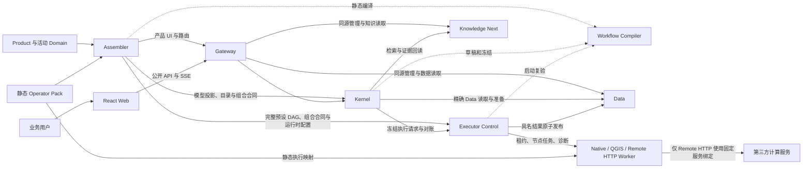
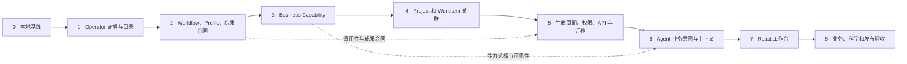

# Groundwater Agent V2 阶段 0 架构基线与差距

核查日期为 2026-11-20（Asia/Shanghai）。本地 `main` 的起始提交为 `bd5d58ab63e16b2f5a59ceabcc7faf1c4c71f411`，开始时工作区干净。本文基于该提交的实际声明、源码、生成配置和本轮离线验证。历史架构及路线图来自本地对象 `ca47397`，其评估对应更早的源码基线。阶段 1 方案和新能力档位均待产品和架构负责人确认。

**基线判断。** 当前实现已有“发现资料与方法 → 准备 → 确认 → 调度 → 发布与查看”的纵向链路。业务入口仍以 Session 为中心。V2 需要补齐可面向用户选择的业务能力与工作流方案、跨会话工作组织，以及有明确验收口径的成果交付。实现应继续使用 Kernel、Data、Knowledge、Executor 及现有 Compiler 和 Operator Pack。

## 1. 产品身份与实际装配

| 项目 | 本地证据 |
| --- | --- |
| 产品和项目 | 产品 `groundwater`，实例项目 `groundwater-demo`。Product Manifest 为 `product-manifest.v8`，公开 API 为 `v12`。产品清单没有独立的产品 SemVer 字段。产品身份由清单 checksum 与 assembly lock 确定。V2 是此次升级计划。由 `--product groundwater` 选择 `products/groundwater/product-manifest.json`。 [产品清单](../../source/products/groundwater/product-manifest.json) · [选择入口](../../source/scripts/development/product_selection.py) |
| 活动 Domain | `groundwater@6.2.0`，`sha256:9862f88dd7cce5bcdcf58dd008edb6465bcfde031d97548785a66eb3e14c5fc3`。Assembler 加载 `domainId/version` 并复算所选文件身份。保留的 `6.1.0` 使用相同的工作流和模型文件，但产品没有选择它。 [活动领域清单](../../source/domains/groundwater/6.2.0/domain-manifest.json) · [选择与校验](../../source/platform/assembler/assembler_manifests.py) |
| 声明和种子 | 18 份 `workflow.v6`、18 份 `executable-model.v6`、18 张模型知识卡、7 个 observation tools、1 个固定执行案例。9 个 Knowledge 源文件展开为 **121 份文档、321 个单元**。种子展开和实际导入是独立环节。 [模型卡](../../source/domains/groundwater/6.2.0/knowledge/model-cards.v1.json) · [Porous 模型卡](../../source/domains/groundwater/6.2.0/knowledge/porous-model-cards.v1.json) · [装配锁](../../source/platform/assembler/assembler.py) |
| Web 配置 | 活动 UI 来源为 `ui/product-ui-porous.v1.json`。生成 `product-ui.v1`，`workspaceLayout=research`，18 个模型，11 个首页示例，其中 7 个 `featured`。案例 `yaozhanbao-transfer-case` 有 `standard` 和 `development_fast`。实际配置的模型 ID 集合与 Kernel、Executor 相同。 [UI 来源](../../source/products/groundwater/ui/product-ui-porous.v1.json) · [UI Schema](../../source/platform/assembler/product-ui.v1.schema.json) · [装配校验](../../source/platform/assembler/assembler_ui.py) |
| 实际生成 | 以默认执行档位在本地缓存编译产品，生成 `assembly-lock.json`、`kernel-config.json`、`executor-config.json`、`compose.json`、`nginx.conf`、`product-ui.json`、`product-icon.svg` 共 7 件。Kernel 与 Executor 的 composition 对象一致。`product-ui.json` 的 SHA-256 为 `a5424dfafd27d95e6e5d4c63e00074aed24ebfd8e05c47bbe7dd3a19d6b97bfd`。部署路径进入 Compose，比较基线时按现有测试归一化目录。 [装配入口](../../source/platform/assembler/assembler.py) · [产物基线测试](../../source/tests/assembler/test_groundwater_generated_baseline.py) |



| 模块 | 责任和核查入口 |
| --- | --- |
| Product、Domain、Assembler | 清单选择产品、领域、UI、外部操作和组合成员。Assembler 校验 Schema、包内路径及内容、版本和摘要、模型引用的 Workflow、案例、知识卡绑定、服务操作及配置覆盖，发布内容寻址产物。 [清单加载](../../source/platform/assembler/assembler_manifests.py) · [装配验证](../../source/platform/assembler/assembler_domain.py) · [产物发布](../../source/platform/assembler/assembler_publication.py) |
| Operator Pack、Compiler | Pack 提供精确算子 Manifest、端口、参数、实现锁、离线夹具和静态分发。Compiler 共享于装配、Kernel 草稿及 Executor，负责声明编译和受控组合验证。 [Pack](../../source/packages/operator-pack/README.md) · [Compiler](../../source/packages/workflow-compiler/src/platform_workflow_compiler) |
| Kernel | Session、Turn 投影、Task、确认与公共 WorkflowRun 的权威。执行路由、证据收集、方案和动作冻结、角色及资源所有权复核、调度和对账。 [交互](../../source/kernel/src/platform_kernel/interaction) · [Agent Runtime](../../source/kernel/src/platform_kernel/agent_runtime) · [任务](../../source/kernel/src/platform_kernel/tasks) · [执行](../../source/kernel/src/platform_kernel/workflow_execution) |
| Data、Knowledge | Data 拥有字节、数据集、版本、语义、发布和可见性，并已有字段画像、质量规则与质量运行 API。Knowledge 拥有知识版本、检索记录及可精确回读的单元。业务准备可复用这些事实。 [Data 发布](../../source/services/data/src/platform_data_service/publication/service.py) · [Data 质量](../../source/services/data/src/platform_data_service/api/routers/quality.py) · [Knowledge](../../source/services/knowledge-next/README.md) |
| Executor、Worker | Executor 拥有内部 Job、DAG、节点尝试、租约和恢复状态，按已冻结合同调度。Worker 使用对应运行时执行静态实现或远程适配。 [作业准入](../../source/services/executor/src/platform_executor_service/control_components/admission.py) · [执行库](../../source/services/executor/src/platform_executor_service/database.py) · [Worker](../../source/services/executor/src/platform_executor_service/worker.py) |
| Web、Gateway | 同源展示、基于权威快照的交互、精确成果读取。Gateway 提供产品配置、路由和受信身份边界，服务端仍校验主体与权限。 [Gateway 装配](../../source/platform/assembler/assembler_gateway.py) · [Web 合同](../../source/docs/capabilities/webui.md) |

## 2. Operator 底座与证据链

| 运行时 | Catalog 精确版本 / 唯一 ID | 预设引用版本 / 节点 | 组合白名单版本 |
| --- | ---: | ---: | ---: |
| `native` | 86 / 85 | 40 / 74 | 49 |
| `qgis` | 15 / 15 | 3 / 8 | 12 |
| `remote_http` | 12 / 11 | 11 / 13 | 1 |
| 合计 | **113 / 111** | **54 / 95** | **62** |

- Manifest、Smoke fixture 声明、implementation lock 行、Catalog index 和静态分发均覆盖同一组 113 个 `ID@version`。版本字面量只有 `1.0.0`、`1.1.0`，分别出现 111、2 次。两组多版本 ID 是 `raster.reproject` 和 `groundwater.porous.pest_calibrate`。前者预设用 `1.0.0`、组合用 `1.1.0`，后者相反。预设与组合交集为 `crs.reproject@1.0.0`、`data.convert@1.0.0`、`table.filter@1.0.0`。其余 51 个仅预设引用，59 个仅在组合白名单中。逐条精确 ID、版本、运行时、工作流数和节点数可用附录脚本重建。 [Catalog 索引](../../source/packages/operator-pack/catalog/index.json) · [完整逐项清单](../../source/docs/development/current-capability-inventory.md#operator-catalog-摘要) · [组合白名单](../../source/products/groundwater/product-manifest.json)
- Index 的 Catalog digest 为 `sha256:3881423fa69deae67a4d31bbab2c202541b8c7ccaf7c1182497da74a67b672ab`。包含实现身份的执行装配 digest 为 `sha256:47eb493ad355de2062110e459c5d69368fd6de457d5debabc9f2f8c2363f4494`。使用处分别校验各自合同。当前装配发现目录启用 113 个版本。远程条目按产品声明的 service/operation 启用，运行还依赖心跳、环境、固定主机、授权及远程服务与模型版本。 [目录加载](../../source/packages/operator-pack/src/moperators/catalog.py) · [装配执行 Catalog](../../source/platform/assembler/assembler_domain.py) · [远程执行](../../source/services/executor/src/platform_executor_service/remote_http.py)
- `list_operators` 提供查询/分类/输入格式/输出端口选择、确定性游标、每页 1–50 条、默认 20，以及每个选择器至多 3 页的轮次限制。`get_operator` 返回精确版本、端口、参数、运行时、技术证据、引用和组合合同。目录发现与确认资格分别投影。动态组合需要当前轮读取目标版本、匹配精确白名单与版本/语义事实，以及 Compiler、Kernel、Executor 相应边界的复核。科学证据状态尚未作为通用组合准入条件。 [目录工具](../../source/kernel/src/platform_kernel/agent_runtime/tooling/catalog_tools.py) · [模式和工具范围](../../source/kernel/src/platform_kernel/agent_runtime/mode.py) · [组合草稿准入](../../source/kernel/src/platform_kernel/agent_runtime/workflow_draft.py)
- **证据产生。** Native/QGIS 的 smoke 可在对应运行时使用精确夹具与子进程，校验输出格式和摘要。仓库另有单算子本地入口、Workflow golden 和用户指定真实案例入口。Remote 镜像 smoke 检查远程声明端口和适配合同，真实操作验证需要外部环境和实际回执。当前静态复核覆盖 113 对 Manifest/Smoke 及精确端口与 Smoke 参数，91 个索引夹具的大小与 SHA-256 一致，Smoke 引用的 78 个不同夹具 ID 均已索引。 [Smoke 实现](../../source/packages/operator-pack/src/moperators/smoke.py) · [静态 Pack 测试](../../source/packages/operator-pack/tests/test_static_pack.py) · [运行手册](../../source/docs/operations/execution-playbook.md)
- **证据冻结和消费。** 产品清单固定 `operator-validation.v1.json` 的文件摘要。记录日期为 2026-11-19。现有 113 行均匹配当前实现锁，`BROWSER_SINGLE_NODE` 62、`WORKER_SINGLE_OPERATOR` 40、`REMOTE_PRESET_NODE` 11。Kernel 目录读模型对实现摘要一致投影 `PASSED`，漂移投影 `STALE`，无记录投影 `NOT_RECORDED`。可选科学复核有独立的 benchmark 与 domainReview 文件身份，在实现匹配时返回。当前科学复核行数为 **0**。输出进入 Agent `get_operator` 和公开 capabilities，Web 分开呈现确认资格、heartbeat、技术和科学复核。 [证据 sidecar](../../source/products/groundwater/operator-validation.v1.json) · [装配校验](../../source/platform/assembler/operator_metadata.py) · [状态投影](../../source/kernel/src/platform_kernel/application/operator_catalog.py) · [Web 目录](../../source/web/src/ProductDrawers.tsx)
- **证据缺口。** v1 校验 `reportChecksum` 的格式，当前仓库搜索未定位可按该摘要重放的原报告或生成器，也缺少每条验证的工件定位、夹具与执行环境绑定以及科学审查政策。Pack 的 `static_implementations.py` 出现在 113 条实现锁中，8 个共享文件分别影响全部 101 条 Native/QGIS 记录。如 `native.py`、`runtime/task.py`。远程锁也需要与 Executor adapter、镜像及实际服务回执对照。环境变化或证据撤回尚无统一失效规则。 [实现锁](../../source/packages/operator-pack/catalog/implementation-lock.json) · [验收状态](../../source/docs/operations/acceptance-gates.md)

## 3. 工作流、模型、Profile 和结果合同

**当前关系。** Workflow 声明节点、端口、DAG 和精确算子版本。Executable Model 固定 Workflow 版本与 checksum，为用户和 Agent 提供工具输入、输入角色、参数映射、默认值、执行策略、具名发布。知识卡固定 Model ID、版本与 checksum，帮助发现、解释和引用。选中的 18 对 Workflow/Model 本轮为一对一，18 张卡也分别匹配模型和工具别名。Composition Contract 是另一条受控声明入口。装配从产品白名单生成同一份配置给 Kernel/Executor，含规则 Schema、身份、预算。Kernel 将完整可确认的草稿冻结为 Workflow v7，Executor 复验后交给现有执行引擎。 [领域装配](../../source/platform/assembler/assembler_domain.py) · [组合适配](../../source/packages/workflow-compiler/src/platform_workflow_compiler/composition/execution.py) · [启动复验](../../source/services/executor/src/platform_executor_service/control_components/admission.py)

**Profile 的等价能力。** 已有精确 `WorkflowSelection`，持久化会话请求中的 model/workflow 身份、角色绑定和关键参数。固定执行案例已有输入角色及档位。Product UI 有展示名、示例、参数组织、结果分组、后续工作及同批成果动作。当前装配有 6 个发布后步骤和 2 个续接规则。代码中暂无带独立稳定身份、版本、可用角色、适用性、结果要求与验证证据的通用 Workflow Profile/Business Capability。新增合同应复用这些入口，并区分“案例档位”“呈现配置”和“正式业务方案”。 [精确选择](../../source/kernel/src/platform_kernel/workflow_selection.py) · [执行案例](../../source/domains/groundwater/6.2.0/cases/yaozhanbao-transfer-case.json) · [产品 UI 规则](../../source/products/groundwater/ui/product-ui-porous.v1.json)

### 18 条活动工作流的用途分层

下表沿用历史路线的用途判断，并通过当前 DAG、模型说明及 UI 复核。共同前缀为 `groundwater.`。正式权限与启用档位仍待产品决策。`featured` 只影响首页展示，规则分类和水源地评价也被置顶。 [当前工件明细](../../source/docs/development/current-capability-inventory.md#工作流与算子组合) · [产品指令](../../source/domains/groundwater/6.2.0/instructions.md) · [第三方门禁](../../source/docs/operations/deployment/third-party-groundwater-models.md)

| 审计用途 | Workflow 和精确版本 | 理由与验收边界 |
| --- | --- | --- |
| 核心 | `summary@1.1.0`、`monitoring-trend@1.1.0`、`flow-field@1.1.0`、`kriging@1.0.0`、`monitoring-coverage@1.2.0`、`render-map@1.1.0` | 对应历史核心分析链，现有工作流覆盖数据概览、趋势、简化流场、空间插值、井点覆盖和制图。井点覆盖计算监测点凸包，运行需要 QGIS。 |
| 专题 | `rule-classification@1.0.0`、`drastic@1.0.0` | 对应规则专题和相对脆弱性。依赖明确的规则来源、量纲或栅格条件。 |
| 高级候选 | `source-sustainability@1.0.0`、`porous-simulation@1.0.0`、`porous-calibration@1.0.0`、`porous-scenario-comparison@1.0.0` | 有精确远程操作绑定及模型/数据要求。Porous Linux 仿真当前 UI 设定为候选/合成场景，现场科学等价性待验证。 |
| 实验用途 | `transfer-learning-analysis@1.0.0`、`porous-inversion-training@1.0.0`、`porous-inversion-sampling@1.0.0`、`porous-agricultural-inversion@1.0.0` | 迁移学习是固定 19 个输入角色、58 节点的留出回测。反演方法需要独立数值与现场验收。 |
| `UNKNOWN` | `porous-map@1.0.0`、`sustainability-input-preparation@1.0.0` | 已有 GeoTIFF 整理和评价候选输入生成，证据不足以断定它们属于独立能力档位。应评估将其作为对应业务的配套步骤。 |

Pastas 与 MODFLOW 6 位于独立 spike，未进入本产品的活动 Domain 和 Product UI。 [独立研究](../../source/products/groundwater/spikes)

### Compiler 的覆盖和缺口

| 环节 | 已实现 | 仍需设计或验证 |
| --- | --- | --- |
| 静态 v6 | 精确算子版本、节点 ID/命名与必需端口、拓扑与循环、可达性、声明与参数映射、Artifact 路径、媒体和格式匹配（含条件格式传播）。 | 各工作流输入语义和业务适用性不会仅由静态图推出。静态 v6 允许某些未使用声明，受控草稿入口会检查。静态图和通用 v7 对集合端口的表达范围不同。 [静态编译](../../source/packages/workflow-compiler/src/platform_workflow_compiler/graph.py) · [格式传播](../../source/packages/workflow-compiler/src/platform_workflow_compiler/formats.py) |
| v6 草稿与可执行 v7 | 草稿检查参数来源、具体值和相应规则、精确 Data 引用形状和格式、未使用声明及缺项。v7 校验环境与词表身份、DAG、端口类型和 cardinality、带证据的事实与谓词、业务目标输出和发布。默认动态组合预算为 12 节点、并行 1、节点内存上限 16 GiB、节点最长 7200 秒。执行子集拒绝延迟才能判定的条件和当前不支持的绑定形状。 | 缺工作流总成本/关键路径预算、重复计算检测和跨预设/动态图的一致专业适用性评价。能力配置应声明可依赖的分析维度。 [草稿编译](../../source/packages/workflow-compiler/src/platform_workflow_compiler/draft.py) · [组合验证](../../source/packages/workflow-compiler/src/platform_workflow_compiler/composition/workflow.py) · [执行子集](../../source/packages/workflow-compiler/src/platform_workflow_compiler/composition/execution.py) |
| 发布和兼容性 | 模型声明具名最终输出，Executor/Data 校验媒体、格式、对象和回执身份。UI 声明 Viewer 和展示分组。影响分析能查精确 Operator → Workflow → Model 和现有 golden case。 | 缺统一主成果、诊断、图件、摘要等业务角色枚举和交付/科学验收合同。需将 Profile 和 Capability 纳入引用图，并保持原定义和历史结果可解析。 [装配引用](../../source/platform/assembler/operator_metadata.py) · [影响分析](../../source/scripts/development/operator_impact.py) |

## 4. Kernel、交互与成果的权威关系

| 对象 | 标识和权威 | 对 V2 的约束 |
| --- | --- | --- |
| Project | Kernel 每实例固定项目 ID，成员角色和账号有持久化实现。Session 筛选检查项目和 owner，Data 独立判断项目与资产可见性。 | Project 作用域可复用。业务项目 CRUD、切换及与部署项目的基数/协作权限待决。 [身份依赖](../../source/kernel/src/platform_kernel/api/dependencies.py) · [项目成员](../../source/kernel/src/platform_kernel/api/routes/auth.py) · [持久化](../../source/kernel/src/platform_kernel/schema/common.py) |
| Session、Turn、AgentRun | Session 具有不可变 owner、项目、当前轮次指针。Turn 由 `(sessionId, goalRevision)` 等事实拼成，`requestId` 在 Session 内幂等。AgentRun 是一次交互运行身份，可能跨多个步骤和确认。快速状态/控制请求可能只有消息回执。 | Conversation 可继续使用 Session。Session 权限、Turn 事件和 AgentRun 执行状态具有不同语义。 [会话与轮次](../../source/kernel/src/platform_kernel/schema/interaction.py) · [受理](../../source/kernel/src/platform_kernel/interaction/message_requests.py) · [历史快照](../../source/kernel/src/platform_kernel/interaction/history.py) |
| Task、WorkItem | Kernel Task 有 `taskId`、目标来源、修订、条件与证据，`tasks.session_id UNIQUE`。现有项目任务历史按可见 Session/Turn 聚合。Web 的 `executionTasks` 是 WorkflowRun 尝试投影。 | WorkItem 的跨会话索引、关联及归档为新增能力。业务工作可链接现有 Task/Conversation/资产，执行状态仍从权威事实投影。 [Task 表](../../source/kernel/src/platform_kernel/schema/tasks.py) · [Task 进度](../../source/kernel/src/platform_kernel/tasks/progress.py) · [历史聚合](../../source/kernel/src/platform_kernel/interaction/task_history.py) · [运行投影](../../source/kernel/src/platform_kernel/workflow_execution/projection.py) |
| Confirmation | 当前轮次、方案动作、Task 修订与精确版本绑定。修改或恢复产生新确认，服务端核对状态、主体与当前修订。 | UI 或 Agent 的可用状态只用于展示和引导。谁能确认、哪些历史尝试可恢复，需要服务端权限规则。 [确认与修订](../../source/kernel/src/platform_kernel/interaction/revisions.py) · [恢复](../../source/kernel/src/platform_kernel/interaction/recovery.py) |
| WorkflowRun 与 Executor Job | Kernel 创建公共 `runId`，用作 Executor 执行的 `requestId`，冻结服务绑定。Executor 发独立 `jobId`，拥有任务图、租约、节点尝试和诊断。Kernel 保留 `remoteJobId` 调度和投影。未确定提交优先按同一请求对账，恢复使用新尝试并保留来源。 | 跨服务关联需要两套精确身份及其映射。业务状态需引用已有确认、运行和发布记录。 [队列](../../source/kernel/src/platform_kernel/workflow_execution/persistence/queue.py) · [请求映射和查询](../../source/kernel/src/platform_kernel/workflow_execution/owner.py) · [Job 准入](../../source/services/executor/src/platform_executor_service/control_components/admission.py) |
| Result、BusinessAsset | Session Results 是按目标修订分页的动作与运行投影，包含失败或无输出记录，当前不单建 Result 主库。Data 版本、语义、对象及 checksum 为实际成果身份。 | 业务资产可持有精确引用、业务标签和审阅记录，回读时独立检查可见性和数据身份。井、区域、含水层等 BusinessObject 主数据所有者需要决策，已有字段与栅格可作为引用证据。 [成果读取](../../source/kernel/src/platform_kernel/agent_runtime/persistence/context.py) · [协议引用](../../source/packages/protocol-contracts/src/platform_protocol_contracts/execution_v6.py) · [监测井模型](../../source/domains/groundwater/6.2.0/models/monitoring-coverage.model.json) |

Executor 节点计算完成后，经 `FINALIZING/COMMIT_PENDING` 推进到 Data 发布。Data 在同一事务发布版本、语义、对象、血缘及回执，已有回执可幂等重读。内置 Executor 的 `Job.SUCCEEDED` 在核实 `PUBLISHED` 回执和具名输出后写入。Kernel 查询发布和节点/图诊断时复验绑定及身份。当前技术流程、Data 发布、领域科学复核、业务审阅各有证据。现有 `TaskContext` 能依条件记录成果与用户审阅。 [执行结果处理](../../source/services/executor/src/platform_executor_service/results.py) · [发布后完成](../../source/services/executor/src/platform_executor_service/result_finalization.py) · [Data 事务](../../source/services/data/src/platform_data_service/publication/service.py) · [Kernel 诊断代理](../../source/kernel/src/platform_kernel/workflow_execution/owner.py)

公开入口包括 `GET /api/v12/capabilities`、`/sessions/{sessionId}/messages`、`/sessions/{sessionId}/events`、`/sessions/{sessionId}/results`、确认与恢复、运行诊断和 Data 精确版本读取。现有 SSE 使用 `Last-Event-ID` 或历史快照的游标续读。后端持久化检查点、队列和任务事实负责恢复，前端以快照追平水位后再开放相关操作。 [公开合同](../../source/products/groundwater/contracts/public-api-v12.json) · [历史查询](../../source/kernel/src/platform_kernel/api/routes/session_queries.py) · [SSE 实现](../../source/kernel/src/platform_kernel/api/routes/session_streams.py) · [运行时恢复](../../source/kernel/src/platform_kernel/runtime.py)

Agent Router 已划分只读咨询、执行提案、工作流草稿及澄清分支。Kernel 根据当前任务、可信选择和模式授权工具，结构化回复会核对本轮证据与真实动作状态。V2 的扩展点是以业务目标和 WorkItem 选择可用的 Capability/Profile，并将精确发布指标、诊断和限制纳入解释。 [路由授权](../../source/kernel/src/platform_kernel/intent_routing/decision.py) · [工具模式](../../source/kernel/src/platform_kernel/agent_runtime/mode.py) · [回复核验](../../source/kernel/src/platform_kernel/agent_runtime/tooling/reply_submission.py)

## 5. Web 已有可复用基础

| 入口 | 当前行为 |
| --- | --- |
| 启动、首页与会话 | `main.tsx` 严格解码生成的 `/product-ui.json`。会话 controller 用 capabilities 核对产品和模型集合。`App.tsx` 连接会话导航、状态、数据库与能力抽屉。`SessionNavigation` 支持搜索、归档、会话切换。`ProductDrawers` 入口优先模型，原子算子目录另外可查。 [启动](../../source/web/src/main.tsx) · [身份核对](../../source/web/src/product-ui.ts) · [根组件](../../source/web/src/App.tsx) · [会话导航](../../source/web/src/SessionNavigation.tsx) |
| 会话与状态 | `TurnTimeline` 按轮次关联资料、确认、任务与可验证产物。`AssistantContent` 渲染结构化回复、限制与证据。`use-session-stream` 读 preview/durable SSE、请求服务端历史，拒绝落后水位的快照。`ui-selectors` 将后端状态及待处理事项映射为 UI 状态。 [轮次](../../source/web/src/TurnTimeline.tsx) · [回复](../../source/web/src/AssistantContent.tsx) · [流与读取](../../source/web/src/use-session-stream.ts) · [状态投影](../../source/web/src/ui-selectors.ts) |
| 专业工作区 | `use-workspace-controller` 以 `#/sessions/<id>/workbench/<tab>` 恢复数据、草稿、参数、任务和成果。`WorkspacePanel` 和 `TaskCard` 复用持久事实、准备缺项、任务审阅、来源和诊断。`ChatCards` 展示当前确认、历史修订和核验后的结果。 [路由控制](../../source/web/src/use-workspace-controller.ts) · [工作台](../../source/web/src/WorkspacePanel.tsx) · [任务卡](../../source/web/src/TaskCard.tsx) · [确认与结果](../../source/web/src/ChatCards.tsx) |
| 结果解释与继续 | 精确读取 Data version、semantic revision、object、checksum 和格式。Viewer、结果摘要与节点/发布诊断按需加载。当前可保留选中引用，也可用成果开启新会话或按配置继续工作。业务跨会话目录仍待建立。 [精确回读](../../source/web/src/api.ts) · [结果摘要](../../source/web/src/ResultInsights.tsx) · [节点诊断](../../source/web/src/WorkflowNodeDetails.tsx) · [发布详情](../../source/web/src/WorkflowPublicationDetails.tsx) |

Web 的 V2 缺口是以 Project/WorkItem/业务能力作为一级入口并保持会话兼容，以及独立验收与成果中心。现有会话页、业务解释、确认和 Data Viewer 可作为实现切片。当前核查覆盖实际装配配置与静态构建，包含 jsdom 行为测试。真实浏览器交互、用户评审和 live Gateway 属于后续验证范围。

## 6. 历史设计对照、实施类型与主要风险

从本地已归档的 `ca47397:plans/repository-assessment/09_TARGET_ARCHITECTURE.md` 与 `10_REFACTORING_ROADMAP.md` 读取设计。历史方案已经提出单工作台、Kernel 与三服务保有所有权、静态 Domain、统一准备及可复现交付。本轮结论以当前实现为准。 [归档入口](../README.md) · [现行架构合同](../../source/docs/architecture/architecture-contract.md)

| 类型 | 主题及现状 | 阶段归属 |
| --- | --- | --- |
| EXISTING | 现有确定性装配和编译、精确版本、会话/确认/执行/发布、权限、恢复、图表与节点诊断可以直接复用。A09 的机械清单已有生成器并通过漂移检查。 | 1–8 |
| EXTEND | A01/A02 部分实现。显式准备核对字段、单位、CRS、基准与时间。Agent 提案在本轮有目标准备记录时绑定相应 READY 快照。代码仍有以参数 Schema、已观察的精确 Data 版本及选择为依据的提案分支。用户修订也有独立的参数和资源校验路径，因此各入口的专业验证回执尚未统一。部分关键事实可能为 `UNKNOWN`，是否阻止确认取决于当前具体检查。 [准备](../../source/kernel/src/platform_kernel/agent_runtime/preparation_tool.py) · [动作冻结](../../source/kernel/src/platform_kernel/agent_runtime/result_processing.py) · [修订](../../source/kernel/src/platform_kernel/interaction/revisions.py) | 2、5、6 |
| EXTEND | A03 已有缺口连续段、季节趋势、变点等诊断，活动趋势 DAG 未接现有自相关算子进行适用性联动。A04–A06 已有精确发布引用、专用评价来源回执、结果指标和执行前研究包。通用运行后科学解释、正式接受状态及可复现交付清单仍缺。 [趋势 DAG](../../source/domains/groundwater/6.2.0/workflows/monitoring-trend.workflow.json) · [研究包](../../source/products/groundwater/research/research_package.py) · [科学验收](../../source/docs/operations/acceptance-gates.md) | 2、5、6、8 |
| EXTEND | A07/A08 已有精确知识取证、生命周期与召回治理，不能从种子声明推定真实导入或来源复核。A16/A17 已有受控技术测试与部分数值案例。科学复核、跨环境对照和独立现场验证有明确缺口。 [证据链](../../source/docs/capabilities/groundwater-research-evidence.md) · [远程科学范围](../../source/docs/operations/deployment/third-party-groundwater-models.md) | 1、2、8 |
| NEW | A10 面向用户的独立能力与 Workflow Profile 合同、发行档位与成熟度。跨会话业务组织与资产关联、用途/对象词表和统一成果交付入口。现有案例档位、Task、Data/Knowledge 身份、Draft 与 Web 组件提供可复用基础。 | 2–7 |
| DECISION | 科学证据对展示、授权和报告的作用，业务 Project、WorkItem 与 Kernel Task 的基数，井、区域、含水层主数据职责，以及对成果的业务审阅与接受责任。 | 1、2、4、5 |
| 文档漂移 | Operator Pack README 仍写 106 条（80/15/11），当前为 113 条（86/15/12）。Kernel README 仍写无账户、成员及授权模块，动态 DAG 的限制需要限定为受控组合边界。科研证据链中的 99/291 属于旧门禁，当前装配冻结 121/321，两个口径应显式标注版本。 [Pack 说明](../../source/packages/operator-pack/README.md) · [Kernel 说明](../../source/kernel/README.md) · [旧研究基线](../../source/docs/capabilities/groundwater-research-evidence.md) | 1 或相关合同的维护阶段 |

| 优先级 | 风险 | 影响范围与前置决策 |
| --- | --- | --- |
| P0 | 把技术 `PASSED`、目录收录或远程 heartbeat 用作专业有效性证明。 | 影响新能力的默认可见性与是否允许执行。明确各类验收的适用范围、失败或过期的处理、已有冻结版本的兼容政策。 |
| P0 | 不同准备、修订和执行入口对未知单位、基准、图层或方法前提的判定不一致。 | 后续提交确认前统一可复验的证据回执和硬性前提。由业务负责人确认哪些事实必需、哪些情景假设可显式授权。 |
| P0 | 跨 Session 关联扩大项目、会话或资产权限，或产生第二套任务状态。 | 在迁移设计前选定 WorkItem 的 owner、协作范围、基数及权限继承规则。关联写入与打开资产时都校验权威事实。 |
| P1 | 共享依赖扩散、远程实现或镜像更新时证据身份漂移。 | 保守保留当前 lock 计算。先用证据目录及依赖对比确认可安全细化的范围。 |
| P1 | 把发布、科学复核、业务验收混成一个完成状态。 | 保留分层状态，决策后定义成果最小清单、复核角色及跨会话恢复约束。 |

## 7. 阶段 1 建议与后续依赖

阶段 1 可在现有 Assembler → Kernel 目录这一条路径上实现。保留 v1 sidecar 的主要成本是继续手工对账，扩展 Manifest 会令业务呈现和验证变化牵动执行身份。推荐以产品或领域拥有的**版本化证据 sidecar**试点，沿用 Product Manifest 的 checksum pin 和 Kernel 的投影入口。需要跨产品通用的执行合同字段，可在有复用证据并批准后考虑 Manifest 演进。

1. **先固定基线。** 复用 `capability_inventory.py`、`operator_impact.py` 与两个现有 Catalog loader 生成健康度、验证覆盖、历史版本和引用矩阵，按本报告口径列出 113 个精确版本。区分 Schema/Contract、Unit、Smoke、Integration、Domain Case、Regression、Scientific Review。将没有可定位证据的层级保留为未评估。将 Pack README 的数量指向生成清单。
2. **提案并试点证据合同。** 记录精确 `operatorId@version`、manifest/implementation digest、测试类型、夹具与期望结果摘要、运行时/镜像或服务版本、工件位置和摘要、复核人及复核适用范围。按类型定义失效条件。为业务用途、关键输入/输出含义、适用限制保留独立元数据归属，确保不改变执行身份。先选 Native 的 `raster.reproject@1.0.0/1.1.0`、QGIS 的 `vector.spatial_join@1.0.0`、远程的 `groundwater.porous.pest_calibrate@1.0.0/1.1.0` 做精确 pin、版本切换和证据状态样例。远程历史回执可用于离线结构复核。
3. **对比 lock 依赖。** 用现有静态映射、Python 导入、动态分发、共享源文件、Worker 容器构建输入构造原型，比较当前实现锁命中范围和保守上界。对无法证明的依赖继续保守覆盖。输出影响对比，先保留既有锁计算与历史版本。
4. **守住目录和准入。** 验证分页、过滤、精确读取、身份权限、同轮证据与组合白名单。加入旧 pin、实现漂移、证据缺失或摘要不符及白名单外精确版本的负例。只有业务负责人批准的证据政策才可改变展示或新准入。既有 Manifest、运行记录及 Data 精确结果引用可按旧版本读取。

候选影响文件为 `source/products/groundwater/operator-validation.*.json`、对应产品 pin、`source/platform/assembler/operator_metadata.py`、`source/kernel/src/platform_kernel/application/operator_catalog.py`、`agent_runtime/tooling/catalog_tools.py`、[Pack README](../../source/packages/operator-pack/README.md) 及 Catalog/Assembler/Kernel 合同测试。第一步基线和依赖原型可复用现有脚本。公开对象如需扩展，在批准后同步 Schema、OpenAPI、生成客户端、Web 类型及回归。最小切片通过新装配交付，沿用现有数据库。 [阶段 1 任务](prompts/02_PHASE_1_OPERATOR_GOVERNANCE.md) · [受影响版本验证](../../source/docs/operations/execution-playbook.md#per-change-checks)

**需要确认的设计决策**

- **阶段 1。** 哪个角色签署哪一层证据，证据到期或撤回对普通发现、专家组合、新执行及历史重跑分别意味着什么。建议先以可核验的事实展示启动试点。
- **阶段 2。** 确认 Profile 的版本边界及必需科学前提，决定哪些未知可接受为显式情景假设，定义主成果、诊断和展示产物角色。
- **阶段 4–5。** 明确 WorkItem 关联一或多个 Session/Task 的基数及只读历史范围。低影响方案是新增一个业务组织和引用层，保留当前 Task 的 Session 约束。若改为跨会话 Task 原生所有权，则需重新验证修订、确认、ACL、历史迁移、幂等和回滚。业务对象主数据归属及项目协作角色同样待定。
- **阶段 5–8。** 区分业务审阅与发布主体，明确证据、报告和项目资产的归档权限、重现责任，以及远程模型和现场数值的验收环境。



## 8. 本轮验证、变更与退出条件

本轮使用 `./bin/bootstrap --status` 验证现有锁定 CPython 3.12.8，Web 使用 Node 22.23.1。装配、回归及构建均在隔离的 Linux 网络命名空间运行。首次 Python 测试收集返回 4，因为空临时缓存中缺少 `o200k_base`。按仓库的构建入口校验并把已签入词表复制到本次专用缓存后复跑。 [离线词表说明](../../source/kernel/vendor/tiktoken/README.md) · [词表冻结测试](../../source/tests/contracts/test_tokenizer_build_input.py)

| 实际检查 | 本轮结果 |
| --- | --- |
| `generate_capability_inventory(..., check=True)` 与 `compile_product(...)` | PASS。清单生成字节与签入文档相同。实际装配生成 7 个产物并核对产品、18 个模型和组合合同。另验证装配锁的 Knowledge 种子计数。 |
| `pytest tests/assembler packages/workflow-compiler/tests packages/operator-pack/tests/test_static_pack.py packages/protocol-contracts/tests tests/cli/test_capability_inventory.py tests/contracts/test_tokenizer_build_input.py` | **275 通过**，含黄金装配摘要、Domain 版本与模型身份、UI 配置拒绝、DAG、组合、Catalog 及共享协议。 |
| `pytest` 的 Kernel 合同用例 | **210 通过**。运行范围为 `kernel/tests/` 下 `test_access_policy.py`、`test_agent_state_integrity.py`、`test_confirmation_recovery.py`、`test_named_result_references.py`、`test_operator_governance.py`、`test_project_boundary.py`、`test_session_results.py`、`test_task_controls.py`、`test_tasks.py`、`test_v11_contract.py`、`test_workflow_drafts.py`、`test_workflow_progress.py`、`test_workflow_selection.py`。 |
| `pytest kernel/tests/test_internal_modules.py -k 'prepar or unit_and_crs or vertical_basis or time_type'` | **21 通过，63 未选**，覆盖本轮参数绑定、表字段、单位、CRS、垂向基准、日期/时区和时间范围。 |
| `python -m scripts.development.check_runtime_openapi` | PASS。直接从 Kernel、Data、Knowledge、Executor 创建应用的 Schema 与签入快照一致。 |
| `python -m scripts.development.generate_web_contracts --product groundwater --check` | PASS。公开合同、类型生成及验证器与签入文件一致。 |
| `node_modules/.bin/vitest run --root web --reporter=dot`，以及在 `source/web` 运行 `npm run build` | **41 文件，425 测试通过**。`tsc --noEmit` 和 Vite 生产构建成功。 |

Python 回归从 `source/` 运行，使用 `-B -m pytest -q -p no:cacheprovider --basetemp <本轮缓存子目录>`。构建、临时数据和生成配置写入项目根的忽略目录 `.pytest_cache/gw-v2-phase0-bd5d58a.ut8Tvr/`。其中 `assembly-evidence.json` 保存实际装配的内容摘要，`capability-inventory.json` 保存逐项完整清单。

本轮测试包括离线的模块集成、公共合同和装配一致性。未运行 live 服务联测、Worker 镜像级 Native/QGIS 执行、真实外部服务、Provider 请求、浏览器 E2E、真实行业数据或独立科学验收。目录证据缺失、现场适用性及部署就绪度的判断保留到对应阶段。

新增文件为本报告。生产源码、API、数据库和活动定义版本沿用起始提交。`git diff --check` 与新报告空白检查通过。结论覆盖阶段 0 的十个核查问题，基线统计可复算，选择和风险均已记录，满足阶段 0 的退出条件。

## 附录 · 复算清单与装配

先在项目根用 `./bin/bootstrap --status` 核对本机已存在的锁定 Python，再进入 `source/`。将下面 Python 块作为该解释器的标准输入，以 `-B` 执行。脚本检查生成文档，并打印每个精确算子版本的运行时、工作流和节点引用数。若要顺带生成装配，设置 `PLATFORM_GENERATED_ROOT` 为工作区内空的绝对缓存路径。Python 回归可在同一网络隔离命令下用以下词表缓存。所有路径使用项目内新建的临时目录。

```bash
mkdir -p .pytest_cache
GW_PHASE0_CACHE="$(mktemp -d "$PWD/.pytest_cache/gw-v2-phase0.XXXXXX")"
GW_PHASE0_PYTHON="$(./bin/bootstrap --status | python3 -c 'import json, sys; result = json.load(sys.stdin); assert result["status"] == "PASS"; print(result["python"])')"
mkdir -p "$GW_PHASE0_CACHE/tiktoken" "$GW_PHASE0_CACHE/tmp"
printf '%s\n' '446a9538cb6c348e3516120d7c08b09f57c36495e2acfffe59a5bf8b0cfb1a2d  source/kernel/vendor/tiktoken/o200k_base.tiktoken' | sha256sum -c -
cp source/kernel/vendor/tiktoken/o200k_base.tiktoken \
  "$GW_PHASE0_CACHE/tiktoken/fb374d419588a4632f3f557e76b4b70aebbca790"
cd source
unshare --user --map-root-user --net -- env \
  TIKTOKEN_CACHE_DIR="$GW_PHASE0_CACHE/tiktoken" TMPDIR="$GW_PHASE0_CACHE/tmp" \
  PLATFORM_GENERATED_ROOT="$GW_PHASE0_CACHE/assembly" "$GW_PHASE0_PYTHON" -B -
```

```python
from collections import Counter, defaultdict
import hashlib
import json
import os
from pathlib import Path

from scripts.development.capability_inventory import generate_capability_inventory
from assembler import compile_product
from assembler_common import _checksum as model_checksum
from executor_profile import ExecutorOperationalProfile
from moperators.catalog import OperatorCatalog
from operator_metadata import load_operator_validation
from platform_workflow_compiler.validation import checksum as workflow_checksum


def read(path):
    return json.loads(path.read_bytes())


def sha(path):
    return "sha256:" + hashlib.sha256(path.read_bytes()).hexdigest()


root = Path.cwd()
product_path = root / "products/groundwater/product-manifest.json"
product = read(product_path)
domain_pin = product["domainPackage"]
domain_dir = root / "domains" / domain_pin["domainId"] / domain_pin["version"]
domain = read(domain_dir / "domain-manifest.json")
catalog_dir = root / "packages/operator-pack/catalog"
index = read(catalog_dir / "index.json")
catalog = OperatorCatalog.load(catalog_dir / "operators")
versions = {f"{entry.id}@{entry.version}": entry for entry in catalog.operators}
assert set(versions) == {f"{entry['id']}@{entry['version']}" for entry in index["operators"]}
assert set(versions) == set(read(catalog_dir / "implementation-lock.json")["operators"])

node_counts = Counter()
workflow_refs = defaultdict(set)
workflow_digests = {}
for name in domain["workflowDefinitions"]:
    workflow = read(domain_dir / name)
    key = (workflow["workflowId"], workflow["version"])
    workflow_digests[key] = workflow_checksum(workflow)
    for node in workflow["nodes"]:
        version = f"{node['operatorId']}@{node['operatorVersion']}"
        node_counts[version] += 1
        workflow_refs[version].add(key)

model_pins = {}
for name in domain["executableModels"]:
    model = read(domain_dir / name)
    ref = model["workflowRef"]
    assert ref["checksum"] == workflow_digests[ref["workflowId"], ref["version"]]
    key = (model["modelId"], model["version"])
    model_pins[key] = (model_checksum(model), model["tool"]["name"])

documents = [
    doc
    for name in domain["knowledgeDocuments"]
    for doc in read(domain_dir / name)["documents"]
]
cards = [doc for doc in documents if "modelRef" in doc]
for card in cards:
    ref = card["modelRef"]
    checksum, tool = model_pins[ref["modelId"], ref["version"]]
    assert checksum == ref["checksum"] and tool in card["aliases"]

whitelist = set(product["compositionOperators"])
assert (set(node_counts) | whitelist) <= versions.keys()
validation = load_operator_validation(product_path.parent, product["operatorValidation"])
matched = {
    key: record for key, record in validation.items()
    if key in versions and versions[key].implementation_revision == record["implementationRevision"]
}
inventory = generate_capability_inventory(
    repository_root=root,
    product_manifest_path=product_path,
    output_path=root / "docs/development/current-capability-inventory.md",
    check=True,
)

print("inventory", inventory["status"], inventory["outputSha256"])
print("manifest rows / IDs / exact versions",
      len(index["operators"]), len({op.id for op in versions.values()}), len(versions))
print("version labels", Counter(op.version for op in versions.values()))
print("workflows / models / cards", len(workflow_digests), len(model_pins), len(cards))
print("knowledge files / documents / units",
      len(domain["knowledgeDocuments"]), len(documents), sum(len(x["chunks"]) for x in documents))
print("workflow versions / nodes / whitelist / overlap",
      len(node_counts), node_counts.total(), len(whitelist), len(whitelist & node_counts.keys()))
print("validation match / stale / missing",
      len(matched), len((validation.keys() & versions.keys()) - matched.keys()),
      len(versions.keys() - validation.keys()))
print("evidence categories", Counter(row["coverage"] for row in matched.values()))
print("scientific review rows", sum("scientificReview" in row for row in matched.values()))
for runtime in sorted({op.runtime for op in versions.values()}):
    selected = {key: op for key, op in versions.items() if op.runtime == runtime}
    print(runtime, len(selected), len({op.id for op in selected.values()}),
          len(selected.keys() & node_counts.keys()), sum(node_counts[key] for key in selected),
          len(selected.keys() & whitelist))
for key, op in sorted(versions.items()):
    print(key, op.runtime, len(workflow_refs[key]), node_counts[key], key in whitelist)

if os.environ.get("PLATFORM_GENERATED_ROOT"):
    output = compile_product(root, product_path, executor_profile=ExecutorOperationalProfile())
    bundle_lock = read(output / "assembly-lock.json")
    kernel = read(output / "kernel-config.json")
    executor = read(output / "executor-config.json")
    ui = read(output / "product-ui.json")
    assert kernel["workflowAuthoring"]["composition"] == executor["workflowComposition"]
    assert set(ui["models"]) == {model["modelId"] for model in kernel["models"]}
    assert {model["modelId"] for model in executor["models"]} == set(ui["models"])
    assert bundle_lock["productUi"]["profileOutputChecksum"] == sha(output / "product-ui.json")
    print("assembly", output)
    for artifact in sorted(output.iterdir()):
        if artifact.is_file():
            print(artifact.name, sha(artifact))
```
