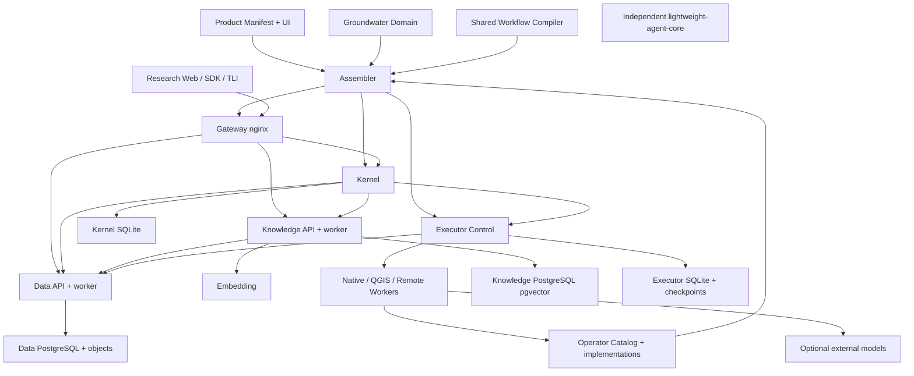

# 01 仓库完整盘点

基线及成熟度定义见 README。统计由 `evidence/reproduce_inventory.py` 读取当前 Git 跟踪文件重新产生，不含 node_modules、缓存、外置运行数据及本评估目录。全部文件身份见 `evidence/files.json`，全部 Python 类/函数行号见 `evidence/SYMBOLS.tsv`。

## 实际规模

| 范围 | 当前数值 | 含义 |
|---|---:|---|
| Git 跟踪文件 | 2,139 | 含代码、声明、锁、测试、文档和第三方封装 |
| Python test_* 函数定义 / 文件 | 2,131 / 254 | AST定义数，不是参数化测试数或通过数 |
| JS/TS test/spec 文件 | 68 | 含单元和浏览器测试，不能等同68测试 |
| 根 pytest 实际收集 | 2,287 | 当前环境 collection 通过；不含所有独立包/Native/第三方套件 |
| 活跃 Domain / 历史 Domain | 6.2.0 / 6.1.0 | Product仅选择6.2.0；旧版本不是默认运行能力 |
| 模型 / Workflow / Execution Case | 18 / 18 / 1 | Case为19输入腰站堡；不是18种独立物理模型 |
| 算子版本 / 唯一ID / Workflow引用版本 | 113 / 111 / 54 | native86、qgis15、remote_http12；两ID各有两个版本 |
| Product组合白名单 | 10 | 表格/栅格有限组合，不是任意代码执行 |
| 知识资产 / 文档 / unit | 9 / 121 / 321 | 独立知识ID121；不是当前数据库已导入数量 |
| 公共HTTP合同 paths / operations | 97 / 109 | 解析 public-api-v12.json；非运行可用性 |
| 非generated/非tests代码文本行 | 172,761 | .py/.ts/.tsx/.js，仍含脚本和少量命名式测试；只作维护体积代理 |

Kernel目录262,276文本行中包含大体积合同JSON，不能当作262k手写业务代码。模块文件/行数的原始口径在 inventory.json；成本判断结合所有权、依赖和测试负担，未虚构人月或运行费用。

## 模块职责、接口及成本

下表测试项均为源码关联；运行结果另见 TEST_EVIDENCE。价值/成本为本评估判断，并非实际使用率。

| 路径 | 职责、输入→输出 | 依赖及使用者 | 数据所有权 / API | 测试与产品价值 / 成本 |
|---|---|---|---|---|
| `source/kernel` | 消息/目标→Task、Plan、确认、WorkflowRun、回复 | Agent SDK/Provider、HTTP clients、compiler；Web/TLI/SDK调用 | SQLite34：交互、身份、授权、编排；API v12 | kernel/tests572函数；核心价值高，状态/恢复/Provider维护成本高 [E30–36] |
| `source/services/gateway` | HTTPS/HTTP边缘、静态前端、认证转发 | nginx、Assembler；所有浏览器请求 | 无业务存储；唯一北向入口 | topology/身份合同；价值高、运行逻辑小；不能按名字视作第二Kernel [E03] |
| `source/services/data` | 文件/语义→版本、对象、查询、发布、lineage；附质量/MLOps | PostgreSQL、DuckDB、Arrow、沙箱；Kernel/Executor/Knowledge/UI使用 | PG8及objects；data-http-v3、data-tools-v4 | tests86函数；核心高，扩张的治理台账增加成本 [E10–16] |
| `source/services/data/client` | 类型化HTTP访问 | httpx/生成合同；Kernel/Executor等 | 无权威业务数据 | wire checks；复用价值高，生成代码不手工去重 |
| `source/services/data/web` | 资料目录、语义编辑、查询、预览、发布界面 | React/shared UI/Data API | UI暂态；Data仍权威 | 单元/E2E存在；管理员有价值，与主站资料面板有复用空间 |
| `source/services/knowledge-next` | 预分块知识包→索引、Evidence、回执 | PG/pgvector、Embedding、Data精确绑定；Agent/UI调用 | PG7：知识版本、生命周期、检索回执；HTTPv3/tools-v5 | tests75函数；证据价值高、检索机制已相对克制 [E20–24] |
| `source/services/knowledge-next/client` | 类型化检索/精确读取 | HTTP、生成合同；Kernel/脚本 | 无独立知识权威 | 功能合同；保留 |
| `source/services/knowledge-next/ui` | 上传、目录、绑定、检索、生命周期 | React/shared UI/Knowledge API | UI暂态 | UI测试；普通研究者入口可收缩，管理能力保留 |
| `source/services/executor` | 冻结模型/组合图→Job、节点、持久产物与Data发布 | compiler/operator-pack、Data client、native/QGIS/remote workers | SQLite9、对象checkpoint；Execution v6/Worker v3 | tests120函数；核心高，隔离/恢复复杂度必要 [E50] |
| `source/services/executor/client` | Job请求与状态查询 | HTTP/共享协议；Kernel | 无执行权威 | wire/schema测试；保留 |
| `source/packages/operator-pack` | 版本化算子及smoke；输入artifact→artifact/value | 科学计算native、QGIS、remote接口；Worker/compiler消费 | 不拥有数据目录；临时输出交Executor | 420文件、93测试函数；默认科研与大量辅助算子共包；需按场景分层 [E40–47] |
| `source/packages/workflow-compiler` | 端口、DAG、语义、组合校验→冻结定义 | 共享合同；Assembler/Kernel/Executor共同使用 | 无业务状态；workflow.v6/v7、composition合同 | 50测试函数；复用优于三处重写；扩张边界需控制 [E54] |
| `source/packages/protocol-contracts` | DataVersionRefV2/JobRequest等跨服务类型 | Kernel/Executor/client | 无状态；wire唯一来源 | 24测试函数；必要合同层 |
| `source/packages/embedding-client` | 有限Embedding HTTP调用 | Knowledge/评测 | 无正文权威 | 13测试函数；小而必要 |
| `source/packages/groundwater-api-client` | Public v12 SDK | 用户脚本/TLI/自动化 | 无业务状态 | SDK合同；保留，历史文件名v11不代表现行API |
| `source/packages/ui-boundary` | UI权限、边界公共代码 | 三个Web workspace | 无业务状态 | 各Web边界测试；适合小型复用 |
| `source/packages/operator-ui` | 算子UI公共表达 | Web及组合图相关UI | 无执行状态 | UI合同；保持按需，不发展GIS桌面 |
| `source/packages/lightweight-agent-core` | 独立嵌入式Agent、journal、workflow、CLI | 自有lock/verification；非Groundwater Compose运行依赖 | 独立本地状态，不共享Kernel库 | 164文件、419测试函数；第二交付面，不能拿来无成本替换Kernel [E52] |
| `source/domains/groundwater` | 指令/模型/Workflow/知识/Case定义 | Product选择；Assembler校验 | 不可变发布身份；domain-manifest.v3 | domain/model合同；核心专业所有者；旧6.1需历史引用审计 |
| `source/products/groundwater` | 服务选择、UI、远程绑定、产品API、研究spikes/案例 | Domain/Assembler、外置资料 | 产品声明及研究包；非服务数据库 | 56文件、22测试函数；需收缩spike默认呈现 [E01/E48] |
| `source/platform/assembler` | Manifest→Kernel/Executor/nginx/Compose/UI配置 | compiler、module manifests、catalog | 外置可重建bundle；不拥有业务状态 | assembler tests；必要静态装配，不应变插件市场 |
| `source/web` | Session/Task/Turn/WorkflowRun、资料与结果展示 | API v12、Data/Knowledge、viewer库 | 本地草稿/队列/界面状态；后端权威 | 286文件；UI单元/E2E存在；三端重复展示可合并 [E51] |
| `source/environments`、根lock | native/QGIS/common/testing及Node兼容域 | 构建/worker/checks | 无业务数据；锁定依赖 | 依赖/Native门禁；保留隔离，不强求同一Python环境 |
| `source/scripts`、`bin` | 开发、装配、检查、XDG生命周期、迁移/归档 | 所有服务/工具链 | 只按明确生命周期操作；用户入口gw/dev | 158脚本文件；运维必要，科研用户不应被迫面对全部命令 [E53] |
| `source/schemas`、`source/docs`、`plans` | 操作合同、当前说明、计划 | 实现/测试应共同校验 | 不构成运行事实 | 已有文档漂移，宜生成能力事实、减少重复叙述 |
| `source/tests` | 跨服务/合同/架构/CLI/E2E | 隔离夹具/可选容器 | 测试临时态 | 606测试函数；不等价606科学验证 |
| `third-party-services/porous-groundwater-linux-service` | 外置原包/求解器Linux构建和remote封装 | 外置vendor、Fortran、PEST/NWT/MT3D、Torch | 远程队列和数值运行；remote-operation.v1 | 15测试函数+独立science脚本；维护成本高、科学适用范围窄 [E46] |
| `third-party-services/groundwater-sustainability-service` | 指标评分和异步remote服务 | FastAPI及自身存储 | 远程评价状态；非Data目录 | 36测试函数；专题价值、规则来源需复核 [E47] |

## 不存在独立顶层目录的职责

仓库没有单独的 `database/knowledge/data/operators/workflows/deployment/configuration` 权威根。数据库DDL分布在各owner；知识/Workflow位于Domain；算子位于operator-pack；部署由Assembler、Dockerfile、Compose和scripts生成；配置schema、manifest、lock留在source，实例字节和密钥按XDG在仓库外。未读取活动数据库、密钥或私有研究载荷，不能因此宣称其完整或安全。

## 实际依赖图

图中HTTP依赖不是Python跨服务内部导入。Research脚本中直接引用Knowledge models属于产品离线辅助面，需在后续复用评估中区分，不应把它推广成服务间共享数据库。
