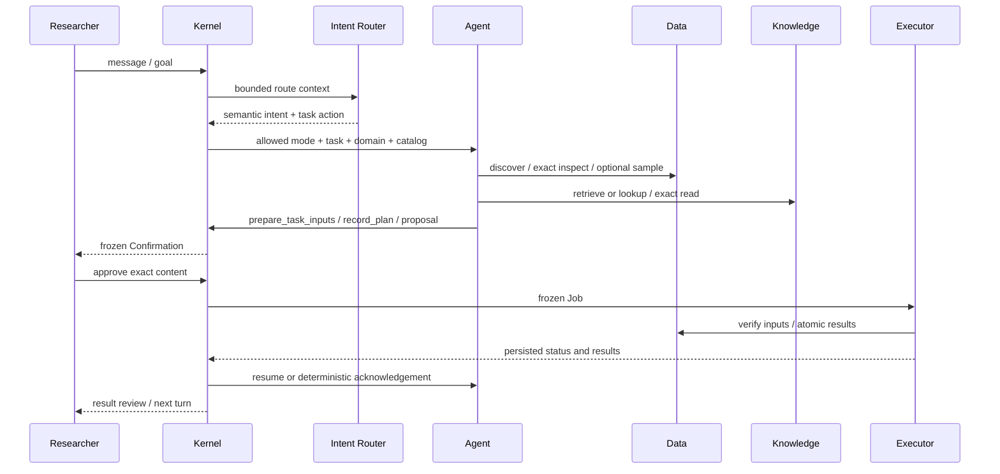

# 05 Agent：保留可信边界，缩短重复决策与取证

**Agent已有任务协作、有限工具调用和确认执行机制；专业适用性的强制保证不完整。最优先不是增加Agent数量，而是统一准备和提案验证，并让完成后的解释真正读取专业诊断。** [E30–36]

## 调用链与能力

| 检查项 | 实际实现 | 判断 |
|---|---|---|
| Intent Router | 无业务工具的模型判意图；Kernel决定权限和路由 | 不是另一个完整Agent。保留权限边界；可测量后为确定性请求/简单咨询减少一次LLM调用，不能仅靠prompt裁权限 |
| Context Assembly | ContextPolicyV1、TaskActive/Execution projections、memory authority、预算 | 有控制，不是无界拼接；Domain指引+模型schema+catalog+card仍重复机械描述 |
| Tool Discovery | Manifest固定7 Observation；按模式开放模型/草稿目录 | 113算子没有全部暴露成Agent执行工具，这一点应保留 |
| Tool Calling | factory/governance/read_governance，有限预算/去重/修复 | 需要保护；Provider专用分支与schema修复增加维护，不宜先新增通用工具层 |
| Knowledge Retrieval | retrieve/lookup是候选，read_evidence后才可引用 | 身份/生命周期检查较完整；来源科学可信性与Demo用途仍欠约束 |
| Task Collaboration | update_task持久目标/criteria/steps，跨Turn保持 | 有产品价值；不是多Agent协作机制，不需扩展代理群 |
| Workflow Planning | record_plan→不可变Action；草稿编译+10算子白名单组合 | 有界组合已实现，不能沿旧README说只能固定DAG；不向任意代码/插件安装扩张 |
| Confirmation | 冻结版本、参数、模型/Workflow身份，修订失效 | KEEP；不得为减流程删审批或复用不同内容的授权 |
| Result Interpretation | 正式回复校验结果身份；特定续接直接生成完成通知 | “执行成功”已有工程证据；“读数值并解释科学问题”尚非统一闭环 |

## P0：准备门禁有两层缺口

**A01：提案边界与显式准备不等价。** `_inspect_data_inputs`会核字段和语义；`prepare_interruption`在没有prepared target时，只检查参数schema和本轮DataVersionRef，并生成只有DATA_IDENTITY的READY，selection_policy默认PINNED。`record_interruption→save_waiting_result`随后将其持久化。本轮合成SDK transcript探针输入来源高程ft、执行参数m，仍生成一个Action和READY。测试是纯函数，不代表实际Provider一定走此路径，也不是完整真实执行演示。[E32/E33；evidence/preparation-boundary-probe.json]

不能用“Agent被指令要求先prepare”消除这个边界缺口。应统一一份校验函数：显式准备、提案fallback、参数修订和组合路径都调用或验证同一份不可变回执；缺回执/回执不匹配即拒绝生成确认。已有确认仍有用户批准要求，此问题不意味着无授权执行。

**A02：关键未知项可READY。** 缺单位、基准等以UNKNOWN返回，而已知冲突才阻止；`test_internal_modules`的单位和基准测试明确断言这种行为。对optional未知合理，对水头计算必需的物理基准不充分。应为需求标required/optional/显式情景假设，不能把所有UNKNOWN一律封死，也不能以模型单位默认值当来源证据。

另外，proposal-boundary保存简化snapshot后，准备详情的展示应验证完整专业检查是否保留；建议A01同时验收“确认卡不会把先前UNKNOWN/FAIL冲掉”。本轮已核持久化覆盖路径，UI实际显示未运行验证。

## 工具和上下文负担

按factory对18个静态模型推导：执行提案模式常规集合约31项（18模型+7Observation+plan/preparation/reply+3Task工具）；只读约11、草稿约13。Provider、clarification和组合上下文会改变集合，**这些是源码分支计数，不是实际请求日志测量**。主要成本是长schema和19输入迁移案例，不应把“31”本身当性能故障。[E31/E34/E45]

固定案例要求逐输入inspection；prepare内部又逐个invoke，且通用read治理不能自动消除这些内部重复。建议按科研场景加载少量模型；合并同轮元数据读取；机械参数/输出从声明生成；保留当前证据读取和执行边界核验。不得删掉lookup/read二者：精确导航和可引用阅读职责不同。

Domain指引对腰站堡写有“立即record_plan并执行工具”的特例，而通用段要求prepare；这类顺序冲突应随A01消除。Kernel应保证安全与一致性，不能依赖模型记住长篇指令里的例外。

## 事实、知识和假设

有能力区分Data身份、Knowledge单元、用户选择与模型默认；Context有权威类别，reply有引用校验。`ResearchAnswerV1`还提供EVIDENCED_FACT/HYPOTHESIS等分类，但位于product research辅助模块，未发现默认AgentReply链调用。因此不能宣称当前所有回答均强制分离事实、知识和假设。[E24/E34]

专业缺项识别主要依赖字段/语义要求、instructions和LLM；缺含水层/井层位、静动水位、测量基准变更、观测质量事件等统一任务规则。最小补强是Domain profile与结构化缺项，不是加“水文专家Agent”。

## AgentPlan、Task Steps、DAG

三者分别回答“本轮准备调用什么”“研究交付还有什么未满足”“计算如何调度”。`derive_task_progress`由criteria/结果/用户review推导；Executor节点由lease/checkpoint控制。它们不是同一状态机。MERGE的对象应是重复goal/step说明和重复展示，不是数据库直接并表。[E35/E50]

建议保留Task为唯一研究进度，Plan压缩为每批冻结执行的理由和Action索引；是否真正删除Plan持久对象应在合同审计后决定，当前Action.plan_revision仍依赖它。模板完成通知与科学解释分离为可追踪交付条件，计算成功不能自动满足“完成科学解释”。
