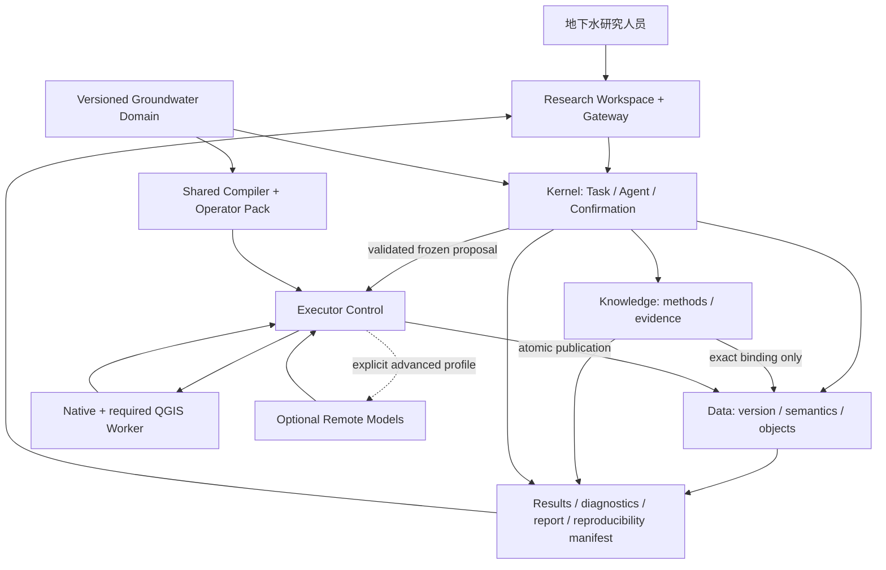

# 09 最精简合理的目标架构

**采用一个研究工作台、一个交互编排核心、三个保留独立所有权的能力服务，加静态地下水领域包。先保持现有物理边界，缩小默认能力集合。** 六个逻辑职责不对应六个新服务，也不新增Research/Report/Quality微服务。[E01/E03/E10/E21/E50]

## 六个逻辑职责及物理落位

| 逻辑职责 | 目标职责 | 物理落位与复用 | 不进入默认路径的内容 |
|---|---|---|---|
| Research Workspace | 问题、目标、资料、方案、确认、结果、复核 | 现有Web+Gateway；Data/Knowledge管理页按角色开放，共用组件 | 通用GIS编辑、所有运维参数、算子海量目录 |
| Agent Intelligence | 有界意图/上下文/取证/方法选择/澄清、Task和确认 | 现有Kernel；Router暂同进程保留；一份准备validator | 多Agent群、重复校验实现、全模型长schema常驻 |
| Data | 原始/派生字节、DatasetVersion、SemanticRevision、查询/预览、原子发布/血缘 | 独立Data API+worker+PG/object store | 默认MLOps实验/registry/alias和外部治理集成 |
| Knowledge | 正式方法/卡片/来源、精确证据读取、生命周期/Data binding | 独立Knowledge API+worker+PGvector；保留lexical降级 | Demo默认召回、无边界RAG、多重检索模型堆叠 |
| Groundwater Domain | 监测profile、方法适用规则、模型/Workflow/算子选择、专业验证基准 | 版本化静态包+Product Manifest；复用compiler/operator-pack | 作为常驻服务；无需数据库/独立调度器 |
| Execution & Research Results | 冻结执行、恢复/取消、诊断、成果发布、最小报告/复现清单 | 独立Executor+必要workers；结果字节仍Data拥有；解释由Kernel和Workspace交付 | 第二成果数据库、通用MLOps训练平台、无边界Workflow Engine |

保持独立：Data、Knowledge、Executor的状态和服务接口；Kernel与网关职责；不同依赖域的Worker。可以合并：UI共用目录/预览/错误处理、Domain机械说明生成、准备校验函数、同轮精确元数据读取。可以共用：protocol-contracts、compiler、已存在quality/table算子与report发布链。

## 三条默认路径

1. **咨询**：问题→必要的正式知识→引用与限制；不自动创建计算计划，不找不存在的项目数据。
2. **监测研究**：资料→专业语义/质量→趋势或空间方法→冻结确认→执行→检查诊断→解释/报告→用户复核。
3. **高级研究**：明确启用的专业模型→模型包/环境/方法成熟度→同一准备、确认、发布和复现边界；不复制第二执行框架。

核心能力建议为summary、monitoring-trend、flow-field、kriging、monitoring-coverage、render-map；规则分类/DRASTIC为按需专题。水源地综合评价和Porous仿真率定按证据成熟度显式选择；GRU和三种Porous反演保留实验入口；MODFLOW/Pastas继续独立spike。当前没有完整的能力profile切换合同，A10需新装配声明，不能假称只改一个现成开关。

## 最小专业准备合同

保留DataVersionRefV2。Domain声明每项前提的物理量/字段/单位/CRS/基准/层位、重要性、证据身份和可接受假设；Kernel使用单一纯校验逻辑产生“通过/必需缺项/明确冲突/允许的情景假设”。确认冻结验证回执摘要及对应data/model/arguments身份。

数据版本/参数/语义改变或用户要求CURRENT_REQUIRED时重新验证。Executor仍复核字节、输入身份和受信执行合同；不要跨服务重新实现一套领域推理。专业报告将声明前提和计算后诊断分开，`SUCCEEDED`只代表执行/发布成功。

## 部署替代方案比较

| 方案 | 改造成本/风险 | 适用结论 |
|---|---|---|
| 保持服务，减默认能力/重复规则 | 最小；合同局部演进，回滚容易 | **推荐近期实施**；先取得真实调用/资源基线 |
| Data/Knowledge共置数据库宿主，分database/roles | 中；备份/故障域/权限/pgvector资源需重验 | 实测内存/运维负担足够大时再做；逻辑owner不合并 |
| Kernel+Data+Knowledge+Executor单体重写 | 高；版本迁移、权限、取消/恢复、沙箱和依赖全重验 | 当前收益证据不足，不推荐作为减负第一步 |
| 用lightweight-agent-core替换Kernel | 高；无现有服务/授权/发布兼容保证 | 另交付面不是现成迁移方案，保留独立 |

研究部署可以仍有多个容器：API/worker/数据库/一次性初始化不是新产品模块。是否减少进程必须以资源实测决定。QGIS当前承担coverage节点；未完成native几何等价验证前，不得称其可直接从核心安装移除。

## 必须补强而非降级的保证

必需科学前提、版本/权限/确认、Data原子发布、取消与不确定提交恢复、知识身份/来源、运行失败可见、计算诊断和报告复现。精简只减少重复实现/无关默认入口，不降低这些保证。没有新服务能自动补齐这些保证，优先复用现有合同和发布渠道。
