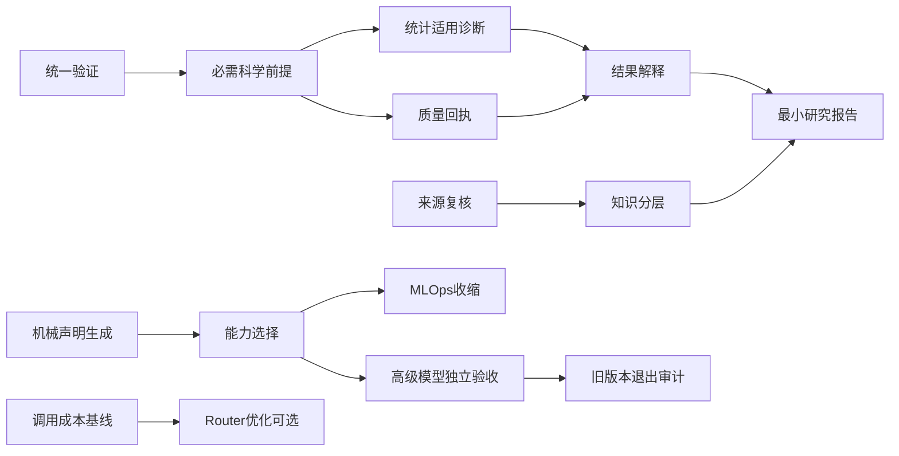

# 10 最小改造路线

本轮仅评估。以下顺序是待审批的实施方案；未删除、迁移、改库、改知识或重构生产代码。完整任务、范围和验收在11。

## 阶段0：固定基线与可信性缺口

先保留本评估源码/测试基线；实现A01统一准备/提案验证，A02明确必需专业条件。A03补趋势适用诊断与限制输出。优先新增负例和跨入口一致性测试，证明缺项、冲突、用户修订和旧证据不会进入可批准执行。

出口：直接工具提案、显式prepare、参数修订、组合Workflow均无法绕过相同前提；既有PINNED历史运行可复现，CURRENT_REQUIRED保持原意；未改变发布/取消/权限保证。影响合同的字段或行为必须版本化发布，不原地覆盖6.2.0定义。

## 阶段1：先完成核心研究交付

A04把专业质量结果绑定可验证执行回执；A05读取结果诊断并区分完成通知与科学解释；A06提供最小版本化研究报告/复现清单。同步A07来源核验、A08演示知识分层、A18文档与实际版本对齐。

最小验收案例：一份明确授权、带单位/基准/时区/井层位的监测表，完成趋势与空间方法选择→确认→真实执行→诊断→引用→报告；任何缺项能够解释并停在正确阶段。合成案例用于边界，独立实测案例用于科学验证；两者分开记录。

出口：用户可从报告追到每张图、每个结论、输入/语义/模型/参数/知识和质量限制；换一个环境可按清单重跑。不要在报告之前新增通用报告服务或工作流引擎。

## 阶段2：默认产品减负

A09生成模型机械说明；A10定义核心/专题/高级/实验能力选择；A11先审计MLOps使用再收默认入口；A12量测并合并同轮重复读取；A14收Plan重复文案；A15抽UI公共部件。A13只有在真实测量显示Router成本足够大时才调整路由。

出口：普通监测任务无需配置Porous、Torch训练、全部算子或MLOps；外部远程不就绪只影响启用的能力；默认主链依然保留必要QGIS，直到A19有等价替代。所有快照/事件/确认/下载可回归。

## 阶段3：高级能力独立验收

A16统计/空间独立基准；A17 Porous数值/现场研究验收；A19局部工具职责去重；A20迁移学习案例与最小回测分离；A21按明确需求决定spike晋级；A22独立轻量包owner/发布检查；A23历史引用与退出审计。A24物理部署共置仅为有测量依据后的备选。

出口：高级能力清楚声明输入合同、外部资产身份、依赖、数值/现场验证状态和失败模式。达到验收才进入核心；实验成功不自动扩大产品承诺。

## 依赖与回滚

先采用新Domain/Product版本和旁路可选配置；不迁数据即可完成多数阶段0–2任务。涉及新合同的实现必须同步schema/client/UI/测试，保留旧公开身份和历史结果读取。需要真正删除或合库时另有迁移计划、快照恢复和兼容验证；不能用“回滚代码”代替数据库回滚策略。

## 成本与范围控制

没有团队规模/运行量/维护工时证据，不给伪精确排期。优先按依赖分批，每批只解决一条可验收研究链或一个重复职责。首批避免改变物理部署和已有四owner数据库；中期避免开发额外Agent/RAG/MLOps平台；后期不因为有算子就自动增加产品场景。

批准顺序建议：先A01–A03，再核心交付A04–A08；随后结合测量选择减负任务。批准某项时应明确冻结合同和验收案例，不能将本报告视作所有未来改动的授权。
