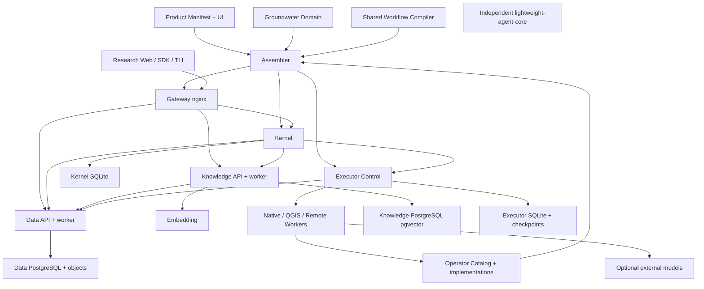
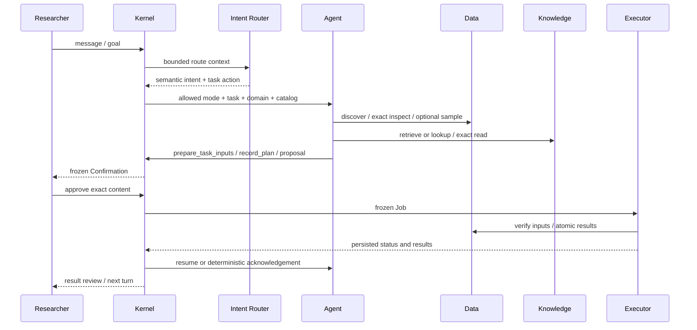
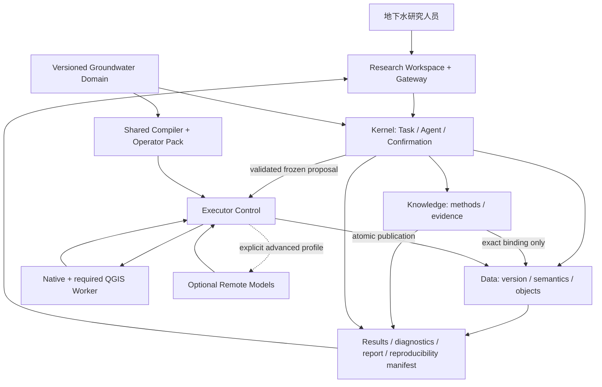
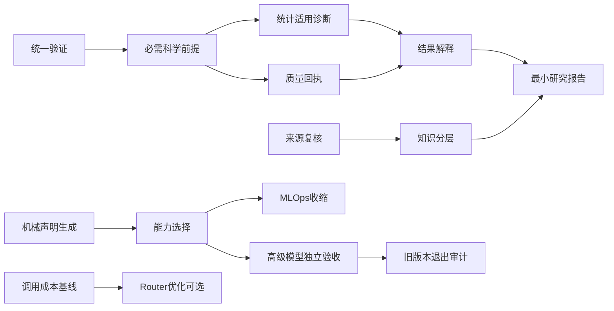

# Groundwater Agent 全仓库产品定位与架构评估（整合版）

评估日期：2026-11-14（Asia/Shanghai）。源码基线：`e6d8512797a128887cf2bab41a92629ddb06b668`。状态：评估完成，实施待审批。

本文件完整整合原25份Markdown报告，统一章节和文内导航。源码链接、原始日志与机器可读清单保留为溯源附件；测试结论沿用原评估记录。

<a id="assessment-overview"></a>

## 评估总览与九个核心问题

评估日期：2026-11-14（Asia/Shanghai）。源码基线：`e6d8512797a128887cf2bab41a92629ddb06b668`。状态：**评估交付，等待审批；未实施重构。**

### 先回答九个问题

1. **究竟是什么产品？** 面向地下水科研人员与专业技术人员的任务型研究工作台：自然语言提出问题，利用明确版本的数据、专业方法和可追溯执行交付研究结果。当前已经实现该链条的工程骨架和若干分析方法，尚不能称为完成全科研流程的自主研究Agent。正式产品证据仍以可信单机/小型实验室为中心。见[产品定位](#product-positioning)，E01–E04。
2. **核心科研工作是什么？** 监测资料整理与语义核实、统计和变化分析、空间水头与简化流场、结果解释及可追溯交付。规则分类/DRASTIC是专题能力；复杂模拟、率定和反演应由高级用户按需启用。它们都服务研究任务，GIS、RAG、MLOps和通用工作流不是产品目标。见[六条业务主线](#core-business-capability)。
3. **当前系统是否围绕这些工作组织？** 部分是。Domain选择模型，Agent取证并生成确认，Executor执行和恢复，Data原子发布，Web审阅；权威身份与执行链较明确。欠缺集中在“科研前提是否成立”和“文件产生后是否回答研究问题”。高级/实验能力、固定案例和独立轻量Agent交付面又增加了维护范围。见[Agent评估](#agent-assessment)，E30–E36/E49/E52。
4. **哪些模块没有足够产品价值？** 没有证据支持立即删除任何完整服务。Data内通用实验/模型注册/alias治理，固定19输入深度学习案例，Porous窄形状学习反演，以及独立lightweight-agent-core，都缺少成为核心默认路径的充分依据；真实外部使用量UNKNOWN。应先隔离默认入口、明确owner和使用证据。见[模块减负](#module-simplification)。
5. **哪些能力重复建设？** 显式prepare与提案边界维护两套不等价检查；同一模型的机械参数/输出在Manifest、instructions、card和UI重复维护；取证/准备有重复描述和样本查询；多个前端存在可复用行为。Dataset/Version/Semantics、Data/Knowledge、Task/DAG、Kernel/Gateway则承担不同职责，不宜按名称相似合并。见[去重决策矩阵](#redundancy-decision-matrix)。
6. **哪些功能应该收缩？** 收缩默认加载的高级/实验模型、纯Demo检索范围、MLOps默认入口、冗长计划文字与重复说明。保留用户批准、精确版本、证据读取、沙箱、执行恢复和原子发布。旧版本/未引用算子先查历史消费者，不依据引用数删除。见[领域能力评估](#domain-workflow-assessment)。
7. **哪些地下水科研能力不足？** 必需单位/垂向基准/井层位及观测状态的强制前提；质量检查执行回执；统计显著性与自相关/季节/采样前提的联动；独立数值和现场验证；来源精确定位；读取数值诊断后的解释和最小可复现报告。完整水量平衡、井试验、水化学/检出限等不是当前闭环，也不应一口气全部新增。见[Data](#data-assessment)、[Knowledge](#knowledge-assessment)。
8. **最精简合理的系统架构是什么？** 保留现有Kernel、Data、Knowledge、Executor四个状态所有者，以及薄Gateway和研究工作台；Groundwater Domain保持版本化声明/方法集合，Agent Intelligence先仍归Kernel。六个逻辑职责不变成六个新服务。远程模型按需部署，核心路径优先复用现有算子和合同。见[目标架构](#target-architecture)。
9. **如何以最小改造成本实现？** 先A01统一准备/提案检查，A02约束关键物理前提，A03补统计适用性；随后闭合质量、解释、报告和知识分层；再按实际测量缩工具/重复读取/默认能力。多数任务不需要先迁库、迁仓或重写服务。见[改造路线](#refactoring-roadmap)和[24项实施任务](#implementation-roadmap)。

### 最需要先处理的证据

**确认前的科研输入验证并不统一。** 在无显式`prepare_task_inputs`的合成工具轨迹中，来源高程单位为ft、提案参数为m，`prepare_interruption`仍返回一个Action及READY，检查仅含DATA_IDENTITY。纯函数探针已复现；没有调用真实Provider、服务或数据库，也不代表可以绕过用户授权。即使显式prepare，部分关键缺项仍以UNKNOWN进入READY。这使“执行可追溯”不能直接等同于“研究前提有效”。[源码与调用链E32/E33](#source-index)，[探针结果](/home/mtd/liweigis/workflow/groundwater-v6/plans/repository-assessment/evidence/preparation-boundary-probe.json)。

### 本轮重算与验证

| 范围 | 当前事实 | 不可据此推断 |
|---|---|---|
| 仓库 | 2,139个已跟踪文件；完整文件/符号/测试定义索引 | 不表示逐行完成所有代码的形式化证明 |
| 当前Domain 6.2.0 | 18模型、18Workflow、1Execution Case、7Observation Tools | 不等于18个独立成熟科学模型 |
| 算子 | 113版本条目、111个ID；native86/qgis15/remote_http12；54条目被当前Workflow引用 | 其余59条目不是自动删除对象 |
| 当前知识 | 9资产、121文档、321单元、44个唯一sourceId | 声明和引用完整不等于正文科学认证 |
| 测试静态盘点 | Python测试定义2,131个/254文件；JS/TS测试文件68个 | 定义数不是参数化收集数或通过数 |
| 根pytest收集 | 2,287项，仅收集 | 不含所有独立包/算子/第三方测试套件，未全量执行 |
| 本轮选定执行 | 495项合同/准备等检查最终通过，另45项算子检查通过，共540项；两项环境设置问题修正后重跑通过 | 不是全套发布验收、真实服务端到端或现场科学验证 |

详见[测试证据与失败记录](#test-evidence)、[审计覆盖与限制](#audit-coverage)。未核实的使用量、活动数据库状态、实际召回质量、真实场地准确度一律UNKNOWN。

### 阅读入口

上述00–11为主体。另提供以下可核查附件：

- [逐模块仓库盘点](#repository-inventory)、[源码/符号/合同/测试/调用链索引](#source-index)。
- [全部算子分类](#operator-matrix)、[全部模型与Workflow](#model-workflow-matrix)、[全部当前知识文档与来源](#knowledge-inventory)。
- [算子源码与测试导航](#operator-test-index)、[模型/工作流/知识卡/测试连接](#model-evidence-detail)。
- [外部一手来源抽查](#external-references)、[进度](#assessment-progress)、[评估决策](#assessment-decisions)、[风险与未知项](#assessment-risks)。

证据等级始终分开：**源码实现 / API公开 / Manifest声明 / 测试通过 / 真实运行验证 / 科研结果验证**。本报告是评估和待审批方案，不授权修改任何生产代码、数据库、知识资产或公开合同。本轮到此交付并停止。

<a id="contents"></a>

## 全文目录

- [评估总览与九个核心问题](#assessment-overview)
- [00 产品定位](#product-positioning)
- [01 仓库完整盘点](#repository-inventory)
- [02 核心业务能力](#core-business-capability)
- [03 Data评估](#data-assessment)
- [04 Knowledge评估](#knowledge-assessment)
- [05 Agent评估](#agent-assessment)
- [06 Domain、Workflow与Operator评估](#domain-workflow-assessment)
- [07 系统减负](#module-simplification)
- [08 去重决策矩阵](#redundancy-decision-matrix)
- [09 精简目标架构](#target-architecture)
- [10 最小改造路线](#refactoring-roadmap)
- [11 实施任务矩阵](#implementation-roadmap)
- [附录A 源码、合同、测试与调用链索引](#source-index)
- [附录B 测试证据](#test-evidence)
- [附录C 审计覆盖与限制](#audit-coverage)
- [附录D 全部模型、Workflow与执行案例](#model-workflow-matrix)
- [附录E 模型、工作流、知识卡与测试连接](#model-evidence-detail)
- [附录F 全部算子分类与处置](#operator-matrix)
- [附录G 算子实现与测试导航](#operator-test-index)
- [附录H 全部知识资产与来源](#knowledge-inventory)
- [附录I 外部一手来源抽查](#external-references)
- [附录J 评估进度](#assessment-progress)
- [附录K 评估决策](#assessment-decisions)
- [附录L 风险与未知项](#assessment-risks)

---

<a id="product-positioning"></a>

## 00 产品定位

原报告：`00_PRODUCT_POSITIONING.md`。

评估日期：2026-11-14（Asia/Shanghai）。源码基线：`e6d8512797a128887cf2bab41a92629ddb06b668`。本文件先作为评估基准建立，最终结论随调用链核验完善；没有把历史验收当作本轮验证。

### 产品是什么

**Groundwater Agent 应定位为面向地下水科研人员和专业技术人员的任务型研究工作台：以自然语言提出问题，以明确版本的数据、专业方法和可追溯执行交付分析结果。当前实现是该定位的部分实现，而非已经完成全部地下水科研能力的自主科学家。**

README 的正式名称是“地下水领域分析系统”；当前产品面向可信单机和小型实验室。自然语言、Data/Knowledge 取证、确认、固定 Workflow 和白名单内有限组合执行、成果浏览的链条均有源码；科研适用性判断、真实现场验证、独立科学复核和完整论文级成果交付仍不能由这些工程机制证明。候选定位适合作为目标，但“数据准备”“方法选择”“专业模拟”“科研成果交付”需分别注明成熟度。[E01–E04、E10、E20、E30、E40，见 evidence/SOURCE_INDEX.md]

源码可支持的当前描述：**使用版本化数据和声明式地下水方法，辅助完成监测统计、简化流场和空间分析、规则评价及可审计的研究执行；提供需额外验证的远程模型和固定迁移学习案例。**

### 用户与场景

| 用户 | 核心需求 | 当前证据与边界 |
|---|---|---|
| 核心：实验室地下水研究人员、监测分析技术人员 | 清理/核实监测数据，趋势、变化、空间水头，获取可追溯图表 | monitoring-trend、flow-field、summary、kriging、Data 语义和成果界面；现场运行本轮未验证 |
| 次要：项目负责人、成果复核者、数据管理员 | 核对版本、来源、参数、权限、结果及归档 | admin/researcher/viewer 成员权限、Confirmation、Task review、Data/Knowledge 管理页；不是企业跨组织治理平台 |
| 高级科研用户：数值模型与评价专家 | 准备模型包、边界条件、率定、情景、规则和不确定性解释 | Porous 远程合同、DRASTIC、规则分类；专业输入仍需用户提供，不能以服务接通推定有效 |
| 实验性用户：方法研发者 | 迁移学习、条件扩散反演、农业抽水反演、MODFLOW/Pastas 探索 | 固定 19 输入案例、Porous 扩展和 product spikes；应独立于默认研究入口 |

这是根据功能和交互推断的用户分层，**真实用户规模、使用频率、满意度和付费需求为 UNKNOWN**，仓库不能证明市场事实。

### 科研业务边界

| 业务 | 产品地位 | 当前成熟度 |
|---|---|---|
| 地下水数据管理与分析 | 核心 | 源码已实现；科研适用性仍需语义及现场资料 |
| 监测统计与变化分析 | 核心 | 有可执行 Workflow、多个统计算子及专门测试；完整预测/因果分析不成立 |
| 空间水头与简化流场 | 核心 | 有水头计算、时点选择、IDW、梯度和 Darcy 简化链；不是数值地下水模型 |
| 地下水资源评价 | 专业专题 | 可接综合评价与准备工具；完整含水层水量平衡和资源评价业务闭环不足 |
| 数值模拟、参数反演及情景分析 | 高级能力 | Porous 已装配远程调用；独立 MODFLOW6/FloPy spike 不能计为默认可用模型；现场科学验证 UNKNOWN |
| 水质与污染研究 | 专业专题 | 规则分类、DRASTIC、远程运移子集；不是完整水化学/污染风险评价平台 |
| 结果解释与科研交付 | 核心 | 结果数据、图表、地图、证据和归档骨架已实现；完整报告产品化仍需补强 |

GIS、Data、Knowledge、Workflow 和模型服务于上述任务。产品不应扩张成传统 WebGIS、通用 GIS 桌面、普通聊天机器人、通用 RAG、通用 MLOps 或无边界 Workflow Engine。通用机制只有在支持这条研究链时才有默认产品价值。独立 lightweight-agent-core 交付面单独计成本，不冒充当前产品运行依赖。

### 核心用户旅程

“实现状态”和“验证状态”是两个维度；有源码不等于真实运行或科研验证。

| 步骤 | 实现状态 | 依据 | 验证状态/限制 |
|---|---|---|---|
| 1 提出研究问题，建立 Session/Task，明确目标 | 已实现 | message_requests、intent_routing、task tools、Web conversation | 有测试；本轮定向检查见 TEST_EVIDENCE，真实 Provider 体验未验证 |
| 2 发现/上传资料，绑定精确版本与字段 | 已实现 | Data catalog/discovery/ingestion、prepare_task_inputs | 文件身份可核查；实际场地元数据完整性未验证 |
| 3 检查物理意义、单位、CRS、基准与时空适用性 | 部分实现 | semanticRequirements、TaskPreparation、领域 instructions | 有执行门禁；自动检查的范围和 UNKNOWN 见 03/05 |
| 4 选择方法、解释假设及限制 | 部分实现 | 模型声明、9 个知识资产、检索与精确读取 | 能提供依据；专家等价判断及独立方法优选未验证 |
| 5 准备/冻结计划，确认参数和输入 | 已实现 | AgentPlan、AgentAction、Confirmation | 身份/授权测试不代表方法有效性 |
| 6 执行、恢复并原子发布成果 | 已实现 | Executor DAG、Worker、Data publication | 本轮不启动服务，不重跑现场/远程完整链 |
| 7 解释数值结果、局限及质量 | 部分实现 | result viewers、submit_reply、model cards、结果诊断 | 某些模型有数值/合成测试；不得统一标为科学已验证 |
| 8 审阅、下载、引用、复现和报告 | 部分实现 | Task review、具名 RESULT、research package/archive | 结果链已实现；通用报告编排和现场独立复现不足 |

### 后续统一判断标准

1. 保留完整性、权限、精确身份、失败可见、授权和复现边界；不能为了少模块破坏可信性。
2. 默认用户路径优先监测数据→质量/语义→统计/空间分析→解释→交付。
3. “未被当前 Workflow 引用”只能触发用途调查，不能直接作为删除依据。
4. 重复的是事实所有权、规则和状态维护，而非所有名称相似的对象；具体结论必须有调用链和测试。
5. 先补科研正确性和交付缺口，再减默认入口与重复维护；避免先重写系统。

---

<a id="repository-inventory"></a>

## 01 仓库完整盘点

原报告：`01_REPOSITORY_INVENTORY.md`。

基线及成熟度定义见 README。统计由 `evidence/reproduce_inventory.py` 读取当前 Git 跟踪文件重新产生，不含 node_modules、缓存、外置运行数据及本评估目录。全部文件身份见 `evidence/files.json`，全部 Python 类/函数行号见 `evidence/SYMBOLS.tsv`。

### 实际规模

| 范围 | 当前数值 | 含义 |
|---|---:|---|
| Git 跟踪文件 | 2,139 | 含代码、声明、锁、测试、文档和第三方封装 |
| Python test_* 函数定义 / 文件 | 2,131 / 254 | AST定义数，不是参数化测试数或通过数 |
| JS/TS test/spec 文件 | 68 | 含单元和浏览器测试，不能等同68测试 |
| 根 pytest 实际收集 | 2,287 | 当前环境 collection 通过；不含所有独立包/Native/第三方套件 |
| 活跃 Domain / 历史 Domain | 6.2.0 / 6.1.0 | Product仅选择6.2.0；旧版本不是默认运行能力 |
| 模型 / Workflow / Execution Case | 18 / 18 / 1 | Case为19输入腰站堡；不是18种独立物理模型 |
| 算子版本 / 唯一ID / Workflow引用版本 | 113 / 111 / 54 | native86、qgis15、remote_http12；两ID各有两个版本 |
| Product组合白名单 | 10 | 表格/栅格有限组合，不是任意代码执行 |
| 知识资产 / 文档 / unit | 9 / 121 / 321 | 独立知识ID121；不是当前数据库已导入数量 |
| 公共HTTP合同 paths / operations | 97 / 109 | 解析 public-api-v12.json；非运行可用性 |
| 非generated/非tests代码文本行 | 172,761 | .py/.ts/.tsx/.js，仍含脚本和少量命名式测试；只作维护体积代理 |

Kernel目录262,276文本行中包含大体积合同JSON，不能当作262k手写业务代码。模块文件/行数的原始口径在 inventory.json；成本判断结合所有权、依赖和测试负担，未虚构人月或运行费用。

### 模块职责、接口及成本

下表测试项均为源码关联；运行结果另见 TEST_EVIDENCE。价值/成本为本评估判断，并非实际使用率。

| 路径 | 职责、输入→输出 | 依赖及使用者 | 数据所有权 / API | 测试与产品价值 / 成本 |
|---|---|---|---|---|
| `source/kernel` | 消息/目标→Task、Plan、确认、WorkflowRun、回复 | Agent SDK/Provider、HTTP clients、compiler；Web/TLI/SDK调用 | SQLite34：交互、身份、授权、编排；API v12 | kernel/tests572函数；核心价值高，状态/恢复/Provider维护成本高 [E30–36] |
| `source/services/gateway` | HTTPS/HTTP边缘、静态前端、认证转发 | nginx、Assembler；所有浏览器请求 | 无业务存储；唯一北向入口 | topology/身份合同；价值高、运行逻辑小；不能按名字视作第二Kernel [E03] |
| `source/services/data` | 文件/语义→版本、对象、查询、发布、lineage；附质量/MLOps | PostgreSQL、DuckDB、Arrow、沙箱；Kernel/Executor/Knowledge/UI使用 | PG8及objects；data-http-v3、data-tools-v4 | tests86函数；核心高，扩张的治理台账增加成本 [E10–16] |
| `source/services/data/client` | 类型化HTTP访问 | httpx/生成合同；Kernel/Executor等 | 无权威业务数据 | wire checks；复用价值高，生成代码不手工去重 |
| `source/services/data/web` | 资料目录、语义编辑、查询、预览、发布界面 | React/shared UI/Data API | UI暂态；Data仍权威 | 单元/E2E存在；管理员有价值，与主站资料面板有复用空间 |
| `source/services/knowledge-next` | 预分块知识包→索引、Evidence、回执 | PG/pgvector、Embedding、Data精确绑定；Agent/UI调用 | PG7：知识版本、生命周期、检索回执；HTTPv3/tools-v5 | tests75函数；证据价值高、检索机制已相对克制 [E20–24] |
| `source/services/knowledge-next/client` | 类型化检索/精确读取 | HTTP、生成合同；Kernel/脚本 | 无独立知识权威 | 功能合同；保留 |
| `source/services/knowledge-next/ui` | 上传、目录、绑定、检索、生命周期 | React/shared UI/Knowledge API | UI暂态 | UI测试；普通研究者入口可收缩，管理能力保留 |
| `source/services/executor` | 冻结模型/组合图→Job、节点、持久产物与Data发布 | compiler/operator-pack、Data client、native/QGIS/remote workers | SQLite9、对象checkpoint；Execution v6/Worker v3 | tests120函数；核心高，隔离/恢复复杂度必要 [E50] |
| `source/services/executor/client` | Job请求与状态查询 | HTTP/共享协议；Kernel | 无执行权威 | wire/schema测试；保留 |
| `source/packages/operator-pack` | 版本化算子及smoke；输入artifact→artifact/value | 科学计算native、QGIS、remote接口；Worker/compiler消费 | 不拥有数据目录；临时输出交Executor | 420文件、93测试函数；默认科研与大量辅助算子共包；需按场景分层 [E40–47] |
| `source/packages/workflow-compiler` | 端口、DAG、语义、组合校验→冻结定义 | 共享合同；Assembler/Kernel/Executor共同使用 | 无业务状态；workflow.v6/v7、composition合同 | 50测试函数；复用优于三处重写；扩张边界需控制 [E54] |
| `source/packages/protocol-contracts` | DataVersionRefV2/JobRequest等跨服务类型 | Kernel/Executor/client | 无状态；wire唯一来源 | 24测试函数；必要合同层 |
| `source/packages/embedding-client` | 有限Embedding HTTP调用 | Knowledge/评测 | 无正文权威 | 13测试函数；小而必要 |
| `source/packages/groundwater-api-client` | Public v12 SDK | 用户脚本/TLI/自动化 | 无业务状态 | SDK合同；保留，历史文件名v11不代表现行API |
| `source/packages/ui-boundary` | UI权限、边界公共代码 | 三个Web workspace | 无业务状态 | 各Web边界测试；适合小型复用 |
| `source/packages/operator-ui` | 算子UI公共表达 | Web及组合图相关UI | 无执行状态 | UI合同；保持按需，不发展GIS桌面 |
| `source/packages/lightweight-agent-core` | 独立嵌入式Agent、journal、workflow、CLI | 自有lock/verification；非Groundwater Compose运行依赖 | 独立本地状态，不共享Kernel库 | 164文件、419测试函数；第二交付面，不能拿来无成本替换Kernel [E52] |
| `source/domains/groundwater` | 指令/模型/Workflow/知识/Case定义 | Product选择；Assembler校验 | 不可变发布身份；domain-manifest.v3 | domain/model合同；核心专业所有者；旧6.1需历史引用审计 |
| `source/products/groundwater` | 服务选择、UI、远程绑定、产品API、研究spikes/案例 | Domain/Assembler、外置资料 | 产品声明及研究包；非服务数据库 | 56文件、22测试函数；需收缩spike默认呈现 [E01/E48] |
| `source/platform/assembler` | Manifest→Kernel/Executor/nginx/Compose/UI配置 | compiler、module manifests、catalog | 外置可重建bundle；不拥有业务状态 | assembler tests；必要静态装配，不应变插件市场 |
| `source/web` | Session/Task/Turn/WorkflowRun、资料与结果展示 | API v12、Data/Knowledge、viewer库 | 本地草稿/队列/界面状态；后端权威 | 286文件；UI单元/E2E存在；三端重复展示可合并 [E51] |
| `source/environments`、根lock | native/QGIS/common/testing及Node兼容域 | 构建/worker/checks | 无业务数据；锁定依赖 | 依赖/Native门禁；保留隔离，不强求同一Python环境 |
| `source/scripts`、`bin` | 开发、装配、检查、XDG生命周期、迁移/归档 | 所有服务/工具链 | 只按明确生命周期操作；用户入口gw/dev | 158脚本文件；运维必要，科研用户不应被迫面对全部命令 [E53] |
| `source/schemas`、`source/docs`、`plans` | 操作合同、当前说明、计划 | 实现/测试应共同校验 | 不构成运行事实 | 已有文档漂移，宜生成能力事实、减少重复叙述 |
| `source/tests` | 跨服务/合同/架构/CLI/E2E | 隔离夹具/可选容器 | 测试临时态 | 606测试函数；不等价606科学验证 |
| `third-party-services/porous-groundwater-linux-service` | 外置原包/求解器Linux构建和remote封装 | 外置vendor、Fortran、PEST/NWT/MT3D、Torch | 远程队列和数值运行；remote-operation.v1 | 15测试函数+独立science脚本；维护成本高、科学适用范围窄 [E46] |
| `third-party-services/groundwater-sustainability-service` | 指标评分和异步remote服务 | FastAPI及自身存储 | 远程评价状态；非Data目录 | 36测试函数；专题价值、规则来源需复核 [E47] |

### 不存在独立顶层目录的职责

仓库没有单独的 `database/knowledge/data/operators/workflows/deployment/configuration` 权威根。数据库DDL分布在各owner；知识/Workflow位于Domain；算子位于operator-pack；部署由Assembler、Dockerfile、Compose和scripts生成；配置schema、manifest、lock留在source，实例字节和密钥按XDG在仓库外。未读取活动数据库、密钥或私有研究载荷，不能因此宣称其完整或安全。

### 实际依赖图



图中HTTP依赖不是Python跨服务内部导入。Research脚本中直接引用Knowledge models属于产品离线辅助面，需在后续复用评估中区分，不应把它推广成服务间共享数据库。

---

<a id="core-business-capability"></a>

## 02 核心业务能力

原报告：`02_CORE_BUSINESS_CAPABILITY.md`。

以00的研究工作台定位为准。**优势是版本化执行和若干专业分析链，缺口是专业适用门禁、默认业务聚焦、系统性科学验证和成果解释交付。**所有表中的“有测试”表示测试源码存在；本轮通过项、环境及未运行项必须查 TEST_EVIDENCE。现场科研结论统一为 UNKNOWN，除非有对应场地、输入版本、方法、基准和复核证据。

成熟度：D=Manifest声明，S=源码实现，A=公开/内部API，T=本轮定向测试，R=本轮完整真实服务运行，V=独立科学验证。D/S/A不能自动递推到T/R/V。

### 业务一：地下水数据管理与分析

| 能力/当前可用范围 | 依赖/算子/Workflow | 数据和知识前提 | 测试/科学验证 | 缺口与判断 |
|---|---|---|---|---|
| 上传、目录、版本、对象、原子发布、下载（S/A） | Data ingestion/catalog/publication；summary | 精确文件、格式/转换、授权、DatasetVersion | Data服务测试；本轮未运行DB集成 | 基础闭环完整，保留；不要新增第二数据目录 [E10–16] |
| 字段语义、单位、CRS、垂向基准（S/A） | Semantics/FieldMeaning→prepare_task_inputs | 必须由来源声明/复核，不能凭列名猜测 | preparation定向测试及探针 | 缺项可能READY；提案路径可能不调用同一检查，P0 [E32/E33] |
| 质量、查询、预览（S/A） | DuckDB/preview worker、table.validate/profile | 文件质量与科研质量分层；CSV默认string | 质量/服务测试存在 | 自动专业适用检查及质量执行回执串联不足；5行样本不证明全量质量 |
| 版本/血缘（S/A） | Data lineage、OpenLineage、publication | 固定上游input_versions、参数和方法版本 | publication/recovery tests | 核心应保留；外部outbox为可选集成，非主业务必需 |

### 业务二：地下水空间和流场分析

| 能力 | 模型/Workflow/算子 | 必需数据与知识 | 测试/科学验证 | 缺口 |
|---|---|---|---|---|
| 计算水头、同步/准同步快照、IDW、梯度及简化速度（D/S） | flow-field 5节点：head.calculate→snapshot→idw→hydraulic_gradient→darcy_velocity | 井/时间/XY、高程-埋深、共同垂向基准、同含水层、米制投影、K/有效孔隙度；Darcy假设 | 合同+算子定向测试通过；部分使用栅格测试替身；R/V UNKNOWN | 不处理各井基准随时间变动、屏段/含水层强制一致性；IDW到梯度传播不确定性不足 [E42] |
| Kriging及诊断（D/S） | kriging：Ordinary/平面漂移Universal；5结果 | 点位/量纲、变异函数/邻域；至少4个唯一点、漂移矩阵秩 | 定向算子/合同测试；有LOO/IDW对照 | 条件方差不是完整置信区间；外部空间验证、参数不确定性仍不足 [E43] |
| 监测覆盖（D/S） | dissolve→convex_hull→convert | ≥3唯一非共线井；CRS | 几何/合同测试存在 | 凸包只是几何覆盖，不能替代含水层边界、代表性或优化布井 |
| 地图交付（D/S） | render-map / cartography.render-png | 精确GeoJSON/GeoTIFF版本、单位/标题 | 定向算子测试 | 单文件PNG；多图层科学版式、比例/图例完整表达须按成果需求补足，不发展通用WebGIS |

### 业务三：地下水统计和变化分析

| 能力 | 模型/算子/Workflow | 前提 | 测试/科学验证 | 缺口 |
|---|---|---|---|---|
| 趋势与稳健变化率 | monitoring-trend：linear_trend、mann_kendall含Sen斜率 | 同一观测量、时间/时区、抽水/测量变化说明 | 定向合同；函数实现可查；独立标准库多工况对照不充分 | 常规p值未接自相关适用门禁；多井多检验无统一策略 [E41] |
| 突变、季节、缺测、阈值 | Pettitt、seasonal_MK、gap_runs、threshold_events；默认趋势共10节点 | 季节和阈值显式启用/设定，窗口一致 | 合成突变/缺测/开关测试本轮通过 | 检验显著≠物理成因；无自动传感器更换/基准事件融合 |
| 自相关/互相关/季节异常 | catalog已有单独算子 | 规则时间轴、缺测/采样策略、足够样本 | 合同/smoke存在；未在本轮逐一执行 | 已实现但未接默认Workflow，不应删；应先形成方法适用诊断 |
| 预测 | GRU迁移学习；Pastas独立spike | 19项固定案例输入或独立单井应力资料、训练/验证冻结 | 单步回测语义测试通过；真实训练及独立验证未跑 | 单步回测不是未来递归预测；不能宣称通用预测闭环 [E45/E48] |
| 不确定性 | Kriging方差、统计量、个别模型限制文本 | 明确误差来源、验证集、适用范围 | 局部测试 | 缺统一观测/参数/结构/情景不确定性报告；优先补诊断而非增加模型 |

### 业务四：地下水数值模拟与参数研究

| 能力 | 实际实现/Workflow | 前提/依赖 | 测试与科学验证 | 评估 |
|---|---|---|---|---|
| Porous流动与运移 | compile→simulate→analyze→render，remote_http | 外置原包及Linux NWT/MT3D/本地AFC、模型ZIP、层网格和边界 | remote合同测试；science/AFC脚本存在，未本轮运行 | 高级专题；现场等价UNKNOWN；AFC不是原版复刻 [E46] |
| PEST率定 | compile→pest_calibrate1.1→simulate | 观测位置/时刻/权重、全局倍率上下界、外置PEST | API/封装测试；非本轮求解验证 | 不是任意高维参数反演平台；补目标函数、残差、可辨识性/独立验证 |
| 情景模拟 | porous-scenario-comparison | 固定基准及明确全局倍率情景 | 合同/脚本 | 保留参数与基准的可追溯比较，不能当作概率预测 |
| 条件扩散反演/农业抽水反演 | 各1节点remote Workflow | 训练数组固定形状、权重/观测条件；农业WEL记录/分组和切分 | 工程代码/接口，现场适用UNKNOWN | EXPERIMENTAL，退出默认工具集合 |
| MODFLOW6/FloPy | 独立稳态线性解析benchmark spike | 单独锁域和二进制、显式网格/边界 | spike tests/基准代码，未本轮运行 | 没有默认可执行模型；是研究基础，不是已交付通用建模能力 |

### 业务五：地下水评价和专题研究

| 能力 | 模型/输入 | 知识前提 | 测试/科学验证 | 缺口 |
|---|---|---|---|---|
| DRASTIC | 七因子同网格栅格+有来源config，3输出 | 评分/权重/等级版本和适用地区；用户核验来源 | 定向合同和算子测试通过 | 相对内在脆弱性，非污染概率；地区验证UNKNOWN [E44] |
| 指标规则分类 | 数据+规则+字段绑定三个版本 | 明确单位、口径、开闭/多区间、VERIFIED来源 | 未评价原因/边界测试通过 | 不是完整水化学；未见离子平衡、检出限/删失处理、QA/QC闭环 |
| 水源地综合评价 | preparation候选输入→另行确认external evaluate | 模拟/监测/管理资料同范围同周期、评分依据 | 本地评分函数/单测、remote合同存在 | 凭据证明传输和版本，不证明指南适用性或监管效力 [E47] |
| 资源评价 | 综合指标/Porous预算的局部能力 | 含水层概化、补排储、水量平衡、可开采量依据 | 不足以证明完整业务 | 区域资源评价闭环未实现；如要成为核心需先定义一个可验收专题，勿增抽象引擎 |
| 水质与污染 | 规则+脆弱性+受限远程运移 | 采样/实验室质量、浓度与背景、污染源、物质反应 | 局部能力 | 水化学解释、反应性运移、污染源解析/健康风险等未见默认实现，不写进当前承诺 |

### 业务六：科研成果交付

| 能力 | 依赖及产物 | 前提 | 测试/科学验证 | 缺口 |
|---|---|---|---|---|
| 图表/地图/表格/诊断浏览 | Web viewers、具名RESULT、Data download | 原子发布后的真实引用 | UI/服务合同存在；本轮未浏览器验收 | 现有查看器有价值，技术身份应折叠、限制须可见 [E49/E51] |
| 文本解释与引用 | submit_reply、read_evidence、模型卡 | 当前Turn完整读证据、结果事实 | evidence/state tests | 一些续接只产生确定性“执行完成”通知；未统一读取数值诊断后解释 [E36] |
| 研究报告 | UI规范有报告页；ResearchAnswer/Package辅助脚本 | 数据/方法/结果/证据/假设/限制的统一清单 | 研究包schema测试 | 未发现通用端到端报告生成/版本发布模型；归档包不等于报告 |
| 复现 | 冻结模型/参数/数据、lineage、archive/spike锁 | 可获得输入、依赖、外部vendor和求解器 | checksum/恢复测试 | 外部资产和现场输入未本轮验证；需完整复现命令和实际重跑证据 |

业务顺序建议：监测数据与语义→统计/空间→诊断解释与交付→按需评价/高级模拟。不是先把所有目录能力放进默认Agent再让模型自行承担科学边界。

---

<a id="data-assessment"></a>

## 03 Data评估

原报告：`03_DATA_ASSESSMENT.md`。

**保留Data独立所有权和版本/语义/发布链；收缩实验管理的默认范围；优先修复科研适用门禁。** 当前Data并非只管理文件：已有字段物理类型、语义修订、单位、quantity_kind、role、来源、适用限制、CRS、vertical_datum、时间范围与空间范围。把这些能力描述成“完全缺失”不符合源码。[E10–16]

### 数据实体与职责

| 实体/能力 | 当前实现与实际调用 | 是否重复 / 处置 |
|---|---|---|
| Dataset | 稳定身份、title/tags/current_version；catalog用于发现 | KEEP；不能与不可变Version合并 |
| DatasetVersion | 不覆盖快照，期望版本CAS、历史查询 | KEEP；复现必需 |
| DataObject | raw与query Parquet分开、各自SHA256 | KEEP；派生查询表示不是第二份业务数据模型；转换配置和Arrow身份需保留 |
| SemanticRevision | 独立解释版本，与字节版本分离；可读取历史semantic ID | KEEP；改单位说明不应覆盖原字节或旧查询解释 |
| Field | 位置型f0/f1标识+原名，描述类型/空值/profile；FieldMeaning保存业务量 | ADVANCE；跨版本列位变化时不假设字段ID永久稳定；需受控井观测语义模板 |
| QualityRun | suite/binding/results/alerts；submit_run接收调用方报告并检查规则集合 | KEEP核心台账，SHRINK外部告警扩张；不能声称已自动执行专业质量检查 |
| Publication | OPEN→PREPARING→READY→PUBLISHED；输出组原子公开 | KEEP；Executor成功依赖Data commit，而非临时文件 |
| DataLineage | 发布input_versions、provenance、lineage边与OpenLineage事件 | KEEP内部关系；外发outbox可选，不需新增血缘平台 |
| Discovery/Inventory | catalog当前事实请求时投影；query/tag/field/unit/quantity/time/space过滤 | KEEP；不是第二数据库。字面匹配不等于语义搜索和适用性判断 |
| Query | 已登记Parquet、结构化受限DSL、队列/沙箱/回执 | KEEP；与完整科研变换算子不是同一任务 |
| Preview | XLSX/GeoPackage等有上限只读视图，不能据此宣称完整解析/质量 | KEEP按需；与Query共享操作设施但保留语义差异 |
| ML Experiment/Run/Registry/Alias | mlops.py与公开ml路由，记录环境、metrics、model版本和alias；MLflow outbox | SHRINK→可选研究扩展。主Kernel/Executor/领域Workflow未发现实际消费入口；真实外部用户UNKNOWN |

### 已有专业表达与实际缺口

`Semantics`有单个数据集级 `vertical_datum`；`FieldMeaning`有meaning/unit/quantity_kind/role/source/applicability。它可以表达“参考高程”“地下水埋深”，但仍主要是调用方声明。它没有默认的井构造、筛管层段、含水层、测量点变化史、静/动水位状态、仪器校准及记录质量限定的强类型业务对象。

不建议立即建立庞大的Well/Aquifer领域数据库。最小补强是一个版本化监测表profile：井标识、观测时刻、物理量、单位、测量基准/高程、层段与质量状态，以及来源证据；允许用现有表格+语义扩展承载。先明确同一研究能否比较这些记录，再决定是否需要新实体。[E10/E32/E42]

流场源码确实计算 `head = reference elevation − depth to water`，且支持m/cm/mm。不能简单说“混淆水位和埋深”。**风险是输入证据强制性不足，而非这条算术公式缺失。** 缺单位/基准时准备结果可能READY；更严重的是跳过显式准备时，提案边界未等价执行字段、语义和CURRENT_REQUIRED检查。[E32/E33；preparation-boundary-probe.json]

### 三种质量不能混为一谈

| 层次 | 能证明什么 | 当前实现 | 还缺什么 |
|---|---|---|---|
| 文件/结构质量 | 字节完整、可解析、类型转换、空值、栅格网格信息 | ingestion全表扫描、field profile、raster metadata | 不能直接证明测量可靠 |
| 规则符合性 | 明确规则版本下哪些行违反约束 | table.validate、QualitySuite/Run | 当前质量台账结果由调用方提交；主Workflow未见统一自动回写闭环 |
| 科研适用性 | 本任务时段、含水层、基准、单位、采样、方法假设是否成立 | Domain指引+局部门禁+模型限制 | required/optional/waivable规则、证据来源、人工判断冻结、结果限制自动带入 |

`quality.py`验证input/semantic/binding和结果规则全集，但没有据此证明真正运行过声明算子；`publication/service.py`也没有按QualityRun做统一科研拒绝门禁。这是业务闭环不足，不能指称现有文件发布事务错误。建议复用Executor已验证输出引用来登记专业检查回执，不再建第二质量执行引擎。[E13/E16/E50]

### 重复读取及成本

实际链：`discover_datasets`候选→`inspect_data_version`身份→`inspect_data_table`（内部又describe并提交5行Query，50ms轮询，最多25s）→`prepare_task_inputs`逐输入再次inspect→Executor admission再次核精确身份/读取字节。19输入迁移案例还要求逐项核实。这证明存在重复往返的路径，但没有生产trace，**实际延迟、重复率、Token占比UNKNOWN**。[E12/E32/E45]

最终Executor重核不能删，它防止跨服务身份漂移。可减少的是同一Turn内重复的描述/样本查询：单次获取带精确身份的元数据快照；准备和提案复用同一验证函数；只在需要看样本时调用TableInspector；CURRENT_REQUIRED/权限/生命周期仍需边界重新确认。不要跨Turn无条件复用旧证据，也不要新增一套缓存失效服务。

### Data减负结论

- KEEP：Dataset/Version/Object/SemanticRevision、对象校验、查询沙箱、发布、lineage、权限。
- MERGE：发现/详情/准备的重复读取流程与展示组件，合并公共实现，不合并权威事实。
- SHRINK：MLflow/outbox外发、注册/alias治理默认入口；保留公开合同兼容与历史可读，先统计使用再弃用。
- ADVANCE：强制专业前提、QualityRun可验证执行来源、语义编辑向任务导向收敛。

P0不能用删除模型或笼统禁止所有UNKNOWN替代。允许可选字段未知；关键物理前提必须补证或由明确适用的情景假设替代，并冻结到批准内容。详见任务A01/A02。

---

<a id="knowledge-assessment"></a>

## 04 Knowledge评估

原报告：`04_KNOWLEDGE_ASSESSMENT.md`。

**当前RAG机制没有明显“技术堆叠过多”的证据；更大的问题是知识内容分层、来源定位、适用范围与默认检索策略。** 服务只有PG/pgvector双路检索、RRF、精确读取和生命周期，没有默认reranker、LLM查询改写或服务内Agent。不要为了减负退化为无版本、无引用的文本拼接。[E20–23]

### 所有Manifest知识资产

完整逐篇清单、来源、分块统计见 evidence/KNOWLEDGE_INVENTORY.md；全文均做结构读取/引用与精确重复检查，逐篇标题摘要核阅、专业正文定向核阅，未对每句话完成专家认证。

| 文件 | 文档 / unit | 实际角色 | 判断 |
|---|---:|---|---|
| agent-discovery-templates.v1.json | 3 / 3 | 项目概览、字典、模型依据模板 | EXPERIMENTAL/教学资料；不能证明真实Data事实 |
| demo-knowledge-interpretation.v1.json | 15 / 45 | 垂向梯度、边界、补排、密度、证据冲突等专业解释 | 不能按demo文件名整包删除；有正式来源引用，需整理归属 |
| demo-knowledge-methods.v1.json | 15 / 45 | 时间标准化、聚合、MK、IDW和敏感性 | 正式方法/产品约定/演示假设混合，逐单元分层 |
| demo-knowledge-quality.v1.json | 15 / 45 | 仪器、井况、基准、筛管、质量标记和资料验收 | 科研价值高；从文本提醒逐步转成任务检查，不另建知识引擎 |
| demo-knowledge-scenarios.v1.json | 15 / 45 | 演示场景与回答范式 | 独立case/demo scope，默认不当项目证据 |
| demo-knowledge.v1.json | 30 / 90 | 基础定义、趋势/流场、Demo操作和术语 | 多主题旧聚合资产；按权威知识主题组织引用，不改旧发布身份 |
| model-cards.v1.json | 10 / 30 | 当前10个模型用途、参数、输出/限制 | modelRef对应可执行身份；优先由声明生成机械信息 |
| porous-model-cards.v1.json | 8 / 8 | 7个Porous模型及评价准备 | 每篇约一段，缺充分科学适用诊断，不能当外部求解器验证 |
| groundwater-statistical-methods.v1.json | 10 / 10 | Sen/Pettitt、Kriging、DRASTIC、MODFLOW/FloPy/PEST/Pastas/不确定性 | 明确方法层；覆盖仍浅，不能将知识提及视为模型已装配 |
| 合计 | **121 / 321** | 44个唯一sourceId | 运行中导入/检索质量本轮UNKNOWN |

结构检查：121个唯一knowledgeId，321段无精确重复；sourceRefs不存在缺失/悬空引用；273段没有locator字段；53段至少引用DEMO_ASSUMPTION或PROJECT_TEMPLATE。**零字节重复不等于零语义重复；有sourceRefs不等于来源支持全文。** 273缺locator是字段存在性统计，不表示其余48段都有精确页码或逐主张溯源。

### 内容职责重叠

- `gw-trend-methods`、`gw-mann-kendall-cautions`、`gw-method-sen-slope`与监测趋势模型卡共同涉及MK/Sen/前提。应由method拥有科学解释，card只写该实现选择、输入和输出，并引用method。
- `gw-idw-and-gradient`、`gw-idw-sensitivity`、`gw-idw-validation`与flow-field卡共同解释IDW及外推。可以分别保留定义、验证方法和产品限制，减少相同规则多处手写。
- instructions重复许多模型卡的参数/输出，而模型JSON又是可执行事实来源。卡片、UI与系统提示的机械内容宜生成；专业限制保留人工审阅。
- 未发现独立Operator Cards资产集合；算子Manifest含description、参数、examples和smoke，不能把这些算作已经建成专业方法知识库。
- Standards以source引用为主，不是已核验、逐条可计算的标准全文库。规则分类/DRASTIC的VERIFIED是输入声明状态，不是平台独立认证。

### Demo与正式检索

`EvidenceService.filters`默认过滤可见性、生命周期/有效期和scope；source_kinds只在请求显式提供时生效。GENERAL由“无Data binding”派生，当前9个资产无真实Data binding，模板、场景和正式方法都可进入GENERAL候选。模型卡多数kind缺省为knowledge，不能只凭kind自动区分。[E21/E22]

因此存在**混合召回风险**，并未通过本轮真实Embedding评测证明“已发生污染回答”。已有领域指引明确Demo不能建立实际字段事实，这是有效保护，但不替代检索层可检验策略。建议逐unit/document设置用途与适用范围，默认科研检索排除纯演示；用户求示例时可显式启用。不能整包丢弃带demo文件名的正式知识。

### 来源、版本和引用

来源有publisher、URL、version、reviewAfter、lifecycle等信息，Knowledge保存不可变正文和独立生命周期修订；撤回/失效和binding校验有实现。导入预分块，服务不自动重新分块；requiredUnits支持上下文依赖。精确evidence/read及checksum应保留。[E22]

抽查发现 `usgs-circular-1139` 在本地题名写成“Ground Water Atlas reference”，USGS官方题录实际是 **Ground Water and Surface Water: A Single Resource**。这是来源元数据错误，不证明相关每句知识错误；修订应发布新知识版本，并核对对应段落，不能只改显示标题。见 EXTERNAL_REFERENCES.md。

目前“官方来源”多为概念依据，不能据题录推定现场参数、数据授权或当前标准适用性。所有未逐项验证的外部来源标UNKNOWN。现有受控语料文档99/291基线对应旧范围，当前Manifest为121/321；两者用途需明确，避免用旧固定数验收新目录。[E24]

### 最小补强

1. 保留Evidence身份、生命周期、精确绑定、预分块和预算；不新增GraphRAG、多层路由或自动改写链。
2. 统一method/card/instructions的事实来源，新增版本引用，保持旧版本可追溯。
3. 优先补正式知识的精确来源定位、适用条件、不可推导结论和错误示例；先覆盖六条主线中的现有模型。
4. 以“问题→正确方法/缺项→正确来源/原文单元→有界解释”为检索评测，不以文档数量增长验收。
5. 数据字典绑定按project/dataset/version/semantic身份生成；绑定知识不能自动追随latest，也不复制Data原文件。

结论：Knowledge服务KEEP，内容组织MERGE/ADVANCE，纯Demo默认入口SHRINK；研究语料授权/专家认可/运行中导入均UNKNOWN，本轮不修改任何知识资产。

---

<a id="agent-assessment"></a>

## 05 Agent评估

原报告：`05_AGENT_ASSESSMENT.md`。

**Agent已有任务协作、有限工具调用和确认执行机制；专业适用性的强制保证不完整。最优先不是增加Agent数量，而是统一准备和提案验证，并让完成后的解释真正读取专业诊断。** [E30–36]

### 调用链与能力



| 检查项 | 实际实现 | 判断 |
|---|---|---|
| Intent Router | 无业务工具的模型判意图；Kernel决定权限和路由 | 不是另一个完整Agent。保留权限边界；可测量后为确定性请求/简单咨询减少一次LLM调用，不能仅靠prompt裁权限 |
| Context Assembly | ContextPolicyV1、TaskActive/Execution projections、memory authority、预算 | 有控制，不是无界拼接；Domain指引+模型schema+catalog+card仍重复机械描述 |
| Tool Discovery | Manifest固定7 Observation；按模式开放模型/草稿目录 | 113算子没有全部暴露成Agent执行工具，这一点应保留 |
| Tool Calling | factory/governance/read_governance，有限预算/去重/修复 | 需要保护；Provider专用分支与schema修复增加维护，不宜先新增通用工具层 |
| Knowledge Retrieval | retrieve/lookup是候选，read_evidence后才可引用 | 身份/生命周期检查较完整；来源科学可信性与Demo用途仍欠约束 |
| Task Collaboration | update_task持久目标/criteria/steps，跨Turn保持 | 有产品价值；不是多Agent协作机制，不需扩展代理群 |
| Workflow Planning | record_plan→不可变Action；草稿编译+10算子白名单组合 | 有界组合已实现，不能沿旧README说只能固定DAG；不向任意代码/插件安装扩张 |
| Confirmation | 冻结版本、参数、模型/Workflow身份，修订失效 | KEEP；不得为减流程删审批或复用不同内容的授权 |
| Result Interpretation | 正式回复校验结果身份；特定续接直接生成完成通知 | “执行成功”已有工程证据；“读数值并解释科学问题”尚非统一闭环 |

### P0：准备门禁有两层缺口

**A01：提案边界与显式准备不等价。** `_inspect_data_inputs`会核字段和语义；`prepare_interruption`在没有prepared target时，只检查参数schema和本轮DataVersionRef，并生成只有DATA_IDENTITY的READY，selection_policy默认PINNED。`record_interruption→save_waiting_result`随后将其持久化。本轮合成SDK transcript探针输入来源高程ft、执行参数m，仍生成一个Action和READY。测试是纯函数，不代表实际Provider一定走此路径，也不是完整真实执行演示。[E32/E33；evidence/preparation-boundary-probe.json]

不能用“Agent被指令要求先prepare”消除这个边界缺口。应统一一份校验函数：显式准备、提案fallback、参数修订和组合路径都调用或验证同一份不可变回执；缺回执/回执不匹配即拒绝生成确认。已有确认仍有用户批准要求，此问题不意味着无授权执行。

**A02：关键未知项可READY。** 缺单位、基准等以UNKNOWN返回，而已知冲突才阻止；`test_internal_modules`的单位和基准测试明确断言这种行为。对optional未知合理，对水头计算必需的物理基准不充分。应为需求标required/optional/显式情景假设，不能把所有UNKNOWN一律封死，也不能以模型单位默认值当来源证据。

另外，proposal-boundary保存简化snapshot后，准备详情的展示应验证完整专业检查是否保留；建议A01同时验收“确认卡不会把先前UNKNOWN/FAIL冲掉”。本轮已核持久化覆盖路径，UI实际显示未运行验证。

### 工具和上下文负担

按factory对18个静态模型推导：执行提案模式常规集合约31项（18模型+7Observation+plan/preparation/reply+3Task工具）；只读约11、草稿约13。Provider、clarification和组合上下文会改变集合，**这些是源码分支计数，不是实际请求日志测量**。主要成本是长schema和19输入迁移案例，不应把“31”本身当性能故障。[E31/E34/E45]

固定案例要求逐输入inspection；prepare内部又逐个invoke，且通用read治理不能自动消除这些内部重复。建议按科研场景加载少量模型；合并同轮元数据读取；机械参数/输出从声明生成；保留当前证据读取和执行边界核验。不得删掉lookup/read二者：精确导航和可引用阅读职责不同。

Domain指引对腰站堡写有“立即record_plan并执行工具”的特例，而通用段要求prepare；这类顺序冲突应随A01消除。Kernel应保证安全与一致性，不能依赖模型记住长篇指令里的例外。

### 事实、知识和假设

有能力区分Data身份、Knowledge单元、用户选择与模型默认；Context有权威类别，reply有引用校验。`ResearchAnswerV1`还提供EVIDENCED_FACT/HYPOTHESIS等分类，但位于product research辅助模块，未发现默认AgentReply链调用。因此不能宣称当前所有回答均强制分离事实、知识和假设。[E24/E34]

专业缺项识别主要依赖字段/语义要求、instructions和LLM；缺含水层/井层位、静动水位、测量基准变更、观测质量事件等统一任务规则。最小补强是Domain profile与结构化缺项，不是加“水文专家Agent”。

### AgentPlan、Task Steps、DAG

三者分别回答“本轮准备调用什么”“研究交付还有什么未满足”“计算如何调度”。`derive_task_progress`由criteria/结果/用户review推导；Executor节点由lease/checkpoint控制。它们不是同一状态机。MERGE的对象应是重复goal/step说明和重复展示，不是数据库直接并表。[E35/E50]

建议保留Task为唯一研究进度，Plan压缩为每批冻结执行的理由和Action索引；是否真正删除Plan持久对象应在合同审计后决定，当前Action.plan_revision仍依赖它。模板完成通知与科学解释分离为可追踪交付条件，计算成功不能自动满足“完成科学解释”。

---

<a id="domain-workflow-assessment"></a>

## 06 Domain、Workflow与Operator评估

原报告：`06_DOMAIN_WORKFLOW_ASSESSMENT.md`。

**Domain是产品的专业核心；应收敛默认能力而保留经审核的高级研究扩展。** 当前不是“18个独立科学模型”：其中包括描述统计、制图、数据准备、几何操作、固定学习链和远程物理求解。完整逐项输入输出合同、runtime、实现入口和引用在 evidence/MODEL_WORKFLOW_MATRIX.md 与 evidence/OPERATOR_MATRIX.md。

逐项源码分派与smoke/测试导航补充见 [OPERATOR_TEST_INDEX](#operator-test-index)；模型→Workflow→modelRef知识卡→测试连接见 [MODEL_EVIDENCE_DETAIL](#model-evidence-detail)。字面测试引用只是导航，不等于覆盖或本轮通过。

### 当前18项能力逐项判断

“定向通过”仅指TEST_EVIDENCE所列合同/算子范围；真实服务运行、现场科学验证本轮均未执行。

| 模型 | Workflow节点/依赖 | 产品分类/处置 | 测试证据与科研边界 |
|---|---|---|---|
| summary | 1；statistics.describe/native | 核心 KEEP | 数值/非有限值/分组语义测试；描述样本，不代表总体 [E40] |
| monitoring-trend | 10；native统计/时间序列 | 核心 ADVANCE | 定向合同/扩展算子通过；补自相关/采样/多重检验门禁 [E41] |
| flow-field | 5；head/snapshot/IDW/gradient/Darcy | 核心 ADVANCE | 定向合同/算子通过；简化二维空间推导，不是MODFLOW [E42] |
| kriging | 1；自有native实现 | 核心中的高级方法 KEEP | 定向算子通过；变异函数、LOO、条件方差，缺外部真值认证 [E43] |
| monitoring-coverage | 3；QGIS dissolve/hull + native convert | 核心辅助 KEEP | 专门几何测试存在；本轮未QGIS真实跑；凸包非水文影响范围 |
| render-map | 1；native PNG | 核心交付 KEEP | 定向算子通过；单文件静态图，非完整报告地图 [E49] |
| rule-classification | 1；table.classify | 专题 KEEP | 定向规则边界测试通过；有来源规则才可评价；不默认宣称标准合规 [E44] |
| drastic | 1；drastic.evaluate | 专题 KEEP | 定向算子通过；七因子相对脆弱性，不是风险概率 [E44] |
| source-sustainability | 1；remote service | 专题 SHRINK默认呈现/ADVANCE依据 | remote测试和评分测试存在；需要第三方规则来源与适用性复核 [E47] |
| sustainability-input-preparation | 1；native汇总/核对 | 专题 KEEP | scope/模拟监测误用测试存在；输出候选而非审批结论 |
| transfer-learning-analysis | 58；native/GRU与空间链 | EXPERIMENTAL | 19输入，训练段scaler和单步回测审计测试通过；真实训练、跨井/跨区外验证未跑 [E45] |
| porous-simulation | 4；compile/simulate/analyze/render remote | 高级研究 KEEP，退出核心默认 | 服务/求解器外置；现场等价UNKNOWN；保留数值诊断 [E46] |
| porous-calibration | 3；compile/PEST1.1/simulate remote | 高级研究 KEEP | 仅声明范围内的全局参数倍率和水头率定，不是一般反演平台 |
| porous-scenario-comparison | 1；remote | 高级研究 KEEP | 明确基准/情景包；结果比较≠概率不确定性 |
| porous-map | 1；remote GeoTIFF整理 | SHRINK / MERGE候选职责 | 与Data raster metadata、制图读取重叠；仍有远程产物合同，先对照再迁移 |
| porous-inversion-training | 1；remote Torch | EXPERIMENTAL | 固定形状同批perm/disp/head训练；物理泛化UNKNOWN |
| porous-inversion-sampling | 1；remote Torch | EXPERIMENTAL | 条件采样/权重版本；后验科学校准UNKNOWN |
| porous-agricultural-inversion | 1；remote MODFLOW响应/有界岭回归 | EXPERIMENTAL | 明确WEL组与观测切分，不能推广为通用农业取水反演 |

### Workflow与合同

领域模型使用 `executable-model.v6`：业务参数schema、默认值、inputBindings、fieldRequirements、semanticRequirements、参数绑定、结果发布描述。Workflow v6拥有计算节点和端口连线。Operator Manifest定义最小执行单元，静态实现按 `(id,version)`选择；发布身份不可原地覆盖。[E01/E40]

Product另选择10个表格/栅格算子，`ArtifactComposition.compile`校验并下沉受限workflow.v7；Kernel与Executor共享compiler并分别验证信任边界。两次验证不是可直接去掉的重复运算。应减少规则实现的重复，保留边界复核。[E54]

当前模型层、Workflow层、Operator层存在名称/输出描述重复；输入绑定与输出端口相互约束仍必要。推荐从合同生成model card机械段、UI参数说明与能力列表；不能为了少JSON把用户参数、DAG调度与函数执行合成一个不可审核文件。

### 全部算子分类

113个版本条目逐行见OPERATOR_MATRIX；分类按主要产品角色，个别共用算子同时服务高级研究。分类不是删除命令。

| 分类 | 数量 | 原则 |
|---|---:|---|
| 核心算子 | 20 | 直接服务当前默认统计、流场、概览、覆盖和制图链 |
| 共用基础算子 | 61 | 表格、时间预处理、矢量/栅格等，按需暴露 |
| 高级专业算子 | 24 | 包含Kriging、DRASTIC、远程专业模型及地表水文辅助；明确适用范围 |
| 实验性算子 | 6 | 3个GRU训练/微调/预测+3个Porous反演相关 |
| 弃用候选 | 2 | raster.reproject1.0、pest_calibrate1.0存在后继版本，先查历史运行/显式调用 |
| 已证实重复算子 | 0 | 同名不同版本/相似名字不是充分重复证据 |
| 未知用途 | 0 | 都有合同描述与静态入口；真实使用频率仍UNKNOWN |

有59个版本条目未被当前18条Workflow引用；其中还可能被Product组合白名单、SDK、后续科研任务使用，不能凭引用数删。`hydrology.*`主要为DEM地表汇流辅助，不等于地下水流动求解，建议SHRINK默认目录，保留明确研究用途的实现。

每条Manifest目录有smoke描述/夹具，静态`IMPLEMENTATIONS`登记与runtime对应。smoke可证明最小接口行为，不能证明科学正确性；本轮只跑8个专业测试文件的45项，未跑所有smoke和QGIS，见TEST_EVIDENCE。

### Porous专项

当前产品已装配7条Porous Workflow及10种remote operation；catalog有11个Porous算子版本（PEST两版）。这些已超出纯设计阶段，不能一概标为“尚未实现”。然而关键vendor原包、NWT/MT3D/PEST二进制及构建产物不在仓库跟踪源码内；本轮未读取私有载荷或跑完整模型，因此不提供科学等价保证。[E46]

`numerics.py`默认选择本地 `conservative-afc.v1` 求解器变体；README明确适用单组分、无反应、TVD、正储存项隐式运移，拒绝未验证组合，并保留negative concentration、守恒/残差等审计。它不是简单裁剪，也不是已获官方认可的通用算法。应保留这些拒绝与诊断，独立验证数值扩散、网格/时间步收敛、边界质量和实测场地，再决定是否进入标准研究路径。

最小减负：Porous作为可选部署与专业能力集；不让普通监测统计承担其构建、GPU/Torch、远程凭据、求解器和反演卡片的认知成本。不要删除与当前业务有价值的仿真/率定，仅把高风险泛化的实验入口与核心流程隔开。

### Transfer Learning专项

58节点不仅是GRU，还包括XLSX提取/展开、时序切分、多个scaler/windows、矢量背景、影像裁窗和绘图准备。数据科学部分和特定案例交付部分耦合，造成19输入门槛。已有训练段标准化、persistence baseline、R²为空原因及空间时间选择审计，值得保留。[E45]

建议先拆“数据/回测最小合同”和“腰站堡空间展示模板”的产品呈现，保持旧模型3.1身份可重放。只有获得不同区域、独立井与前向预测验证后再晋级默认预测能力。不能把用真实观测历史的单步留出回测包装为未来预报；也不应以“高级”名义优先增加更多网络模型。

### 真正缺少的专业能力与取舍

优先补监测语义/井层位一致性、统计适用诊断、空间外推与参数敏感性标记、标准/规则精确依据、计算后数值解释和最小可复现报告。抽水试验参数估计、完整水量平衡、水化学QA/QC等没有默认端到端实现；可列为有需求后的专业任务，不在本轮建议无条件新增所有模型。

---

<a id="module-simplification"></a>

## 07 系统减负

原报告：`07_MODULE_SIMPLIFICATION.md`。

**建议保留四个状态所有者（Kernel、Data、Knowledge、Executor），把默认产品路径收敛到监测资料、统计/空间分析和可信交付。** 最低成本不是换框架或并数据库，而是消除同一校验的分叉、缩短工具/信息路径、隔离实验依赖。证据在E01–54及08矩阵。

### 十二组重点边界

| 比较 | 已核事实 | 建议与限制 |
|---|---|---|
| Kernel / Gateway | nginx无业务存储，auth_request向Kernel取身份，Kernel拥有Session/Task | KEEP；没有两个业务后端。可合并打包运维入口，不撤掉边缘头重写/CSRF/静态服务边界 [E02/E03] |
| Data / Knowledge | Data拥有字节/版本/语义，Knowledge拥有Evidence/生命周期；绑定走HTTP | KEEP逻辑独立；共享基础库/客户端代码可评估，不能重复保存原文件或共享表直连 [E10/E22] |
| Domain / Product | Domain专业定义，Product选服务/UI/remote binding | KEEP；描述参数和输出的重复内容MERGE为生成投影，不并成一个无版本配置 [E01/E04] |
| Model Card / Method Knowledge | 卡片重复描述schema和参数；方法含科学原理/限制 | MERGE机械信息来源；method与实现card仍分工，引用而非复制 [E23] |
| Observation /业务Tools | 前者精确读取，后者准备确认后的模型提案；算子不直接给Agent | KEEP权限分离；SHRINK同Turn重复inspection，不能把读工具授权升级为执行 [E31/E32] |
| Operator / Workflow | 函数合同vs组合DAG；54引用/113版本不是全目录使用情况 | KEEP层次；按场景暴露目录；旧版本需历史引用审计 [E40/E54] |
| AgentPlan / Task Steps | Plan绑定本轮action与plan_revision；Task是跨轮交付 | SHRINK Plan文字/重复计划生成；保留冻结执行理由，暂不并表 [E35] |
| Task Steps / Executor DAG | criteria/review进度 vs节点租约/计算依赖 | KEEP；通过workflow_run/output refs关联，不同步两套节点状态 [E35/E50] |
| 前端状态 / 后端状态 | UI selector映射快照；本地存队列/草稿 | KEEP后端权威；MERGE重复label/公共读取组件需合同测试；未发现前端另有权威科学完成状态 [E51] |
| Data Quality / 专业检查 | 文件profile、caller报告QualityRun、task semantic checks分层 | MERGE规则定义/回执链，ADVANCE必需科研前提；不把文件OK当科研READY [E11/E13/E32] |
| Demo / 正式科研 | general检索含未绑定模板和演示；default domain含真实方法 | SHRINK Demo默认召回；保留用于教学/测试的独立用途 [E20/E21] |
| Porous / 核心工作流 | 7条remote能力、私有vendor和求解器；不依赖于普通趋势/流场 | EXPERIMENTAL反演；仿真/率定作为高级可选能力，不要求默认监测路径部署 [E46] |

### 本轮确认的重复与尚不能确认的重复

可以直接进入设计的重复：prepare与proposal-boundary不同校验逻辑；模型参数/输出在JSON、指令、卡、UI中的重复维护；资料目录/预览/轮询在主站与能力管理页中的同类职责；MLRun环境/参数/指标与WorkflowRun/Result provenance的重叠记录风险。

不能直接认定重复：原始文件与规范化Parquet；DataVersionRef与Data对象；immutable semantic revision与Knowledge binding；Kernel WorkflowRun与Executor Job；两版本reproject或PEST；Raster Data preview与scientific render-map。它们分别服务身份、传输、执行、解释或交付，需要保持合同边界。

UI同名polling/recovery文件**并非逐字相同**，因此只能按行为契约抽取公共部分，不能全局替换。MLOps没有找到主执行路径调用，并不证明没有外部API用户；先审计调用与导出需求。

### 减负的优先顺序

1. **统一必需校验**：先处理A01/A02，避免精简放大科研错误。
2. **收默认能力和知识范围**：核心方法优先，Porous/GRU/地表DEM辅助按需进入；真实启用状态与科学成熟度分开。
3. **减少重复维护**：机械卡片生成、精确元数据单次读取、共用UI边界；保留用户能检查的冻结内容。
4. **MLOps范围冻结**：停止以Data为中心扩建训练/注册/上线治理。保留不可变模型artifact及metrics即可满足多数当前研究复现；已有公开接口兼容退出。
5. **物理服务合并留后**：只有真实资源/延迟证据证明值得时，才评估Knowledge/Data数据库宿主共置；当前不建议跨owner合库或重写Kernel。

### 删除候选的必要门槛

REMOVE_CANDIDATE不意味着允许删除。本轮候选主要是确认不再消费的旧生成说明/废弃UI配置及旧版本默认装配引用。每项须有：全仓引用、当前Product和导出SDK、外部API/历史运行使用、归档重放、替代版本、回滚方案。未查活动库和外部客户端，因此多数实际删除决定仍UNKNOWN。

6.1.0领域包、PEST1.0、raster.reproject1.0有历史身份价值；不能在“减负”名义下原地修改或删除。当前lightweight-agent-core是另一交付面，建议独立发布/测试入口，不立即迁仓，不以其规模作为删代码理由。

### 效益如何验收

记录每条代表研究任务的工具数、Provider请求/输入Token、Data读取/查询次数、端到端等待、默认能力卡片数、服务依赖及失败原因。当前实际基线UNKNOWN，任务A12先测再给阈值；本报告不声称“减半成本”或“提升数倍”。更重要的硬验收是：必需前提缺失不产生可批准执行，结果能追到输入/方法/限制，同一研究能复现。

---

<a id="redundancy-decision-matrix"></a>

## 08 去重决策矩阵

原报告：`08_REDUNDANCY_DECISION_MATRIX.md`。

分类：KEEP保留；MERGE合并重复职责；SHRINK收缩范围；DEPRECATE逐步弃用；REMOVE_CANDIDATE进入删除评估；ADVANCE补强；EXPERIMENTAL独立实验；UNKNOWN证据不足。主建议一项，附条件动作；均为提案，未实施。

| ID / 模块或职责 | 决策 | 产品价值 / 成本 | 证据与根因 | 下一步/依赖/风险 | 合同影响 / 任务 |
|---|---|---|---|---|---|
| D01 Kernel交互编排 | KEEP | 高/高 | Session/Task/授权/恢复是核心；E30–36 | 修准备缺口，避免另建研究编排层 | 行为修订；A01/A02 |
| D02 Gateway | KEEP | 高/低 | 无业务状态；E03 | 保留可信头与唯一入口 | 无；A18文档 |
| D03 Data版本/对象/语义 | KEEP | 高/中 | 冻结输入/成果复现；E10/E16 | 补专业profile | 新领域合同；A02/A04 |
| D04 Data ML experiments/registry/aliases | SHRINK | 默认路径低/中高 | 公开API有实现，未见主执行消费者；E14 | 先使用审计与导出，再停止新增默认入口 | 退出API需版本策略；A11 |
| D05 Data Query / Preview | KEEP | 高/中 | 沙箱和只读预览不同目的；E15 | 共用持久队列设施，减少重复查询 | 不改变语义；A12 |
| D06 Data质量台账+专业质量 | ADVANCE | 高/中 | caller结果和专业要求未统一执行证明；E13/E32 | 接既有Executor/回执，不另建质量引擎 | 回执/门禁扩展；A04 |
| D07 Knowledge服务 | KEEP | 高/中 | 单PG双路检索/精确Evidence；E21 | 优先内容治理 | 检索scope可扩展；A08 |
| D08 Model card机械参数 | MERGE | 中/中 | 与model/schema/UI/instructions多处重复；E01/E23/E34 | 生成机械段，人工专业限制保留 | 新Domain/知识版本；A09 |
| D09 Method知识 | ADVANCE | 高/中 | 科学依据浅、locator不足；E23 | 现有方法适用性和来源逐项复核 | 新知识版本；A07/A16 |
| D10 Demo/Template检索 | SHRINK | 教学高/默认科研低 | 无绑定进入GENERAL；E20/E21 | 用途分层，不按文件名删整包 | 检索/内容标签合同；A08 |
| D11 Domain/Product | KEEP | 高/中 | 专业定义vs装配选择；E01 | 移除重复手写投影 | 不合并身份；A09/A10 |
| D12 Observation链 | SHRINK | 高/中 | describe/sample/prepare重复读取；E12/E32 | 同Turn快照复用+末端身份复核 | 可选批量读合同；A12 |
| D13 Router/Agent双请求 | UNKNOWN | 权限边界高/体验成本未知 | Router无工具；尚无请求延迟实测；E30 | 先量化，再评估规则旁路/合并语义判读 | 路由/授权不可削弱；A13 |
| D14 AgentPlan/Task文字 | SHRINK | 中/中 | 同目标多轮重述但plan_revision被action引用；E35 | 减展示和写入，保留冻结理由 | Plan删除需迁移；A14 |
| D15 Task/DAG状态 | KEEP | 高/中 | 不同粒度所有权；E35/E50 | 仅结果引用关联 | 无；A14 |
| D16 前端selector/后端状态 | KEEP | 高/中 | 快照权威、未知状态保守映射；E51 | 复用selector，不新增状态机 | 无；A15 |
| D17 三套UI目录/预览/错误恢复 | MERGE | 中/中 | 共同交互职责，不是逐字复制；E51 | 抽共用组件/读hook，保留角色与service入口 | UI行为回归；A15 |
| D18 Operator/Workflow | KEEP | 高/中高 | 计算单元vsDAG；E40/E54 | 场景目录分层，不删未引用项 | 默认选择新版本；A10 |
| D19 有限Workflow组合 | SHRINK | 有用/中高 | 已10白名单而非无界引擎；E54 | 只维持科研准备组合，稳定后再考虑更多 | 编译/恢复合同保留；A10 |
| D20 普通时间/空间诊断 | ADVANCE | 高/中 | ACF/空间验证等已有算子未接业务；E41/E43 | 复用算子补适用性与输出解释 | 新Workflow版本；A03/A16 |
| D21 Porous仿真/率定/情景 | KEEP | 专题高/高 | 确有remote实现；外置solver与科学边界；E46 | 作为高级可选包，独立数值验收 | Product部署选择；A10/A17 |
| D22 Porous反演训练/采样/农业 | EXPERIMENTAL | 窄/高 | 固定形状/方法研究；E46 | 隔离工具、依赖、成熟度说明 | 新默认装配；A10/A17 |
| D23 porous-map | MERGE | 有限/中 | 与本地栅格检查/发布职责部分重叠；E11/E46 | 对照输出/CRS/nodata再决定本地替代 | 新算子版本；A19 |
| D24 Transfer Learning | EXPERIMENTAL | 窄/高 | 19输入/58节点含固定案例展示；E45 | 分开最小回测和案例空间展示 | 新模型/Workflow身份；A20 |
| D25 MODFLOW6/Pastas spikes | EXPERIMENTAL | 研究价值/中 | 独立环境与合成基准；E48 | 暂不进入默认产品，按明确需求晋级 | 晋级才新model；A21 |
| D26 hydrology通用DEM辅助 | SHRINK | 按需/中 | 地表汇流不等于地下水；E40 | 隐藏默认目录，保留需求明确项 | 产品能力选择；A10 |
| D27 QGIS worker | KEEP | 当前coverage必需/高 | 工作流确有QGIS节点；E40 | 不能直接删除；本地替代需几何/CRS等价基准 | 新workflow/runtime；A19 |
| D28 lightweight-agent-core | EXPERIMENTAL（对本产品） | 第二交付面/高 | 419测试函数，非Compose依赖；E52 | 明确独立owner/release/check，不迁仓 | 本产品无需改API；A22 |
| D29 旧Domain与双版本算子 | DEPRECATE（新选择） | 历史高/中 | 6.1未默认选择；两个算子有后继 | 查历史/外部消费后再定；保留重放 | 不得原地改身份；A23 |
| D30 旧生成说明/未消费UI候选 | REMOVE_CANDIDATE | 低/低 | 文档漂移已发现，旧UI仍可能被测试使用 | 先逐引用与发布用途审计，未授权删除 | 文档/测试；A18/A23 |
| D31 Research Result/报告 | ADVANCE | 核心高/中 | 查看/下载/归档与完整报告有间隙；E49 | 结果解释+最小版本化报告，复用Data | 新成果/报告合同；A05/A06 |
| D32 多PG进程/物理共置 | UNKNOWN | 运维潜在成本未知 | 逻辑隔离明确；无资源量测；E03/E53 | 按实测考虑同宿主不同database/roles；不合表 | 部署/备份合同；A24 |

没有直接REMOVE结论；缺少运行使用证据时，减少默认可见性比删除实现更易回退。完整算子级决定见OPERATOR_MATRIX，不能只用本表替代逐版本引用审计。

---

<a id="target-architecture"></a>

## 09 精简目标架构

原报告：`09_TARGET_ARCHITECTURE.md`。

**采用一个研究工作台、一个交互编排核心、三个保留独立所有权的能力服务，加静态地下水领域包。先保持现有物理边界，缩小默认能力集合。** 六个逻辑职责不对应六个新服务，也不新增Research/Report/Quality微服务。[E01/E03/E10/E21/E50]

### 六个逻辑职责及物理落位

| 逻辑职责 | 目标职责 | 物理落位与复用 | 不进入默认路径的内容 |
|---|---|---|---|
| Research Workspace | 问题、目标、资料、方案、确认、结果、复核 | 现有Web+Gateway；Data/Knowledge管理页按角色开放，共用组件 | 通用GIS编辑、所有运维参数、算子海量目录 |
| Agent Intelligence | 有界意图/上下文/取证/方法选择/澄清、Task和确认 | 现有Kernel；Router暂同进程保留；一份准备validator | 多Agent群、重复校验实现、全模型长schema常驻 |
| Data | 原始/派生字节、DatasetVersion、SemanticRevision、查询/预览、原子发布/血缘 | 独立Data API+worker+PG/object store | 默认MLOps实验/registry/alias和外部治理集成 |
| Knowledge | 正式方法/卡片/来源、精确证据读取、生命周期/Data binding | 独立Knowledge API+worker+PGvector；保留lexical降级 | Demo默认召回、无边界RAG、多重检索模型堆叠 |
| Groundwater Domain | 监测profile、方法适用规则、模型/Workflow/算子选择、专业验证基准 | 版本化静态包+Product Manifest；复用compiler/operator-pack | 作为常驻服务；无需数据库/独立调度器 |
| Execution & Research Results | 冻结执行、恢复/取消、诊断、成果发布、最小报告/复现清单 | 独立Executor+必要workers；结果字节仍Data拥有；解释由Kernel和Workspace交付 | 第二成果数据库、通用MLOps训练平台、无边界Workflow Engine |

保持独立：Data、Knowledge、Executor的状态和服务接口；Kernel与网关职责；不同依赖域的Worker。可以合并：UI共用目录/预览/错误处理、Domain机械说明生成、准备校验函数、同轮精确元数据读取。可以共用：protocol-contracts、compiler、已存在quality/table算子与report发布链。



### 三条默认路径

1. **咨询**：问题→必要的正式知识→引用与限制；不自动创建计算计划，不找不存在的项目数据。
2. **监测研究**：资料→专业语义/质量→趋势或空间方法→冻结确认→执行→检查诊断→解释/报告→用户复核。
3. **高级研究**：明确启用的专业模型→模型包/环境/方法成熟度→同一准备、确认、发布和复现边界；不复制第二执行框架。

核心能力建议为summary、monitoring-trend、flow-field、kriging、monitoring-coverage、render-map；规则分类/DRASTIC为按需专题。水源地综合评价和Porous仿真率定按证据成熟度显式选择；GRU和三种Porous反演保留实验入口；MODFLOW/Pastas继续独立spike。当前没有完整的能力profile切换合同，A10需新装配声明，不能假称只改一个现成开关。

### 最小专业准备合同

保留DataVersionRefV2。Domain声明每项前提的物理量/字段/单位/CRS/基准/层位、重要性、证据身份和可接受假设；Kernel使用单一纯校验逻辑产生“通过/必需缺项/明确冲突/允许的情景假设”。确认冻结验证回执摘要及对应data/model/arguments身份。

数据版本/参数/语义改变或用户要求CURRENT_REQUIRED时重新验证。Executor仍复核字节、输入身份和受信执行合同；不要跨服务重新实现一套领域推理。专业报告将声明前提和计算后诊断分开，`SUCCEEDED`只代表执行/发布成功。

### 部署替代方案比较

| 方案 | 改造成本/风险 | 适用结论 |
|---|---|---|
| 保持服务，减默认能力/重复规则 | 最小；合同局部演进，回滚容易 | **推荐近期实施**；先取得真实调用/资源基线 |
| Data/Knowledge共置数据库宿主，分database/roles | 中；备份/故障域/权限/pgvector资源需重验 | 实测内存/运维负担足够大时再做；逻辑owner不合并 |
| Kernel+Data+Knowledge+Executor单体重写 | 高；版本迁移、权限、取消/恢复、沙箱和依赖全重验 | 当前收益证据不足，不推荐作为减负第一步 |
| 用lightweight-agent-core替换Kernel | 高；无现有服务/授权/发布兼容保证 | 另交付面不是现成迁移方案，保留独立 |

研究部署可以仍有多个容器：API/worker/数据库/一次性初始化不是新产品模块。是否减少进程必须以资源实测决定。QGIS当前承担coverage节点；未完成native几何等价验证前，不得称其可直接从核心安装移除。

### 必须补强而非降级的保证

必需科学前提、版本/权限/确认、Data原子发布、取消与不确定提交恢复、知识身份/来源、运行失败可见、计算诊断和报告复现。精简只减少重复实现/无关默认入口，不降低这些保证。没有新服务能自动补齐这些保证，优先复用现有合同和发布渠道。

---

<a id="refactoring-roadmap"></a>

## 10 最小改造路线

原报告：`10_REFACTORING_ROADMAP.md`。

本轮仅评估。以下顺序是待审批的实施方案；未删除、迁移、改库、改知识或重构生产代码。完整任务、范围和验收在11。

### 阶段0：固定基线与可信性缺口

先保留本评估源码/测试基线；实现A01统一准备/提案验证，A02明确必需专业条件。A03补趋势适用诊断与限制输出。优先新增负例和跨入口一致性测试，证明缺项、冲突、用户修订和旧证据不会进入可批准执行。

出口：直接工具提案、显式prepare、参数修订、组合Workflow均无法绕过相同前提；既有PINNED历史运行可复现，CURRENT_REQUIRED保持原意；未改变发布/取消/权限保证。影响合同的字段或行为必须版本化发布，不原地覆盖6.2.0定义。

### 阶段1：先完成核心研究交付

A04把专业质量结果绑定可验证执行回执；A05读取结果诊断并区分完成通知与科学解释；A06提供最小版本化研究报告/复现清单。同步A07来源核验、A08演示知识分层、A18文档与实际版本对齐。

最小验收案例：一份明确授权、带单位/基准/时区/井层位的监测表，完成趋势与空间方法选择→确认→真实执行→诊断→引用→报告；任何缺项能够解释并停在正确阶段。合成案例用于边界，独立实测案例用于科学验证；两者分开记录。

出口：用户可从报告追到每张图、每个结论、输入/语义/模型/参数/知识和质量限制；换一个环境可按清单重跑。不要在报告之前新增通用报告服务或工作流引擎。

### 阶段2：默认产品减负

A09生成模型机械说明；A10定义核心/专题/高级/实验能力选择；A11先审计MLOps使用再收默认入口；A12量测并合并同轮重复读取；A14收Plan重复文案；A15抽UI公共部件。A13只有在真实测量显示Router成本足够大时才调整路由。

出口：普通监测任务无需配置Porous、Torch训练、全部算子或MLOps；外部远程不就绪只影响启用的能力；默认主链依然保留必要QGIS，直到A19有等价替代。所有快照/事件/确认/下载可回归。

### 阶段3：高级能力独立验收

A16统计/空间独立基准；A17 Porous数值/现场研究验收；A19局部工具职责去重；A20迁移学习案例与最小回测分离；A21按明确需求决定spike晋级；A22独立轻量包owner/发布检查；A23历史引用与退出审计。A24物理部署共置仅为有测量依据后的备选。

出口：高级能力清楚声明输入合同、外部资产身份、依赖、数值/现场验证状态和失败模式。达到验收才进入核心；实验成功不自动扩大产品承诺。

### 依赖与回滚



先采用新Domain/Product版本和旁路可选配置；不迁数据即可完成多数阶段0–2任务。涉及新合同的实现必须同步schema/client/UI/测试，保留旧公开身份和历史结果读取。需要真正删除或合库时另有迁移计划、快照恢复和兼容验证；不能用“回滚代码”代替数据库回滚策略。

### 成本与范围控制

没有团队规模/运行量/维护工时证据，不给伪精确排期。优先按依赖分批，每批只解决一条可验收研究链或一个重复职责。首批避免改变物理部署和已有四owner数据库；中期避免开发额外Agent/RAG/MLOps平台；后期不因为有算子就自动增加产品场景。

批准顺序建议：先A01–A03，再核心交付A04–A08；随后结合测量选择减负任务。批准某项时应明确冻结合同和验收案例，不能将本报告视作所有未来改动的授权。

---

<a id="implementation-roadmap"></a>

## 11 实施任务矩阵

原报告：`11_IMPLEMENTATION_ROADMAP.md`。

只列建议，不构成实施授权。P0影响科研正确性或核心可信闭环；P1关键缺口/重复维护；P2性能成本和收缩；P3有明确需求或使用证据后再做。源码范围以source为根，下列模块短路径须结合SOURCE_INDEX的精确文件/符号定位。所有验收阈值由对应独立方法基准定义，不以测试数量替代科学结论。

| Task ID | 优先级 | 任务 | 依赖 | 合同变更 |
|---|---|---|---|---|
| A01 | P0 | 统一准备与提案边界 | 无 | 是：准备/确认行为及回执语义；若加字段同步schema/客户端，不能改旧模型身份 |
| A02 | P0 | 强制关键物理前提 | A01 | 是：Domain/semantic requirement schema新版本；Data字段若扩展须版本策略 |
| A03 | P0 | 趋势显著性与适用性联动 | A01/A02 | 是：新Workflow/算子输出版本；原有结果不重写 |
| A04 | P1 | 闭合专业质量回执 | A01/A02 | 是：质量回执/来源字段与准备合同 |
| A05 | P1 | 将数值解释作为独立交付条件 | A01/A02；与A03/A04衔接 | 可能：Task交付类型/结果摘要schema，不改变Job成功含义 |
| A06 | P1 | 交付最小可复现研究报告 | A04/A05/A07/A08 | 是：report/reproducibility artifact合同；不新增报告服务 |
| A07 | P1 | 修复来源元数据并核关键方法依据 | 无 | 是：新Domain/Knowledge内容版本；通常无需HTTP变更 |
| A08 | P1 | 隔离演示与正式科研检索 | A07 | 是：检索默认策略/分类与新知识版本 |
| A09 | P1 | 统一机械能力说明来源 | A07 | 新Domain/知识/UI声明版本；运行API可保持 |
| A10 | P1 | 收敛默认能力与部署选择 | A09；A01先保证执行安全 | 是：Product/Kernel/Executor capability-selection/配置新版本 |
| A11 | P1 | Data MLOps默认收缩 | A10及使用审计 | 是：若真正弃用公开API；只隐藏UI也需配置与说明 |
| A12 | P2 | 量测并减少重复元数据调用 | A01 | 可选：batch API或内部回执；保持DataVersionRef语义 |
| A13 | P2 | 按证据优化Router | A12 | 可能：路由合同/配置；授权合同不削弱 |
| A14 | P2 | 压缩Plan与Task重复文字 | A01/A05 | 如改变Plan持久格式则是；先做展示/生成压缩可不改wire |
| A15 | P2 | 合并三端UI公共行为 | A10 | 通常否；有缺字段时独立提合同变更 |
| A16 | P1 | 建立核心专业方法独立验证集 | A02/A03/A07 | 验证策略合同可能是；不需新服务 |
| A17 | P2 | Porous独立科研验收 | A10/A16 | 可能：diagnostic/result与模型版本；remote安全合同保留 |
| A18 | P1 | 消除文档与当前事实漂移 | A09可后续自动化 | 否：文档；数量来自当前生成 |
| A19 | P2 | 验证局部空间工具替代 | A10/A16 | 是：新operator/Workflow身份与部署选择 |
| A20 | P2 | 迁移学习从固定案例解耦 | A10/A16 | 是：新model/workflow/case，旧版本不可覆盖 |
| A21 | P3 | 按需求决定MODFLOW/Pastas晋级 | A16及真实需求 | 晋级时是；本阶段不改变默认产品 |
| A22 | P2 | 明确第二Agent交付面成本 | 无 | 无当前产品API变更；独立发布策略需明确 |
| A23 | P3 | 旧版本与删除候选审计 | A10/A17/A20及使用审计 | 是：删除公开身份/配置需版本与迁移策略 |
| A24 | P3 | 以实测决定物理共置 | A12/A10 | 是：部署/备份/恢复合同，不合业务表 |

### A01 · P0 · 统一准备与提案边界

| 项目 | 内容 |
|---|---|
| 当前问题 | 无显式prepare时，ft来源+m参数仍生成READY；纯函数探针已复现 |
| 源码范围 | kernel/agent_runtime/preparation_tool.py、result_processing.py、run_finalization.py、tasks/preparation.py [E32/E33] |
| 根因 | 校验集中在可选工具；提案fallback只提取身份/schema |
| 影响 | 科学冲突可进入确认，文档称等价门禁而源码不等价 |
| 建议动作 | 提取一份validator；显式准备/直接提案/修订/组合共用验证回执；保留完整检查 |
| 依赖 | 无 |
| 风险 | 新增拒绝可能打断旧Provider工具顺序；需给可修复缺项 |
| 测试 | 复用probe成负例；单位/字段冲突、无prepare、参数漂移、重复action、旧语义、CURRENT_REQUIRED与PINNED |
| 验收标准 | 所有入口同条件同判定；没有有效回执不能产生可执行确认；确认卡保留专业检查；旧数据仅按明确PINNED允许 |
| 是否需要合同修改 | 是：准备/确认行为及回执语义；若加字段同步schema/客户端，不能改旧模型身份 |

### A02 · P0 · 强制关键物理前提

| 项目 | 内容 |
|---|---|
| 当前问题 | 缺单位/垂向基准等UNKNOWN可READY |
| 源码范围 | Data Semantics、Domain model semanticRequirements、Kernel preparation、UI准备卡 [E10/E32/E42] |
| 根因 | 字段可表达，但需求缺少重要性/证据和可假设策略 |
| 影响 | 错单位、异基准/异层井混用可产生看似合理水头/流场 |
| 建议动作 | Domain监测profile声明必需/可选/显式情景假设；来源绑定、层位和基准变化检查 |
| 依赖 | A01 |
| 风险 | 过严门禁误阻合法情景；自由文本转类型需兼容 |
| 测试 | 单位缺失/转换、混基准、层位不同、静动水位混合、情景假设、可选未知、历史语义 |
| 验收标准 | 关键未知显示具体缺项且无可批准执行；允许假设明确进入确认和报告；optional未知不阻塞 |
| 是否需要合同修改 | 是：Domain/semantic requirement schema新版本；Data字段若扩展须版本策略 |

### A03 · P0 · 趋势显著性与适用性联动

| 项目 | 内容 |
|---|---|
| 当前问题 | MK/Sen/线性/Pettitt有数值结果；默认Workflow未接自相关诊断 |
| 源码范围 | monitoring-trend.workflow.json、mann_kendall.py、seasonal_mann_kendall.py、timeseries_autocorrelation.py [E41] |
| 根因 | 数值公式实现与方法前提/观测状态分离 |
| 影响 | 存在不满足独立性/季节采样前提时过度解释显著性的风险；不认定所有当前p值均错 |
| 建议动作 | 复用ACF/完整性算子和方法知识；声明适用检查、足够样本、方法变体及限制；按需明确修正策略 |
| 依赖 | A01/A02 |
| 风险 | 自动套用预白化等修正也可能错误，需专家准则 |
| 测试 | 独立/自相关/季节/缺测/同值/小样本合成序列与可信参考算法；多井同时检验用例 |
| 验收标准 | 前提不足时结果明确未验证/需复核；显著性叙述包含条件，不自动推因果；数值基准有误差阈值 |
| 是否需要合同修改 | 是：新Workflow/算子输出版本；原有结果不重写 |

### A04 · P1 · 闭合专业质量回执

| 项目 | 内容 |
|---|---|
| 当前问题 | QualityRun接收caller报告，主链未统一证明对应检查执行 |
| 源码范围 | Data quality.py、table.validate、Executor result publication [E13/E16/E50] |
| 根因 | 规则台账和计算事实未连接 |
| 影响 | 用户易混淆文件可读、规则通过与科学适用 |
| 建议动作 | 以版本化规则和真实Operator结果引用生成质量回执，准备按任务要求消费；不建新引擎 |
| 依赖 | A01/A02 |
| 风险 | 旧质量记录不能追溯升级为已验证 |
| 测试 | 伪造/缺失run引用、不同semantic、规则版本不符、部分失败、重放 |
| 验收标准 | 每个显示为已执行的QualityRun能追到输入/规则/实现/输出；caller_declared明确区别 |
| 是否需要合同修改 | 是：质量回执/来源字段与准备合同 |

### A05 · P1 · 将数值解释作为独立交付条件

| 项目 | 内容 |
|---|---|
| 当前问题 | 部分成功续接仅生成执行完成通知 |
| 源码范围 | run_resume.py、run_finalization.py、reply/Task criteria、model output summaries [E36/E49] |
| 根因 | 通知成功与解释研究问题混在用户预期里 |
| 影响 | 用户收到文件但缺方法诊断、有效性和结论边界 |
| 建议动作 | 保留稳定完成通知；增加读取具名数值诊断的解释步骤，解释失败不抹掉计算成功 |
| 依赖 | A01/A02；与A03/A04衔接 |
| 风险 | LLM再解释可能夸大；需结构化事实和引用校验 |
| 测试 | 成功计算+解释失败、非有限指标、负浓度/不收敛、缺诊断、用户复核 |
| 验收标准 | 每条主线结果摘要引用真实指标、质量状态和限制；Task解释条件单独验收 |
| 是否需要合同修改 | 可能：Task交付类型/结果摘要schema，不改变Job成功含义 |

### A06 · P1 · 交付最小可复现研究报告

| 项目 | 内容 |
|---|---|
| 当前问题 | 查看/下载/归档已存在，统一研究报告闭环不足 |
| 源码范围 | Web Workspace/ArtifactViewer、product research_package、Data publication [E24/E49] |
| 根因 | 报告模板设计和实际执行结果未统一绑定 |
| 影响 | 科研成果交付停在文件集合 |
| 建议动作 | 复用发布链生成Markdown/HTML研究报告及JSON复现清单；绑定问题、前提、版本、参数、图表、引用、限制、诊断 |
| 依赖 | A04/A05/A07/A08 |
| 风险 | 报告可能引用未读证据或生成假精度 |
| 测试 | 数据/模型/知识变化、图片缺失、重跑、引用失效、未验证研究结论 |
| 验收标准 | 从报告任一结论/图追到确切结果和输入；保留旧报告；独立环境可按清单重跑代表案例 |
| 是否需要合同修改 | 是：report/reproducibility artifact合同；不新增报告服务 |

### A07 · P1 · 修复来源元数据并核关键方法依据

| 项目 | 内容 |
|---|---|
| 当前问题 | Circular1139题名不符；273unit无locator |
| 源码范围 | Domain knowledge sources/chunks、KNOWLEDGE_INVENTORY [E23] |
| 根因 | 概念引用累积，逐主张定位未成为维护要求 |
| 影响 | 检索命中难以专家复核 |
| 建议动作 | 先校正来源身份，再核核心方法的页/节/适用限制；用新知识版本发布 |
| 依赖 | 无 |
| 风险 | 只加URL仍无法证明正文；不得无授权复制标准全文 |
| 测试 | 来源ID/标题/年份/locator一致性，失效链接与错误归因负例 |
| 验收标准 | 核心方法可逐主张定位；未知明确标注；旧证据身份不改写 |
| 是否需要合同修改 | 是：新Domain/Knowledge内容版本；通常无需HTTP变更 |

### A08 · P1 · 隔离演示与正式科研检索

| 项目 | 内容 |
|---|---|
| 当前问题 | 模板/场景和正式知识同在GENERAL候选 |
| 源码范围 | Knowledge filters/metadata与Domain知识分层 [E20/E21] |
| 根因 | GENERAL表示未绑定Data，不表示正式可信 |
| 影响 | 有混入正式回答的风险，实际发生率UNKNOWN |
| 建议动作 | 定义用途/成熟度筛选；默认排除纯Demo，示例请求显式启用；不按文件名整包删 |
| 依赖 | A07 |
| 风险 | 误排正式方法导致召回损失 |
| 测试 | 核心问题集、示例请求、混合source文档、bound/general、撤回/过期 |
| 验收标准 | 正式任务不得引用Demo作为项目事实；需要示例时仍能检索；正式召回不下降 |
| 是否需要合同修改 | 是：检索默认策略/分类与新知识版本 |

### A09 · P1 · 统一机械能力说明来源

| 项目 | 内容 |
|---|---|
| 当前问题 | 模型/schema/Workflow/UI/card/instructions重复参数与输出 |
| 源码范围 | Domain/Product、Assembler capability_inventory、卡片生成 [E01/E04/E23/E34] |
| 根因 | 多处手写同步 |
| 影响 | 漂移、长上下文、维护重复 |
| 建议动作 | 从模型/Workflow生成参数输出/身份；method人工维护、card引用专业限制 |
| 依赖 | A07 |
| 风险 | 生成器不能自动生成科学有效性 |
| 测试 | 声明变更后卡/UI/指令一致性、checksum、旧版本可读 |
| 验收标准 | 同一参数默认/输出名只有一处可执行来源，专业限制有明确owner |
| 是否需要合同修改 | 新Domain/知识/UI声明版本；运行API可保持 |

### A10 · P1 · 收敛默认能力与部署选择

| 项目 | 内容 |
|---|---|
| 当前问题 | 默认装配含18模型和高级remote/ML；当前没有完整分层profile合同 |
| 源码范围 | Product Manifest/UI、Assembler、readiness、Agent工具factory [E01/E03/E31/E46] |
| 根因 | 已安装等于默认可见，科研成熟度与部署能力混用 |
| 影响 | 普通研究负担和不必要依赖 |
| 建议动作 | 定义核心/专题/高级/实验选择；按场景提供少量模型；核心不要求未启用remote就绪 |
| 依赖 | A09；A01先保证执行安全 |
| 风险 | 旧Session恢复仍需旧定义和绑定；误隐藏有效功能 |
| 测试 | 核心离线remote、显式启用高级、旧run恢复、未知能力错误、QGIS依赖 |
| 验收标准 | 核心任务不需Porous/Torch训练配置；能力卡标成熟度；旧身份能恢复 |
| 是否需要合同修改 | 是：Product/Kernel/Executor capability-selection/配置新版本 |

### A11 · P1 · Data MLOps默认收缩

| 项目 | 内容 |
|---|---|
| 当前问题 | 实验/registry/alias公开接口未见核心消费 |
| 源码范围 | Data mlops/router/outbox、API客户端 [E14] |
| 根因 | 通用平台能力超前于当前研究闭环 |
| 影响 | 维护/API/迁移成本，可能重复WorkflowRun事实 |
| 建议动作 | 先查调用者、保留导出/历史读；默认不启用新增治理；研究仅保留版本化artifact/metrics |
| 依赖 | A10及使用审计 |
| 风险 | 外部API用户UNKNOWN，不可直接删表/接口 |
| 测试 | 现有读取兼容、导出完整、alias旧引用解析、未启用时明确错误 |
| 验收标准 | 有使用清单与退出策略；核心Workflow无依赖；无历史数据损失 |
| 是否需要合同修改 | 是：若真正弃用公开API；只隐藏UI也需配置与说明 |

### A12 · P2 · 量测并减少重复元数据调用

| 项目 | 内容 |
|---|---|
| 当前问题 | inspect/sample/prepare/Executor链重复读取 |
| 源码范围 | Data TableInspector、ObservationClient、preparation_tool [E12/E31/E32] |
| 根因 | 同Turn可信快照未充分复用 |
| 影响 | 等待/Token/API次数成本；实际幅度UNKNOWN |
| 建议动作 | 记录代表任务基线；复用精确metadata快照/可选batch；按需样本；保留最终身份检查 |
| 依赖 | A01 |
| 风险 | 缓存跨项目/版本/权限泄漏或过时 |
| 测试 | CURRENT_REQUIRED变化、语义修订、权限变化、19输入、超时、分页 |
| 验收标准 | 同任务减少已证明冗余调用；无跨Turn陈旧证据；性能报告给实际数字 |
| 是否需要合同修改 | 可选：batch API或内部回执；保持DataVersionRef语义 |

### A13 · P2 · 按证据优化Router

| 项目 | 内容 |
|---|---|
| 当前问题 | Router+Agent可能两次判断但职责不同 |
| 源码范围 | intent_routing、mode、Provider上下文 [E30/E34] |
| 根因 | 语义理解与授权分层带调用成本 |
| 影响 | 体验成本未知，不是已证实冗余 |
| 建议动作 | 测量后为明确控制/普通请求做确定性路径；保留Kernel最终授权 |
| 依赖 | A12 |
| 风险 | 咨询误路由执行、否定/多意图解析退化 |
| 测试 | 否定执行、建议比较、明确执行、状态请求、修订/停止、中文省略句 |
| 验收标准 | 错误授权为零；延迟/准确率按同测试集报告；无收益则保留 |
| 是否需要合同修改 | 可能：路由合同/配置；授权合同不削弱 |

### A14 · P2 · 压缩Plan与Task重复文字

| 项目 | 内容 |
|---|---|
| 当前问题 | 本轮Plan与长期Task重复goal/steps |
| 源码范围 | task_tools、TaskProgress、Plan persistence/UI [E35] |
| 根因 | 不同用途对象重复描述 |
| 影响 | 多工具/多上下文/重复用户卡片 |
| 建议动作 | 以Task承载目标，Plan保留冻结批次理由/动作索引；不映射DAG为Task步骤 |
| 依赖 | A01/A05 |
| 风险 | 破坏action.plan_revision和旧确认重放 |
| 测试 | 多轮改目标、多批执行、Plan修订/回放、Task review |
| 验收标准 | 用户只看到一份研究目标/交付进度；授权批次仍精确可审计 |
| 是否需要合同修改 | 如改变Plan持久格式则是；先做展示/生成压缩可不改wire |

### A15 · P2 · 合并三端UI公共行为

| 项目 | 内容 |
|---|---|
| 当前问题 | 主站/Data/Knowledge目录、轮询/错误恢复有同类职责 |
| 源码范围 | web与两个service UI、ui-boundary [E51] |
| 根因 | 管理页独立演进 |
| 影响 | 维护重复和表现不一致 |
| 建议动作 | 按行为提取catalog/preview/error hooks；保留权限和后端状态投影 |
| 依赖 | A10 |
| 风险 | 相似文件不完全一致，通用组件可能抹掉不同语义 |
| 测试 | SSE重连、回执不确定、旧响应覆盖、权限、未知枚举、下载身份、无障碍 |
| 验收标准 | 不增加前端权威状态；三入口共同用例通过；无新增巨型通用UI框架 |
| 是否需要合同修改 | 通常否；有缺字段时独立提合同变更 |

### A16 · P1 · 建立核心专业方法独立验证集

| 项目 | 内容 |
|---|---|
| 当前问题 | 当前smoke/合成/合同不等于跨方法科学验证 |
| 源码范围 | operator-pack统计/流场/Kriging/Drastic，product real-data/golden cases [E41–45] |
| 根因 | 工程验收和科学验收证据未形成统一任务门槛 |
| 影响 | 潜在科学错误难从测试数发现 |
| 建议动作 | 专家定义解析/独立参考与实测holdout；覆盖符号/单位/CRS/网格/NoData/边界；记录误差和限制 |
| 依赖 | A02/A03/A07 |
| 风险 | 基准与实现共享同一错误；现场输入需授权 |
| 测试 | 独立公式/库/外部真值、空间分块验证、网格敏感性、规则边界 |
| 验收标准 | 每个核心模型有独立基准、容差、输入身份和已知限制；不把失败删掉 |
| 是否需要合同修改 | 验证策略合同可能是；不需新服务 |

### A17 · P2 · Porous独立科研验收

| 项目 | 内容 |
|---|---|
| 当前问题 | 外置vendor及自有AFC，现场等价UNKNOWN |
| 源码范围 | porous_remote与build/verify脚本、remote contract、Product绑定 [E46] |
| 根因 | 工程Linux迁移与科学泛化层级不同 |
| 影响 | 可能把正常终止/守恒当完整有效性 |
| 建议动作 | 固定原包/源码补丁/编译器/solver身份；解析解、收敛、数值扩散/残差/负值，再独立场地验证 |
| 依赖 | A10/A16 |
| 风险 | 高成本；原包授权与Windows基准可能缺失 |
| 测试 | verify_afc/原生smoke/PEST残差、边界质量、unsupported reaction、取消/不确定提交 |
| 验收标准 | 缺数值审计不得发布；标明场地/适用范围；不足时保持高级或实验 |
| 是否需要合同修改 | 可能：diagnostic/result与模型版本；remote安全合同保留 |

### A18 · P1 · 消除文档与当前事实漂移

| 项目 | 内容 |
|---|---|
| 当前问题 | Kernel README仍v33/无账户/仅静态DAG，知识文档99/291与当前范围不同 |
| 源码范围 | kernel/README、groundwater-research-evidence、docs/current inventory [E02/E24/E54] |
| 根因 | 多个事实副本和历史基线未标清范围 |
| 影响 | 误导定位、部署及验收 |
| 建议动作 | 按当前合同自动生成版本/数量，历史验收单独标基线；解释121/321不代表导入 |
| 依赖 | A09可后续自动化 |
| 风险 | 把历史记录直接改成新事实会伪造历史 |
| 测试 | doc检查与current schema、manifest计数、新旧范围区分 |
| 验收标准 | 读README不会得到错误身份/模型/知识成熟度；历史报告不重写结果 |
| 是否需要合同修改 | 否：文档；数量来自当前生成 |

### A19 · P2 · 验证局部空间工具替代

| 项目 | 内容 |
|---|---|
| 当前问题 | Porous地图准备与Data元数据重叠；QGIS仅部分核心依赖但不能直接删 |
| 源码范围 | porous maps/Data raster、coverage的QGIS节点 [E11/E40/E46] |
| 根因 | 相近功能分散在不同运行域 |
| 影响 | 增加可选remote/QGIS负担 |
| 建议动作 | 先按CRS/掩膜/几何/拓扑/输出合同对照；有等价证据后新版本替代 |
| 依赖 | A10/A16 |
| 风险 | 库差异造成科学输出变化 |
| 测试 | 地理/投影CRS、重复共线点、面积单位、nodata/mask/多band、极端extent |
| 验收标准 | 只有等价范围进入替代；无法等价保持原runtime；旧输出可重放 |
| 是否需要合同修改 | 是：新operator/Workflow身份与部署选择 |

### A20 · P2 · 迁移学习从固定案例解耦

| 项目 | 内容 |
|---|---|
| 当前问题 | 19输入58节点混合回测与空间展示 |
| 源码范围 | transfer_data/gru/transfer_spatial、Case/Workflow [E45] |
| 根因 | 案例叙事和最小方法合同耦合 |
| 影响 | 输入繁重、泛化承诺过强 |
| 建议动作 | 新版本分回测核心与可选图件模板；保持历史模型；不新增通用训练平台 |
| 依赖 | A10/A16 |
| 风险 | 改变切分/scaler或移除地理语义导致不可比 |
| 测试 | 训练段fit、同split/row digest、persistence baseline、按井/区域holdout、真实未来验证另列 |
| 验收标准 | 可不提供无关背景图层完成明确回测；所有指标可比且不称未来递归预报 |
| 是否需要合同修改 | 是：新model/workflow/case，旧版本不可覆盖 |

### A21 · P3 · 按需求决定MODFLOW/Pastas晋级

| 项目 | 内容 |
|---|---|
| 当前问题 | spike存在但不在默认18模型内 |
| 源码范围 | products/groundwater/spikes/research [E48] |
| 根因 | 研发试验尚未形成完整输入/交付业务 |
| 影响 | 若直接宣称可用会误导；盲目扩展增加成本 |
| 建议动作 | 先收集明确场景，选择一个标准模型包/诊断/结果合同再评审晋级 |
| 依赖 | A16及真实需求 |
| 风险 | 建模数据/边界/许可/依赖体积未知 |
| 测试 | 保留解析benchmark；若晋级再端到端输入/结果/独立验证 |
| 验收标准 | 未达门槛仍标EXPERIMENTAL；不得靠示例运行晋级 |
| 是否需要合同修改 | 晋级时是；本阶段不改变默认产品 |

### A22 · P2 · 明确第二Agent交付面成本

| 项目 | 内容 |
|---|---|
| 当前问题 | lightweight-agent-core独立且体积/测试较大 |
| 源码范围 | packages/lightweight-agent-core与checks/docs [E52] |
| 根因 | 单仓两个交付面易混淆 |
| 影响 | 全仓测试成本和重复抽象决策 |
| 建议动作 | 明确独立owner/release/受影响检查入口，保持依赖断开；仅证明确需共享的纯函数再复用 |
| 依赖 | 无 |
| 风险 | 立即迁仓或替换Kernel会放大成本 |
| 测试 | import boundary、各自wheel/验证；主产品不导入轻量状态库 |
| 验收标准 | 主产品改动无需无关交付门禁；公共合同修改仍跑依赖方 |
| 是否需要合同修改 | 无当前产品API变更；独立发布策略需明确 |

### A23 · P3 · 旧版本与删除候选审计

| 项目 | 内容 |
|---|---|
| 当前问题 | 旧Domain/PEST/reproject/备用UI的实际历史消费者UNKNOWN |
| 源码范围 | domains6.1、两个旧算子版本、product UI旧配置 [E01/E40] |
| 根因 | 不可变身份承担历史复现，引用数不能决定删除 |
| 影响 | 误删破坏旧研究归档/外部调用 |
| 建议动作 | 列引用、历史/外部消费、替代与回滚；先退出新选择，保留归档读取，再评审删除 |
| 依赖 | A10/A17/A20及使用审计 |
| 风险 | 本轮未查活动库，因此禁止据本报告直接删除 |
| 测试 | 旧run归档重放/SDK显式调用/恢复迁移/配置兼容 |
| 验收标准 | 每项删除候选有用户确认、兼容期/导出、恢复证据；证据不足保留UNKNOWN |
| 是否需要合同修改 | 是：删除公开身份/配置需版本与迁移策略 |

### A24 · P3 · 以实测决定物理共置

| 项目 | 内容 |
|---|---|
| 当前问题 | 多个PG/API/worker实际资源成本UNKNOWN |
| 源码范围 | Assembler topology、Data/Knowledge配置与运维 [E03/E53] |
| 根因 | 进程数不能直接说明浪费 |
| 影响 | 无证据合库可能损害隔离与恢复 |
| 建议动作 | 量测科研负载后比较现状与同宿主不同库角色；先不改变owner/API |
| 依赖 | A12/A10 |
| 风险 | 共故障域、备份恢复/权限/pgvector竞争 |
| 测试 | 角色拒绝跨库、独立迁移/恢复、压力/故障、资源收益 |
| 验收标准 | 有可复现量测收益且原隔离保证通过才批准；否则保留现状 |
| 是否需要合同修改 | 是：部署/备份/恢复合同，不合业务表 |

### 批准与停止条件

本轮到评估材料交付即停止。建议先审批A01–A03；其余按核心交付和实际减负证据逐批决定。没有立即删库/合库/迁仓/删除算子的任务。本轮未进行这些动作。

---

<a id="source-index"></a>

## 附录A 源码、合同、测试与调用链索引

原报告：`evidence/SOURCE_INDEX.md`。

基线 e6d8512797a128887cf2bab41a92629ddb06b668；2026-11-14。以下 E 编号是主报告结论的定位入口。路径、符号、合同、测试和调用链分别给出。测试列表示相关测试存在，不自动表示本轮通过；实际结果只认 TEST_EVIDENCE.md 和日志。全量逐符号行号见 SYMBOLS.tsv，逐文件SHA256见 files.json。

### E01 产品装配与定位

源码：

- [source/products/groundwater/product-manifest.json](/home/mtd/liweigis/workflow/groundwater-v6/source/products/groundwater/product-manifest.json:1)
- [source/domains/groundwater/6.2.0/domain-manifest.json](/home/mtd/liweigis/workflow/groundwater-v6/source/domains/groundwater/6.2.0/domain-manifest.json:1)
- [source/domains/groundwater/6.2.0/instructions.md](/home/mtd/liweigis/workflow/groundwater-v6/source/domains/groundwater/6.2.0/instructions.md:1)

合同：`product-manifest.v8 / domain-manifest.v3`。

调用链：Product→Domain6.2.0→18 Model/Workflow；Assembler装配。

测试关联：

- [source/tests/contracts/test_groundwater_product.py](/home/mtd/liweigis/workflow/groundwater-v6/source/tests/contracts/test_groundwater_product.py:19) — `test_dialogue_advice_instructions_use_natural_language_options, test_data_observations_accept_exact_version_identity_and_lineage, test_groundwater_v11_domain_upgrades_models_and_preserves_workflow_identity, test_flow_field_binds_computed_head_through_snapshot_and_idw, test_coverage_dissolves_before_hull_and_uses_existing_runtimes`
- [source/tests/assembler/test_product_manifest.py](/home/mtd/liweigis/workflow/groundwater-v6/source/tests/assembler/test_product_manifest.py:39) — `test_domain_cli_checks_current_package_without_loading_legacy_services, test_default_module_scan_only_returns_current_contracts, test_retired_infrastructure_dependency_is_not_implicitly_provided, test_data_route_compiles_research_streaming_limits_at_gateway, test_product_route_prefix_is_a_strict_trust_boundary, test_data_is_a_required_v11_product_service, test_isolated_assembly_inputs_exclude_local_generated_and_dependency_trees, test_remote_workflow_operation_must_be_enabled_by_product_binding, test_groundwater_compiles_v12_research_outputs, test_groundwater_compiles_native_png_model_and_expected_parallelism`

### E02 架构约束及文档漂移

源码：

- [source/docs/architecture/architecture-contract.md](/home/mtd/liweigis/workflow/groundwater-v6/source/docs/architecture/architecture-contract.md:1)
- [source/kernel/README.md](/home/mtd/liweigis/workflow/groundwater-v6/source/kernel/README.md:1)
- [source/kernel/src/platform_kernel/schema/__init__.py](/home/mtd/liweigis/workflow/groundwater-v6/source/kernel/src/platform_kernel/schema/__init__.py:1)
- [source/kernel/src/platform_kernel/access/research_auth.py](/home/mtd/liweigis/workflow/groundwater-v6/source/kernel/src/platform_kernel/access/research_auth.py:34) — `_now, _wire_time, _parse_time, _digest, validate_username, validate_password, bootstrap_admin, create_user, list_users, patch_user`

合同：`API v12 / Kernel schema34`。

调用链：Gateway→Kernel身份；旧README仍称v33/无身份。

测试关联：

- [source/tests/contracts/test_public_api_contract.py](/home/mtd/liweigis/workflow/groundwater-v6/source/tests/contracts/test_public_api_contract.py:13) — `test_checked_in_public_contract_matches_owner_openapi, test_explicit_product_selection_matches_single_product_default, test_public_contract_has_only_gateway_paths_and_unique_operations, test_public_problem_contracts_share_the_same_required_core, test_all_service_problem_schemas_are_identical, test_data_and_knowledge_emit_the_same_public_problem_shape, test_public_http_rejects_snake_case_but_tool_arguments_keep_contract_keys`

### E03 部署和网关

源码：

- [source/platform/assembler/assembler_gateway.py](/home/mtd/liweigis/workflow/groundwater-v6/source/platform/assembler/assembler_gateway.py:11) — `_compile_routes, _nginx_config`
- [source/platform/assembler/assembler_runtime.py](/home/mtd/liweigis/workflow/groundwater-v6/source/platform/assembler/assembler_runtime.py:21) — `_worker_runtime_config, _service_healthcheck, _persistent_mount, _build, _ordinary_service, _executor_services, _data_services, _knowledge_next_services, _compose`
- [source/platform/assembler/deployment_topology.py](/home/mtd/liweigis/workflow/groundwater-v6/source/platform/assembler/deployment_topology.py:66) — `_network_bindings, _harden, apply_assembled_topology`
- [source/services/gateway/Dockerfile](/home/mtd/liweigis/workflow/groundwater-v6/source/services/gateway/Dockerfile:1)

合同：`platform.module/v9 / topology.v1`。

调用链：浏览器→nginx auth_request→Kernel；反向代理Data/Knowledge。

测试关联：

- [source/tests/assembler/test_deployment_topology.py](/home/mtd/liweigis/workflow/groundwater-v6/source/tests/assembler/test_deployment_topology.py:18) — `test_assembled_topology_has_only_declared_network_roles, test_topology_applies_hardening_except_registered_roles, test_independent_data_and_knowledge_compose_follow_the_topology_contract`

### E04 UI产品定义

源码：

- [评估基线中的 UI 总体设计](https://github.com/gaoyegis99-source/groundwater-agent/blob/e6d8512797a128887cf2bab41a92629ddb06b668/plans/ui-interaction-spec/00_MASTER_SPEC.md)
- [source/products/groundwater/ui/product-ui-porous.v1.json](/home/mtd/liweigis/workflow/groundwater-v6/source/products/groundwater/ui/product-ui-porous.v1.json:1)
- [source/web/src/product-ui.ts](/home/mtd/liweigis/workflow/groundwater-v6/source/web/src/product-ui.ts:1)

合同：`product-ui.v1`。

调用链：Product UI→能力抽屉/示例/成果viewer。

测试关联：

- [source/tests/assembler/test_product_ui.py](/home/mtd/liweigis/workflow/groundwater-v6/source/tests/assembler/test_product_ui.py:66) — `test_product_ui_must_completely_and_strictly_cover_domain, test_product_ui_source_checksum_is_verified_before_output, test_product_ui_reference_cannot_escape_product, test_product_icon_rejects_active_or_external_svg, test_product_icon_allows_local_fragment_references, test_ui_artifacts_lock_gateway_and_no_cache_are_one_assembly`
- [source/web/src/product-ui.test.tsx](/home/mtd/liweigis/workflow/groundwater-v6/source/web/src/product-ui.test.tsx:1)

### E10 Data语义合同

源码：

- [source/services/data/src/platform_data_service/models.py](/home/mtd/liweigis/workflow/groundwater-v6/source/services/data/src/platform_data_service/models.py:10) — `Model, Conversion, FieldMeaning, SpatialExtent, Semantics, Output, BeginPublication, Metric, Metrics, Filter`
- [source/services/data/src/platform_data_service/semantics/service.py](/home/mtd/liweigis/workflow/groundwater-v6/source/services/data/src/platform_data_service/semantics/service.py:8) — `check_semantics, add_semantics`

合同：`Semantics / FieldMeaning / SemanticRevision`。

调用链：上传/修订→semantic_revisions→准备门禁。

测试关联：

- [source/services/data/tests/test_service.py](/home/mtd/liweigis/workflow/groundwater-v6/source/services/data/tests/test_service.py:610) — `test_inventory_and_structured_discovery_explain_current_catalog_matches, test_discovery_binds_quantity_and_unit_to_the_same_field, test_conversion_duplicates_aggregation_and_semantic_revision, test_preview_exact_identity_idempotency_and_cancel`

### E11 Data解析与文件质量

源码：

- [source/services/data/src/platform_data_service/ingestion/service.py](/home/mtd/liweigis/workflow/groundwater-v6/source/services/data/src/platform_data_service/ingestion/service.py:15) — `prepare`
- [source/services/data/src/platform_data_service/ingestion/field_profile.py](/home/mtd/liweigis/workflow/groundwater-v6/source/services/data/src/platform_data_service/ingestion/field_profile.py:19) — `_bounded_text, _display_value, _temporal_kind, _has_range, _string_type, _FieldProfile, TableFieldProfiler`
- [source/services/data/src/platform_data_service/ingestion/raster.py](/home/mtd/liweigis/workflow/groundwater-v6/source/services/data/src/platform_data_service/ingestion/raster.py:11) — `inspect_raster, _describe`

合同：`descriptor / DataObject / conversion`。

调用链：入库扫描→原始对象/查询对象/字段profile。

测试关联：

- [source/services/data/tests/test_service.py](/home/mtd/liweigis/workflow/groundwater-v6/source/services/data/tests/test_service.py:610) — `test_inventory_and_structured_discovery_explain_current_catalog_matches, test_discovery_binds_quantity_and_unit_to_the_same_field, test_conversion_duplicates_aggregation_and_semantic_revision, test_preview_exact_identity_idempotency_and_cancel`

### E12 Data发现与读取

源码：

- [source/services/data/src/platform_data_service/catalog/discovery.py](/home/mtd/liweigis/workflow/groundwater-v6/source/services/data/src/platform_data_service/catalog/discovery.py:12) — `project_discovery, _field_catalog, _matches, _score_and_reasons, _matched_fields, _unknowns, _terms, _fold, _unit_key, _field_text`
- [source/services/data/src/platform_data_service/catalog/service.py](/home/mtd/liweigis/workflow/groundwater-v6/source/services/data/src/platform_data_service/catalog/service.py:6) — `version, describe, list_datasets, inventory, discover_datasets`
- [source/services/data/src/platform_data_service/table_inspection.py](/home/mtd/liweigis/workflow/groundwater-v6/source/services/data/src/platform_data_service/table_inspection.py:15) — `TableInspector`

合同：`data-tools-v4 / DataVersionRefV2`。

调用链：Observation→project_discovery/describe；inspect→query轮询。

测试关联：

- [source/services/data/tests/test_service.py](/home/mtd/liweigis/workflow/groundwater-v6/source/services/data/tests/test_service.py:610) — `test_inventory_and_structured_discovery_explain_current_catalog_matches, test_discovery_binds_quantity_and_unit_to_the_same_field, test_conversion_duplicates_aggregation_and_semantic_revision, test_preview_exact_identity_idempotency_and_cancel`

### E13 Data质量结果台账

源码：

- [source/services/data/src/platform_data_service/quality.py](/home/mtd/liweigis/workflow/groundwater-v6/source/services/data/src/platform_data_service/quality.py:200) — `submit_run, _derive_status, replace_binding`
- [source/services/data/src/platform_data_service/api/routers/quality.py](/home/mtd/liweigis/workflow/groundwater-v6/source/services/data/src/platform_data_service/api/routers/quality.py:23) — `_require_operator, register_quality_routes`

合同：`QualityRun / table-validation-rules.v1`。

调用链：外部规则结果→submit_run→quality_runs/outbox；非自动专业核查。

测试关联：

- [source/services/data/tests/test_quality_control.py](/home/mtd/liweigis/workflow/groundwater-v6/source/services/data/tests/test_quality_control.py:93) — `test_quality_suite_binding_complete_run_alert_and_replay, test_quality_contract_rejects_invalid_and_partial_rules`

### E14 Data实验与模型注册

源码：

- [source/services/data/src/platform_data_service/mlops.py](/home/mtd/liweigis/workflow/groundwater-v6/source/services/data/src/platform_data_service/mlops.py:13) — `_experiment_wire, create_experiment, _resolve, resolve_alias, _resolved_wire, _run_wire, record_run, get_run, _model_wire, register_model_version`
- [source/services/data/src/platform_data_service/api/routers/mlops.py](/home/mtd/liweigis/workflow/groundwater-v6/source/services/data/src/platform_data_service/api/routers/mlops.py:25) — `_require_operator, register_mlops_routes`
- [source/services/data/src/platform_data_service/outbox_delivery.py](/home/mtd/liweigis/workflow/groundwater-v6/source/services/data/src/platform_data_service/outbox_delivery.py:8) — `OutboxDispatcher`

合同：`Data HTTP v3 ml endpoints`。

调用链：API→experiment/run/alias→MLflow outbox；主执行路径未发现消费。

测试关联：

- [source/services/data/tests/test_mlops_lifecycle.py](/home/mtd/liweigis/workflow/groundwater-v6/source/services/data/tests/test_mlops_lifecycle.py:74) — `test_ml_experiment_registry_alias_resolution_and_rollback`

### E15 Data查询与预览

源码：

- [source/services/data/src/platform_data_service/query/execute.py](/home/mtd/liweigis/workflow/groundwater-v6/source/services/data/src/platform_data_service/query/execute.py:8) — `execute`
- [source/services/data/src/platform_data_service/preview/execute.py](/home/mtd/liweigis/workflow/groundwater-v6/source/services/data/src/platform_data_service/preview/execute.py:24) — `_scalar, _field_type, _unique_headers, _validate_xlsx, _xlsx, _quoted, _geometry, _coordinate_count, _crs, _sqlite_type`
- [source/services/data/src/platform_data_service/adapters/sandbox.py](/home/mtd/liweigis/workflow/groundwater-v6/source/services/data/src/platform_data_service/adapters/sandbox.py:12) — `Ruleset, PathRule, restrict_query, ArgumentComparison, install_container_profile`

合同：`Query / Preview / data-http-v3`。

调用链：API→持久队列→沙箱子进程→有限结果。

测试关联：

- [source/services/data/tests/test_service.py](/home/mtd/liweigis/workflow/groundwater-v6/source/services/data/tests/test_service.py:610) — `test_inventory_and_structured_discovery_explain_current_catalog_matches, test_discovery_binds_quantity_and_unit_to_the_same_field, test_conversion_duplicates_aggregation_and_semantic_revision, test_preview_exact_identity_idempotency_and_cancel`

### E16 Data发布与血缘

源码：

- [source/services/data/src/platform_data_service/publication/service.py](/home/mtd/liweigis/workflow/groundwater-v6/source/services/data/src/platform_data_service/publication/service.py:8) — `get, _subject, get_owned, public, _publication_kind, begin, attach, prepare, abort, commit`
- [source/services/data/src/platform_data_service/openlineage.py](/home/mtd/liweigis/workflow/groundwater-v6/source/services/data/src/platform_data_service/openlineage.py:15) — `_time, _run_id, _facet, _dataset, _event, _inputs, _outputs, record_start, record_complete, record_fail`

合同：`BeginPublication / commit / DataVersionRefV2`。

调用链：Executor→prepare→commit→lineage；事务公开整组结果。

测试关联：

- [source/services/executor/tests/test_named_publication_integration.py](/home/mtd/liweigis/workflow/groundwater-v6/source/services/executor/tests/test_named_publication_integration.py:21) — `test_named_data_reference_requires_complete_exact_identity, test_two_named_outputs_publish_atomically_and_are_exactly_reusable, test_published_receipt_recovery_does_not_repeat_execution`
- [source/services/data/tests/test_openlineage_outbox.py](/home/mtd/liweigis/workflow/groundwater-v6/source/services/data/tests/test_openlineage_outbox.py:45) — `test_publication_writes_openlineage_start_and_complete_transactionally, test_outbox_delivery_is_idempotent_fail_open_and_reclaims_lease`

### E20 全量知识资产

源码：

- [source/domains/groundwater/6.2.0/domain-manifest.json](/home/mtd/liweigis/workflow/groundwater-v6/source/domains/groundwater/6.2.0/domain-manifest.json:1)
- [source/services/knowledge-next/src/platform_knowledge_next/models.py](/home/mtd/liweigis/workflow/groundwater-v6/source/services/knowledge-next/src/platform_knowledge_next/models.py:13) — `Model, Source, DataBinding, Unit, Document, document_content, stored_document_content, KnowledgePackageV1, Budget, RetrievalMetadataFilter`

合同：`domain-knowledge.v2 / knowledge-package.v1`。

调用链：9资产→121文档/321unit；详见KNOWLEDGE_INVENTORY。

测试关联：

- [source/tests/assembler/test_domain_packages.py](/home/mtd/liweigis/workflow/groundwater-v6/source/tests/assembler/test_domain_packages.py:79) — `test_release_is_deterministic_portable_and_contains_only_declared_files, test_two_products_reuse_one_package_without_copying_definitions, test_pinned_package_rejects_any_changed_file_before_output, test_model_default_respects_exclusive_schema_bounds_before_output, test_model_default_respects_pattern_before_output, test_model_default_must_satisfy_bound_operator_schema, test_model_default_must_satisfy_every_downstream_parameter, test_invalid_model_json_schema_fails_before_output, test_model_field_requirement_is_validated_at_assembly, test_model_semantic_requirement_is_validated_at_assembly`

### E21 检索、绑定、读取

源码：

- [source/services/knowledge-next/src/platform_knowledge_next/retrieval.py](/home/mtd/liweigis/workflow/groundwater-v6/source/services/knowledge-next/src/platform_knowledge_next/retrieval.py:20) — `binding_applies, EvidenceService`
- [source/services/knowledge-next/src/platform_knowledge_next/retrieval_budget.py](/home/mtd/liweigis/workflow/groundwater-v6/source/services/knowledge-next/src/platform_knowledge_next/retrieval_budget.py:8) — `required_context_ids, additional_context_units, context_content_chars, fits_context_budget`

合同：`EvidenceService / knowledge-tools-v5`。

调用链：查询→lexical/vector→RRF→unit→read/checksum/binding。

测试关联：

- [source/services/knowledge-next/tests/test_retrieval_budget.py](/home/mtd/liweigis/workflow/groundwater-v6/source/services/knowledge-next/tests/test_retrieval_budget.py:16) — `test_required_context_ids_resolves_transitive_cycles_once, test_additional_context_units_excludes_already_included_units, test_context_budget_accepts_exact_limits_and_rejects_each_overflow`
- [source/services/knowledge-next/tests/test_scope_retry.py](/home/mtd/liweigis/workflow/groundwater-v6/source/services/knowledge-next/tests/test_scope_retry.py:129) — `test_scope_identity_history_budget_and_receipt, test_scope_contract_rejects_ambiguous_context, test_project_rejected_before_embedding, test_combined_uses_global_modality_ranks_no_quotas, test_hnsw_candidate_under_return_uses_exact_fallback, test_hnsw_small_cohort_does_not_use_exact_fallback, test_combined_candidates_share_snapshot, test_retry_releases_worker_replays_and_recovers_after_restart, test_retry_budget_is_finite_across_restarts, test_embedding_transient_retry_recovers_without_new_idempotency_key`

### E22 知识导入与分块边界

源码：

- [source/services/knowledge-next/src/platform_knowledge_next/package_conversion.py](/home/mtd/liweigis/workflow/groundwater-v6/source/services/knowledge-next/src/platform_knowledge_next/package_conversion.py:7) — `convert_domain_package`
- [source/services/knowledge-next/src/platform_knowledge_next/ingestion.py](/home/mtd/liweigis/workflow/groundwater-v6/source/services/knowledge-next/src/platform_knowledge_next/ingestion.py:28) — `submit, request_manual_retry, utcnow, claim, renew, check_versions, Importer`
- [source/services/knowledge-next/src/platform_knowledge_next/data_adapter.py](/home/mtd/liweigis/workflow/groundwater-v6/source/services/knowledge-next/src/platform_knowledge_next/data_adapter.py:17) — `DataTransientError, retry_after, DataAdapter`

合同：`KnowledgePackageV1 / DataBinding`。

调用链：预分块包→验证/embedding→原子生效；不二次解析Data原文件。

测试关联：

- [source/services/knowledge-next/tests/test_functional_contracts.py](/home/mtd/liweigis/workflow/groundwater-v6/source/services/knowledge-next/tests/test_functional_contracts.py:28) — `test_kernel_verified_gateway_identity_and_management_roles, test_readiness_checks_database_and_embedding, test_readiness_reports_embedding_failure, test_http_catalog_pagination_and_import_listing, test_history_lifecycle_cas_receipt_and_exact_read, test_all_static_tools_and_openapi_agree, test_http_input_limits_are_atomic_and_readonly_covers_lifecycle, test_simultaneous_replay_and_commit_response_loss, test_cli_domain_conversion_and_typed_http_client_write_guard`

### E23 知识来源和主题重叠

源码：

- [source/domains/groundwater/6.2.0/knowledge/demo-knowledge-interpretation.v1.json](/home/mtd/liweigis/workflow/groundwater-v6/source/domains/groundwater/6.2.0/knowledge/demo-knowledge-interpretation.v1.json:1)
- [source/domains/groundwater/6.2.0/knowledge/model-cards.v1.json](/home/mtd/liweigis/workflow/groundwater-v6/source/domains/groundwater/6.2.0/knowledge/model-cards.v1.json:1)
- [source/domains/groundwater/6.2.0/knowledge/groundwater-statistical-methods.v1.json](/home/mtd/liweigis/workflow/groundwater-v6/source/domains/groundwater/6.2.0/knowledge/groundwater-statistical-methods.v1.json:1)

合同：`sourceRefs / locator / modelRef`。

调用链：Domain→Knowledge检索；USGS题录抽查见EXTERNAL_REFERENCES。

测试关联：

- [source/tests/contracts/test_groundwater_evaluator_diagnostics.py](/home/mtd/liweigis/workflow/groundwater-v6/source/tests/contracts/test_groundwater_evaluator_diagnostics.py:9) — `test_http_failure_reports_status_and_validation_location_without_prompt, test_failed_session_assertion_reports_state_without_agent_message, test_semantic_cases_share_pagination_inputs_without_cumulative_context, test_excluded_stale_case_does_not_prepare_resources`

### E24 受控语料与研究包

源码：

- [source/products/groundwater/research/research_corpus.py](/home/mtd/liweigis/workflow/groundwater-v6/source/products/groundwater/research/research_corpus.py:23) — `_sha256_file, _canonical_digest, CorpusTimeRange, AuthorizedCorpusSource, ControlledCorpusDocument, ControlledCorpusManifestV1, verify_external_sources, verify_import_baseline`
- [source/products/groundwater/research/research_package.py](/home/mtd/liweigis/workflow/groundwater-v6/source/products/groundwater/research/research_package.py:20) — `_digest, ResearchCitationV1, ResearchAnswerV1, GroundwaterModelIdentity, GroundwaterDomainPackageIdentity, ResearchProposalV1, build_reproducible_research_package`
- [source/docs/capabilities/groundwater-research-evidence.md](/home/mtd/liweigis/workflow/groundwater-v6/source/docs/capabilities/groundwater-research-evidence.md:1)

合同：`groundwater-controlled-corpus.v1 / ResearchAnswerV1`。

调用链：离线脚本→授权清单/研究提案；未发现默认Agent使用ResearchAnswerV1。

测试关联：

- [source/products/groundwater/tests/test_research.py](/home/mtd/liweigis/workflow/groundwater-v6/source/products/groundwater/tests/test_research.py:89) — `test_controlled_corpus_verifies_external_bytes_and_import_baseline, test_import_baseline_accepts_v6_version_response_shape, test_controlled_corpus_rejects_digest_escape_and_repo_local_sources, test_research_answer_and_package_require_exact_active_evidence`

### E30 意图路由

源码：

- [source/kernel/src/platform_kernel/intent_routing/router.py](/home/mtd/liweigis/workflow/groundwater-v6/source/kernel/src/platform_kernel/intent_routing/router.py:124) — `IntentRoutingError, IntentRouter, _usage, _utc_now, _elapsed_ms`
- [source/kernel/src/platform_kernel/intent_routing/decision.py](/home/mtd/liweigis/workflow/groundwater-v6/source/kernel/src/platform_kernel/intent_routing/decision.py:8) — `_semantic_literal_decision, _authorize_model_decision`
- [source/kernel/src/platform_kernel/intent_routing/result_mapping.py](/home/mtd/liweigis/workflow/groundwater-v6/source/kernel/src/platform_kernel/intent_routing/result_mapping.py:9) — `map_provider_result`
- [source/kernel/src/platform_kernel/agent_runtime/mode.py](/home/mtd/liweigis/workflow/groundwater-v6/source/kernel/src/platform_kernel/agent_runtime/mode.py:9) — `AgentModeCapabilities, ModeResolutionError, resolve_mode_capabilities`

合同：`IntentDecisionV4 / AgentModeCapabilities`。

调用链：消息→Router无工具判意图→Kernel权限映射→Agent。

测试关联：

- [source/tests/architecture/test_intent_router_boundaries.py](/home/mtd/liweigis/workflow/groundwater-v6/source/tests/architecture/test_intent_router_boundaries.py:12) — `test_router_delegates_context_provider_and_result_algorithms, test_router_algorithm_modules_do_not_import_the_router_facade, test_generation_transport_is_single_attempt_and_protocol_repair_is_bounded`

### E31 工具与读调用治理

源码：

- [source/kernel/src/platform_kernel/agent_runtime/tooling/factory.py](/home/mtd/liweigis/workflow/groundwater-v6/source/kernel/src/platform_kernel/agent_runtime/tooling/factory.py:23) — `build_agent_tools`
- [source/kernel/src/platform_kernel/agent_runtime/tooling/read_governance.py](/home/mtd/liweigis/workflow/groundwater-v6/source/kernel/src/platform_kernel/agent_runtime/tooling/read_governance.py:32) — `_pending_exact_evidence, _proposal_evidence_read_enabled, _control_result, _prepare_tools, _knowledge_backed_preparation_enabled, _strip_schema_titles, _govern_read_tool, _repair_current_provider_batch, _schema_repair_instruction, _dataset_search_result_digest`
- [source/kernel/src/platform_kernel/agent_runtime/governance.py](/home/mtd/liweigis/workflow/groundwater-v6/source/kernel/src/platform_kernel/agent_runtime/governance.py:12) — `RunLimits, run_limits, new_governance, validate_governance, resume_governance, governance, non_submit_enabled, read_tool_enabled, evidence_read_enabled, preparation_tool_enabled`

合同：`build_agent_tools / RunLimits`。

调用链：mode决定工具集合→去重/预算→service observation。

测试关联：

- [source/kernel/tests/test_sdk_execution_governance.py](/home/mtd/liweigis/workflow/groundwater-v6/source/kernel/tests/test_sdk_execution_governance.py:124) — `test_mode_run_limits_are_fixed, test_execution_read_budget_covers_version_and_table_inspection_per_input, test_observation_growth_blocks_next_model_request_and_keeps_usage, test_dialogue_enters_submit_only_finalization_on_eighth_request, test_exact_successful_duplicate_is_not_sent_upstream_and_forces_finalization, test_equivalent_dataset_searches_advance_execution_to_proposal, test_minimax_repairs_disabled_discovery_tool_after_proposal_transition, test_stale_read_does_not_forget_an_earlier_successful_read, test_new_checksum_after_stale_read_is_sent_upstream, test_read_tool_limit_short_circuits_thirteenth_call`
- [source/kernel/tests/test_internal_modules.py](/home/mtd/liweigis/workflow/groundwater-v6/source/kernel/tests/test_internal_modules.py:1632) — `test_preparation_distinguishes_equivalent_convertible_and_missing_field_units, test_preparation_blocks_known_unit_and_crs_mismatches, test_preparation_checks_declared_vertical_basis_without_inferring_missing_facts, test_preparation_keeps_missing_crs_timezone_and_range_unknown`

### E32 专业准备与UNKNOWN

源码：

- [source/kernel/src/platform_kernel/agent_runtime/preparation_tool.py](/home/mtd/liweigis/workflow/groundwater-v6/source/kernel/src/platform_kernel/agent_runtime/preparation_tool.py:233) — `_inspect_data_inputs, _check_semantic_requirement, _check_vertical_basis_requirement, _ready_snapshot`
- [source/kernel/src/platform_kernel/tasks/preparation.py](/home/mtd/liweigis/workflow/groundwater-v6/source/kernel/src/platform_kernel/tasks/preparation.py:14) — `_candidate_identity, _candidate_entries, save_preparation, save_preparation_connection, _with_candidate_entries, preparation_in_connection, get_preparation`

合同：`TaskPreparationV1 / semanticRequirements`。

调用链：prepare_task_inputs→_inspect_data_inputs→单位/基准/CRS检查；缺失可READY。

测试关联：

- [source/kernel/tests/test_internal_modules.py](/home/mtd/liweigis/workflow/groundwater-v6/source/kernel/tests/test_internal_modules.py:1632) — `test_preparation_distinguishes_equivalent_convertible_and_missing_field_units, test_preparation_blocks_known_unit_and_crs_mismatches, test_preparation_checks_declared_vertical_basis_without_inferring_missing_facts, test_preparation_keeps_missing_crs_timezone_and_range_unknown`

### E33 提案边界校验缺口

源码：

- [source/kernel/src/platform_kernel/agent_runtime/result_processing.py](/home/mtd/liweigis/workflow/groundwater-v6/source/kernel/src/platform_kernel/agent_runtime/result_processing.py:166) — `prepare_interruption`
- [source/kernel/src/platform_kernel/agent_runtime/run_finalization.py](/home/mtd/liweigis/workflow/groundwater-v6/source/kernel/src/platform_kernel/agent_runtime/run_finalization.py:255) — `record_interruption, finalize_completed_execution`
- [source/kernel/src/platform_kernel/agent_runtime/persistence/run_lifecycle.py](/home/mtd/liweigis/workflow/groundwater-v6/source/kernel/src/platform_kernel/agent_runtime/persistence/run_lifecycle.py:28) — `confirmation_is_current, create_run, save_waiting_result, mark_execution_queued, fail_workflow_definition_unavailable, claim_state, finish_run, fail_run, supersede_waiting_run, publish_workflow_draft`
- [source/kernel/src/platform_kernel/agent_runtime/evidence.py](/home/mtd/liweigis/workflow/groundwater-v6/source/kernel/src/platform_kernel/agent_runtime/evidence.py:21) — `TurnEvidence, knowledge_identity, exact_retrieval_identities, trusted_read_identity, read_supersedes_identity, _object, _payload, _data_reference, collect_turn_evidence`

合同：`prepare_interruption / PreparedAction / AgentPlanV2`。

调用链：本轮exact read→无显式prepare→仅DATA_IDENTITY的READY→save_waiting_result。

测试关联：

- [plans/repository-assessment/evidence/probe_preparation_boundary.py](/home/mtd/liweigis/workflow/groundwater-v6/plans/repository-assessment/evidence/probe_preparation_boundary.py:1)

### E34 上下文与指令维护

源码：

- [source/kernel/src/platform_kernel/agent_runtime/prompts.py](/home/mtd/liweigis/workflow/groundwater-v6/source/kernel/src/platform_kernel/agent_runtime/prompts.py:17) — `describe_capabilities, build_instructions, build_draft_instructions, _execution_retrieval_instruction`
- [source/kernel/src/platform_kernel/agent_runtime/context_policy.py](/home/mtd/liweigis/workflow/groundwater-v6/source/kernel/src/platform_kernel/agent_runtime/context_policy.py:30) — `ContextPolicyV1`
- [source/kernel/src/platform_kernel/agent_runtime/sdk_execution/execution_builders.py](/home/mtd/liweigis/workflow/groundwater-v6/source/kernel/src/platform_kernel/agent_runtime/sdk_execution/execution_builders.py:41) — `_build_agent, _finish_when_submitted, _build_run_config, _build_run_context, _capabilities, new_trace_id`

合同：`ContextPolicyV1 / context block authority`。

调用链：Domain指引+catalog+Task+Execution projections→Provider。

测试关联：

- [source/kernel/tests/test_agent_context_efficiency.py](/home/mtd/liweigis/workflow/groundwater-v6/source/kernel/tests/test_agent_context_efficiency.py:42) — `test_dialogue_prompt_assigns_read_only_method_comparison_and_structured_options, test_small_request_context_overhead_stays_within_five_percent, test_initial_history_reads_only_unsummarized_turns_with_identical_model_input, test_execution_context_keeps_old_outputs_without_loading_action_arguments, test_execution_fact_tools_project_prior_run_without_parameters, test_activity_projection_decodes_only_selected_runs_and_preserves_timing`

### E35 Task与Plan语义

源码：

- [source/kernel/src/platform_kernel/tasks/progress.py](/home/mtd/liweigis/workflow/groundwater-v6/source/kernel/src/platform_kernel/tasks/progress.py:21) — `_RuntimeFacts, derive_task_progress, _criterion_progress, _draft_progress, _result_progress, _runtime_facts, _task_state, _current_blocked_preparation, _continuation_blocking_reason, _step_progress`
- [source/kernel/src/platform_kernel/agent_runtime/tooling/task_tools.py](/home/mtd/liweigis/workflow/groundwater-v6/source/kernel/src/platform_kernel/agent_runtime/tooling/task_tools.py:37) — `_PlanInput, build_plan_tool, build_task_tools`
- [source/kernel/src/platform_kernel/schema/tasks.py](/home/mtd/liweigis/workflow/groundwater-v6/source/kernel/src/platform_kernel/schema/tasks.py:1)
- [source/kernel/src/platform_kernel/schema/agent.py](/home/mtd/liweigis/workflow/groundwater-v6/source/kernel/src/platform_kernel/schema/agent.py:1)

合同：`TaskProgressV1 / AgentPlanV2`。

调用链：Task criteria/results/review→派生进度；Plan绑定本轮action。

测试关联：

- [source/kernel/tests/test_internal_modules.py](/home/mtd/liweigis/workflow/groundwater-v6/source/kernel/tests/test_internal_modules.py:1632) — `test_preparation_distinguishes_equivalent_convertible_and_missing_field_units, test_preparation_blocks_known_unit_and_crs_mismatches, test_preparation_checks_declared_vertical_basis_without_inferring_missing_facts, test_preparation_keeps_missing_crs_timezone_and_range_unknown`

### E36 确认与结果续接

源码：

- [source/kernel/src/platform_kernel/interaction/confirmation.py](/home/mtd/liweigis/workflow/groundwater-v6/source/kernel/src/platform_kernel/interaction/confirmation.py:25) — `ClaimedDecision, request_decision, recover_requested, next_requested, has_requested, claim_decision, finalize_decision`
- [source/kernel/src/platform_kernel/interaction/confirmation_commands.py](/home/mtd/liweigis/workflow/groundwater-v6/source/kernel/src/platform_kernel/interaction/confirmation_commands.py:14) — `SessionProjectionPort, ConfirmationExecutor`
- [source/kernel/src/platform_kernel/agent_runtime/run_resume.py](/home/mtd/liweigis/workflow/groundwater-v6/source/kernel/src/platform_kernel/agent_runtime/run_resume.py:47) — `confirm_run, reconcile_execution, finalize_recovery, confirm_recovery, reject_run, resume_execution, resume_run, finalize_rejection`

合同：`Confirmation / frozen AgentAction`。

调用链：确认冻结身份→WorkflowRun；MiniMax/组合/案例可确定性完成通知。

测试关联：

- [source/kernel/tests/test_agent_state_integrity.py](/home/mtd/liweigis/workflow/groundwater-v6/source/kernel/tests/test_agent_state_integrity.py:87) — `test_waiting_confirmation_projects_current_session_in_same_transaction, test_approved_action_reads_workflow_fact_without_reconciliation, test_trusted_direct_confirmation_retains_dispatch_authorization, test_agent_transition_and_event_roll_back_together, test_supersede_cas_emits_one_event, test_stale_terminal_transition_cannot_change_memory_or_emit_event, test_recovery_restores_previous_phase_without_duplicate_steps, test_recovery_rejects_impossible_persisted_phase, test_final_workflow_references_are_action_and_session_scoped, test_minimax_terminal_execution_is_projected_from_persisted_facts`

### E40 算子目录及实现

源码：

- [source/packages/operator-pack/catalog/index.json](/home/mtd/liweigis/workflow/groundwater-v6/source/packages/operator-pack/catalog/index.json:1)
- [source/packages/operator-pack/src/moperators/static_implementations.py](/home/mtd/liweigis/workflow/groundwater-v6/source/packages/operator-pack/src/moperators/static_implementations.py:23) — `_native, _qgis, _reference_grid, _remote_http, execute`

合同：`operator-manifest.v1 / IMPLEMENTATIONS`。

调用链：Catalog→Assembler→Worker→版本化函数；remote独立worker。

测试关联：

- [source/packages/operator-pack/tests/test_static_pack.py](/home/mtd/liweigis/workflow/groundwater-v6/source/packages/operator-pack/tests/test_static_pack.py:22) — `test_remote_http_smoke_does_not_import_native_numeric_runtime, test_native_smokes_stage_each_operator_version_in_its_own_directory, test_native_dependencies_exclude_duckdb_without_arrow_table_api, test_catalog_lock_smokes_and_static_mapping_are_complete, test_pack_contains_no_service_control_plane, test_all_manifest_artifacts_declare_formats_for_control_return_validation, test_conditional_output_cases_are_exhaustive_and_exact, test_data_convert_parameter_cases_cover_output_format_enum, test_parameter_output_cases_reject_invalid_metadata`

### E41 统计科学边界

源码：

- [source/packages/operator-pack/src/moperators/operators/mann_kendall.py](/home/mtd/liweigis/workflow/groundwater-v6/source/packages/operator-pack/src/moperators/operators/mann_kendall.py:13) — `_s_statistic, run`
- [source/packages/operator-pack/src/moperators/operators/seasonal_mann_kendall.py](/home/mtd/liweigis/workflow/groundwater-v6/source/packages/operator-pack/src/moperators/operators/seasonal_mann_kendall.py:29) — `run, _s, _variance`
- [source/packages/operator-pack/src/moperators/operators/statistics_pettitt.py](/home/mtd/liweigis/workflow/groundwater-v6/source/packages/operator-pack/src/moperators/operators/statistics_pettitt.py:27) — `run, _not_evaluable, _average_ranks`
- [source/domains/groundwater/6.2.0/workflows/monitoring-trend.workflow.json](/home/mtd/liweigis/workflow/groundwater-v6/source/domains/groundwater/6.2.0/workflows/monitoring-trend.workflow.json:1)

合同：`monitoring-trend workflow1.1 / statistical outputs`。

调用链：10节点含季节/突变/缺测/阈值；ACF算子未接主链。

测试关联：

- [source/packages/operator-pack/tests/test_monitoring_trend_expansion.py](/home/mtd/liweigis/workflow/groundwater-v6/source/packages/operator-pack/tests/test_monitoring_trend_expansion.py:64) — `test_pettitt_synthetic_shift_reports_interpretation_and_missingness, test_seasonal_mann_kendall_requires_opt_in_and_explicit_season, test_gap_runs_reports_contiguous_runs_separately_from_completeness, test_threshold_events_are_disabled_without_an_explicit_user_threshold, test_operator_schemas_keep_legacy_calls_and_allow_explicitly_disabled_branches`
- [source/tests/contracts/test_groundwater_monitoring_trend_expansion.py](/home/mtd/liweigis/workflow/groundwater-v6/source/tests/contracts/test_groundwater_monitoring_trend_expansion.py:63) — `test_monitoring_trend_adds_four_nodes_without_breaking_legacy_contract, test_optional_scientific_branches_require_explicit_decisions, test_expanded_outputs_describe_interpretation_limits`

### E42 水头与简化流场

源码：

- [source/packages/operator-pack/src/moperators/operators/head_calculate.py](/home/mtd/liweigis/workflow/groundwater-v6/source/packages/operator-pack/src/moperators/operators/head_calculate.py:9) — `run`
- [source/packages/operator-pack/src/moperators/operators/hydraulic_gradient.py](/home/mtd/liweigis/workflow/groundwater-v6/source/packages/operator-pack/src/moperators/operators/hydraulic_gradient.py:17) — `run`
- [source/packages/operator-pack/src/moperators/operators/darcy_velocity.py](/home/mtd/liweigis/workflow/groundwater-v6/source/packages/operator-pack/src/moperators/operators/darcy_velocity.py:18) — `_same_grid, run`
- [source/domains/groundwater/6.2.0/models/flow-field.model.json](/home/mtd/liweigis/workflow/groundwater-v6/source/domains/groundwater/6.2.0/models/flow-field.model.json:1)

合同：`head=elevation-depth / flow-field3.1`。

调用链：head→snapshot→IDW→gradient→Darcy/porosity。

测试关联：

- [source/packages/operator-pack/tests/test_flow_field_interpretation.py](/home/mtd/liweigis/workflow/groundwater-v6/source/packages/operator-pack/tests/test_flow_field_interpretation.py:87) — `test_head_calculation_reports_basis_units_and_computed_status, test_gradient_summary_defines_projected_grid_direction_and_limitations, test_velocity_summary_separates_darcy_flux_from_seepage_and_observation`

### E43 克里金诊断

源码：

- [source/packages/operator-pack/src/moperators/operators/kriging.py](/home/mtd/liweigis/workflow/groundwater-v6/source/packages/operator-pack/src/moperators/operators/kriging.py:24) — `Variogram, Grid, KrigingContext, _artifact, _value, _load_rows, _null_values, _number, _read_points, _pairwise_distances`
- [source/domains/groundwater/6.2.0/models/kriging.model.json](/home/mtd/liweigis/workflow/groundwater-v6/source/domains/groundwater/6.2.0/models/kriging.model.json:1)

合同：`kriging1.0 / 5 outputs`。

调用链：点→变异函数/预测方差/LOO/IDW对照。

测试关联：

- [source/packages/operator-pack/tests/test_kriging.py](/home/mtd/liweigis/workflow/groundwater-v6/source/packages/operator-pack/tests/test_kriging.py:71) — `test_universal_kriging_reproduces_planar_drift_and_loo_metrics, test_exact_mode_has_zero_variance_at_wells_and_positive_between_them, test_fixed_seed_auto_variogram_is_reproducible, test_invalid_kriging_inputs_fail_stably, test_outputs_keep_prediction_variance_diagnostics_loo_and_summary_separate`
- [source/tests/contracts/test_groundwater_kriging_capability.py](/home/mtd/liweigis/workflow/groundwater-v6/source/tests/contracts/test_groundwater_kriging_capability.py:30) — `test_kriging_operator_contract_has_five_auditable_outputs, test_groundwater_kriging_model_is_one_node_and_binds_exact_data, test_publications_explain_variance_loo_extrapolation_and_idw_boundary, test_product_ui_exposes_method_variogram_neighbor_and_exact_controls, test_agent_guidance_and_model_card_keep_scientific_limits_visible`

### E44 规则分类与脆弱性

源码：

- [source/packages/operator-pack/src/moperators/operators/table_classify.py](/home/mtd/liweigis/workflow/groundwater-v6/source/packages/operator-pack/src/moperators/operators/table_classify.py:159) — `Classification, Bound, IndicatorRule, Binding, _load_document, _number, _bound, _sort_key, _validate_no_overlap, _parse_rules`
- [source/packages/operator-pack/src/moperators/operators/drastic.py](/home/mtd/liweigis/workflow/groundwater-v6/source/packages/operator-pack/src/moperators/operators/drastic.py:154) — `Interval, ParsedConfig, _artifact, _value, _reject_nonstandard_constant, _read_config, _number, _interval, _sort_key, _validate_disjoint`

合同：`table-classification-rules.v1 / groundwater-drastic-config.v1`。

调用链：明确规则+来源+单位→分类；七对齐栅格→DRASTIC。

测试关联：

- [source/packages/operator-pack/tests/test_table_classify.py](/home/mtd/liweigis/workflow/groundwater-v6/source/packages/operator-pack/tests/test_table_classify.py:187) — `test_classifies_open_closed_boundaries_and_two_sided_ph_rules, test_preserves_exact_integer_boundaries_beyond_float_precision, test_reports_missing_non_numeric_out_of_range_and_unverified_rules, test_open_open_internal_boundary_is_explicitly_not_evaluated, test_rejects_unit_or_basis_mismatch, test_rejects_overlapping_class_bounds_including_equal_closed_boundary, test_rule_summary_preserves_sources_bounds_and_verification_status`
- [source/packages/operator-pack/tests/test_drastic.py](/home/mtd/liweigis/workflow/groundwater-v6/source/packages/operator-pack/tests/test_drastic.py:218) — `test_constant_ratings_match_manual_weighted_sum_and_classification, test_random_rasters_match_independent_numpy_oracle, test_nodata_propagates_and_rule_gaps_remain_uncovered, test_grid_mismatch_is_rejected_without_implicit_alignment, test_invalid_or_unverified_config_fails_stably`

### E45 迁移学习

源码：

- [source/packages/operator-pack/src/moperators/operators/transfer_data.py](/home/mtd/liweigis/workflow/groundwater-v6/source/packages/operator-pack/src/moperators/operators/transfer_data.py:21) — `unpivot, _groups, split, scaler_fit, _scaler, scaler_transform, scaler_inverse, windows, _metrics, _metric_comparison`
- [source/packages/operator-pack/src/moperators/operators/gru_attention.py](/home/mtd/liweigis/workflow/groundwater-v6/source/packages/operator-pack/src/moperators/operators/gru_attention.py:22) — `_seed, _model, inspect_weights, _restore, _train, _save, pretrain, finetune, predict`
- [source/domains/groundwater/6.2.0/workflows/transfer-learning-analysis.workflow.json](/home/mtd/liweigis/workflow/groundwater-v6/source/domains/groundwater/6.2.0/workflows/transfer-learning-analysis.workflow.json:1)
- [source/domains/groundwater/6.2.0/cases/yaozhanbao-transfer-case.json](/home/mtd/liweigis/workflow/groundwater-v6/source/domains/groundwater/6.2.0/cases/yaozhanbao-transfer-case.json:1)

合同：`transfer-learning3.1 / 19inputs / 58nodes`。

调用链：时间切分→训练段scaler→GRU→单步留出回测→空间图。

测试关联：

- [source/packages/operator-pack/tests/test_transfer_learning_audit_semantics.py](/home/mtd/liweigis/workflow/groundwater-v6/source/packages/operator-pack/tests/test_transfer_learning_audit_semantics.py:21) — `test_target_split_audits_boundaries_and_scaler_excludes_holdout, test_per_well_metrics_preserve_baseline_and_null_reasons, test_imagery_coverage_records_mask_basis_threshold_and_bands, test_map_month_diagnostics_record_effective_selection_and_selected_time`

### E46 Porous专业外部能力

源码：

- [third-party-services/porous-groundwater-linux-service/porous_remote/science.py](/home/mtd/liweigis/workflow/groundwater-v6/third-party-services/porous-groundwater-linux-service/porous_remote/science.py:23) — `_water_budget, _safe_definition, _runtime_definition, compile_model, compile_definition, simulate`
- [third-party-services/porous-groundwater-linux-service/porous_remote/calibration.py](/home/mtd/liweigis/workflow/groundwater-v6/third-party-services/porous-groundwater-linux-service/porous_remote/calibration.py:17) — `_number, _configuration, _scenario, _write_case, _forward, calibrate, main`
- [third-party-services/porous-groundwater-linux-service/porous_remote/inversion.py](/home/mtd/liweigis/workflow/groundwater-v6/third-party-services/porous-groundwater-linux-service/porous_remote/inversion.py:17) — `_integer, _number, _model_config, _runtime, _device_name, _model, _preprocess, _read_npy, _training_data, _normalize`
- [third-party-services/porous-groundwater-linux-service/porous_remote/numerics.py](/home/mtd/liweigis/workflow/groundwater-v6/third-party-services/porous-groundwater-linux-service/porous_remote/numerics.py:9) — `configure_transport, read_audit`
- [third-party-services/porous-groundwater-linux-service/README.md](/home/mtd/liweigis/workflow/groundwater-v6/third-party-services/porous-groundwater-linux-service/README.md:1)

合同：`remote-operation.v1 / porous-pest-head.v1 / conservative-afc.v1`。

调用链：远程worker→service runner→外置vendor/求解器；现场科学等价UNKNOWN。

测试关联：

- [third-party-services/porous-groundwater-linux-service/tests/test_remote_contract.py](/home/mtd/liweigis/workflow/groundwater-v6/third-party-services/porous-groundwater-linux-service/tests/test_remote_contract.py:52) — `test_health_version_and_authentication, test_request_field_error_does_not_echo_input_or_enqueue, test_all_fixed_operations_upload_reconcile_replay_conflict_and_cancel, test_upload_hash_and_input_identity_are_verified, test_service_ports_match_every_v6_operator_version, test_exported_request_contract_matches_adapter_and_rejects_wrong_ports, test_result_manifest_pins_artifact_bytes_formats_and_download_paths`
- [third-party-services/porous-groundwater-linux-service/tests/test_quality.py](/home/mtd/liweigis/workflow/groundwater-v6/third-party-services/porous-groundwater-linux-service/tests/test_quality.py:8) — `test_quality_checks_all_times_and_masks_without_changing_raw, test_empty_concentration_is_not_quality_passed`

### E47 水源地专题评价

源码：

- [source/packages/operator-pack/src/moperators/operators/sustainability_preparation.py](/home/mtd/liweigis/workflow/groundwater-v6/source/packages/operator-pack/src/moperators/operators/sustainability_preparation.py:43) — `_scope, _validate_indicator, prepare, _from_budget, _load, prepare_operator, main`
- [third-party-services/groundwater-sustainability-service/app/sustainability.py](/home/mtd/liweigis/workflow/groundwater-v6/third-party-services/groundwater-sustainability-service/app/sustainability.py:10) — `DemoContext, WeightConfiguration, SustainabilityInput, SustainabilityTaskInput, IndicatorScoreRange, SustainabilityIndicatorItem, SustainabilityIndicatorGroup, SustainabilityEvaluationResult, _range, _band`

合同：`sustainability-evaluation.v1.1 / remote-operation.v1`。

调用链：资料口径核对→候选JSON→另行确认→加权评价/凭据。

测试关联：

- [source/products/groundwater/tests/test_prepare_sustainability_input.py](/home/mtd/liweigis/workflow/groundwater-v6/source/products/groundwater/tests/test_prepare_sustainability_input.py:45) — `test_prepare_preserves_the_source_role_and_assessment_payload, test_prepare_blocks_scope_mismatch_and_simulated_monitoring_counts, test_prepare_blocks_duplicate_indicator_sources`
- [third-party-services/groundwater-sustainability-service/tests/test_sustainability.py](/home/mtd/liweigis/workflow/groundwater-v6/third-party-services/groundwater-sustainability-service/tests/test_sustainability.py:42) — `test_exploitation_coefficient_boundaries, test_indicator_score_ranges, test_midpoint_scores_are_weighted_and_guide_ranges_remain_visible, test_user_custom_weights_are_applied_to_both_hierarchy_levels, test_custom_weight_sums_must_equal_100_percent, test_custom_weights_are_supported_by_http_api_and_invalid_totals_are_structured_errors, test_http_api_omitting_weights_uses_guide_recommendations, test_midpoint_selection_produces_single_grade_when_range_crossed, test_grade_iii_uses_basic_sustainability_label, test_restriction_override_and_pending_review`

### E48 独立MODFLOW/Pastas试验

源码：

- [source/products/groundwater/research/modflow6_spike.py](/home/mtd/liweigis/workflow/groundwater-v6/source/products/groundwater/research/modflow6_spike.py:79) — `Modflow6SpikeError, _canonical_bytes, _digest_bytes, _file_digest, _is_within, _mapping, _exact_keys, _nonempty_string, _positive_int, _finite_float`
- [source/products/groundwater/research/pastas_spike.py](/home/mtd/liweigis/workflow/groundwater-v6/source/products/groundwater/research/pastas_spike.py:36) — `PastasSpikeError, _canonical_bytes, _digest_bytes, _digest, _file_digest, _is_within, _validated_paths, _mapping, _exact_keys, _nonempty_string`
- [source/products/groundwater/spikes/modflow6/README.md](/home/mtd/liweigis/workflow/groundwater-v6/source/products/groundwater/spikes/modflow6/README.md:1)
- [source/products/groundwater/spikes/pastas/README.md](/home/mtd/liweigis/workflow/groundwater-v6/source/products/groundwater/spikes/pastas/README.md:1)

合同：`spike config/result v1 / separate lock`。

调用链：外部输入→独立环境→合成基准；非18模型之一。

测试关联：

- [source/products/groundwater/tests/test_modflow6_spike.py](/home/mtd/liweigis/workflow/groundwater-v6/source/products/groundwater/tests/test_modflow6_spike.py:38) — `test_modflow6_config_freezes_the_analytical_boundary, test_flopy_is_locked_outside_every_default_runtime, test_mf6_binary_lock_and_dockerfile_reject_unapproved_supply_paths, test_official_mf6_release_archive_matches_every_locked_identity, test_modflow6_spike_refuses_runtime_state_inside_source_tree, test_flopy_312_and_mf6_681_solve_the_dockerized_linear_benchmark`
- [source/products/groundwater/tests/test_pastas_spike.py](/home/mtd/liweigis/workflow/groundwater-v6/source/products/groundwater/tests/test_pastas_spike.py:33) — `test_pastas_spike_config_freezes_the_scientific_boundary, test_pastas_dependency_is_pinned_outside_every_default_runtime, test_pastas_metrics_are_identical_to_the_gru_metric_contract, test_pastas_spike_refuses_runtime_state_inside_source_tree, test_gru_comparison_requires_the_same_split_rows_and_metrics, test_pastas_201_solves_an_independent_exponential_benchmark, test_pastas_spike_rejects_missing_stress_before_model_construction`

### E49 成果交付与验收

源码：

- [source/web/src/ArtifactViewer.tsx](/home/mtd/liweigis/workflow/groundwater-v6/source/web/src/ArtifactViewer.tsx:1)
- [source/web/src/WorkspacePanel.tsx](/home/mtd/liweigis/workflow/groundwater-v6/source/web/src/WorkspacePanel.tsx:1)
- [source/docs/reference/v12-research-acceptance-policy.v1.json](/home/mtd/liweigis/workflow/groundwater-v6/source/docs/reference/v12-research-acceptance-policy.v1.json:1)
- [source/products/groundwater/research/research_package.py](/home/mtd/liweigis/workflow/groundwater-v6/source/products/groundwater/research/research_package.py:20) — `_digest, ResearchCitationV1, ResearchAnswerV1, GroundwaterModelIdentity, GroundwaterDomainPackageIdentity, ResearchProposalV1, build_reproducible_research_package`

合同：`Data RESULT / ResearchAnswerV1 / archive.v1`。

调用链：原子结果→viewer/下载→用户评审；归档≠完整研究报告。

测试关联：

- [source/web/src/card-review.test.tsx](/home/mtd/liweigis/workflow/groundwater-v6/source/web/src/card-review.test.tsx:1)
- [source/products/groundwater/tests/test_research.py](/home/mtd/liweigis/workflow/groundwater-v6/source/products/groundwater/tests/test_research.py:89) — `test_controlled_corpus_verifies_external_bytes_and_import_baseline, test_import_baseline_accepts_v6_version_response_shape, test_controlled_corpus_rejects_digest_escape_and_repo_local_sources, test_research_answer_and_package_require_exact_active_evidence`

### E50 执行和恢复所有权

源码：

- [source/services/executor/src/platform_executor_service/control.py](/home/mtd/liweigis/workflow/groundwater-v6/source/services/executor/src/platform_executor_service/control.py:18) — `ExecutorControl`
- [source/services/executor/src/platform_executor_service/task_execution.py](/home/mtd/liweigis/workflow/groundwater-v6/source/services/executor/src/platform_executor_service/task_execution.py:15) — `WorkerCapacity, ReadyTaskSpec, TaskLease, TaskOutcome, select_ready_tasks, require_lease, _tail`
- [source/services/executor/src/platform_executor_service/result_publication.py](/home/mtd/liweigis/workflow/groundwater-v6/source/services/executor/src/platform_executor_service/result_publication.py:15) — `result_model, publication_contract, PublicationSession, PublicationUpload`
- [source/services/executor/src/platform_executor_service/remote_http.py](/home/mtd/liweigis/workflow/groundwater-v6/source/services/executor/src/platform_executor_service/remote_http.py:26) — `RemoteOperationError, RemoteExecutionResult, _now, _file_identity, RemoteOperationRunner, execute_remote_operation`

合同：`Execution Protocol v6 / Worker v3 / schema9`。

调用链：Kernel WorkflowRun→Job→node/lease→Data commit→终态。

测试关联：

- [source/services/executor/tests/test_schema_contract.py](/home/mtd/liweigis/workflow/groundwater-v6/source/services/executor/tests/test_schema_contract.py:17) — `test_v12_keeps_executor_sqlite_v9_signature, test_stopped_v8_database_migrates_to_v9_without_losing_worker_rows`
- [source/services/executor/tests/test_remote_http.py](/home/mtd/liweigis/workflow/groundwater-v6/source/services/executor/tests/test_remote_http.py:116) — `test_operation_must_be_enabled_by_deployment_binding, test_remote_operation_uploads_once_verifies_results_and_writes_receipt, test_receipt_pins_operation_inputs_values_and_artifact_identity, test_remote_receipt_must_confirm_success_before_outputs_are_materialized, test_result_versions_must_match_the_version_handshake, test_ambiguous_submit_reconciles_without_blind_resubmission, test_download_checksum_mismatch_fails_closed, test_cancel_records_unconfirmed_remote_termination, test_worker_shutdown_leaves_submitted_operation_for_recovery, test_accepted_cancellation_reconciles_terminal_state`
- [source/services/executor/tests/test_orchestration_engine.py](/home/mtd/liweigis/workflow/groundwater-v6/source/services/executor/tests/test_orchestration_engine.py:20) — `test_success_unlocks_only_nodes_with_all_dependencies_satisfied, test_failure_skips_the_complete_downstream_closure, test_first_lease_loss_retries_and_second_loss_fails, test_finalization_requires_every_node_to_succeed`

### E51 前端状态与组件复用

源码：

- [source/web/src/ui-selectors.ts](/home/mtd/liweigis/workflow/groundwater-v6/source/web/src/ui-selectors.ts:1)
- [source/web/src/session-stream-state.ts](/home/mtd/liweigis/workflow/groundwater-v6/source/web/src/session-stream-state.ts:1)
- [source/web/src/task-state.ts](/home/mtd/liweigis/workflow/groundwater-v6/source/web/src/task-state.ts:1)
- [source/services/data/web/src/polling.ts](/home/mtd/liweigis/workflow/groundwater-v6/source/services/data/web/src/polling.ts:1)
- [source/services/knowledge-next/ui/src/polling.ts](/home/mtd/liweigis/workflow/groundwater-v6/source/services/knowledge-next/ui/src/polling.ts:1)

合同：`API v12 snapshot / SessionEvent v20`。

调用链：服务端快照/SSE→UI映射；本地仅草稿/消息队列。

测试关联：

- [source/web/src/ui-selectors.test.ts](/home/mtd/liweigis/workflow/groundwater-v6/source/web/src/ui-selectors.test.ts:1)
- [source/web/src/session-stream-state.test.ts](/home/mtd/liweigis/workflow/groundwater-v6/source/web/src/session-stream-state.test.ts:1)

### E52 独立轻量Agent交付面

源码：

- [source/packages/lightweight-agent-core/README.md](/home/mtd/liweigis/workflow/groundwater-v6/source/packages/lightweight-agent-core/README.md:1)
- [source/packages/lightweight-agent-core/src/platform_lightweight_agent/engine.py](/home/mtd/liweigis/workflow/groundwater-v6/source/packages/lightweight-agent-core/src/platform_lightweight_agent/engine.py:87) — `ProcessResourceDiagnostics, _ProcessResourceWaiter, _ProcessResourceEntry, _ProcessResourceRegistry, process_resource_diagnostics, _run_target, _event_target, _journal_get, _journal_status, _journal_events`
- [source/packages/lightweight-agent-core/src/platform_lightweight_agent/workflow_v3.py](/home/mtd/liweigis/workflow/groundwater-v6/source/packages/lightweight-agent-core/src/platform_lightweight_agent/workflow_v3.py:99) — `_TransitionAbortedError, _WaitingDecisionConsumedError, _ModelRequestCancelledError, _RecoveryQueryCancelledError, _RecoveryObservation, _recovery_limits, _optional_dependencies, _compile_schema, _compile_schema_json, _validation_issue`

合同：`lightweight package own contracts`。

调用链：独立Python嵌入包；默认Kernel/Compose未导入。

测试关联：

- [source/packages/lightweight-agent-core/pyproject.toml](/home/mtd/liweigis/workflow/groundwater-v6/source/packages/lightweight-agent-core/pyproject.toml:1)

### E53 部署生命周期与复杂度

源码：

- [source/scripts/maintenance/project_environment.py](/home/mtd/liweigis/workflow/groundwater-v6/source/scripts/maintenance/project_environment.py:47) — `EnvironmentRefusalError, _refusal, owned_path, layout, lifecycle, _workspace_identity, validation_cache_root, validation_state_root, socket_path, require_socket`
- [source/scripts/maintenance/dependency_materializer.py](/home/mtd/liweigis/workflow/groundwater-v6/source/scripts/maintenance/dependency_materializer.py:55) — `DependencyRefusalError, _now, root, _sha256, _npm_volatile, _files, _manifest_inputs_match, _candidate_scope, _reuse_scope, _run`
- [source/scripts/maintenance/gw.py](/home/mtd/liweigis/workflow/groundwater-v6/source/scripts/maintenance/gw.py:45) — `_version, doctor, _apply_or_plan, _instance, _clean, _engine, _config, _snapshot, _archive, _migrate`
- [source/docs/architecture/dependency-runtime-architecture.md](/home/mtd/liweigis/workflow/groundwater-v6/source/docs/architecture/dependency-runtime-architecture.md:1)

合同：`layout4 / XDG / locked dependencies`。

调用链：gw→plan→explicit apply；本轮未调用mutations。

测试关联：

- [source/tests/architecture/test_xdg_runtime_architecture.py](/home/mtd/liweigis/workflow/groundwater-v6/source/tests/architecture/test_xdg_runtime_architecture.py:31) — `test_xdg_roles_are_disjoint_and_resolution_has_no_side_effects, test_instance_identifiers_cannot_escape, test_layout_schema_four_has_no_repository_runtime_role, test_doctor_runs_without_runtime_or_project_environment, test_toolchain_location_is_bound_to_lock_digest, test_staged_toolchain_rewrites_absolute_console_script_paths`

### E54 有限Workflow组合

源码：

- [source/packages/workflow-compiler/src/platform_workflow_compiler/composition/execution.py](/home/mtd/liweigis/workflow/groundwater-v6/source/packages/workflow-compiler/src/platform_workflow_compiler/composition/execution.py:34) — `_adapter_digest, _logical_type, _port, _manifest, _set_raster_contract, _set_reference_grid_contract, raster_input_facts, _workflow_vocabulary, ArtifactComposition, execution_arguments`
- [source/kernel/src/platform_kernel/workflow_execution/composed.py](/home/mtd/liweigis/workflow/groundwater-v6/source/kernel/src/platform_kernel/workflow_execution/composed.py:14) — `resolve_composed`
- [source/services/executor/src/platform_executor_service/orchestration.py](/home/mtd/liweigis/workflow/groundwater-v6/source/services/executor/src/platform_executor_service/orchestration.py:7) — `NodeSnapshot, WorkflowSnapshot, JobAdmitted, TaskSucceeded, TaskFailed, LeaseLost, TransitionCommands, transition, finalization_ready, _failed`

合同：`workflow.v7 / composition profile / Execution v6`。

调用链：10个产品白名单算子→草稿验证→确认冻结→Executor重新编译。

测试关联：

- [source/tests/e2e/test_composed_workflow.py](/home/mtd/liweigis/workflow/groundwater-v6/source/tests/e2e/test_composed_workflow.py:348) — `test_agent_composes_confirms_executes_and_publishes`
- [source/packages/workflow-compiler/tests](/home/mtd/liweigis/workflow/groundwater-v6/source/packages/workflow-compiler/tests:1)

---

<a id="test-evidence"></a>

## 附录B 测试证据

原报告：`evidence/TEST_EVIDENCE.md`。

源码基线：`e6d8512797a128887cf2bab41a92629ddb06b668`。执行日期：2026-11-14。只运行隔离检查，没有启动产品服务或连接活动数据库；测试自身使用临时目录及模拟/临时SQLite。没有请求真实模型或Embedding Provider，也没有运行QGIS/远程求解器/真实训练。

### 数量口径

- `reproduce_inventory.py`对当前跟踪Python AST统计：2,131个`test_*`函数、254个含测试定义文件。参数化、异步和独立包使该数不能与pytest case数直接相加比较。另有68个JS/TS `.test/.spec`文件，本轮未执行其前端测试。
- 根`source`的pytest配置实际收集2,287项，见[collect.log](/home/mtd/liweigis/workflow/groundwater-v6/plans/repository-assessment/evidence/collect.log)及[命令元数据](/home/mtd/liweigis/workflow/groundwater-v6/plans/repository-assessment/evidence/collect.json)。它不涵盖全部operator-pack、lightweight及third-party独立套件；收集成功不等于执行成功。
- 本轮最终通过540个不同的选定case：495个主合同/准备/装配等检查（493首轮通过+2单独重跑通过）及45个算子检查。不是“2287全部通过”，也不应把两次执行同一case重复计数。

### 完整执行记录

| 记录 | 范围 | 结果 | 含义 |
|---|---|---|---|
| collect | `source`根`--collect-only -q` | exit0；2287 collected，pytest报告2.54秒 | 验证当前可收集范围 |
| contracts-attempt1 | 目标套件误包含不存在的`services/data/tests/test_json_schema_validation.py` | exit4；no tests ran | 本轮检查脚本选错路径，不是产品测试失败；已保留日志 |
| contracts | `tests/contracts`、`tests/assembler`、Executor remote_http/schema、Kernel internal_modules/settings、Knowledge retrieval_budget | exit1；493 passed、2 failed，323.95秒 | 两项失败来自本轮隔离环境设置，详见下文 |
| retry | 上述两项失败case | exit0；2 passed，3.90秒 | 修正检查环境后通过；没有修改生产源码 |
| operators | 8个专业算子测试文件 | exit0；45 passed，2.23秒 | 验证所选数值/边界/语义行为；部分测试含mock |
| preparation boundary probe | 真实`prepare_interruption`函数+真实flow-field输入schema，合成工具轨迹 | READY、1个Action、只有DATA_IDENTITY | 复现风险现状，不是修复后回归通过，不是现场执行 |

日志与精确命令：[首次路径错误](/home/mtd/liweigis/workflow/groundwater-v6/plans/repository-assessment/evidence/contracts-attempt1.log)、[主检查](/home/mtd/liweigis/workflow/groundwater-v6/plans/repository-assessment/evidence/contracts.log)、[重跑](/home/mtd/liweigis/workflow/groundwater-v6/plans/repository-assessment/evidence/retry.log)、[算子](/home/mtd/liweigis/workflow/groundwater-v6/plans/repository-assessment/evidence/operators.log)。各同名JSON（主检查为contracts.json、算子为operators-check.json、重跑为retry-check.json）包含cwd、UTC起止时间、完整argv及exit code。日志的pytest耗时与外层进程总耗时口径不同。

#### 两项失败及归因

1. `tests/contracts/test_agent_evaluator.py::test_compose_compiles_temporary_sources_and_cleans_up`：本轮先将`PLATFORM_GENERATED_ROOT`指到`/tmp/groundwater-assessment-*/assembly`，触发`PATH_OUTSIDE_OWNED_ROOT`。重跑改用允许的XDG build根下独立`repository-assessment-*`目录；没有复用或覆盖活动装配目录。
2. `tests/contracts/test_groundwater_resource_wiring.py::test_sdk_configuration_error_terminalizes_run_session_and_trace`：本轮设置`OPENAI_AGENTS_DISABLE_TRACING=1`，使测试要求的错误trace不可见。重跑去掉该设置后通过；该测试模拟SDK配置错误，不需要真实Provider。

这是环境调整后对原失败case的定向重跑，**没有重新执行整495项套件以证明同一进程中全绿**。原失败证据完整保留，不能将其抹去或描述成首次全部通过。

### 环境与可复现入口

主检查使用现成项目Python3.12：`/home/mtd/.cache/groundwater-v6/toolchains/v6-d2879b157dedc56a/bin/python`。算子检查使用现成科学环境Python3.13：`/home/mtd/miniconda3/bin/python3`，显式PYTHONPATH和独立pytest配置；因此算子通过**不构成锁定Native环境的发布验收**。没有安装/升级依赖。

[run_checks.py](/home/mtd/liweigis/workflow/groundwater-v6/plans/repository-assessment/evidence/run_checks.py)支持`collect`、`contracts`、`retry`、`operators`。最终保留的重现脚本已采用修正后的构建路径和tracing设置；后续运行写带时间戳的`recheck-*`日志，保留本轮原始证据。它设置`PYTHONDONTWRITEBYTECODE=1`、禁用自动加载pytest插件与cacheprovider、分配独立basetemp，清除TEST数据库/URL环境变量。路径是本机环境记录，不保证别的机器直接可用。

在仓库根可以复查清单或重跑选定检查（本轮已完成，无需为报告再次执行）：

```bash
python3 plans/repository-assessment/evidence/reproduce_inventory.py
python3 plans/repository-assessment/evidence/build_detail_tables.py
python3 plans/repository-assessment/evidence/build_source_index.py
python3 plans/repository-assessment/evidence/build_capability_evidence.py
python3 plans/repository-assessment/evidence/run_checks.py contracts
python3 plans/repository-assessment/evidence/run_checks.py operators
```

前两个清单脚本顺序执行，后者补回算子分类，避免以原始清单覆盖详细矩阵。清单脚本只写报告目录。纯函数探针见[probe_preparation_boundary.py](/home/mtd/liweigis/workflow/groundwater-v6/plans/repository-assessment/evidence/probe_preparation_boundary.py)，输出为[preparation-boundary-probe.json](/home/mtd/liweigis/workflow/groundwater-v6/plans/repository-assessment/evidence/preparation-boundary-probe.json)；使用上述项目Python及`PYTHONDONTWRITEBYTECODE=1`可重现，脚本自身不写数据库/知识/源码。

### 算子测试具体范围

`test_flow_field_interpretation.py`、`test_kriging.py`、`test_monitoring_trend_expansion.py`、`test_drastic.py`、`test_table_classify.py`、`test_transfer_learning_audit_semantics.py`、`test_summary_scientific_semantics.py`、`test_render_map_scientific_expression.py`，均位于`source/packages/operator-pack/tests/`。

它们覆盖水头/梯度结果解释、Kriging数值/诊断、趋势扩展、规则/NoData边界、迁移学习训练切分与单步回测含义、统计与制图科学表达。包括合成输入和mock，不能推定真实井网、外部基准、跨场地泛化、全部QGIS行为或神经网络训练已经验证。

### 明确未运行

| 验证层 | 状态 | 不作的结论 |
|---|---|---|
| 全量根pytest、独立lightweight、前端/浏览器、全部operator smoke | NOT_RUN | 不宣称全仓回归通过 |
| Data/Knowledge PostgreSQL/pgvector集成与真实导入 | NOT_RUN | 活动库schema、数据质量、索引性能UNKNOWN |
| 真实SDK/Provider/Embedding、全流程用户交互 | NOT_RUN | 工具实际选择、token成本、召回污染、用户体验UNKNOWN |
| QGIS、远程HTTP真实服务、Porous vendor/NWT/MT3D/PEST | NOT_RUN | 运行可用性与外部依赖身份UNKNOWN |
| MODFLOW6/Pastas真实外部二进制/环境、GRU训练 | NOT_RUN | spike/案例可运行性、预测精度UNKNOWN |
| 现场独立资料、数值收敛/质量守恒完整验收 | NOT_RUN | 科研结果准确性、监管适用性UNKNOWN |
| 活动数据库、用户数据、真实归档恢复、生产安全渗透 | NOT_RUN | 使用情况、外部消费者、生产安全保证UNKNOWN |

源码中存在其他验证脚本和历史验收材料时，只记录“实现/材料存在”，不把其历史结果登记为本轮通过。报告完整性与源码未改检查另见REPORT_VALIDATION.json。

---

<a id="audit-coverage"></a>

## 附录C 审计覆盖与限制

原报告：`evidence/AUDIT_COVERAGE.md`。

### 覆盖方式

本轮完成用户要求的全仓**产品、模块、合同、领域能力和减负评估**。全量清单与关键路径审查相结合，不声称对2,139个文件逐行完成安全/数学证明。

| 范围 | 实际完成 | 证据 |
|---|---|---|
| 全部Git跟踪文件 | 路径、模块、大小、行数、SHA256；Python AST符号与测试定义 | files.json、inventory.json、SYMBOLS.tsv、TEST_FUNCTIONS.tsv |
| Product/Domain当前装配 | 当前Manifest、领域instructions、产品UI和主要设计/合同对照 | E01–E04/E54 |
| 全113算子版本 | Manifest逐项解析、端口/runtime/静态实现/Workflow引用/smoke分类；重点科研实现审查 | OPERATOR_MATRIX、operators.json；E40–E47 |
| 当前18模型/18Workflow/1Case | 全量JSON、绑定、节点依赖、输出、专业前提；18能力逐项判断 | MODEL_WORKFLOW_MATRIX、models/workflows.json |
| 9知识资产 | 全部121文档321单元结构与正文载入、引用/分块/精确重复扫描；标题摘要核阅、专业内容定向核阅 | KNOWLEDGE_INVENTORY、knowledge_assets.json；E20–E24 |
| Agent/Kernel | Router→Context/Tools→准备→提案→确认→执行→续接；状态所有权和纯函数探针 | E30–E36/E51/E54 |
| Data/Knowledge | 数据模型、发现/读取/质量/发布/实验治理，检索/绑定/版本/生命周期 | E10–E24 |
| Executor/部署 | DAG/lease/checkpoint/发布/恢复，Gateway/装配/topology/XDG | E03/E50/E53 |
| 前端/交付 | 产品UI规范、展示/状态派生、Data与Knowledge管理界面、Task review/成果与研究包 | E04/E49/E51 |
| 实验及独立交付 | Porous、Transfer、MODFLOW6/Pastas spike、lightweight-agent-core依赖和产品价值 | E45–E48/E52 |
| 科学/测试 | 选定合同和专业算子检查；来源抽查与科学前提核验 | TEST_EVIDENCE、EXTERNAL_REFERENCES |

9资产全文已载入用于结构/引用和重复检查，**不等于对321单元逐句进行了专家认证**。当前未发现“精确文本重复”，不推导“语义无重复”。未跟踪的私有vendor、用户文件、活动数据库和密钥没有读取，不纳入文件哈希盘点。

### 六种成熟度分别记录

| 等级 | 可接受的证据 | 不能升级成 |
|---|---|---|
| 源码已实现 | 可定位函数/实现和调用链 | 服务当前健康或输出正确 |
| API已公开 | 当前HTTP/tools schema及路由 | 已有实际消费者 |
| Manifest已声明 | Product/Domain/catalog选择及绑定 | 实际执行完成 |
| 测试已通过 | 本轮明确命令、环境、exit、日志 | 全发布验收或专家认可 |
| 真实运行已验证 | 真实服务/输入/运行ID与可核回执 | 现场科学准确性 |
| 科研结果已验证 | 独立参考、适用条件、误差/守恒/泛化/现场复核 | 无条件适用其他场地 |

本轮主要覆盖前四类的特定范围；后两类不统一授予通过。本报告的UNKNOWN保留到有独立证据，不以仓库旧报告、来源标签或测试总数填补。

### 分类可信度

KEEP/MERGE/SHRINK等是根据当前产品目标、源码耦合和维护面提出的建议。未测得真实使用量或工时，成本只作相对判断。算子主分类用于审阅，不取消其他合法使用场景；未被Workflow引用、同名不同版本、两份持久快照，都不是删除充分条件。

所有重要结论通过E编号接到SOURCE_INDEX的文件/符号、合同、测试和调用链。符号索引提供完整定位；测试关联表示测试存在，只有TEST_EVIDENCE列出的范围才标本轮通过。科学、法定标准、生产安全和市场定位的外推均受上述边界约束。

---

<a id="model-workflow-matrix"></a>

## 附录D 全部模型、Workflow与执行案例

原报告：`evidence/MODEL_WORKFLOW_MATRIX.md`。

数据身份均经 Model inputBindings→Workflow inputs→Operator ports；字节所有权归 Data，执行状态归 Executor。每项科学/现场验证默认为 UNKNOWN，代码/合同和定向测试见主报告。

| 模型/工具 | Workflow/节点/runtime | 输入参数 | 输出/字段与语义门禁数 | 依据 |
|---|---|---|---|---|
| `groundwater.monitoring-trend@3.1.0`<br>`run_monitoring_trend` | groundwater.monitoring-trend@1.1.0 / 10 / {'native': 10} | versionId | 21 outputs / 3 field / 5 semantic | [model](/home/mtd/liweigis/workflow/groundwater-v6/source/domains/groundwater/6.2.0/models/monitoring-trend.model.json) |
| `groundwater.flow-field@3.1.0`<br>`run_flow_field` | groundwater.flow-field@1.1.0 / 5 / {'native': 5} | versionId | 8 outputs / 6 field / 7 semantic | [model](/home/mtd/liweigis/workflow/groundwater-v6/source/domains/groundwater/6.2.0/models/flow-field.model.json) |
| `groundwater.kriging@1.0.0`<br>`run_kriging` | groundwater.kriging@1.0.0 / 1 / {'native': 1} | versionId | 5 outputs / 3 field / 2 semantic | [model](/home/mtd/liweigis/workflow/groundwater-v6/source/domains/groundwater/6.2.0/models/kriging.model.json) |
| `groundwater.rule-classification@1.0.0`<br>`run_rule_classification` | groundwater.rule-classification@1.0.0 / 1 / {'native': 1} | dataVersionId, rulesVersionId, bindingsVersionId | 4 outputs / 0 field / 0 semantic | [model](/home/mtd/liweigis/workflow/groundwater-v6/source/domains/groundwater/6.2.0/models/rule-classification.model.json) |
| `groundwater.drastic@1.0.0`<br>`run_drastic` | groundwater.drastic@1.0.0 / 1 / {'native': 1} | depthVersionId, rechargeVersionId, aquiferMediaVersionId, soilMediaVersionId, topographyVersionId, vadoseImpactVersionId, hydraulicConductivityVersionId, configVersionId | 3 outputs / 0 field / 7 semantic | [model](/home/mtd/liweigis/workflow/groundwater-v6/source/domains/groundwater/6.2.0/models/drastic.model.json) |
| `groundwater.transfer-learning-analysis@3.1.0`<br>`run_transfer_learning_analysis` | groundwater.transfer-learning-analysis@1.0.0 / 58 / {'native': 52, 'qgis': 6} | workbookVersionId, monthMappingVersionId, sourceFilterVersionId, targetFilterVersionId, boundaryVersionId, imageryVersionId, countiesVersionId, townshipsVersionId, riversVersionId, groundwater_systemsVersionId, railwaysVersionId, basin_boundaryVersionId, source-scaler-rulesVersionId, target-scaler-rulesVersionId, source-windows-rulesVersionId, target-windows-rulesVersionId, holdout-windows-rulesVersionId, inverse-rulesVersionId, imagery-rulesVersionId | 25 outputs / 0 field / 8 semantic | [model](/home/mtd/liweigis/workflow/groundwater-v6/source/domains/groundwater/6.2.0/models/transfer-learning-analysis.model.json) |
| `groundwater.summary@3.1.0`<br>`run_summary` | groundwater.summary@1.1.0 / 1 / {'native': 1} | versionId | 2 outputs / 2 field / 1 semantic | [model](/home/mtd/liweigis/workflow/groundwater-v6/source/domains/groundwater/6.2.0/models/summary.model.json) |
| `groundwater.monitoring-coverage@3.1.0`<br>`run_monitoring_coverage` | groundwater.monitoring-coverage@1.2.0 / 3 / {'qgis': 2, 'native': 1} | versionId | 2 outputs / 0 field / 1 semantic | [model](/home/mtd/liweigis/workflow/groundwater-v6/source/domains/groundwater/6.2.0/models/monitoring-coverage.model.json) |
| `groundwater.render-map@3.1.0`<br>`render_map` | groundwater.render-map@1.1.0 / 1 / {'native': 1} | sourceVersionId | 2 outputs / 1 field / 1 semantic | [model](/home/mtd/liweigis/workflow/groundwater-v6/source/domains/groundwater/6.2.0/models/render-map.model.json) |
| `groundwater.source-sustainability@1.1.0`<br>`run_source_sustainability` | groundwater.source-sustainability@1.0.0 / 1 / {'remote_http': 1} | assessmentVersionId | 3 outputs / 0 field / 0 semantic | [model](/home/mtd/liweigis/workflow/groundwater-v6/source/domains/groundwater/6.2.0/models/source-sustainability.model.json) |
| `groundwater.porous-simulation@1.0.0`<br>`run_porous_simulation` | groundwater.porous-simulation@1.0.0 / 4 / {'remote_http': 4} | projectPackageVersionId | 12 outputs / 0 field / 0 semantic | [model](/home/mtd/liweigis/workflow/groundwater-v6/source/domains/groundwater/6.2.0/models/porous-simulation.model.json) |
| `groundwater.porous-calibration@1.0.0`<br>`run_porous_pest_calibration` | groundwater.porous-calibration@1.0.0 / 3 / {'remote_http': 3} | projectPackageVersionId, calibrationObservationsVersionId | 9 outputs / 0 field / 0 semantic | [model](/home/mtd/liweigis/workflow/groundwater-v6/source/domains/groundwater/6.2.0/models/porous-calibration.model.json) |
| `groundwater.porous-scenario-comparison@1.0.0`<br>`run_porous_scenario_compare` | groundwater.porous-scenario-comparison@1.0.0 / 1 / {'remote_http': 1} | scenarioPackageVersionId | 4 outputs / 0 field / 0 semantic | [model](/home/mtd/liweigis/workflow/groundwater-v6/source/domains/groundwater/6.2.0/models/porous-scenario-comparison.model.json) |
| `groundwater.porous-map@1.0.0`<br>`run_porous_map_prepare` | groundwater.porous-map@1.0.0 / 1 / {'remote_http': 1} | geoTiffVersionId | 3 outputs / 0 field / 0 semantic | [model](/home/mtd/liweigis/workflow/groundwater-v6/source/domains/groundwater/6.2.0/models/porous-map.model.json) |
| `groundwater.porous-inversion-training@1.0.0`<br>`run_porous_inversion_train` | groundwater.porous-inversion-training@1.0.0 / 1 / {'remote_http': 1} | inversionTrainingVersionId | 4 outputs / 0 field / 0 semantic | [model](/home/mtd/liweigis/workflow/groundwater-v6/source/domains/groundwater/6.2.0/models/porous-inversion-training.model.json) |
| `groundwater.porous-inversion-sampling@1.0.0`<br>`run_porous_inversion_sample` | groundwater.porous-inversion-sampling@1.0.0 / 1 / {'remote_http': 1} | inversionWeightsVersionId, inversionSamplingVersionId | 4 outputs / 0 field / 0 semantic | [model](/home/mtd/liweigis/workflow/groundwater-v6/source/domains/groundwater/6.2.0/models/porous-inversion-sampling.model.json) |
| `groundwater.porous-agricultural-inversion@1.0.0`<br>`run_porous_agri_inversion` | groundwater.porous-agricultural-inversion@1.0.0 / 1 / {'remote_http': 1} | agriculturalDataVersionId | 4 outputs / 0 field / 0 semantic | [model](/home/mtd/liweigis/workflow/groundwater-v6/source/domains/groundwater/6.2.0/models/porous-agricultural-inversion.model.json) |
| `groundwater.sustainability-input-preparation@1.0.0`<br>`prepare_source_sustainability` | groundwater.sustainability-input-preparation@1.0.0 / 1 / {'native': 1} | simulationEvidenceVersionId, monitoringEvidenceVersionId, managementEvidenceVersionId | 2 outputs / 0 field / 0 semantic | [model](/home/mtd/liweigis/workflow/groundwater-v6/source/domains/groundwater/6.2.0/models/sustainability-input-preparation.model.json) |

### Execution Case

- [yaozhanbao-transfer-case](/home/mtd/liweigis/workflow/groundwater-v6/source/domains/groundwater/6.2.0/cases/yaozhanbao-transfer-case.json)：绑定 {'modelId': 'groundwater.transfer-learning-analysis', 'version': '3.1.0'}；19 项角色；标签 `case:yaozhanbao-transfer-case`。载荷在仓库外，本轮未验证其物化、授权和真实运行。

---

<a id="model-evidence-detail"></a>

## 附录E 模型、工作流、知识卡与测试连接

原报告：`evidence/MODEL_EVIDENCE_DETAIL.md`。

全部模型已声明/有实现；下表连接当前Workflow、各算子节点、modelRef知识卡和显式模型ID测试引用。测试引用不是通过状态；本轮通过范围见TEST_EVIDENCE。所有真实完整运行及现场科研验证为UNKNOWN。

| 模型 | Workflow/算子依赖 | modelRef知识 | 测试导航（最多3处） |
|---|---|---|---|
| [groundwater.monitoring-trend](/home/mtd/liweigis/workflow/groundwater-v6/source/domains/groundwater/6.2.0/models/monitoring-trend.model.json) | [Workflow](/home/mtd/liweigis/workflow/groundwater-v6/source/domains/groundwater/6.2.0/workflows/monitoring-trend.workflow.json)<br>`timeseries.aggregate@1.0.0`<br>`timeseries.completeness@1.0.0`<br>`statistics.linear_trend@1.0.0`<br>`statistics.mann_kendall@1.0.0`<br>`statistics.mad_outliers@1.0.0`<br>`timeseries.period_change@1.0.0`<br>`statistics.pettitt_change_point@1.0.0`<br>`statistics.seasonal_mann_kendall@1.0.0`<br>`timeseries.gap_runs@1.0.0`<br>`timeseries.threshold_events@1.0.0` | [gw-model-card-monitoring-trend](/home/mtd/liweigis/workflow/groundwater-v6/source/domains/groundwater/6.2.0/knowledge/model-cards.v1.json) | [test_data_and_formats.py](/home/mtd/liweigis/workflow/groundwater-v6/source/services/knowledge-next/tests/test_data_and_formats.py:138)<br>[test_groundwater_e2e_data_nature.py](/home/mtd/liweigis/workflow/groundwater-v6/source/tests/architecture/test_groundwater_e2e_data_nature.py:40)<br>[test_product_manifest.py](/home/mtd/liweigis/workflow/groundwater-v6/source/tests/assembler/test_product_manifest.py:294) |
| [groundwater.flow-field](/home/mtd/liweigis/workflow/groundwater-v6/source/domains/groundwater/6.2.0/models/flow-field.model.json) | [Workflow](/home/mtd/liweigis/workflow/groundwater-v6/source/domains/groundwater/6.2.0/workflows/flow-field.workflow.json)<br>`groundwater.head.calculate@1.0.0`<br>`timeseries.snapshot@1.0.0`<br>`points.interpolate.idw@1.0.0`<br>`groundwater.hydraulic_gradient@1.0.0`<br>`groundwater.darcy_velocity@1.0.0` | [gw-model-card-flow-field](/home/mtd/liweigis/workflow/groundwater-v6/source/domains/groundwater/6.2.0/knowledge/model-cards.v1.json) | [test_execution_boundaries.py](/home/mtd/liweigis/workflow/groundwater-v6/source/services/executor/tests/test_execution_boundaries.py:575)<br>[test_product_manifest.py](/home/mtd/liweigis/workflow/groundwater-v6/source/tests/assembler/test_product_manifest.py:352)<br>[test_evaluate_reply_quality.py](/home/mtd/liweigis/workflow/groundwater-v6/source/tests/cli/test_evaluate_reply_quality.py:54) |
| [groundwater.kriging](/home/mtd/liweigis/workflow/groundwater-v6/source/domains/groundwater/6.2.0/models/kriging.model.json) | [Workflow](/home/mtd/liweigis/workflow/groundwater-v6/source/domains/groundwater/6.2.0/workflows/kriging.workflow.json)<br>`points.interpolate.kriging@1.0.0` | [gw-model-card-kriging](/home/mtd/liweigis/workflow/groundwater-v6/source/domains/groundwater/6.2.0/knowledge/model-cards.v1.json) | [test_product_manifest.py](/home/mtd/liweigis/workflow/groundwater-v6/source/tests/assembler/test_product_manifest.py:587)<br>[test_evaluate_reply_quality.py](/home/mtd/liweigis/workflow/groundwater-v6/source/tests/cli/test_evaluate_reply_quality.py:64)<br>[test_groundwater_kriging_capability.py](/home/mtd/liweigis/workflow/groundwater-v6/source/tests/contracts/test_groundwater_kriging_capability.py:77) |
| [groundwater.rule-classification](/home/mtd/liweigis/workflow/groundwater-v6/source/domains/groundwater/6.2.0/models/rule-classification.model.json) | [Workflow](/home/mtd/liweigis/workflow/groundwater-v6/source/domains/groundwater/6.2.0/workflows/rule-classification.workflow.json)<br>`table.classify@1.0.0` | [gw-model-card-rule-classification](/home/mtd/liweigis/workflow/groundwater-v6/source/domains/groundwater/6.2.0/knowledge/model-cards.v1.json) | [test_product_manifest.py](/home/mtd/liweigis/workflow/groundwater-v6/source/tests/assembler/test_product_manifest.py:592)<br>[test_evaluate_reply_quality.py](/home/mtd/liweigis/workflow/groundwater-v6/source/tests/cli/test_evaluate_reply_quality.py:65)<br>[test_table_classify_capability.py](/home/mtd/liweigis/workflow/groundwater-v6/source/tests/contracts/test_table_classify_capability.py:101) |
| [groundwater.drastic](/home/mtd/liweigis/workflow/groundwater-v6/source/domains/groundwater/6.2.0/models/drastic.model.json) | [Workflow](/home/mtd/liweigis/workflow/groundwater-v6/source/domains/groundwater/6.2.0/workflows/drastic.workflow.json)<br>`groundwater.drastic.evaluate@1.0.0` | [gw-model-card-drastic](/home/mtd/liweigis/workflow/groundwater-v6/source/domains/groundwater/6.2.0/knowledge/model-cards.v1.json) | [test_product_manifest.py](/home/mtd/liweigis/workflow/groundwater-v6/source/tests/assembler/test_product_manifest.py:586)<br>[test_evaluate_reply_quality.py](/home/mtd/liweigis/workflow/groundwater-v6/source/tests/cli/test_evaluate_reply_quality.py:66)<br>[test_groundwater_drastic_capability.py](/home/mtd/liweigis/workflow/groundwater-v6/source/tests/contracts/test_groundwater_drastic_capability.py:72) |
| [groundwater.transfer-learning-analysis](/home/mtd/liweigis/workflow/groundwater-v6/source/domains/groundwater/6.2.0/models/transfer-learning-analysis.model.json) | [Workflow](/home/mtd/liweigis/workflow/groundwater-v6/source/domains/groundwater/6.2.0/workflows/transfer-learning-analysis.workflow.json)<br>`spreadsheet.extract_table@1.0.0`<br>`table.timeseries_unpivot@1.0.0`<br>`table.filter@1.0.0`<br>`timeseries.chronological_split@1.0.0`<br>`preprocessing.standard_scaler_fit@1.0.0`<br>`preprocessing.standard_scaler_transform@1.0.0`<br>`timeseries.supervised_windows@1.0.0`<br>`ml.gru_attention_pretrain@1.0.0`<br>`ml.gru_attention_finetune@1.0.0`<br>`ml.gru_attention_predict@1.0.0`<br>`preprocessing.standard_scaler_inverse@1.0.0`<br>`statistics.regression_metrics@1.0.0`<br>`crs.reproject@1.0.0`<br>`vector.envelope@1.0.0`<br>`raster.window@1.0.0`<br>`vector.clip@1.0.0`<br>`vector.from_xy@1.0.0`<br>`vector.tag_membership@1.0.0`<br>`timeseries.snapshot@1.0.0`<br>`data.convert@1.0.0`<br>`raster.reproject@1.0.0` | [gw-model-card-transfer-learning-analysis](/home/mtd/liweigis/workflow/groundwater-v6/source/domains/groundwater/6.2.0/knowledge/model-cards.v1.json) | [test_product_manifest.py](/home/mtd/liweigis/workflow/groundwater-v6/source/tests/assembler/test_product_manifest.py:588)<br>[test_evaluate_reply_quality.py](/home/mtd/liweigis/workflow/groundwater-v6/source/tests/cli/test_evaluate_reply_quality.py:56)<br>[test_groundwater_transfer_learning_audit_semantics.py](/home/mtd/liweigis/workflow/groundwater-v6/source/tests/contracts/test_groundwater_transfer_learning_audit_semantics.py:34) |
| [groundwater.summary](/home/mtd/liweigis/workflow/groundwater-v6/source/domains/groundwater/6.2.0/models/summary.model.json) | [Workflow](/home/mtd/liweigis/workflow/groundwater-v6/source/domains/groundwater/6.2.0/workflows/summary.workflow.json)<br>`statistics.describe@1.0.0` | [gw-model-card-summary](/home/mtd/liweigis/workflow/groundwater-v6/source/domains/groundwater/6.2.0/knowledge/model-cards.v1.json) | [test_capability_context.py](/home/mtd/liweigis/workflow/groundwater-v6/source/kernel/tests/test_capability_context.py:56)<br>[test_context_compiler.py](/home/mtd/liweigis/workflow/groundwater-v6/source/kernel/tests/test_context_compiler.py:191)<br>[test_execution_case_resolver.py](/home/mtd/liweigis/workflow/groundwater-v6/source/kernel/tests/test_execution_case_resolver.py:81) |
| [groundwater.monitoring-coverage](/home/mtd/liweigis/workflow/groundwater-v6/source/domains/groundwater/6.2.0/models/monitoring-coverage.model.json) | [Workflow](/home/mtd/liweigis/workflow/groundwater-v6/source/domains/groundwater/6.2.0/workflows/monitoring-coverage.workflow.json)<br>`vector.dissolve@1.0.0`<br>`vector.convex_hull@1.0.0`<br>`data.convert@1.0.0` | [gw-model-card-monitoring-coverage](/home/mtd/liweigis/workflow/groundwater-v6/source/domains/groundwater/6.2.0/knowledge/model-cards.v1.json) | [test_product_manifest.py](/home/mtd/liweigis/workflow/groundwater-v6/source/tests/assembler/test_product_manifest.py:590)<br>[test_evaluate_reply_quality.py](/home/mtd/liweigis/workflow/groundwater-v6/source/tests/cli/test_evaluate_reply_quality.py:53)<br>[test_groundwater_monitoring_coverage_interpretation.py](/home/mtd/liweigis/workflow/groundwater-v6/source/tests/contracts/test_groundwater_monitoring_coverage_interpretation.py:90) |
| [groundwater.render-map](/home/mtd/liweigis/workflow/groundwater-v6/source/domains/groundwater/6.2.0/models/render-map.model.json) | [Workflow](/home/mtd/liweigis/workflow/groundwater-v6/source/domains/groundwater/6.2.0/workflows/render-map.workflow.json)<br>`cartography.render-png@1.0.0` | [gw-model-card-render-map](/home/mtd/liweigis/workflow/groundwater-v6/source/domains/groundwater/6.2.0/knowledge/model-cards.v1.json) | [test_product_manifest.py](/home/mtd/liweigis/workflow/groundwater-v6/source/tests/assembler/test_product_manifest.py:591)<br>[test_evaluate_reply_quality.py](/home/mtd/liweigis/workflow/groundwater-v6/source/tests/cli/test_evaluate_reply_quality.py:59)<br>[test_groundwater_render_map_scientific_expression.py](/home/mtd/liweigis/workflow/groundwater-v6/source/tests/contracts/test_groundwater_render_map_scientific_expression.py:35) |
| [groundwater.source-sustainability](/home/mtd/liweigis/workflow/groundwater-v6/source/domains/groundwater/6.2.0/models/source-sustainability.model.json) | [Workflow](/home/mtd/liweigis/workflow/groundwater-v6/source/domains/groundwater/6.2.0/workflows/source-sustainability.workflow.json)<br>`groundwater.source_sustainability.evaluate@1.0.0` | [gw-model-card-source-sustainability](/home/mtd/liweigis/workflow/groundwater-v6/source/domains/groundwater/6.2.0/knowledge/model-cards.v1.json) | [test_control.py](/home/mtd/liweigis/workflow/groundwater-v6/source/services/executor/tests/test_control.py:178)<br>[test_product_manifest.py](/home/mtd/liweigis/workflow/groundwater-v6/source/tests/assembler/test_product_manifest.py:593)<br>[test_evaluate_reply_quality.py](/home/mtd/liweigis/workflow/groundwater-v6/source/tests/cli/test_evaluate_reply_quality.py:61) |
| [groundwater.porous-simulation](/home/mtd/liweigis/workflow/groundwater-v6/source/domains/groundwater/6.2.0/models/porous-simulation.model.json) | [Workflow](/home/mtd/liweigis/workflow/groundwater-v6/source/domains/groundwater/6.2.0/workflows/porous-simulation.workflow.json)<br>`groundwater.porous.model_compile@1.0.0`<br>`groundwater.porous.flow_transport_simulate@1.0.0`<br>`groundwater.porous.result_analyze@1.0.0`<br>`groundwater.porous.result_render@1.0.0` | [gw-model-card-porous-simulation](/home/mtd/liweigis/workflow/groundwater-v6/source/domains/groundwater/6.2.0/knowledge/porous-model-cards.v1.json) | [test_product_manifest.py](/home/mtd/liweigis/workflow/groundwater-v6/source/tests/assembler/test_product_manifest.py:597)<br>[test_evaluate_reply_quality.py](/home/mtd/liweigis/workflow/groundwater-v6/source/tests/cli/test_evaluate_reply_quality.py:73) |
| [groundwater.porous-calibration](/home/mtd/liweigis/workflow/groundwater-v6/source/domains/groundwater/6.2.0/models/porous-calibration.model.json) | [Workflow](/home/mtd/liweigis/workflow/groundwater-v6/source/domains/groundwater/6.2.0/workflows/porous-calibration.workflow.json)<br>`groundwater.porous.model_compile@1.0.0`<br>`groundwater.porous.pest_calibrate@1.1.0`<br>`groundwater.porous.flow_transport_simulate@1.0.0` | [gw-model-card-porous-calibration](/home/mtd/liweigis/workflow/groundwater-v6/source/domains/groundwater/6.2.0/knowledge/porous-model-cards.v1.json) | [test_product_manifest.py](/home/mtd/liweigis/workflow/groundwater-v6/source/tests/assembler/test_product_manifest.py:598)<br>[test_evaluate_reply_quality.py](/home/mtd/liweigis/workflow/groundwater-v6/source/tests/cli/test_evaluate_reply_quality.py:68) |
| [groundwater.porous-scenario-comparison](/home/mtd/liweigis/workflow/groundwater-v6/source/domains/groundwater/6.2.0/models/porous-scenario-comparison.model.json) | [Workflow](/home/mtd/liweigis/workflow/groundwater-v6/source/domains/groundwater/6.2.0/workflows/porous-scenario-comparison.workflow.json)<br>`groundwater.porous.scenario_compare@1.0.0` | [gw-model-card-porous-scenario-comparison](/home/mtd/liweigis/workflow/groundwater-v6/source/domains/groundwater/6.2.0/knowledge/porous-model-cards.v1.json) | [test_product_manifest.py](/home/mtd/liweigis/workflow/groundwater-v6/source/tests/assembler/test_product_manifest.py:599)<br>[test_evaluate_reply_quality.py](/home/mtd/liweigis/workflow/groundwater-v6/source/tests/cli/test_evaluate_reply_quality.py:72) |
| [groundwater.porous-map](/home/mtd/liweigis/workflow/groundwater-v6/source/domains/groundwater/6.2.0/models/porous-map.model.json) | [Workflow](/home/mtd/liweigis/workflow/groundwater-v6/source/domains/groundwater/6.2.0/workflows/porous-map.workflow.json)<br>`groundwater.porous.map_prepare@1.0.0` | [gw-model-card-porous-map](/home/mtd/liweigis/workflow/groundwater-v6/source/domains/groundwater/6.2.0/knowledge/porous-model-cards.v1.json) | [test_product_manifest.py](/home/mtd/liweigis/workflow/groundwater-v6/source/tests/assembler/test_product_manifest.py:600)<br>[test_evaluate_reply_quality.py](/home/mtd/liweigis/workflow/groundwater-v6/source/tests/cli/test_evaluate_reply_quality.py:71) |
| [groundwater.porous-inversion-training](/home/mtd/liweigis/workflow/groundwater-v6/source/domains/groundwater/6.2.0/models/porous-inversion-training.model.json) | [Workflow](/home/mtd/liweigis/workflow/groundwater-v6/source/domains/groundwater/6.2.0/workflows/porous-inversion-training.workflow.json)<br>`groundwater.porous.inversion_train@1.0.0` | [gw-model-card-porous-inversion-training](/home/mtd/liweigis/workflow/groundwater-v6/source/domains/groundwater/6.2.0/knowledge/porous-model-cards.v1.json) | [test_product_manifest.py](/home/mtd/liweigis/workflow/groundwater-v6/source/tests/assembler/test_product_manifest.py:601)<br>[test_evaluate_reply_quality.py](/home/mtd/liweigis/workflow/groundwater-v6/source/tests/cli/test_evaluate_reply_quality.py:70) |
| [groundwater.porous-inversion-sampling](/home/mtd/liweigis/workflow/groundwater-v6/source/domains/groundwater/6.2.0/models/porous-inversion-sampling.model.json) | [Workflow](/home/mtd/liweigis/workflow/groundwater-v6/source/domains/groundwater/6.2.0/workflows/porous-inversion-sampling.workflow.json)<br>`groundwater.porous.inversion_sample@1.0.0` | [gw-model-card-porous-inversion-sampling](/home/mtd/liweigis/workflow/groundwater-v6/source/domains/groundwater/6.2.0/knowledge/porous-model-cards.v1.json) | [test_product_manifest.py](/home/mtd/liweigis/workflow/groundwater-v6/source/tests/assembler/test_product_manifest.py:602)<br>[test_evaluate_reply_quality.py](/home/mtd/liweigis/workflow/groundwater-v6/source/tests/cli/test_evaluate_reply_quality.py:69) |
| [groundwater.porous-agricultural-inversion](/home/mtd/liweigis/workflow/groundwater-v6/source/domains/groundwater/6.2.0/models/porous-agricultural-inversion.model.json) | [Workflow](/home/mtd/liweigis/workflow/groundwater-v6/source/domains/groundwater/6.2.0/workflows/porous-agricultural-inversion.workflow.json)<br>`groundwater.porous.agri_invert@1.0.0` | [gw-model-card-porous-agricultural-inversion](/home/mtd/liweigis/workflow/groundwater-v6/source/domains/groundwater/6.2.0/knowledge/porous-model-cards.v1.json) | [test_product_manifest.py](/home/mtd/liweigis/workflow/groundwater-v6/source/tests/assembler/test_product_manifest.py:603)<br>[test_evaluate_reply_quality.py](/home/mtd/liweigis/workflow/groundwater-v6/source/tests/cli/test_evaluate_reply_quality.py:67) |
| [groundwater.sustainability-input-preparation](/home/mtd/liweigis/workflow/groundwater-v6/source/domains/groundwater/6.2.0/models/sustainability-input-preparation.model.json) | [Workflow](/home/mtd/liweigis/workflow/groundwater-v6/source/domains/groundwater/6.2.0/workflows/sustainability-input-preparation.workflow.json)<br>`groundwater.source_sustainability.prepare@1.0.0` | [gw-model-card-sustainability-input-preparation](/home/mtd/liweigis/workflow/groundwater-v6/source/domains/groundwater/6.2.0/knowledge/porous-model-cards.v1.json) | [test_product_manifest.py](/home/mtd/liweigis/workflow/groundwater-v6/source/tests/assembler/test_product_manifest.py:604)<br>[test_evaluate_reply_quality.py](/home/mtd/liweigis/workflow/groundwater-v6/source/tests/cli/test_evaluate_reply_quality.py:74) |

---

<a id="operator-matrix"></a>

## 附录F 全部算子分类与处置

原报告：`evidence/OPERATOR_MATRIX.md`。

113 行按 `id@version` 计，111 个 ID。每行已核对 Manifest、输入输出、静态实现登记及当前 Workflow 引用。smoke=夹具存在，不表示已运行。远程条目由 Executor remote_http 调用，静态占位函数故意拒绝本地运行。未逐一执行全部算子，未列专门测试的算子只可认定有目录/实现/夹具；科学验证 UNKNOWN。

| 算子版本 | runtime/实现入口 | 分类/建议 | 当前 Workflow | 输入→输出 | 合同与 smoke |
|---|---|---|---|---|---|
| `cartography.render-png@1.0.0` | native / `cartography.render_png` | 核心算子 / KEEP；默认科研闭环 | render-map | data → image,summary | [manifest](/home/mtd/liweigis/workflow/groundwater-v6/source/packages/operator-pack/catalog/operators/cartography.render-png/1.0.0/manifest.json)；1 smoke 文件 |
| `crs.reproject@1.0.0` | native / `_native` | 共用基础算子 / KEEP；按需基础处理 | transfer-learning-analysis | data → data | [manifest](/home/mtd/liweigis/workflow/groundwater-v6/source/packages/operator-pack/catalog/operators/crs.reproject/1.0.0/manifest.json)；1 smoke 文件 |
| `data.convert@1.0.0` | native / `_native` | 核心算子 / KEEP；默认科研闭环 | monitoring-coverage<br>transfer-learning-analysis | data → data | [manifest](/home/mtd/liweigis/workflow/groundwater-v6/source/packages/operator-pack/catalog/operators/data.convert/1.0.0/manifest.json)；1 smoke 文件 |
| `data.inspect@1.0.0` | native / `_native` | 共用基础算子 / KEEP；按需基础处理 | 无当前引用；不等于无用 | data → summary | [manifest](/home/mtd/liweigis/workflow/groundwater-v6/source/packages/operator-pack/catalog/operators/data.inspect/1.0.0/manifest.json)；1 smoke 文件 |
| `document.chunk@1.0.0` | native / `_native` | 共用基础算子 / SHRINK；知识摄取外部预处理，不扩展RAG服务 | 无当前引用；不等于无用 | blocks → chunks,summary | [manifest](/home/mtd/liweigis/workflow/groundwater-v6/source/packages/operator-pack/catalog/operators/document.chunk/1.0.0/manifest.json)；1 smoke 文件 |
| `document.text_extract@1.0.0` | native / `_native` | 共用基础算子 / SHRINK；知识摄取外部预处理，不扩展RAG服务 | 无当前引用；不等于无用 | document → text,blocks,summary | [manifest](/home/mtd/liweigis/workflow/groundwater-v6/source/packages/operator-pack/catalog/operators/document.text_extract/1.0.0/manifest.json)；1 smoke 文件 |
| `geometry.repair@1.0.0` | qgis / `_qgis` | 共用基础算子 / KEEP；按需基础处理 | 无当前引用；不等于无用 | vector → vector | [manifest](/home/mtd/liweigis/workflow/groundwater-v6/source/packages/operator-pack/catalog/operators/geometry.repair/1.0.0/manifest.json)；1 smoke 文件 |
| `geometry.validate@1.0.0` | qgis / `_qgis` | 共用基础算子 / KEEP；按需基础处理 | 无当前引用；不等于无用 | vector → report,summary | [manifest](/home/mtd/liweigis/workflow/groundwater-v6/source/packages/operator-pack/catalog/operators/geometry.validate/1.0.0/manifest.json)；1 smoke 文件 |
| `groundwater.darcy_velocity@1.0.0` | native / `_native` | 核心算子 / KEEP；默认科研闭环 | flow-field | gradientMagnitude,flowDirection → darcyFlux,seepageVelocity,velocityEast,velocityNorth,summary | [manifest](/home/mtd/liweigis/workflow/groundwater-v6/source/packages/operator-pack/catalog/operators/groundwater.darcy_velocity/1.0.0/manifest.json)；1 smoke 文件 |
| `groundwater.drastic.evaluate@1.0.0` | native / `_native` | 高级专业算子 / KEEP；独立专题包，先验证适用范围 | drastic | D,R,A,S,T,I,C,config → index,classification,summary | [manifest](/home/mtd/liweigis/workflow/groundwater-v6/source/packages/operator-pack/catalog/operators/groundwater.drastic.evaluate/1.0.0/manifest.json)；1 smoke 文件 |
| `groundwater.drawdown.calculate@1.0.0` | native / `_native` | 高级专业算子 / KEEP；独立专题包，先验证适用范围 | 无当前引用；不等于无用 | observations → drawdowns,summary | [manifest](/home/mtd/liweigis/workflow/groundwater-v6/source/packages/operator-pack/catalog/operators/groundwater.drawdown.calculate/1.0.0/manifest.json)；1 smoke 文件 |
| `groundwater.head.calculate@1.0.0` | native / `_native` | 核心算子 / KEEP；默认科研闭环 | flow-field | observations → heads,summary | [manifest](/home/mtd/liweigis/workflow/groundwater-v6/source/packages/operator-pack/catalog/operators/groundwater.head.calculate/1.0.0/manifest.json)；1 smoke 文件 |
| `groundwater.hydraulic_gradient@1.0.0` | native / `_native` | 核心算子 / KEEP；默认科研闭环 | flow-field | head → magnitude,direction,summary | [manifest](/home/mtd/liweigis/workflow/groundwater-v6/source/packages/operator-pack/catalog/operators/groundwater.hydraulic_gradient/1.0.0/manifest.json)；1 smoke 文件 |
| `groundwater.porous.agri_invert@1.0.0` | remote_http / `_remote_http` | 实验性算子 / EXPERIMENTAL；限定训练/研究输入 | porous-agricultural-inversion | agricultural_data → posterior_arrays,metrics,report_package,run_receipt | [manifest](/home/mtd/liweigis/workflow/groundwater-v6/source/packages/operator-pack/catalog/operators/groundwater.porous.agri_invert/1.0.0/manifest.json)；1 smoke 文件 |
| `groundwater.porous.flow_transport_simulate@1.0.0` | remote_http / `_remote_http` | 高级专业算子 / KEEP；独立专题包，先验证适用范围 | porous-calibration<br>porous-simulation | model_package → calculation_summary,effective_parameters,result_package,run_receipt | [manifest](/home/mtd/liweigis/workflow/groundwater-v6/source/packages/operator-pack/catalog/operators/groundwater.porous.flow_transport_simulate/1.0.0/manifest.json)；1 smoke 文件 |
| `groundwater.porous.inversion_sample@1.0.0` | remote_http / `_remote_http` | 实验性算子 / EXPERIMENTAL；限定训练/研究输入 | porous-inversion-sampling | weights,sample_config → posterior_samples,metrics,report_package,run_receipt | [manifest](/home/mtd/liweigis/workflow/groundwater-v6/source/packages/operator-pack/catalog/operators/groundwater.porous.inversion_sample/1.0.0/manifest.json)；1 smoke 文件 |
| `groundwater.porous.inversion_train@1.0.0` | remote_http / `_remote_http` | 实验性算子 / EXPERIMENTAL；限定训练/研究输入 | porous-inversion-training | training_data → weights,metrics,report_package,run_receipt | [manifest](/home/mtd/liweigis/workflow/groundwater-v6/source/packages/operator-pack/catalog/operators/groundwater.porous.inversion_train/1.0.0/manifest.json)；1 smoke 文件 |
| `groundwater.porous.map_prepare@1.0.0` | remote_http / `_remote_http` | 高级专业算子 / KEEP；独立专题包，先验证适用范围 | porous-map | map_input → geospatial_output,crs_attribution_metadata,run_receipt | [manifest](/home/mtd/liweigis/workflow/groundwater-v6/source/packages/operator-pack/catalog/operators/groundwater.porous.map_prepare/1.0.0/manifest.json)；1 smoke 文件 |
| `groundwater.porous.model_compile@1.0.0` | remote_http / `_remote_http` | 高级专业算子 / KEEP；独立专题包，先验证适用范围 | porous-calibration<br>porous-simulation | project_package → model_package,validation_report,run_receipt | [manifest](/home/mtd/liweigis/workflow/groundwater-v6/source/packages/operator-pack/catalog/operators/groundwater.porous.model_compile/1.0.0/manifest.json)；1 smoke 文件 |
| `groundwater.porous.pest_calibrate@1.0.0` | remote_http / `_remote_http` | 弃用候选 / DEPRECATE；存在新版本，先查历史身份引用 | 无当前引用；不等于无用 | model_package,observations → calibrated_parameters,residual_diagnostics,calibration_package,run_receipt | [manifest](/home/mtd/liweigis/workflow/groundwater-v6/source/packages/operator-pack/catalog/operators/groundwater.porous.pest_calibrate/1.0.0/manifest.json)；1 smoke 文件 |
| `groundwater.porous.pest_calibrate@1.1.0` | remote_http / `_remote_http` | 高级专业算子 / KEEP；独立专题包，先验证适用范围 | porous-calibration | model_package,observations → calibrated_parameters,residual_diagnostics,calibration_package,run_receipt,calibrated_model_package | [manifest](/home/mtd/liweigis/workflow/groundwater-v6/source/packages/operator-pack/catalog/operators/groundwater.porous.pest_calibrate/1.1.0/manifest.json)；1 smoke 文件 |
| `groundwater.porous.result_analyze@1.0.0` | remote_http / `_remote_http` | 高级专业算子 / KEEP；独立专题包，先验证适用范围 | porous-simulation | result_package → analysis_table,metadata,run_receipt | [manifest](/home/mtd/liweigis/workflow/groundwater-v6/source/packages/operator-pack/catalog/operators/groundwater.porous.result_analyze/1.0.0/manifest.json)；1 smoke 文件 |
| `groundwater.porous.result_render@1.0.0` | remote_http / `_remote_http` | 高级专业算子 / KEEP；独立专题包，先验证适用范围 | porous-simulation | result_package → rendered_figure,vtu_pvd_package,metadata,run_receipt | [manifest](/home/mtd/liweigis/workflow/groundwater-v6/source/packages/operator-pack/catalog/operators/groundwater.porous.result_render/1.0.0/manifest.json)；1 smoke 文件 |
| `groundwater.porous.scenario_compare@1.0.0` | remote_http / `_remote_http` | 高级专业算子 / KEEP；独立专题包，先验证适用范围 | porous-scenario-comparison | scenario_package → scenario_table,comparison_summary,result_package,run_receipt | [manifest](/home/mtd/liweigis/workflow/groundwater-v6/source/packages/operator-pack/catalog/operators/groundwater.porous.scenario_compare/1.0.0/manifest.json)；1 smoke 文件 |
| `groundwater.source_sustainability.evaluate@1.0.0` | remote_http / `_remote_http` | 高级专业算子 / KEEP；独立专题包，先验证适用范围 | source-sustainability | assessment_input → sustainability_result,result_file,run_receipt | [manifest](/home/mtd/liweigis/workflow/groundwater-v6/source/packages/operator-pack/catalog/operators/groundwater.source_sustainability.evaluate/1.0.0/manifest.json)；1 smoke 文件 |
| `groundwater.source_sustainability.prepare@1.0.0` | native / `sustainability_preparation.prepare_operator` | 高级专业算子 / KEEP；独立专题包，先验证适用范围 | sustainability-input-preparation | simulation,monitoring,management → assessment_input,field_sources | [manifest](/home/mtd/liweigis/workflow/groundwater-v6/source/packages/operator-pack/catalog/operators/groundwater.source_sustainability.prepare/1.0.0/manifest.json)；1 smoke 文件 |
| `hydrology.basins@1.0.0` | native / `_native` | 高级专业算子 / SHRINK；地表水文辅助，退出默认目录 | 无当前引用；不等于无用 | flowDirection → basins | [manifest](/home/mtd/liweigis/workflow/groundwater-v6/source/packages/operator-pack/catalog/operators/hydrology.basins/1.0.0/manifest.json)；1 smoke 文件 |
| `hydrology.fill_sinks@1.0.0` | qgis / `_qgis` | 高级专业算子 / SHRINK；地表水文辅助，退出默认目录 | 无当前引用；不等于无用 | dem → dem | [manifest](/home/mtd/liweigis/workflow/groundwater-v6/source/packages/operator-pack/catalog/operators/hydrology.fill_sinks/1.0.0/manifest.json)；1 smoke 文件 |
| `hydrology.flow_accumulation@1.0.0` | native / `_native` | 高级专业算子 / SHRINK；地表水文辅助，退出默认目录 | 无当前引用；不等于无用 | flowDirection → accumulation | [manifest](/home/mtd/liweigis/workflow/groundwater-v6/source/packages/operator-pack/catalog/operators/hydrology.flow_accumulation/1.0.0/manifest.json)；1 smoke 文件 |
| `hydrology.flow_direction@1.0.0` | native / `_native` | 高级专业算子 / SHRINK；地表水文辅助，退出默认目录 | 无当前引用；不等于无用 | dem → flowDirection | [manifest](/home/mtd/liweigis/workflow/groundwater-v6/source/packages/operator-pack/catalog/operators/hydrology.flow_direction/1.0.0/manifest.json)；1 smoke 文件 |
| `hydrology.snap_pour_points@1.0.0` | native / `_native` | 高级专业算子 / SHRINK；地表水文辅助，退出默认目录 | 无当前引用；不等于无用 | points,accumulation → points | [manifest](/home/mtd/liweigis/workflow/groundwater-v6/source/packages/operator-pack/catalog/operators/hydrology.snap_pour_points/1.0.0/manifest.json)；1 smoke 文件 |
| `hydrology.stream_extract@1.0.0` | native / `_native` | 高级专业算子 / SHRINK；地表水文辅助，退出默认目录 | 无当前引用；不等于无用 | accumulation → streams | [manifest](/home/mtd/liweigis/workflow/groundwater-v6/source/packages/operator-pack/catalog/operators/hydrology.stream_extract/1.0.0/manifest.json)；1 smoke 文件 |
| `hydrology.stream_order@1.0.0` | native / `_native` | 高级专业算子 / SHRINK；地表水文辅助，退出默认目录 | 无当前引用；不等于无用 | flowDirection,streams → streamOrder | [manifest](/home/mtd/liweigis/workflow/groundwater-v6/source/packages/operator-pack/catalog/operators/hydrology.stream_order/1.0.0/manifest.json)；1 smoke 文件 |
| `hydrology.watershed@1.0.0` | native / `_native` | 高级专业算子 / SHRINK；地表水文辅助，退出默认目录 | 无当前引用；不等于无用 | flowDirection,pourPoints → watershed | [manifest](/home/mtd/liweigis/workflow/groundwater-v6/source/packages/operator-pack/catalog/operators/hydrology.watershed/1.0.0/manifest.json)；1 smoke 文件 |
| `ml.gru_attention_finetune@1.0.0` | native / `gru_attention.finetune` | 实验性算子 / EXPERIMENTAL；限定训练/研究输入 | transfer-learning-analysis | features,targets,weights,modelSpec → weights,modelSpec,loss | [manifest](/home/mtd/liweigis/workflow/groundwater-v6/source/packages/operator-pack/catalog/operators/ml.gru_attention_finetune/1.0.0/manifest.json)；1 smoke 文件 |
| `ml.gru_attention_predict@1.0.0` | native / `gru_attention.predict` | 实验性算子 / EXPERIMENTAL；限定训练/研究输入 | transfer-learning-analysis | features,sampleIndex,weights,modelSpec → predictions | [manifest](/home/mtd/liweigis/workflow/groundwater-v6/source/packages/operator-pack/catalog/operators/ml.gru_attention_predict/1.0.0/manifest.json)；1 smoke 文件 |
| `ml.gru_attention_pretrain@1.0.0` | native / `gru_attention.pretrain` | 实验性算子 / EXPERIMENTAL；限定训练/研究输入 | transfer-learning-analysis | features,targets → weights,modelSpec,loss | [manifest](/home/mtd/liweigis/workflow/groundwater-v6/source/packages/operator-pack/catalog/operators/ml.gru_attention_pretrain/1.0.0/manifest.json)；1 smoke 文件 |
| `points.interpolate.idw@1.0.0` | native / `_native` | 核心算子 / KEEP；默认科研闭环 | flow-field | points → raster | [manifest](/home/mtd/liweigis/workflow/groundwater-v6/source/packages/operator-pack/catalog/operators/points.interpolate.idw/1.0.0/manifest.json)；1 smoke 文件 |
| `points.interpolate.kriging@1.0.0` | native / `_native` | 高级专业算子 / KEEP；独立专题包，先验证适用范围 | kriging | points → prediction,variance,variogramDiagnostics,loo,summary | [manifest](/home/mtd/liweigis/workflow/groundwater-v6/source/packages/operator-pack/catalog/operators/points.interpolate.kriging/1.0.0/manifest.json)；1 smoke 文件 |
| `preprocessing.standard_scaler_fit@1.0.0` | native / `transfer_data.scaler_fit` | 共用基础算子 / KEEP；按需基础处理 | transfer-learning-analysis | data,rules → scaler | [manifest](/home/mtd/liweigis/workflow/groundwater-v6/source/packages/operator-pack/catalog/operators/preprocessing.standard_scaler_fit/1.0.0/manifest.json)；1 smoke 文件 |
| `preprocessing.standard_scaler_inverse@1.0.0` | native / `transfer_data.scaler_inverse` | 共用基础算子 / KEEP；按需基础处理 | transfer-learning-analysis | data,scaler,rules → data | [manifest](/home/mtd/liweigis/workflow/groundwater-v6/source/packages/operator-pack/catalog/operators/preprocessing.standard_scaler_inverse/1.0.0/manifest.json)；1 smoke 文件 |
| `preprocessing.standard_scaler_transform@1.0.0` | native / `transfer_data.scaler_transform` | 共用基础算子 / KEEP；按需基础处理 | transfer-learning-analysis | data,scaler → data | [manifest](/home/mtd/liweigis/workflow/groundwater-v6/source/packages/operator-pack/catalog/operators/preprocessing.standard_scaler_transform/1.0.0/manifest.json)；1 smoke 文件 |
| `raster.algebra@1.0.0` | native / `_native` | 共用基础算子 / KEEP；按需基础处理 | 无当前引用；不等于无用 | rasters → raster | [manifest](/home/mtd/liweigis/workflow/groundwater-v6/source/packages/operator-pack/catalog/operators/raster.algebra/1.0.0/manifest.json)；1 smoke 文件 |
| `raster.align_grid@1.0.0` | native / `_reference_grid` | 共用基础算子 / KEEP；按需基础处理 | 无当前引用；不等于无用 | raster,reference → raster | [manifest](/home/mtd/liweigis/workflow/groundwater-v6/source/packages/operator-pack/catalog/operators/raster.align_grid/1.0.0/manifest.json)；1 smoke 文件 |
| `raster.aspect@1.0.0` | native / `_native` | 共用基础算子 / KEEP；按需基础处理 | 无当前引用；不等于无用 | raster → raster | [manifest](/home/mtd/liweigis/workflow/groundwater-v6/source/packages/operator-pack/catalog/operators/raster.aspect/1.0.0/manifest.json)；1 smoke 文件 |
| `raster.cell_statistics@1.0.0` | native / `_native` | 共用基础算子 / KEEP；按需基础处理 | 无当前引用；不等于无用 | rasters → raster,summary | [manifest](/home/mtd/liweigis/workflow/groundwater-v6/source/packages/operator-pack/catalog/operators/raster.cell_statistics/1.0.0/manifest.json)；1 smoke 文件 |
| `raster.clip@1.0.0` | native / `_native` | 共用基础算子 / KEEP；按需基础处理 | 无当前引用；不等于无用 | raster,mask → raster | [manifest](/home/mtd/liweigis/workflow/groundwater-v6/source/packages/operator-pack/catalog/operators/raster.clip/1.0.0/manifest.json)；1 smoke 文件 |
| `raster.contour@1.0.0` | native / `_native` | 共用基础算子 / KEEP；按需基础处理 | 无当前引用；不等于无用 | raster → vector | [manifest](/home/mtd/liweigis/workflow/groundwater-v6/source/packages/operator-pack/catalog/operators/raster.contour/1.0.0/manifest.json)；1 smoke 文件 |
| `raster.fill_nodata@1.0.0` | native / `_native` | 共用基础算子 / KEEP；按需基础处理 | 无当前引用；不等于无用 | raster → raster | [manifest](/home/mtd/liweigis/workflow/groundwater-v6/source/packages/operator-pack/catalog/operators/raster.fill_nodata/1.0.0/manifest.json)；1 smoke 文件 |
| `raster.hillshade@1.0.0` | native / `_native` | 共用基础算子 / KEEP；按需基础处理 | 无当前引用；不等于无用 | raster → raster | [manifest](/home/mtd/liweigis/workflow/groundwater-v6/source/packages/operator-pack/catalog/operators/raster.hillshade/1.0.0/manifest.json)；1 smoke 文件 |
| `raster.mosaic@1.0.0` | native / `_native` | 共用基础算子 / KEEP；按需基础处理 | 无当前引用；不等于无用 | rasters → raster | [manifest](/home/mtd/liweigis/workflow/groundwater-v6/source/packages/operator-pack/catalog/operators/raster.mosaic/1.0.0/manifest.json)；1 smoke 文件 |
| `raster.polygonize@1.0.0` | native / `_native` | 共用基础算子 / KEEP；按需基础处理 | 无当前引用；不等于无用 | raster → vector | [manifest](/home/mtd/liweigis/workflow/groundwater-v6/source/packages/operator-pack/catalog/operators/raster.polygonize/1.0.0/manifest.json)；1 smoke 文件 |
| `raster.proximity@1.0.0` | native / `_native` | 共用基础算子 / KEEP；按需基础处理 | 无当前引用；不等于无用 | raster → raster | [manifest](/home/mtd/liweigis/workflow/groundwater-v6/source/packages/operator-pack/catalog/operators/raster.proximity/1.0.0/manifest.json)；1 smoke 文件 |
| `raster.rasterize@1.0.0` | native / `_native` | 共用基础算子 / KEEP；按需基础处理 | 无当前引用；不等于无用 | vector → raster | [manifest](/home/mtd/liweigis/workflow/groundwater-v6/source/packages/operator-pack/catalog/operators/raster.rasterize/1.0.0/manifest.json)；1 smoke 文件 |
| `raster.reclassify@1.0.0` | native / `_native` | 共用基础算子 / KEEP；按需基础处理 | 无当前引用；不等于无用 | raster,rules → raster | [manifest](/home/mtd/liweigis/workflow/groundwater-v6/source/packages/operator-pack/catalog/operators/raster.reclassify/1.0.0/manifest.json)；1 smoke 文件 |
| `raster.reproject@1.0.0` | native / `_native` | 弃用候选 / DEPRECATE；存在新版本，先查历史身份引用 | transfer-learning-analysis | raster → raster | [manifest](/home/mtd/liweigis/workflow/groundwater-v6/source/packages/operator-pack/catalog/operators/raster.reproject/1.0.0/manifest.json)；1 smoke 文件 |
| `raster.reproject@1.1.0` | native / `_reference_grid` | 共用基础算子 / KEEP；按需基础处理 | 无当前引用；不等于无用 | raster,reference → raster | [manifest](/home/mtd/liweigis/workflow/groundwater-v6/source/packages/operator-pack/catalog/operators/raster.reproject/1.1.0/manifest.json)；1 smoke 文件 |
| `raster.resample@1.0.0` | native / `_native` | 共用基础算子 / KEEP；按需基础处理 | 无当前引用；不等于无用 | raster → raster | [manifest](/home/mtd/liweigis/workflow/groundwater-v6/source/packages/operator-pack/catalog/operators/raster.resample/1.0.0/manifest.json)；1 smoke 文件 |
| `raster.sample_points@1.0.0` | native / `_native` | 共用基础算子 / KEEP；按需基础处理 | 无当前引用；不等于无用 | raster,points → samples,summary | [manifest](/home/mtd/liweigis/workflow/groundwater-v6/source/packages/operator-pack/catalog/operators/raster.sample_points/1.0.0/manifest.json)；1 smoke 文件 |
| `raster.slope@1.0.0` | native / `_native` | 共用基础算子 / KEEP；按需基础处理 | 无当前引用；不等于无用 | raster → raster | [manifest](/home/mtd/liweigis/workflow/groundwater-v6/source/packages/operator-pack/catalog/operators/raster.slope/1.0.0/manifest.json)；1 smoke 文件 |
| `raster.statistics@1.0.0` | native / `_native` | 共用基础算子 / KEEP；按需基础处理 | 无当前引用；不等于无用 | raster → statistics | [manifest](/home/mtd/liweigis/workflow/groundwater-v6/source/packages/operator-pack/catalog/operators/raster.statistics/1.0.0/manifest.json)；1 smoke 文件 |
| `raster.window@1.0.0` | native / `transfer_spatial.raster_window` | 共用基础算子 / KEEP；按需基础处理 | transfer-learning-analysis | raster,extent,rules → raster,coverage | [manifest](/home/mtd/liweigis/workflow/groundwater-v6/source/packages/operator-pack/catalog/operators/raster.window/1.0.0/manifest.json)；1 smoke 文件 |
| `raster.zonal_statistics@1.0.0` | native / `_native` | 共用基础算子 / KEEP；按需基础处理 | 无当前引用；不等于无用 | raster,zones → statistics,summary | [manifest](/home/mtd/liweigis/workflow/groundwater-v6/source/packages/operator-pack/catalog/operators/raster.zonal_statistics/1.0.0/manifest.json)；1 smoke 文件 |
| `spreadsheet.extract_table@1.0.0` | native / `_native` | 共用基础算子 / KEEP；按需基础处理 | transfer-learning-analysis | workbook → data,summary | [manifest](/home/mtd/liweigis/workflow/groundwater-v6/source/packages/operator-pack/catalog/operators/spreadsheet.extract_table/1.0.0/manifest.json)；1 smoke 文件 |
| `statistics.describe@1.0.0` | native / `_native` | 核心算子 / KEEP；默认科研闭环 | summary | data → summary,details | [manifest](/home/mtd/liweigis/workflow/groundwater-v6/source/packages/operator-pack/catalog/operators/statistics.describe/1.0.0/manifest.json)；1 smoke 文件 |
| `statistics.linear_trend@1.0.0` | native / `_native` | 核心算子 / KEEP；默认科研闭环 | monitoring-trend | observations → trends,summary | [manifest](/home/mtd/liweigis/workflow/groundwater-v6/source/packages/operator-pack/catalog/operators/statistics.linear_trend/1.0.0/manifest.json)；1 smoke 文件 |
| `statistics.mad_outliers@1.0.0` | native / `_native` | 核心算子 / KEEP；默认科研闭环 | monitoring-trend | observations → observations,summary | [manifest](/home/mtd/liweigis/workflow/groundwater-v6/source/packages/operator-pack/catalog/operators/statistics.mad_outliers/1.0.0/manifest.json)；1 smoke 文件 |
| `statistics.mann_kendall@1.0.0` | native / `_native` | 核心算子 / KEEP；默认科研闭环 | monitoring-trend | observations → trends,summary | [manifest](/home/mtd/liweigis/workflow/groundwater-v6/source/packages/operator-pack/catalog/operators/statistics.mann_kendall/1.0.0/manifest.json)；1 smoke 文件 |
| `statistics.pettitt_change_point@1.0.0` | native / `_native` | 核心算子 / KEEP；默认科研闭环 | monitoring-trend | observations → changePoints,summary | [manifest](/home/mtd/liweigis/workflow/groundwater-v6/source/packages/operator-pack/catalog/operators/statistics.pettitt_change_point/1.0.0/manifest.json)；1 smoke 文件 |
| `statistics.regression_metrics@1.0.0` | native / `transfer_data.regression_metrics` | 共用基础算子 / KEEP；按需基础处理 | transfer-learning-analysis | predictions → evaluated,overall,perGroup | [manifest](/home/mtd/liweigis/workflow/groundwater-v6/source/packages/operator-pack/catalog/operators/statistics.regression_metrics/1.0.0/manifest.json)；1 smoke 文件 |
| `statistics.seasonal_mann_kendall@1.0.0` | native / `_native` | 核心算子 / KEEP；默认科研闭环 | monitoring-trend | observations → trends,summary | [manifest](/home/mtd/liweigis/workflow/groundwater-v6/source/packages/operator-pack/catalog/operators/statistics.seasonal_mann_kendall/1.0.0/manifest.json)；1 smoke 文件 |
| `table.classify@1.0.0` | native / `_native` | 高级专业算子 / KEEP；独立专题包，先验证适用范围 | rule-classification | data,rules,bindings → classified,indicatorClassifications,ruleSummary,summary | [manifest](/home/mtd/liweigis/workflow/groundwater-v6/source/packages/operator-pack/catalog/operators/table.classify/1.0.0/manifest.json)；1 smoke 文件 |
| `table.deduplicate@1.0.0` | native / `_native` | 共用基础算子 / KEEP；按需基础处理 | 无当前引用；不等于无用 | data,rules → unique,duplicates,summary | [manifest](/home/mtd/liweigis/workflow/groundwater-v6/source/packages/operator-pack/catalog/operators/table.deduplicate/1.0.0/manifest.json)；1 smoke 文件 |
| `table.filter@1.0.0` | native / `_native` | 共用基础算子 / KEEP；按需基础处理 | transfer-learning-analysis | data,rules → matched,rejected,summary | [manifest](/home/mtd/liweigis/workflow/groundwater-v6/source/packages/operator-pack/catalog/operators/table.filter/1.0.0/manifest.json)；1 smoke 文件 |
| `table.join@1.0.0` | native / `_native` | 共用基础算子 / KEEP；按需基础处理 | 无当前引用；不等于无用 | left,right,rules → data,summary | [manifest](/home/mtd/liweigis/workflow/groundwater-v6/source/packages/operator-pack/catalog/operators/table.join/1.0.0/manifest.json)；1 smoke 文件 |
| `table.profile@1.0.0` | native / `_native` | 共用基础算子 / KEEP；按需基础处理 | 无当前引用；不等于无用 | data → profiles,summary | [manifest](/home/mtd/liweigis/workflow/groundwater-v6/source/packages/operator-pack/catalog/operators/table.profile/1.0.0/manifest.json)；1 smoke 文件 |
| `table.project@1.0.0` | native / `_native` | 共用基础算子 / KEEP；按需基础处理 | 无当前引用；不等于无用 | data,rules → data,summary | [manifest](/home/mtd/liweigis/workflow/groundwater-v6/source/packages/operator-pack/catalog/operators/table.project/1.0.0/manifest.json)；1 smoke 文件 |
| `table.sort@1.0.0` | native / `_native` | 共用基础算子 / KEEP；按需基础处理 | 无当前引用；不等于无用 | data,rules → data,summary | [manifest](/home/mtd/liweigis/workflow/groundwater-v6/source/packages/operator-pack/catalog/operators/table.sort/1.0.0/manifest.json)；1 smoke 文件 |
| `table.timeseries_unpivot@1.0.0` | native / `transfer_data.unpivot` | 共用基础算子 / KEEP；按需基础处理 | transfer-learning-analysis | data,mapping → data | [manifest](/home/mtd/liweigis/workflow/groundwater-v6/source/packages/operator-pack/catalog/operators/table.timeseries_unpivot/1.0.0/manifest.json)；1 smoke 文件 |
| `table.validate@1.0.0` | native / `_native` | 共用基础算子 / KEEP；按需基础处理 | 无当前引用；不等于无用 | data,rules → valid,invalid,violations,summary | [manifest](/home/mtd/liweigis/workflow/groundwater-v6/source/packages/operator-pack/catalog/operators/table.validate/1.0.0/manifest.json)；1 smoke 文件 |
| `timeseries.aggregate@1.0.0` | native / `_native` | 核心算子 / KEEP；默认科研闭环 | monitoring-trend | observations → series,summary | [manifest](/home/mtd/liweigis/workflow/groundwater-v6/source/packages/operator-pack/catalog/operators/timeseries.aggregate/1.0.0/manifest.json)；1 smoke 文件 |
| `timeseries.autocorrelation@1.0.0` | native / `_native` | 高级专业算子 / ADVANCE；有实现，应建立适用门禁后接入业务 | 无当前引用；不等于无用 | observations → correlations,summary | [manifest](/home/mtd/liweigis/workflow/groundwater-v6/source/packages/operator-pack/catalog/operators/timeseries.autocorrelation/1.0.0/manifest.json)；1 smoke 文件 |
| `timeseries.baseline_anomaly@1.0.0` | native / `_native` | 共用基础算子 / KEEP；按需基础处理 | 无当前引用；不等于无用 | observations → anomalies,summary | [manifest](/home/mtd/liweigis/workflow/groundwater-v6/source/packages/operator-pack/catalog/operators/timeseries.baseline_anomaly/1.0.0/manifest.json)；1 smoke 文件 |
| `timeseries.chronological_split@1.0.0` | native / `transfer_data.split` | 共用基础算子 / KEEP；按需基础处理 | transfer-learning-analysis | data → fitRows,trainTargets,holdoutTargets,split | [manifest](/home/mtd/liweigis/workflow/groundwater-v6/source/packages/operator-pack/catalog/operators/timeseries.chronological_split/1.0.0/manifest.json)；1 smoke 文件 |
| `timeseries.completeness@1.0.0` | native / `_native` | 核心算子 / KEEP；默认科研闭环 | monitoring-trend | observations → profiles,summary | [manifest](/home/mtd/liweigis/workflow/groundwater-v6/source/packages/operator-pack/catalog/operators/timeseries.completeness/1.0.0/manifest.json)；1 smoke 文件 |
| `timeseries.cross_correlation@1.0.0` | native / `_native` | 高级专业算子 / ADVANCE；有实现，应建立适用门禁后接入业务 | 无当前引用；不等于无用 | left,right → correlations,summary | [manifest](/home/mtd/liweigis/workflow/groundwater-v6/source/packages/operator-pack/catalog/operators/timeseries.cross_correlation/1.0.0/manifest.json)；1 smoke 文件 |
| `timeseries.empirical_percentile@1.0.0` | native / `_native` | 共用基础算子 / KEEP；按需基础处理 | 无当前引用；不等于无用 | observations → percentiles,summary | [manifest](/home/mtd/liweigis/workflow/groundwater-v6/source/packages/operator-pack/catalog/operators/timeseries.empirical_percentile/1.0.0/manifest.json)；1 smoke 文件 |
| `timeseries.gap_runs@1.0.0` | native / `_native` | 核心算子 / KEEP；默认科研闭环 | monitoring-trend | observations → gaps,summary | [manifest](/home/mtd/liweigis/workflow/groundwater-v6/source/packages/operator-pack/catalog/operators/timeseries.gap_runs/1.0.0/manifest.json)；1 smoke 文件 |
| `timeseries.lag_change@1.0.0` | native / `_native` | 共用基础算子 / KEEP；按需基础处理 | 无当前引用；不等于无用 | observations → changes,summary | [manifest](/home/mtd/liweigis/workflow/groundwater-v6/source/packages/operator-pack/catalog/operators/timeseries.lag_change/1.0.0/manifest.json)；1 smoke 文件 |
| `timeseries.period_change@1.0.0` | native / `_native` | 核心算子 / KEEP；默认科研闭环 | monitoring-trend | observations → changes,summary | [manifest](/home/mtd/liweigis/workflow/groundwater-v6/source/packages/operator-pack/catalog/operators/timeseries.period_change/1.0.0/manifest.json)；1 smoke 文件 |
| `timeseries.rate_of_change@1.0.0` | native / `_native` | 共用基础算子 / KEEP；按需基础处理 | 无当前引用；不等于无用 | observations → rates,summary | [manifest](/home/mtd/liweigis/workflow/groundwater-v6/source/packages/operator-pack/catalog/operators/timeseries.rate_of_change/1.0.0/manifest.json)；1 smoke 文件 |
| `timeseries.regularize@1.0.0` | native / `_native` | 共用基础算子 / KEEP；按需基础处理 | 无当前引用；不等于无用 | observations → series,summary | [manifest](/home/mtd/liweigis/workflow/groundwater-v6/source/packages/operator-pack/catalog/operators/timeseries.regularize/1.0.0/manifest.json)；1 smoke 文件 |
| `timeseries.rolling_statistics@1.0.0` | native / `_native` | 共用基础算子 / KEEP；按需基础处理 | 无当前引用；不等于无用 | observations → statistics,summary | [manifest](/home/mtd/liweigis/workflow/groundwater-v6/source/packages/operator-pack/catalog/operators/timeseries.rolling_statistics/1.0.0/manifest.json)；1 smoke 文件 |
| `timeseries.seasonal_anomaly@1.0.0` | native / `_native` | 高级专业算子 / ADVANCE；有实现，应建立适用门禁后接入业务 | 无当前引用；不等于无用 | observations → anomalies,summary | [manifest](/home/mtd/liweigis/workflow/groundwater-v6/source/packages/operator-pack/catalog/operators/timeseries.seasonal_anomaly/1.0.0/manifest.json)；1 smoke 文件 |
| `timeseries.snapshot@1.0.0` | native / `_native` | 核心算子 / KEEP；默认科研闭环 | flow-field<br>transfer-learning-analysis | observations → snapshot,diagnostics,summary | [manifest](/home/mtd/liweigis/workflow/groundwater-v6/source/packages/operator-pack/catalog/operators/timeseries.snapshot/1.0.0/manifest.json)；1 smoke 文件 |
| `timeseries.supervised_windows@1.0.0` | native / `transfer_data.windows` | 共用基础算子 / KEEP；按需基础处理 | transfer-learning-analysis | data,targets,rules → features,targets,sampleIndex | [manifest](/home/mtd/liweigis/workflow/groundwater-v6/source/packages/operator-pack/catalog/operators/timeseries.supervised_windows/1.0.0/manifest.json)；1 smoke 文件 |
| `timeseries.threshold_events@1.0.0` | native / `_native` | 核心算子 / KEEP；默认科研闭环 | monitoring-trend | observations → classified,events,summary | [manifest](/home/mtd/liweigis/workflow/groundwater-v6/source/packages/operator-pack/catalog/operators/timeseries.threshold_events/1.0.0/manifest.json)；1 smoke 文件 |
| `vector.buffer@1.0.0` | native / `_native` | 共用基础算子 / KEEP；按需基础处理 | 无当前引用；不等于无用 | vector → vector | [manifest](/home/mtd/liweigis/workflow/groundwater-v6/source/packages/operator-pack/catalog/operators/vector.buffer/1.0.0/manifest.json)；1 smoke 文件 |
| `vector.centroid@1.0.0` | qgis / `_qgis` | 共用基础算子 / KEEP；按需基础处理 | 无当前引用；不等于无用 | vector → vector | [manifest](/home/mtd/liweigis/workflow/groundwater-v6/source/packages/operator-pack/catalog/operators/vector.centroid/1.0.0/manifest.json)；1 smoke 文件 |
| `vector.clip@1.0.0` | qgis / `_qgis` | 共用基础算子 / KEEP；按需基础处理 | transfer-learning-analysis | vector,mask → vector | [manifest](/home/mtd/liweigis/workflow/groundwater-v6/source/packages/operator-pack/catalog/operators/vector.clip/1.0.0/manifest.json)；1 smoke 文件 |
| `vector.convex_hull@1.0.0` | qgis / `_qgis` | 核心算子 / KEEP；默认科研闭环 | monitoring-coverage | vector → vector | [manifest](/home/mtd/liweigis/workflow/groundwater-v6/source/packages/operator-pack/catalog/operators/vector.convex_hull/1.0.0/manifest.json)；1 smoke 文件 |
| `vector.dissolve@1.0.0` | qgis / `_qgis` | 核心算子 / KEEP；默认科研闭环 | monitoring-coverage | vector → vector,summary | [manifest](/home/mtd/liweigis/workflow/groundwater-v6/source/packages/operator-pack/catalog/operators/vector.dissolve/1.0.0/manifest.json)；1 smoke 文件 |
| `vector.envelope@1.0.0` | native / `transfer_spatial.envelope` | 共用基础算子 / KEEP；按需基础处理 | transfer-learning-analysis | vector → extent | [manifest](/home/mtd/liweigis/workflow/groundwater-v6/source/packages/operator-pack/catalog/operators/vector.envelope/1.0.0/manifest.json)；1 smoke 文件 |
| `vector.extract_by_extent@1.0.0` | qgis / `_qgis` | 共用基础算子 / KEEP；按需基础处理 | 无当前引用；不等于无用 | vector → vector | [manifest](/home/mtd/liweigis/workflow/groundwater-v6/source/packages/operator-pack/catalog/operators/vector.extract_by_extent/1.0.0/manifest.json)；1 smoke 文件 |
| `vector.from_xy@1.0.0` | native / `transfer_spatial.from_xy` | 共用基础算子 / KEEP；按需基础处理 | transfer-learning-analysis | data → points | [manifest](/home/mtd/liweigis/workflow/groundwater-v6/source/packages/operator-pack/catalog/operators/vector.from_xy/1.0.0/manifest.json)；1 smoke 文件 |
| `vector.merge@1.0.0` | qgis / `_qgis` | 共用基础算子 / KEEP；按需基础处理 | 无当前引用；不等于无用 | vectors → vector | [manifest](/home/mtd/liweigis/workflow/groundwater-v6/source/packages/operator-pack/catalog/operators/vector.merge/1.0.0/manifest.json)；1 smoke 文件 |
| `vector.multipart_to_singleparts@1.0.0` | qgis / `_qgis` | 共用基础算子 / KEEP；按需基础处理 | 无当前引用；不等于无用 | vector → vector | [manifest](/home/mtd/liweigis/workflow/groundwater-v6/source/packages/operator-pack/catalog/operators/vector.multipart_to_singleparts/1.0.0/manifest.json)；1 smoke 文件 |
| `vector.nearest_join@1.0.0` | qgis / `_qgis` | 共用基础算子 / KEEP；按需基础处理 | 无当前引用；不等于无用 | target,join → vector | [manifest](/home/mtd/liweigis/workflow/groundwater-v6/source/packages/operator-pack/catalog/operators/vector.nearest_join/1.0.0/manifest.json)；1 smoke 文件 |
| `vector.overlay@1.0.0` | qgis / `_qgis` | 共用基础算子 / KEEP；按需基础处理 | 无当前引用；不等于无用 | left,right → vector | [manifest](/home/mtd/liweigis/workflow/groundwater-v6/source/packages/operator-pack/catalog/operators/vector.overlay/1.0.0/manifest.json)；1 smoke 文件 |
| `vector.point_on_surface@1.0.0` | qgis / `_qgis` | 共用基础算子 / KEEP；按需基础处理 | 无当前引用；不等于无用 | vector → vector | [manifest](/home/mtd/liweigis/workflow/groundwater-v6/source/packages/operator-pack/catalog/operators/vector.point_on_surface/1.0.0/manifest.json)；1 smoke 文件 |
| `vector.simplify@1.0.0` | qgis / `_qgis` | 共用基础算子 / KEEP；按需基础处理 | 无当前引用；不等于无用 | vector → vector | [manifest](/home/mtd/liweigis/workflow/groundwater-v6/source/packages/operator-pack/catalog/operators/vector.simplify/1.0.0/manifest.json)；1 smoke 文件 |
| `vector.spatial_join@1.0.0` | qgis / `_qgis` | 共用基础算子 / KEEP；按需基础处理 | 无当前引用；不等于无用 | target,join → vector | [manifest](/home/mtd/liweigis/workflow/groundwater-v6/source/packages/operator-pack/catalog/operators/vector.spatial_join/1.0.0/manifest.json)；1 smoke 文件 |
| `vector.tag_membership@1.0.0` | native / `transfer_spatial.tag_membership` | 共用基础算子 / KEEP；按需基础处理 | transfer-learning-analysis | points,polygons → points | [manifest](/home/mtd/liweigis/workflow/groundwater-v6/source/packages/operator-pack/catalog/operators/vector.tag_membership/1.0.0/manifest.json)；1 smoke 文件 |

分类统计：{"核心算子": 20, "共用基础算子": 61, "高级专业算子": 24, "实验性算子": 6, "弃用候选": 2}。没有仅凭名称确认的“重复算子”；不同版本不是重复算法证据。“未知用途”类别为0，因为合同描述均有用途；实际用户需求和历史使用仍可为 UNKNOWN。

测试定位：`test_static_pack.py`核对目录/实现一致性；8 个专业算子测试文件本轮 45 项通过（operators.log）；其它 smoke/QGIS/远程完整运行未执行。各算子对具体科学问题的适用性不能由静态目录通过推断。

---

<a id="operator-test-index"></a>

## 附录G 算子实现与测试导航

原报告：`evidence/OPERATOR_TEST_INDEX.md`。

每行给出实际代码入口或分派、全部smoke文件及显式提到算子ID的测试位置。字面引用只是导航，**不是逐算子测试覆盖率**；测试可能只验证合同，也可能通过间接调用覆盖而未出现字面ID。无直接引用时标UNKNOWN，不推断无测试。所有现场/独立科学验证仍UNKNOWN。

| 算子版本 | 源码定位 | smoke | 显式测试引用（最多3处） |
|---|---|---|---|
| `cartography.render-png@1.0.0` | [cartography.py::render_png](/home/mtd/liweigis/workflow/groundwater-v6/source/packages/operator-pack/src/moperators/operators/cartography.py:314) | [smoke.json](/home/mtd/liweigis/workflow/groundwater-v6/source/packages/operator-pack/catalog/operators/cartography.render-png/1.0.0/smoke.json) | [test_cartography.py](/home/mtd/liweigis/workflow/groundwater-v6/source/packages/operator-pack/tests/test_cartography.py:27)<br>[test_render_map_scientific_expression.py](/home/mtd/liweigis/workflow/groundwater-v6/source/packages/operator-pack/tests/test_render_map_scientific_expression.py:19)<br>[test_static_pack.py](/home/mtd/liweigis/workflow/groundwater-v6/source/packages/operator-pack/tests/test_static_pack.py:57) |
| `crs.reproject@1.0.0` | [native.py::_native_gis_operator](/home/mtd/liweigis/workflow/groundwater-v6/source/packages/operator-pack/src/moperators/operators/native.py:1401) | [smoke.json](/home/mtd/liweigis/workflow/groundwater-v6/source/packages/operator-pack/catalog/operators/crs.reproject/1.0.0/smoke.json) | [test_product_manifest.py](/home/mtd/liweigis/workflow/groundwater-v6/source/tests/assembler/test_product_manifest.py:1051) |
| `data.convert@1.0.0` | [native.py::_native_gis_operator](/home/mtd/liweigis/workflow/groundwater-v6/source/packages/operator-pack/src/moperators/operators/native.py:1397) | [smoke.json](/home/mtd/liweigis/workflow/groundwater-v6/source/packages/operator-pack/catalog/operators/data.convert/1.0.0/smoke.json) | [test_compiler.py](/home/mtd/liweigis/workflow/groundwater-v6/source/packages/workflow-compiler/tests/test_compiler.py:121)<br>[test_groundwater_product.py](/home/mtd/liweigis/workflow/groundwater-v6/source/tests/contracts/test_groundwater_product.py:209) |
| `data.inspect@1.0.0` | [native.py::run_native_operator](/home/mtd/liweigis/workflow/groundwater-v6/source/packages/operator-pack/src/moperators/operators/native.py:1574) | [smoke.json](/home/mtd/liweigis/workflow/groundwater-v6/source/packages/operator-pack/catalog/operators/data.inspect/1.0.0/smoke.json) | UNKNOWN：本轮未定位直接字面引用 |
| `document.chunk@1.0.0` | [analysis.py::module](/home/mtd/liweigis/workflow/groundwater-v6/source/packages/operator-pack/src/moperators/operators/analysis.py:58) | [smoke.json](/home/mtd/liweigis/workflow/groundwater-v6/source/packages/operator-pack/catalog/operators/document.chunk/1.0.0/smoke.json) | UNKNOWN：本轮未定位直接字面引用 |
| `document.text_extract@1.0.0` | [analysis.py::module](/home/mtd/liweigis/workflow/groundwater-v6/source/packages/operator-pack/src/moperators/operators/analysis.py:59) | [smoke.json](/home/mtd/liweigis/workflow/groundwater-v6/source/packages/operator-pack/catalog/operators/document.text_extract/1.0.0/smoke.json) | UNKNOWN：本轮未定位直接字面引用 |
| `geometry.repair@1.0.0` | [qgis.py::run_qgis_operator](/home/mtd/liweigis/workflow/groundwater-v6/source/packages/operator-pack/src/moperators/operators/qgis.py:389) | [smoke.json](/home/mtd/liweigis/workflow/groundwater-v6/source/packages/operator-pack/catalog/operators/geometry.repair/1.0.0/smoke.json) | UNKNOWN：本轮未定位直接字面引用 |
| `geometry.validate@1.0.0` | [qgis.py::run_qgis_operator](/home/mtd/liweigis/workflow/groundwater-v6/source/packages/operator-pack/src/moperators/operators/qgis.py:244) | [smoke.json](/home/mtd/liweigis/workflow/groundwater-v6/source/packages/operator-pack/catalog/operators/geometry.validate/1.0.0/smoke.json) | UNKNOWN：本轮未定位直接字面引用 |
| `groundwater.darcy_velocity@1.0.0` | [groundwater.py::run_groundwater_operator](/home/mtd/liweigis/workflow/groundwater-v6/source/packages/operator-pack/src/moperators/operators/groundwater.py:23) | [smoke.json](/home/mtd/liweigis/workflow/groundwater-v6/source/packages/operator-pack/catalog/operators/groundwater.darcy_velocity/1.0.0/smoke.json) | [test_groundwater_flow_field_interpretation.py](/home/mtd/liweigis/workflow/groundwater-v6/source/tests/contracts/test_groundwater_flow_field_interpretation.py:93) |
| `groundwater.drastic.evaluate@1.0.0` | [groundwater.py::run_groundwater_operator](/home/mtd/liweigis/workflow/groundwater-v6/source/packages/operator-pack/src/moperators/operators/groundwater.py:17) | [smoke.json](/home/mtd/liweigis/workflow/groundwater-v6/source/packages/operator-pack/catalog/operators/groundwater.drastic.evaluate/1.0.0/smoke.json) | [test_groundwater_drastic_capability.py](/home/mtd/liweigis/workflow/groundwater-v6/source/tests/contracts/test_groundwater_drastic_capability.py:44) |
| `groundwater.drawdown.calculate@1.0.0` | [analysis.py::module](/home/mtd/liweigis/workflow/groundwater-v6/source/packages/operator-pack/src/moperators/operators/analysis.py:60) | [smoke.json](/home/mtd/liweigis/workflow/groundwater-v6/source/packages/operator-pack/catalog/operators/groundwater.drawdown.calculate/1.0.0/smoke.json) | UNKNOWN：本轮未定位直接字面引用 |
| `groundwater.head.calculate@1.0.0` | [analysis.py::module](/home/mtd/liweigis/workflow/groundwater-v6/source/packages/operator-pack/src/moperators/operators/analysis.py:47) | [smoke.json](/home/mtd/liweigis/workflow/groundwater-v6/source/packages/operator-pack/catalog/operators/groundwater.head.calculate/1.0.0/smoke.json) | [test_compiler.py](/home/mtd/liweigis/workflow/groundwater-v6/source/packages/workflow-compiler/tests/test_compiler.py:501)<br>[test_groundwater_flow_field_interpretation.py](/home/mtd/liweigis/workflow/groundwater-v6/source/tests/contracts/test_groundwater_flow_field_interpretation.py:78) |
| `groundwater.hydraulic_gradient@1.0.0` | [groundwater.py::run_groundwater_operator](/home/mtd/liweigis/workflow/groundwater-v6/source/packages/operator-pack/src/moperators/operators/groundwater.py:21) | [smoke.json](/home/mtd/liweigis/workflow/groundwater-v6/source/packages/operator-pack/catalog/operators/groundwater.hydraulic_gradient/1.0.0/smoke.json) | [test_groundwater_flow_field_interpretation.py](/home/mtd/liweigis/workflow/groundwater-v6/source/tests/contracts/test_groundwater_flow_field_interpretation.py:85) |
| `groundwater.porous.agri_invert@1.0.0` | [remote_http.py::remote_http worker](/home/mtd/liweigis/workflow/groundwater-v6/source/services/executor/src/platform_executor_service/remote_http.py:1) | [smoke.json](/home/mtd/liweigis/workflow/groundwater-v6/source/packages/operator-pack/catalog/operators/groundwater.porous.agri_invert/1.0.0/smoke.json) | UNKNOWN：本轮未定位直接字面引用 |
| `groundwater.porous.flow_transport_simulate@1.0.0` | [remote_http.py::remote_http worker](/home/mtd/liweigis/workflow/groundwater-v6/source/services/executor/src/platform_executor_service/remote_http.py:1) | [smoke.json](/home/mtd/liweigis/workflow/groundwater-v6/source/packages/operator-pack/catalog/operators/groundwater.porous.flow_transport_simulate/1.0.0/smoke.json) | UNKNOWN：本轮未定位直接字面引用 |
| `groundwater.porous.inversion_sample@1.0.0` | [remote_http.py::remote_http worker](/home/mtd/liweigis/workflow/groundwater-v6/source/services/executor/src/platform_executor_service/remote_http.py:1) | [smoke.json](/home/mtd/liweigis/workflow/groundwater-v6/source/packages/operator-pack/catalog/operators/groundwater.porous.inversion_sample/1.0.0/smoke.json) | UNKNOWN：本轮未定位直接字面引用 |
| `groundwater.porous.inversion_train@1.0.0` | [remote_http.py::remote_http worker](/home/mtd/liweigis/workflow/groundwater-v6/source/services/executor/src/platform_executor_service/remote_http.py:1) | [smoke.json](/home/mtd/liweigis/workflow/groundwater-v6/source/packages/operator-pack/catalog/operators/groundwater.porous.inversion_train/1.0.0/smoke.json) | UNKNOWN：本轮未定位直接字面引用 |
| `groundwater.porous.map_prepare@1.0.0` | [remote_http.py::remote_http worker](/home/mtd/liweigis/workflow/groundwater-v6/source/services/executor/src/platform_executor_service/remote_http.py:1) | [smoke.json](/home/mtd/liweigis/workflow/groundwater-v6/source/packages/operator-pack/catalog/operators/groundwater.porous.map_prepare/1.0.0/smoke.json) | UNKNOWN：本轮未定位直接字面引用 |
| `groundwater.porous.model_compile@1.0.0` | [remote_http.py::remote_http worker](/home/mtd/liweigis/workflow/groundwater-v6/source/services/executor/src/platform_executor_service/remote_http.py:1) | [smoke.json](/home/mtd/liweigis/workflow/groundwater-v6/source/packages/operator-pack/catalog/operators/groundwater.porous.model_compile/1.0.0/smoke.json) | UNKNOWN：本轮未定位直接字面引用 |
| `groundwater.porous.pest_calibrate@1.0.0` | [remote_http.py::remote_http worker](/home/mtd/liweigis/workflow/groundwater-v6/source/services/executor/src/platform_executor_service/remote_http.py:1) | [smoke.json](/home/mtd/liweigis/workflow/groundwater-v6/source/packages/operator-pack/catalog/operators/groundwater.porous.pest_calibrate/1.0.0/smoke.json) | UNKNOWN：本轮未定位直接字面引用 |
| `groundwater.porous.pest_calibrate@1.1.0` | [remote_http.py::remote_http worker](/home/mtd/liweigis/workflow/groundwater-v6/source/services/executor/src/platform_executor_service/remote_http.py:1) | [smoke.json](/home/mtd/liweigis/workflow/groundwater-v6/source/packages/operator-pack/catalog/operators/groundwater.porous.pest_calibrate/1.1.0/smoke.json) | UNKNOWN：本轮未定位直接字面引用 |
| `groundwater.porous.result_analyze@1.0.0` | [remote_http.py::remote_http worker](/home/mtd/liweigis/workflow/groundwater-v6/source/services/executor/src/platform_executor_service/remote_http.py:1) | [smoke.json](/home/mtd/liweigis/workflow/groundwater-v6/source/packages/operator-pack/catalog/operators/groundwater.porous.result_analyze/1.0.0/smoke.json) | UNKNOWN：本轮未定位直接字面引用 |
| `groundwater.porous.result_render@1.0.0` | [remote_http.py::remote_http worker](/home/mtd/liweigis/workflow/groundwater-v6/source/services/executor/src/platform_executor_service/remote_http.py:1) | [smoke.json](/home/mtd/liweigis/workflow/groundwater-v6/source/packages/operator-pack/catalog/operators/groundwater.porous.result_render/1.0.0/smoke.json) | UNKNOWN：本轮未定位直接字面引用 |
| `groundwater.porous.scenario_compare@1.0.0` | [remote_http.py::remote_http worker](/home/mtd/liweigis/workflow/groundwater-v6/source/services/executor/src/platform_executor_service/remote_http.py:1) | [smoke.json](/home/mtd/liweigis/workflow/groundwater-v6/source/packages/operator-pack/catalog/operators/groundwater.porous.scenario_compare/1.0.0/smoke.json) | UNKNOWN：本轮未定位直接字面引用 |
| `groundwater.source_sustainability.evaluate@1.0.0` | [remote_http.py::remote_http worker](/home/mtd/liweigis/workflow/groundwater-v6/source/services/executor/src/platform_executor_service/remote_http.py:1) | [smoke.json](/home/mtd/liweigis/workflow/groundwater-v6/source/packages/operator-pack/catalog/operators/groundwater.source_sustainability.evaluate/1.0.0/smoke.json) | [test_groundwater_source_sustainability_provenance.py](/home/mtd/liweigis/workflow/groundwater-v6/source/tests/contracts/test_groundwater_source_sustainability_provenance.py:48) |
| `groundwater.source_sustainability.prepare@1.0.0` | [sustainability_preparation.py::prepare_operator](/home/mtd/liweigis/workflow/groundwater-v6/source/packages/operator-pack/src/moperators/operators/sustainability_preparation.py:214) | [smoke.json](/home/mtd/liweigis/workflow/groundwater-v6/source/packages/operator-pack/catalog/operators/groundwater.source_sustainability.prepare/1.0.0/smoke.json) | UNKNOWN：本轮未定位直接字面引用 |
| `hydrology.basins@1.0.0` | [native.py::_native_gis_operator](/home/mtd/liweigis/workflow/groundwater-v6/source/packages/operator-pack/src/moperators/operators/native.py:1546) | [smoke.json](/home/mtd/liweigis/workflow/groundwater-v6/source/packages/operator-pack/catalog/operators/hydrology.basins/1.0.0/smoke.json) | UNKNOWN：本轮未定位直接字面引用 |
| `hydrology.fill_sinks@1.0.0` | [qgis.py::run_qgis_operator](/home/mtd/liweigis/workflow/groundwater-v6/source/packages/operator-pack/src/moperators/operators/qgis.py:227) | [smoke.json](/home/mtd/liweigis/workflow/groundwater-v6/source/packages/operator-pack/catalog/operators/hydrology.fill_sinks/1.0.0/smoke.json) | UNKNOWN：本轮未定位直接字面引用 |
| `hydrology.flow_accumulation@1.0.0` | [native.py::_native_gis_operator](/home/mtd/liweigis/workflow/groundwater-v6/source/packages/operator-pack/src/moperators/operators/native.py:1504) | [smoke.json](/home/mtd/liweigis/workflow/groundwater-v6/source/packages/operator-pack/catalog/operators/hydrology.flow_accumulation/1.0.0/smoke.json) | UNKNOWN：本轮未定位直接字面引用 |
| `hydrology.flow_direction@1.0.0` | [native.py::_native_gis_operator](/home/mtd/liweigis/workflow/groundwater-v6/source/packages/operator-pack/src/moperators/operators/native.py:1500) | [smoke.json](/home/mtd/liweigis/workflow/groundwater-v6/source/packages/operator-pack/catalog/operators/hydrology.flow_direction/1.0.0/smoke.json) | UNKNOWN：本轮未定位直接字面引用 |
| `hydrology.snap_pour_points@1.0.0` | [native.py::_native_gis_operator](/home/mtd/liweigis/workflow/groundwater-v6/source/packages/operator-pack/src/moperators/operators/native.py:1525) | [smoke.json](/home/mtd/liweigis/workflow/groundwater-v6/source/packages/operator-pack/catalog/operators/hydrology.snap_pour_points/1.0.0/smoke.json) | UNKNOWN：本轮未定位直接字面引用 |
| `hydrology.stream_extract@1.0.0` | [native.py::_native_gis_operator](/home/mtd/liweigis/workflow/groundwater-v6/source/packages/operator-pack/src/moperators/operators/native.py:1508) | [smoke.json](/home/mtd/liweigis/workflow/groundwater-v6/source/packages/operator-pack/catalog/operators/hydrology.stream_extract/1.0.0/smoke.json) | UNKNOWN：本轮未定位直接字面引用 |
| `hydrology.stream_order@1.0.0` | [native.py::_native_gis_operator](/home/mtd/liweigis/workflow/groundwater-v6/source/packages/operator-pack/src/moperators/operators/native.py:1516) | [smoke.json](/home/mtd/liweigis/workflow/groundwater-v6/source/packages/operator-pack/catalog/operators/hydrology.stream_order/1.0.0/smoke.json) | UNKNOWN：本轮未定位直接字面引用 |
| `hydrology.watershed@1.0.0` | [native.py::_native_gis_operator](/home/mtd/liweigis/workflow/groundwater-v6/source/packages/operator-pack/src/moperators/operators/native.py:1535) | [smoke.json](/home/mtd/liweigis/workflow/groundwater-v6/source/packages/operator-pack/catalog/operators/hydrology.watershed/1.0.0/smoke.json) | UNKNOWN：本轮未定位直接字面引用 |
| `ml.gru_attention_finetune@1.0.0` | [gru_attention.py::finetune](/home/mtd/liweigis/workflow/groundwater-v6/source/packages/operator-pack/src/moperators/operators/gru_attention.py:156) | [smoke.json](/home/mtd/liweigis/workflow/groundwater-v6/source/packages/operator-pack/catalog/operators/ml.gru_attention_finetune/1.0.0/smoke.json) | [test_transfer_operators.py](/home/mtd/liweigis/workflow/groundwater-v6/source/packages/operator-pack/tests/test_transfer_operators.py:32) |
| `ml.gru_attention_predict@1.0.0` | [gru_attention.py::predict](/home/mtd/liweigis/workflow/groundwater-v6/source/packages/operator-pack/src/moperators/operators/gru_attention.py:164) | [smoke.json](/home/mtd/liweigis/workflow/groundwater-v6/source/packages/operator-pack/catalog/operators/ml.gru_attention_predict/1.0.0/smoke.json) | [test_transfer_operators.py](/home/mtd/liweigis/workflow/groundwater-v6/source/packages/operator-pack/tests/test_transfer_operators.py:33) |
| `ml.gru_attention_pretrain@1.0.0` | [gru_attention.py::pretrain](/home/mtd/liweigis/workflow/groundwater-v6/source/packages/operator-pack/src/moperators/operators/gru_attention.py:143) | [smoke.json](/home/mtd/liweigis/workflow/groundwater-v6/source/packages/operator-pack/catalog/operators/ml.gru_attention_pretrain/1.0.0/smoke.json) | [test_transfer_operators.py](/home/mtd/liweigis/workflow/groundwater-v6/source/packages/operator-pack/tests/test_transfer_operators.py:31)<br>[test_mlops_lifecycle.py](/home/mtd/liweigis/workflow/groundwater-v6/source/services/data/tests/test_mlops_lifecycle.py:102) |
| `points.interpolate.idw@1.0.0` | [native.py::_native_gis_operator](/home/mtd/liweigis/workflow/groundwater-v6/source/packages/operator-pack/src/moperators/operators/native.py:1550) | [smoke.json](/home/mtd/liweigis/workflow/groundwater-v6/source/packages/operator-pack/catalog/operators/points.interpolate.idw/1.0.0/smoke.json) | UNKNOWN：本轮未定位直接字面引用 |
| `points.interpolate.kriging@1.0.0` | [native.py::_native_gis_operator](/home/mtd/liweigis/workflow/groundwater-v6/source/packages/operator-pack/src/moperators/operators/native.py:1552) | [smoke.json](/home/mtd/liweigis/workflow/groundwater-v6/source/packages/operator-pack/catalog/operators/points.interpolate.kriging/1.0.0/smoke.json) | [test_kriging.py](/home/mtd/liweigis/workflow/groundwater-v6/source/packages/operator-pack/tests/test_kriging.py:53)<br>[test_groundwater_kriging_capability.py](/home/mtd/liweigis/workflow/groundwater-v6/source/tests/contracts/test_groundwater_kriging_capability.py:33) |
| `preprocessing.standard_scaler_fit@1.0.0` | [transfer_data.py::scaler_fit](/home/mtd/liweigis/workflow/groundwater-v6/source/packages/operator-pack/src/moperators/operators/transfer_data.py:150) | [smoke.json](/home/mtd/liweigis/workflow/groundwater-v6/source/packages/operator-pack/catalog/operators/preprocessing.standard_scaler_fit/1.0.0/smoke.json) | [test_transfer_operators.py](/home/mtd/liweigis/workflow/groundwater-v6/source/packages/operator-pack/tests/test_transfer_operators.py:26) |
| `preprocessing.standard_scaler_inverse@1.0.0` | [transfer_data.py::scaler_inverse](/home/mtd/liweigis/workflow/groundwater-v6/source/packages/operator-pack/src/moperators/operators/transfer_data.py:202) | [smoke.json](/home/mtd/liweigis/workflow/groundwater-v6/source/packages/operator-pack/catalog/operators/preprocessing.standard_scaler_inverse/1.0.0/smoke.json) | [test_transfer_operators.py](/home/mtd/liweigis/workflow/groundwater-v6/source/packages/operator-pack/tests/test_transfer_operators.py:28) |
| `preprocessing.standard_scaler_transform@1.0.0` | [transfer_data.py::scaler_transform](/home/mtd/liweigis/workflow/groundwater-v6/source/packages/operator-pack/src/moperators/operators/transfer_data.py:187) | [smoke.json](/home/mtd/liweigis/workflow/groundwater-v6/source/packages/operator-pack/catalog/operators/preprocessing.standard_scaler_transform/1.0.0/smoke.json) | [test_transfer_operators.py](/home/mtd/liweigis/workflow/groundwater-v6/source/packages/operator-pack/tests/test_transfer_operators.py:27) |
| `raster.algebra@1.0.0` | [native.py::_native_gis_operator](/home/mtd/liweigis/workflow/groundwater-v6/source/packages/operator-pack/src/moperators/operators/native.py:1464) | [smoke.json](/home/mtd/liweigis/workflow/groundwater-v6/source/packages/operator-pack/catalog/operators/raster.algebra/1.0.0/smoke.json) | [test_compiler.py](/home/mtd/liweigis/workflow/groundwater-v6/source/packages/workflow-compiler/tests/test_compiler.py:265) |
| `raster.align_grid@1.0.0` | [raster_reference_grid.py::run](/home/mtd/liweigis/workflow/groundwater-v6/source/packages/operator-pack/src/moperators/operators/raster_reference_grid.py:1) | [smoke.json](/home/mtd/liweigis/workflow/groundwater-v6/source/packages/operator-pack/catalog/operators/raster.align_grid/1.0.0/smoke.json) | [test_raster_reference_grid.py](/home/mtd/liweigis/workflow/groundwater-v6/source/packages/operator-pack/tests/test_raster_reference_grid.py:36)<br>[test_static_pack.py](/home/mtd/liweigis/workflow/groundwater-v6/source/packages/operator-pack/tests/test_static_pack.py:59)<br>[test_composed_workflow.py](/home/mtd/liweigis/workflow/groundwater-v6/source/tests/e2e/test_composed_workflow.py:299) |
| `raster.aspect@1.0.0` | [native.py::_native_gis_operator](/home/mtd/liweigis/workflow/groundwater-v6/source/packages/operator-pack/src/moperators/operators/native.py:1487) | [smoke.json](/home/mtd/liweigis/workflow/groundwater-v6/source/packages/operator-pack/catalog/operators/raster.aspect/1.0.0/smoke.json) | UNKNOWN：本轮未定位直接字面引用 |
| `raster.cell_statistics@1.0.0` | [analysis.py::module](/home/mtd/liweigis/workflow/groundwater-v6/source/packages/operator-pack/src/moperators/operators/analysis.py:61) | [smoke.json](/home/mtd/liweigis/workflow/groundwater-v6/source/packages/operator-pack/catalog/operators/raster.cell_statistics/1.0.0/smoke.json) | [test_compiler.py](/home/mtd/liweigis/workflow/groundwater-v6/source/packages/workflow-compiler/tests/test_compiler.py:266)<br>[test_composed_workflow.py](/home/mtd/liweigis/workflow/groundwater-v6/source/tests/e2e/test_composed_workflow.py:47) |
| `raster.clip@1.0.0` | [native.py::_native_gis_operator](/home/mtd/liweigis/workflow/groundwater-v6/source/packages/operator-pack/src/moperators/operators/native.py:1442) | [smoke.json](/home/mtd/liweigis/workflow/groundwater-v6/source/packages/operator-pack/catalog/operators/raster.clip/1.0.0/smoke.json) | UNKNOWN：本轮未定位直接字面引用 |
| `raster.contour@1.0.0` | [native.py::_native_gis_operator](/home/mtd/liweigis/workflow/groundwater-v6/source/packages/operator-pack/src/moperators/operators/native.py:1491) | [smoke.json](/home/mtd/liweigis/workflow/groundwater-v6/source/packages/operator-pack/catalog/operators/raster.contour/1.0.0/smoke.json) | [test_modflow6_spike.py](/home/mtd/liweigis/workflow/groundwater-v6/source/products/groundwater/tests/test_modflow6_spike.py:265) |
| `raster.fill_nodata@1.0.0` | [native.py::_native_gis_operator](/home/mtd/liweigis/workflow/groundwater-v6/source/packages/operator-pack/src/moperators/operators/native.py:1495) | [smoke.json](/home/mtd/liweigis/workflow/groundwater-v6/source/packages/operator-pack/catalog/operators/raster.fill_nodata/1.0.0/smoke.json) | UNKNOWN：本轮未定位直接字面引用 |
| `raster.hillshade@1.0.0` | [native.py::_native_gis_operator](/home/mtd/liweigis/workflow/groundwater-v6/source/packages/operator-pack/src/moperators/operators/native.py:1487) | [smoke.json](/home/mtd/liweigis/workflow/groundwater-v6/source/packages/operator-pack/catalog/operators/raster.hillshade/1.0.0/smoke.json) | UNKNOWN：本轮未定位直接字面引用 |
| `raster.mosaic@1.0.0` | [native.py::_native_gis_operator](/home/mtd/liweigis/workflow/groundwater-v6/source/packages/operator-pack/src/moperators/operators/native.py:1470) | [smoke.json](/home/mtd/liweigis/workflow/groundwater-v6/source/packages/operator-pack/catalog/operators/raster.mosaic/1.0.0/smoke.json) | [test_compiler.py](/home/mtd/liweigis/workflow/groundwater-v6/source/packages/workflow-compiler/tests/test_compiler.py:267) |
| `raster.polygonize@1.0.0` | [native.py::_native_gis_operator](/home/mtd/liweigis/workflow/groundwater-v6/source/packages/operator-pack/src/moperators/operators/native.py:1476) | [smoke.json](/home/mtd/liweigis/workflow/groundwater-v6/source/packages/operator-pack/catalog/operators/raster.polygonize/1.0.0/smoke.json) | UNKNOWN：本轮未定位直接字面引用 |
| `raster.proximity@1.0.0` | [native.py::_native_gis_operator](/home/mtd/liweigis/workflow/groundwater-v6/source/packages/operator-pack/src/moperators/operators/native.py:1493) | [smoke.json](/home/mtd/liweigis/workflow/groundwater-v6/source/packages/operator-pack/catalog/operators/raster.proximity/1.0.0/smoke.json) | UNKNOWN：本轮未定位直接字面引用 |
| `raster.rasterize@1.0.0` | [native.py::_native_gis_operator](/home/mtd/liweigis/workflow/groundwater-v6/source/packages/operator-pack/src/moperators/operators/native.py:1478) | [smoke.json](/home/mtd/liweigis/workflow/groundwater-v6/source/packages/operator-pack/catalog/operators/raster.rasterize/1.0.0/smoke.json) | [test_compiler.py](/home/mtd/liweigis/workflow/groundwater-v6/source/packages/workflow-compiler/tests/test_compiler.py:670) |
| `raster.reclassify@1.0.0` | [native.py::_native_gis_operator](/home/mtd/liweigis/workflow/groundwater-v6/source/packages/operator-pack/src/moperators/operators/native.py:1472) | [smoke.json](/home/mtd/liweigis/workflow/groundwater-v6/source/packages/operator-pack/catalog/operators/raster.reclassify/1.0.0/smoke.json) | [test_composed_workflow.py](/home/mtd/liweigis/workflow/groundwater-v6/source/tests/e2e/test_composed_workflow.py:47) |
| `raster.reproject@1.0.0` | [native.py::_native_gis_operator](/home/mtd/liweigis/workflow/groundwater-v6/source/packages/operator-pack/src/moperators/operators/native.py:1423) | [smoke.json](/home/mtd/liweigis/workflow/groundwater-v6/source/packages/operator-pack/catalog/operators/raster.reproject/1.0.0/smoke.json) | [test_raster_reference_grid.py](/home/mtd/liweigis/workflow/groundwater-v6/source/packages/operator-pack/tests/test_raster_reference_grid.py:73)<br>[test_static_pack.py](/home/mtd/liweigis/workflow/groundwater-v6/source/packages/operator-pack/tests/test_static_pack.py:59)<br>[test_composed_workflow.py](/home/mtd/liweigis/workflow/groundwater-v6/source/tests/e2e/test_composed_workflow.py:298) |
| `raster.reproject@1.1.0` | [raster_reference_grid.py::run](/home/mtd/liweigis/workflow/groundwater-v6/source/packages/operator-pack/src/moperators/operators/raster_reference_grid.py:1) | [smoke.json](/home/mtd/liweigis/workflow/groundwater-v6/source/packages/operator-pack/catalog/operators/raster.reproject/1.1.0/smoke.json) | [test_raster_reference_grid.py](/home/mtd/liweigis/workflow/groundwater-v6/source/packages/operator-pack/tests/test_raster_reference_grid.py:73)<br>[test_static_pack.py](/home/mtd/liweigis/workflow/groundwater-v6/source/packages/operator-pack/tests/test_static_pack.py:59)<br>[test_composed_workflow.py](/home/mtd/liweigis/workflow/groundwater-v6/source/tests/e2e/test_composed_workflow.py:298) |
| `raster.resample@1.0.0` | [native.py::_native_gis_operator](/home/mtd/liweigis/workflow/groundwater-v6/source/packages/operator-pack/src/moperators/operators/native.py:1468) | [smoke.json](/home/mtd/liweigis/workflow/groundwater-v6/source/packages/operator-pack/catalog/operators/raster.resample/1.0.0/smoke.json) | UNKNOWN：本轮未定位直接字面引用 |
| `raster.sample_points@1.0.0` | [analysis.py::module](/home/mtd/liweigis/workflow/groundwater-v6/source/packages/operator-pack/src/moperators/operators/analysis.py:62) | [smoke.json](/home/mtd/liweigis/workflow/groundwater-v6/source/packages/operator-pack/catalog/operators/raster.sample_points/1.0.0/smoke.json) | UNKNOWN：本轮未定位直接字面引用 |
| `raster.slope@1.0.0` | [native.py::_native_gis_operator](/home/mtd/liweigis/workflow/groundwater-v6/source/packages/operator-pack/src/moperators/operators/native.py:1487) | [smoke.json](/home/mtd/liweigis/workflow/groundwater-v6/source/packages/operator-pack/catalog/operators/raster.slope/1.0.0/smoke.json) | [test_compiler.py](/home/mtd/liweigis/workflow/groundwater-v6/source/packages/workflow-compiler/tests/test_compiler.py:626) |
| `raster.statistics@1.0.0` | [native.py::_native_gis_operator](/home/mtd/liweigis/workflow/groundwater-v6/source/packages/operator-pack/src/moperators/operators/native.py:1480) | [smoke.json](/home/mtd/liweigis/workflow/groundwater-v6/source/packages/operator-pack/catalog/operators/raster.statistics/1.0.0/smoke.json) | UNKNOWN：本轮未定位直接字面引用 |
| `raster.window@1.0.0` | [transfer_spatial.py::raster_window](/home/mtd/liweigis/workflow/groundwater-v6/source/packages/operator-pack/src/moperators/operators/transfer_spatial.py:137) | [smoke.json](/home/mtd/liweigis/workflow/groundwater-v6/source/packages/operator-pack/catalog/operators/raster.window/1.0.0/smoke.json) | [test_transfer_operators.py](/home/mtd/liweigis/workflow/groundwater-v6/source/packages/operator-pack/tests/test_transfer_operators.py:37)<br>[test_groundwater_transfer_learning_audit_semantics.py](/home/mtd/liweigis/workflow/groundwater-v6/source/tests/contracts/test_groundwater_transfer_learning_audit_semantics.py:124) |
| `raster.zonal_statistics@1.0.0` | [native.py::_native_gis_operator](/home/mtd/liweigis/workflow/groundwater-v6/source/packages/operator-pack/src/moperators/operators/native.py:1466) | [smoke.json](/home/mtd/liweigis/workflow/groundwater-v6/source/packages/operator-pack/catalog/operators/raster.zonal_statistics/1.0.0/smoke.json) | UNKNOWN：本轮未定位直接字面引用 |
| `spreadsheet.extract_table@1.0.0` | [analysis.py::module](/home/mtd/liweigis/workflow/groundwater-v6/source/packages/operator-pack/src/moperators/operators/analysis.py:63) | [smoke.json](/home/mtd/liweigis/workflow/groundwater-v6/source/packages/operator-pack/catalog/operators/spreadsheet.extract_table/1.0.0/smoke.json) | UNKNOWN：本轮未定位直接字面引用 |
| `statistics.describe@1.0.0` | [native.py::run_native_operator](/home/mtd/liweigis/workflow/groundwater-v6/source/packages/operator-pack/src/moperators/operators/native.py:1581) | [smoke.json](/home/mtd/liweigis/workflow/groundwater-v6/source/packages/operator-pack/catalog/operators/statistics.describe/1.0.0/smoke.json) | [test_summary_scientific_semantics.py](/home/mtd/liweigis/workflow/groundwater-v6/source/packages/operator-pack/tests/test_summary_scientific_semantics.py:22)<br>[test_workflow_drafts.py](/home/mtd/liweigis/workflow/groundwater-v6/source/kernel/tests/test_workflow_drafts.py:95)<br>[test_compiler.py](/home/mtd/liweigis/workflow/groundwater-v6/source/packages/workflow-compiler/tests/test_compiler.py:38) |
| `statistics.linear_trend@1.0.0` | [analysis.py::module](/home/mtd/liweigis/workflow/groundwater-v6/source/packages/operator-pack/src/moperators/operators/analysis.py:51) | [smoke.json](/home/mtd/liweigis/workflow/groundwater-v6/source/packages/operator-pack/catalog/operators/statistics.linear_trend/1.0.0/smoke.json) | UNKNOWN：本轮未定位直接字面引用 |
| `statistics.mad_outliers@1.0.0` | [analysis.py::module](/home/mtd/liweigis/workflow/groundwater-v6/source/packages/operator-pack/src/moperators/operators/analysis.py:53) | [smoke.json](/home/mtd/liweigis/workflow/groundwater-v6/source/packages/operator-pack/catalog/operators/statistics.mad_outliers/1.0.0/smoke.json) | UNKNOWN：本轮未定位直接字面引用 |
| `statistics.mann_kendall@1.0.0` | [analysis.py::module](/home/mtd/liweigis/workflow/groundwater-v6/source/packages/operator-pack/src/moperators/operators/analysis.py:52) | [smoke.json](/home/mtd/liweigis/workflow/groundwater-v6/source/packages/operator-pack/catalog/operators/statistics.mann_kendall/1.0.0/smoke.json) | UNKNOWN：本轮未定位直接字面引用 |
| `statistics.pettitt_change_point@1.0.0` | [analysis.py::module](/home/mtd/liweigis/workflow/groundwater-v6/source/packages/operator-pack/src/moperators/operators/analysis.py:64) | [smoke.json](/home/mtd/liweigis/workflow/groundwater-v6/source/packages/operator-pack/catalog/operators/statistics.pettitt_change_point/1.0.0/smoke.json) | [test_groundwater_monitoring_trend_expansion.py](/home/mtd/liweigis/workflow/groundwater-v6/source/tests/contracts/test_groundwater_monitoring_trend_expansion.py:77) |
| `statistics.regression_metrics@1.0.0` | [transfer_data.py::regression_metrics](/home/mtd/liweigis/workflow/groundwater-v6/source/packages/operator-pack/src/moperators/operators/transfer_data.py:302) | [smoke.json](/home/mtd/liweigis/workflow/groundwater-v6/source/packages/operator-pack/catalog/operators/statistics.regression_metrics/1.0.0/smoke.json) | [test_transfer_operators.py](/home/mtd/liweigis/workflow/groundwater-v6/source/packages/operator-pack/tests/test_transfer_operators.py:30)<br>[test_groundwater_transfer_learning_audit_semantics.py](/home/mtd/liweigis/workflow/groundwater-v6/source/tests/contracts/test_groundwater_transfer_learning_audit_semantics.py:123) |
| `statistics.seasonal_mann_kendall@1.0.0` | [analysis.py::module](/home/mtd/liweigis/workflow/groundwater-v6/source/packages/operator-pack/src/moperators/operators/analysis.py:65) | [smoke.json](/home/mtd/liweigis/workflow/groundwater-v6/source/packages/operator-pack/catalog/operators/statistics.seasonal_mann_kendall/1.0.0/smoke.json) | [test_groundwater_monitoring_trend_expansion.py](/home/mtd/liweigis/workflow/groundwater-v6/source/tests/contracts/test_groundwater_monitoring_trend_expansion.py:78) |
| `table.classify@1.0.0` | [analysis.py::module](/home/mtd/liweigis/workflow/groundwater-v6/source/packages/operator-pack/src/moperators/operators/analysis.py:67) | [smoke.json](/home/mtd/liweigis/workflow/groundwater-v6/source/packages/operator-pack/catalog/operators/table.classify/1.0.0/smoke.json) | [test_table_classify.py](/home/mtd/liweigis/workflow/groundwater-v6/source/packages/operator-pack/tests/test_table_classify.py:164)<br>[test_table_classify_capability.py](/home/mtd/liweigis/workflow/groundwater-v6/source/tests/contracts/test_table_classify_capability.py:32) |
| `table.deduplicate@1.0.0` | [analysis.py::module](/home/mtd/liweigis/workflow/groundwater-v6/source/packages/operator-pack/src/moperators/operators/analysis.py:66) | [smoke.json](/home/mtd/liweigis/workflow/groundwater-v6/source/packages/operator-pack/catalog/operators/table.deduplicate/1.0.0/smoke.json) | [test_composed_workflow.py](/home/mtd/liweigis/workflow/groundwater-v6/source/tests/e2e/test_composed_workflow.py:51) |
| `table.filter@1.0.0` | [analysis.py::module](/home/mtd/liweigis/workflow/groundwater-v6/source/packages/operator-pack/src/moperators/operators/analysis.py:68) | [smoke.json](/home/mtd/liweigis/workflow/groundwater-v6/source/packages/operator-pack/catalog/operators/table.filter/1.0.0/smoke.json) | [test_composed_workflow.py](/home/mtd/liweigis/workflow/groundwater-v6/source/tests/e2e/test_composed_workflow.py:46) |
| `table.join@1.0.0` | [analysis.py::module](/home/mtd/liweigis/workflow/groundwater-v6/source/packages/operator-pack/src/moperators/operators/analysis.py:69) | [smoke.json](/home/mtd/liweigis/workflow/groundwater-v6/source/packages/operator-pack/catalog/operators/table.join/1.0.0/smoke.json) | [test_workflow_drafts.py](/home/mtd/liweigis/workflow/groundwater-v6/source/kernel/tests/test_workflow_drafts.py:177)<br>[test_compiler.py](/home/mtd/liweigis/workflow/groundwater-v6/source/packages/workflow-compiler/tests/test_compiler.py:777) |
| `table.profile@1.0.0` | [analysis.py::module](/home/mtd/liweigis/workflow/groundwater-v6/source/packages/operator-pack/src/moperators/operators/analysis.py:70) | [smoke.json](/home/mtd/liweigis/workflow/groundwater-v6/source/packages/operator-pack/catalog/operators/table.profile/1.0.0/smoke.json) | [test_internal_modules.py](/home/mtd/liweigis/workflow/groundwater-v6/source/kernel/tests/test_internal_modules.py:234)<br>[test_composed_workflow.py](/home/mtd/liweigis/workflow/groundwater-v6/source/tests/e2e/test_composed_workflow.py:46) |
| `table.project@1.0.0` | [analysis.py::module](/home/mtd/liweigis/workflow/groundwater-v6/source/packages/operator-pack/src/moperators/operators/analysis.py:71) | [smoke.json](/home/mtd/liweigis/workflow/groundwater-v6/source/packages/operator-pack/catalog/operators/table.project/1.0.0/smoke.json) | [test_compiler.py](/home/mtd/liweigis/workflow/groundwater-v6/source/packages/workflow-compiler/tests/test_compiler.py:761)<br>[test_composed_workflow.py](/home/mtd/liweigis/workflow/groundwater-v6/source/tests/e2e/test_composed_workflow.py:49) |
| `table.sort@1.0.0` | [analysis.py::module](/home/mtd/liweigis/workflow/groundwater-v6/source/packages/operator-pack/src/moperators/operators/analysis.py:72) | [smoke.json](/home/mtd/liweigis/workflow/groundwater-v6/source/packages/operator-pack/catalog/operators/table.sort/1.0.0/smoke.json) | [test_workflow_drafts.py](/home/mtd/liweigis/workflow/groundwater-v6/source/kernel/tests/test_workflow_drafts.py:85)<br>[test_compiler.py](/home/mtd/liweigis/workflow/groundwater-v6/source/packages/workflow-compiler/tests/test_compiler.py:272)<br>[test_evaluate_reply_quality.py](/home/mtd/liweigis/workflow/groundwater-v6/source/tests/cli/test_evaluate_reply_quality.py:121) |
| `table.timeseries_unpivot@1.0.0` | [transfer_data.py::unpivot](/home/mtd/liweigis/workflow/groundwater-v6/source/packages/operator-pack/src/moperators/operators/transfer_data.py:21) | [smoke.json](/home/mtd/liweigis/workflow/groundwater-v6/source/packages/operator-pack/catalog/operators/table.timeseries_unpivot/1.0.0/smoke.json) | [test_transfer_operators.py](/home/mtd/liweigis/workflow/groundwater-v6/source/packages/operator-pack/tests/test_transfer_operators.py:24) |
| `table.validate@1.0.0` | [analysis.py::module](/home/mtd/liweigis/workflow/groundwater-v6/source/packages/operator-pack/src/moperators/operators/analysis.py:73) | [smoke.json](/home/mtd/liweigis/workflow/groundwater-v6/source/packages/operator-pack/catalog/operators/table.validate/1.0.0/smoke.json) | [test_quality_control.py](/home/mtd/liweigis/workflow/groundwater-v6/source/services/data/tests/test_quality_control.py:148)<br>[test_composed_workflow.py](/home/mtd/liweigis/workflow/groundwater-v6/source/tests/e2e/test_composed_workflow.py:52) |
| `timeseries.aggregate@1.0.0` | [analysis.py::module](/home/mtd/liweigis/workflow/groundwater-v6/source/packages/operator-pack/src/moperators/operators/analysis.py:48) | [smoke.json](/home/mtd/liweigis/workflow/groundwater-v6/source/packages/operator-pack/catalog/operators/timeseries.aggregate/1.0.0/smoke.json) | UNKNOWN：本轮未定位直接字面引用 |
| `timeseries.autocorrelation@1.0.0` | [analysis.py::module](/home/mtd/liweigis/workflow/groundwater-v6/source/packages/operator-pack/src/moperators/operators/analysis.py:74) | [smoke.json](/home/mtd/liweigis/workflow/groundwater-v6/source/packages/operator-pack/catalog/operators/timeseries.autocorrelation/1.0.0/smoke.json) | UNKNOWN：本轮未定位直接字面引用 |
| `timeseries.baseline_anomaly@1.0.0` | [analysis.py::module](/home/mtd/liweigis/workflow/groundwater-v6/source/packages/operator-pack/src/moperators/operators/analysis.py:75) | [smoke.json](/home/mtd/liweigis/workflow/groundwater-v6/source/packages/operator-pack/catalog/operators/timeseries.baseline_anomaly/1.0.0/smoke.json) | UNKNOWN：本轮未定位直接字面引用 |
| `timeseries.chronological_split@1.0.0` | [transfer_data.py::split](/home/mtd/liweigis/workflow/groundwater-v6/source/packages/operator-pack/src/moperators/operators/transfer_data.py:105) | [smoke.json](/home/mtd/liweigis/workflow/groundwater-v6/source/packages/operator-pack/catalog/operators/timeseries.chronological_split/1.0.0/smoke.json) | [test_transfer_operators.py](/home/mtd/liweigis/workflow/groundwater-v6/source/packages/operator-pack/tests/test_transfer_operators.py:25)<br>[test_groundwater_transfer_learning_audit_semantics.py](/home/mtd/liweigis/workflow/groundwater-v6/source/tests/contracts/test_groundwater_transfer_learning_audit_semantics.py:122) |
| `timeseries.completeness@1.0.0` | [analysis.py::module](/home/mtd/liweigis/workflow/groundwater-v6/source/packages/operator-pack/src/moperators/operators/analysis.py:49) | [smoke.json](/home/mtd/liweigis/workflow/groundwater-v6/source/packages/operator-pack/catalog/operators/timeseries.completeness/1.0.0/smoke.json) | UNKNOWN：本轮未定位直接字面引用 |
| `timeseries.cross_correlation@1.0.0` | [analysis.py::module](/home/mtd/liweigis/workflow/groundwater-v6/source/packages/operator-pack/src/moperators/operators/analysis.py:76) | [smoke.json](/home/mtd/liweigis/workflow/groundwater-v6/source/packages/operator-pack/catalog/operators/timeseries.cross_correlation/1.0.0/smoke.json) | UNKNOWN：本轮未定位直接字面引用 |
| `timeseries.empirical_percentile@1.0.0` | [analysis.py::module](/home/mtd/liweigis/workflow/groundwater-v6/source/packages/operator-pack/src/moperators/operators/analysis.py:77) | [smoke.json](/home/mtd/liweigis/workflow/groundwater-v6/source/packages/operator-pack/catalog/operators/timeseries.empirical_percentile/1.0.0/smoke.json) | UNKNOWN：本轮未定位直接字面引用 |
| `timeseries.gap_runs@1.0.0` | [analysis.py::module](/home/mtd/liweigis/workflow/groundwater-v6/source/packages/operator-pack/src/moperators/operators/analysis.py:78) | [smoke.json](/home/mtd/liweigis/workflow/groundwater-v6/source/packages/operator-pack/catalog/operators/timeseries.gap_runs/1.0.0/smoke.json) | [test_operator_quick_run.py](/home/mtd/liweigis/workflow/groundwater-v6/source/packages/operator-pack/tests/test_operator_quick_run.py:27)<br>[test_dev_operator_smoke.py](/home/mtd/liweigis/workflow/groundwater-v6/source/tests/cli/test_dev_operator_smoke.py:123)<br>[test_groundwater_monitoring_trend_expansion.py](/home/mtd/liweigis/workflow/groundwater-v6/source/tests/contracts/test_groundwater_monitoring_trend_expansion.py:79) |
| `timeseries.lag_change@1.0.0` | [analysis.py::module](/home/mtd/liweigis/workflow/groundwater-v6/source/packages/operator-pack/src/moperators/operators/analysis.py:79) | [smoke.json](/home/mtd/liweigis/workflow/groundwater-v6/source/packages/operator-pack/catalog/operators/timeseries.lag_change/1.0.0/smoke.json) | UNKNOWN：本轮未定位直接字面引用 |
| `timeseries.period_change@1.0.0` | [analysis.py::module](/home/mtd/liweigis/workflow/groundwater-v6/source/packages/operator-pack/src/moperators/operators/analysis.py:54) | [smoke.json](/home/mtd/liweigis/workflow/groundwater-v6/source/packages/operator-pack/catalog/operators/timeseries.period_change/1.0.0/smoke.json) | UNKNOWN：本轮未定位直接字面引用 |
| `timeseries.rate_of_change@1.0.0` | [analysis.py::module](/home/mtd/liweigis/workflow/groundwater-v6/source/packages/operator-pack/src/moperators/operators/analysis.py:80) | [smoke.json](/home/mtd/liweigis/workflow/groundwater-v6/source/packages/operator-pack/catalog/operators/timeseries.rate_of_change/1.0.0/smoke.json) | UNKNOWN：本轮未定位直接字面引用 |
| `timeseries.regularize@1.0.0` | [analysis.py::module](/home/mtd/liweigis/workflow/groundwater-v6/source/packages/operator-pack/src/moperators/operators/analysis.py:81) | [smoke.json](/home/mtd/liweigis/workflow/groundwater-v6/source/packages/operator-pack/catalog/operators/timeseries.regularize/1.0.0/smoke.json) | UNKNOWN：本轮未定位直接字面引用 |
| `timeseries.rolling_statistics@1.0.0` | [analysis.py::module](/home/mtd/liweigis/workflow/groundwater-v6/source/packages/operator-pack/src/moperators/operators/analysis.py:82) | [smoke.json](/home/mtd/liweigis/workflow/groundwater-v6/source/packages/operator-pack/catalog/operators/timeseries.rolling_statistics/1.0.0/smoke.json) | UNKNOWN：本轮未定位直接字面引用 |
| `timeseries.seasonal_anomaly@1.0.0` | [analysis.py::module](/home/mtd/liweigis/workflow/groundwater-v6/source/packages/operator-pack/src/moperators/operators/analysis.py:83) | [smoke.json](/home/mtd/liweigis/workflow/groundwater-v6/source/packages/operator-pack/catalog/operators/timeseries.seasonal_anomaly/1.0.0/smoke.json) | UNKNOWN：本轮未定位直接字面引用 |
| `timeseries.snapshot@1.0.0` | [analysis.py::module](/home/mtd/liweigis/workflow/groundwater-v6/source/packages/operator-pack/src/moperators/operators/analysis.py:50) | [smoke.json](/home/mtd/liweigis/workflow/groundwater-v6/source/packages/operator-pack/catalog/operators/timeseries.snapshot/1.0.0/smoke.json) | [test_groundwater_transfer_learning_audit_semantics.py](/home/mtd/liweigis/workflow/groundwater-v6/source/tests/contracts/test_groundwater_transfer_learning_audit_semantics.py:125) |
| `timeseries.supervised_windows@1.0.0` | [transfer_data.py::windows](/home/mtd/liweigis/workflow/groundwater-v6/source/packages/operator-pack/src/moperators/operators/transfer_data.py:219) | [smoke.json](/home/mtd/liweigis/workflow/groundwater-v6/source/packages/operator-pack/catalog/operators/timeseries.supervised_windows/1.0.0/smoke.json) | [test_transfer_operators.py](/home/mtd/liweigis/workflow/groundwater-v6/source/packages/operator-pack/tests/test_transfer_operators.py:29) |
| `timeseries.threshold_events@1.0.0` | [analysis.py::module](/home/mtd/liweigis/workflow/groundwater-v6/source/packages/operator-pack/src/moperators/operators/analysis.py:84) | [smoke.json](/home/mtd/liweigis/workflow/groundwater-v6/source/packages/operator-pack/catalog/operators/timeseries.threshold_events/1.0.0/smoke.json) | [test_compiler.py](/home/mtd/liweigis/workflow/groundwater-v6/source/packages/workflow-compiler/tests/test_compiler.py:688)<br>[test_groundwater_monitoring_trend_expansion.py](/home/mtd/liweigis/workflow/groundwater-v6/source/tests/contracts/test_groundwater_monitoring_trend_expansion.py:80) |
| `vector.buffer@1.0.0` | [native.py::_native_gis_operator](/home/mtd/liweigis/workflow/groundwater-v6/source/packages/operator-pack/src/moperators/operators/native.py:1399) | [smoke.json](/home/mtd/liweigis/workflow/groundwater-v6/source/packages/operator-pack/catalog/operators/vector.buffer/1.0.0/smoke.json) | UNKNOWN：本轮未定位直接字面引用 |
| `vector.centroid@1.0.0` | [qgis.py::run_qgis_operator](/home/mtd/liweigis/workflow/groundwater-v6/source/packages/operator-pack/src/moperators/operators/qgis.py:296) | [smoke.json](/home/mtd/liweigis/workflow/groundwater-v6/source/packages/operator-pack/catalog/operators/vector.centroid/1.0.0/smoke.json) | UNKNOWN：本轮未定位直接字面引用 |
| `vector.clip@1.0.0` | [qgis.py::run_qgis_operator](/home/mtd/liweigis/workflow/groundwater-v6/source/packages/operator-pack/src/moperators/operators/qgis.py:369) | [smoke.json](/home/mtd/liweigis/workflow/groundwater-v6/source/packages/operator-pack/catalog/operators/vector.clip/1.0.0/smoke.json) | UNKNOWN：本轮未定位直接字面引用 |
| `vector.convex_hull@1.0.0` | [qgis.py::run_qgis_operator](/home/mtd/liweigis/workflow/groundwater-v6/source/packages/operator-pack/src/moperators/operators/qgis.py:297) | [smoke.json](/home/mtd/liweigis/workflow/groundwater-v6/source/packages/operator-pack/catalog/operators/vector.convex_hull/1.0.0/smoke.json) | [test_groundwater_product.py](/home/mtd/liweigis/workflow/groundwater-v6/source/tests/contracts/test_groundwater_product.py:208) |
| `vector.dissolve@1.0.0` | [qgis.py::run_qgis_operator](/home/mtd/liweigis/workflow/groundwater-v6/source/packages/operator-pack/src/moperators/operators/qgis.py:294) | [smoke.json](/home/mtd/liweigis/workflow/groundwater-v6/source/packages/operator-pack/catalog/operators/vector.dissolve/1.0.0/smoke.json) | [test_monitoring_coverage_interpretation.py](/home/mtd/liweigis/workflow/groundwater-v6/source/packages/operator-pack/tests/test_monitoring_coverage_interpretation.py:128)<br>[test_groundwater_product.py](/home/mtd/liweigis/workflow/groundwater-v6/source/tests/contracts/test_groundwater_product.py:207) |
| `vector.envelope@1.0.0` | [transfer_spatial.py::envelope](/home/mtd/liweigis/workflow/groundwater-v6/source/packages/operator-pack/src/moperators/operators/transfer_spatial.py:104) | [smoke.json](/home/mtd/liweigis/workflow/groundwater-v6/source/packages/operator-pack/catalog/operators/vector.envelope/1.0.0/smoke.json) | [test_transfer_operators.py](/home/mtd/liweigis/workflow/groundwater-v6/source/packages/operator-pack/tests/test_transfer_operators.py:36) |
| `vector.extract_by_extent@1.0.0` | [qgis.py::run_qgis_operator](/home/mtd/liweigis/workflow/groundwater-v6/source/packages/operator-pack/src/moperators/operators/qgis.py:386) | [smoke.json](/home/mtd/liweigis/workflow/groundwater-v6/source/packages/operator-pack/catalog/operators/vector.extract_by_extent/1.0.0/smoke.json) | UNKNOWN：本轮未定位直接字面引用 |
| `vector.from_xy@1.0.0` | [transfer_spatial.py::from_xy](/home/mtd/liweigis/workflow/groundwater-v6/source/packages/operator-pack/src/moperators/operators/transfer_spatial.py:56) | [smoke.json](/home/mtd/liweigis/workflow/groundwater-v6/source/packages/operator-pack/catalog/operators/vector.from_xy/1.0.0/smoke.json) | [test_transfer_operators.py](/home/mtd/liweigis/workflow/groundwater-v6/source/packages/operator-pack/tests/test_transfer_operators.py:34) |
| `vector.merge@1.0.0` | [qgis.py::run_qgis_operator](/home/mtd/liweigis/workflow/groundwater-v6/source/packages/operator-pack/src/moperators/operators/qgis.py:457) | [smoke.json](/home/mtd/liweigis/workflow/groundwater-v6/source/packages/operator-pack/catalog/operators/vector.merge/1.0.0/smoke.json) | [test_compiler.py](/home/mtd/liweigis/workflow/groundwater-v6/source/packages/workflow-compiler/tests/test_compiler.py:268) |
| `vector.multipart_to_singleparts@1.0.0` | [qgis.py::run_qgis_operator](/home/mtd/liweigis/workflow/groundwater-v6/source/packages/operator-pack/src/moperators/operators/qgis.py:387) | [smoke.json](/home/mtd/liweigis/workflow/groundwater-v6/source/packages/operator-pack/catalog/operators/vector.multipart_to_singleparts/1.0.0/smoke.json) | UNKNOWN：本轮未定位直接字面引用 |
| `vector.nearest_join@1.0.0` | [qgis.py::run_qgis_operator](/home/mtd/liweigis/workflow/groundwater-v6/source/packages/operator-pack/src/moperators/operators/qgis.py:435) | [smoke.json](/home/mtd/liweigis/workflow/groundwater-v6/source/packages/operator-pack/catalog/operators/vector.nearest_join/1.0.0/smoke.json) | UNKNOWN：本轮未定位直接字面引用 |
| `vector.overlay@1.0.0` | [qgis.py::run_qgis_operator](/home/mtd/liweigis/workflow/groundwater-v6/source/packages/operator-pack/src/moperators/operators/qgis.py:271) | [smoke.json](/home/mtd/liweigis/workflow/groundwater-v6/source/packages/operator-pack/catalog/operators/vector.overlay/1.0.0/smoke.json) | UNKNOWN：本轮未定位直接字面引用 |
| `vector.point_on_surface@1.0.0` | [qgis.py::run_qgis_operator](/home/mtd/liweigis/workflow/groundwater-v6/source/packages/operator-pack/src/moperators/operators/qgis.py:388) | [smoke.json](/home/mtd/liweigis/workflow/groundwater-v6/source/packages/operator-pack/catalog/operators/vector.point_on_surface/1.0.0/smoke.json) | UNKNOWN：本轮未定位直接字面引用 |
| `vector.simplify@1.0.0` | [qgis.py::run_qgis_operator](/home/mtd/liweigis/workflow/groundwater-v6/source/packages/operator-pack/src/moperators/operators/qgis.py:295) | [smoke.json](/home/mtd/liweigis/workflow/groundwater-v6/source/packages/operator-pack/catalog/operators/vector.simplify/1.0.0/smoke.json) | UNKNOWN：本轮未定位直接字面引用 |
| `vector.spatial_join@1.0.0` | [qgis.py::run_qgis_operator](/home/mtd/liweigis/workflow/groundwater-v6/source/packages/operator-pack/src/moperators/operators/qgis.py:339) | [smoke.json](/home/mtd/liweigis/workflow/groundwater-v6/source/packages/operator-pack/catalog/operators/vector.spatial_join/1.0.0/smoke.json) | UNKNOWN：本轮未定位直接字面引用 |
| `vector.tag_membership@1.0.0` | [transfer_spatial.py::tag_membership](/home/mtd/liweigis/workflow/groundwater-v6/source/packages/operator-pack/src/moperators/operators/transfer_spatial.py:77) | [smoke.json](/home/mtd/liweigis/workflow/groundwater-v6/source/packages/operator-pack/catalog/operators/vector.tag_membership/1.0.0/smoke.json) | [test_transfer_operators.py](/home/mtd/liweigis/workflow/groundwater-v6/source/packages/operator-pack/tests/test_transfer_operators.py:35) |

---

<a id="knowledge-inventory"></a>

## 附录H 全部知识资产与来源

原报告：`evidence/KNOWLEDGE_INVENTORY.md`。

全文均作结构读取、源引用/精确重复检查；逐篇标题和摘要核阅，专业内容定向核阅。不是121篇知识逐句专家认证。未检查的外部来源真实性记 UNKNOWN。

| 资产 | 文档 | 分块 | modelRef | 来源缺引用/内容缺locator |
|---|---|---:|---|---|
| [agent-discovery-templates.v1.json](/home/mtd/liweigis/workflow/groundwater-v6/source/domains/groundwater/6.2.0/knowledge/agent-discovery-templates.v1.json) | `gw-project-overview-template` 项目概览填写模板（演示，未绑定真实项目） | 1 | — | 0 / 1；演示/模板来源块 1 |
| [agent-discovery-templates.v1.json](/home/mtd/liweigis/workflow/groundwater-v6/source/domains/groundwater/6.2.0/knowledge/agent-discovery-templates.v1.json) | `gw-data-dictionary-template` 精确资源数据字典填写模板（演示，未绑定资源） | 1 | — | 0 / 1；演示/模板来源块 1 |
| [agent-discovery-templates.v1.json](/home/mtd/liweigis/workflow/groundwater-v6/source/domains/groundwater/6.2.0/knowledge/agent-discovery-templates.v1.json) | `gw-model-evidence-template` 模型参数依据填写模板（演示） | 1 | — | 0 / 1；演示/模板来源块 1 |
| [demo-knowledge-interpretation.v1.json](/home/mtd/liweigis/workflow/groundwater-v6/source/domains/groundwater/6.2.0/knowledge/demo-knowledge-interpretation.v1.json) | `gw-vertical-hydraulic-gradient` 地下水垂向水力梯度 | 3 | — | 0 / 3 |
| [demo-knowledge-interpretation.v1.json](/home/mtd/liweigis/workflow/groundwater-v6/source/domains/groundwater/6.2.0/knowledge/demo-knowledge-interpretation.v1.json) | `gw-nested-well-comparison` 成组浅深监测井比较 | 3 | — | 0 / 3 |
| [demo-knowledge-interpretation.v1.json](/home/mtd/liweigis/workflow/groundwater-v6/source/domains/groundwater/6.2.0/knowledge/demo-knowledge-interpretation.v1.json) | `gw-surface-water-groundwater-interaction` 河流补给地下水或接受地下水排泄的交换解释 | 3 | — | 0 / 3 |
| [demo-knowledge-interpretation.v1.json](/home/mtd/liweigis/workflow/groundwater-v6/source/domains/groundwater/6.2.0/knowledge/demo-knowledge-interpretation.v1.json) | `gw-recharge-response-lag` 地下水补给响应与时间滞后 | 3 | — | 0 / 3 |
| [demo-knowledge-interpretation.v1.json](/home/mtd/liweigis/workflow/groundwater-v6/source/domains/groundwater/6.2.0/knowledge/demo-knowledge-interpretation.v1.json) | `gw-hydrogeologic-boundaries` 地下水水文地质边界概念 | 3 | — | 0 / 3 |
| [demo-knowledge-interpretation.v1.json](/home/mtd/liweigis/workflow/groundwater-v6/source/domains/groundwater/6.2.0/knowledge/demo-knowledge-interpretation.v1.json) | `gw-source-sink-conceptualization` 地下水源汇与局部水头形态 | 3 | — | 0 / 3 |
| [demo-knowledge-interpretation.v1.json](/home/mtd/liweigis/workflow/groundwater-v6/source/domains/groundwater/6.2.0/knowledge/demo-knowledge-interpretation.v1.json) | `gw-anisotropy-heterogeneity-scale` 含水层各向异性非均质与尺度效应 | 3 | — | 0 / 3 |
| [demo-knowledge-interpretation.v1.json](/home/mtd/liweigis/workflow/groundwater-v6/source/domains/groundwater/6.2.0/knowledge/demo-knowledge-interpretation.v1.json) | `gw-density-temperature-limitations` 地下水密度温度与淡水水头限制 | 3 | — | 0 / 3 |
| [demo-knowledge-interpretation.v1.json](/home/mtd/liweigis/workflow/groundwater-v6/source/domains/groundwater/6.2.0/knowledge/demo-knowledge-interpretation.v1.json) | `gw-confined-pressure-response` 承压含水层压力响应解释 | 3 | — | 0 / 3 |
| [demo-knowledge-interpretation.v1.json](/home/mtd/liweigis/workflow/groundwater-v6/source/domains/groundwater/6.2.0/knowledge/demo-knowledge-interpretation.v1.json) | `gw-contours-gradient-flow` 等水头线水力梯度与流向关系 | 3 | — | 0 / 3 |
| [demo-knowledge-interpretation.v1.json](/home/mtd/liweigis/workflow/groundwater-v6/source/domains/groundwater/6.2.0/knowledge/demo-knowledge-interpretation.v1.json) | `gw-multi-snapshot-comparison` 多时点地下水流场比较 | 3 | — | 0 / 3 |
| [demo-knowledge-interpretation.v1.json](/home/mtd/liweigis/workflow/groundwater-v6/source/domains/groundwater/6.2.0/knowledge/demo-knowledge-interpretation.v1.json) | `gw-spatial-validation-boundaries` 地下水空间插值验证边界 | 3 | — | 0 / 3 |
| [demo-knowledge-interpretation.v1.json](/home/mtd/liweigis/workflow/groundwater-v6/source/domains/groundwater/6.2.0/knowledge/demo-knowledge-interpretation.v1.json) | `gw-conflicting-evidence-resolution` 地下水冲突证据处理 | 3 | — | 0 / 3 |
| [demo-knowledge-interpretation.v1.json](/home/mtd/liweigis/workflow/groundwater-v6/source/domains/groundwater/6.2.0/knowledge/demo-knowledge-interpretation.v1.json) | `gw-source-freshness-citation` 地下水知识来源时效与引用 | 3 | — | 0 / 3 |
| [demo-knowledge-interpretation.v1.json](/home/mtd/liweigis/workflow/groundwater-v6/source/domains/groundwater/6.2.0/knowledge/demo-knowledge-interpretation.v1.json) | `gw-untrusted-knowledge-safety` 地下水知识不可信内容安全 | 3 | — | 0 / 3 |
| [demo-knowledge-methods.v1.json](/home/mtd/liweigis/workflow/groundwater-v6/source/domains/groundwater/6.2.0/knowledge/demo-knowledge-methods.v1.json) | `gw-time-normalization` 日期格式对流场快照的影响与地下水监测时间标准化 | 3 | — | 0 / 3 |
| [demo-knowledge-methods.v1.json](/home/mtd/liweigis/workflow/groundwater-v6/source/domains/groundwater/6.2.0/knowledge/demo-knowledge-methods.v1.json) | `gw-sampling-frequency-bias` 采样频率与趋势偏差 | 3 | — | 0 / 3 |
| [demo-knowledge-methods.v1.json](/home/mtd/liweigis/workflow/groundwater-v6/source/domains/groundwater/6.2.0/knowledge/demo-knowledge-methods.v1.json) | `gw-aggregation-choice` 地下水时间聚合选择 | 3 | — | 0 / 3 |
| [demo-knowledge-methods.v1.json](/home/mtd/liweigis/workflow/groundwater-v6/source/domains/groundwater/6.2.0/knowledge/demo-knowledge-methods.v1.json) | `gw-completeness-design` 地下水监测完整率设计 | 3 | — | 0 / 3；演示/模板来源块 1 |
| [demo-knowledge-methods.v1.json](/home/mtd/liweigis/workflow/groundwater-v6/source/domains/groundwater/6.2.0/knowledge/demo-knowledge-methods.v1.json) | `gw-linear-trend-diagnostics` 线性趋势诊断与限制 | 3 | — | 0 / 3 |
| [demo-knowledge-methods.v1.json](/home/mtd/liweigis/workflow/groundwater-v6/source/domains/groundwater/6.2.0/knowledge/demo-knowledge-methods.v1.json) | `gw-mann-kendall-cautions` Mann–Kendall趋势检验注意事项 | 3 | — | 0 / 3 |
| [demo-knowledge-methods.v1.json](/home/mtd/liweigis/workflow/groundwater-v6/source/domains/groundwater/6.2.0/knowledge/demo-knowledge-methods.v1.json) | `gw-mad-outlier-review` MAD异常点复核方法 | 3 | — | 0 / 3 |
| [demo-knowledge-methods.v1.json](/home/mtd/liweigis/workflow/groundwater-v6/source/domains/groundwater/6.2.0/knowledge/demo-knowledge-methods.v1.json) | `gw-period-comparison-design` 基准期与对比期设计 | 3 | — | 0 / 3 |
| [demo-knowledge-methods.v1.json](/home/mtd/liweigis/workflow/groundwater-v6/source/domains/groundwater/6.2.0/knowledge/demo-knowledge-methods.v1.json) | `gw-indicator-direction` 地下水埋深（depth to water）与水头指标方向解释 | 3 | — | 0 / 3 |
| [demo-knowledge-methods.v1.json](/home/mtd/liweigis/workflow/groundwater-v6/source/domains/groundwater/6.2.0/knowledge/demo-knowledge-methods.v1.json) | `gw-snapshot-selection-policy` 流场快照选择策略 | 3 | — | 0 / 3 |
| [demo-knowledge-methods.v1.json](/home/mtd/liweigis/workflow/groundwater-v6/source/domains/groundwater/6.2.0/knowledge/demo-knowledge-methods.v1.json) | `gw-idw-validation` IDW插值验证与敏感性 | 3 | — | 0 / 3 |
| [demo-knowledge-methods.v1.json](/home/mtd/liweigis/workflow/groundwater-v6/source/domains/groundwater/6.2.0/knowledge/demo-knowledge-methods.v1.json) | `gw-raster-resolution` 流场栅格像元与尺度 | 3 | — | 0 / 3 |
| [demo-knowledge-methods.v1.json](/home/mtd/liweigis/workflow/groundwater-v6/source/domains/groundwater/6.2.0/knowledge/demo-knowledge-methods.v1.json) | `gw-boundary-effects` 地下水流场边界效应 | 3 | — | 0 / 3 |
| [demo-knowledge-methods.v1.json](/home/mtd/liweigis/workflow/groundwater-v6/source/domains/groundwater/6.2.0/knowledge/demo-knowledge-methods.v1.json) | `gw-darcy-sensitivity` Darcy速度参数敏感性 | 3 | — | 0 / 3；演示/模板来源块 1 |
| [demo-knowledge-methods.v1.json](/home/mtd/liweigis/workflow/groundwater-v6/source/domains/groundwater/6.2.0/knowledge/demo-knowledge-methods.v1.json) | `gw-evidence-provenance` 地下水分析证据链与溯源 | 3 | — | 0 / 3 |
| [demo-knowledge-quality.v1.json](/home/mtd/liweigis/workflow/groundwater-v6/source/domains/groundwater/6.2.0/knowledge/demo-knowledge-quality.v1.json) | `gw-pressure-transducer-records` 地下水压力传感器连续记录 | 3 | — | 0 / 3 |
| [demo-knowledge-quality.v1.json](/home/mtd/liweigis/workflow/groundwater-v6/source/domains/groundwater/6.2.0/knowledge/demo-knowledge-quality.v1.json) | `gw-barometric-temperature-effects` 气压温度对地下水位记录的影响 | 3 | — | 0 / 3 |
| [demo-knowledge-quality.v1.json](/home/mtd/liweigis/workflow/groundwater-v6/source/domains/groundwater/6.2.0/knowledge/demo-knowledge-quality.v1.json) | `gw-manual-calibration-checks` 人工水位测量与仪器校准检查 | 3 | — | 0 / 3 |
| [demo-knowledge-quality.v1.json](/home/mtd/liweigis/workflow/groundwater-v6/source/domains/groundwater/6.2.0/knowledge/demo-knowledge-quality.v1.json) | `gw-dry-flowing-well-states` 低于探头量程、井干与自流井状态记录 | 3 | — | 0 / 3 |
| [demo-knowledge-quality.v1.json](/home/mtd/liweigis/workflow/groundwater-v6/source/domains/groundwater/6.2.0/knowledge/demo-knowledge-quality.v1.json) | `gw-static-pumping-recovery-state` 静水位动水位与停泵恢复状态 | 3 | — | 0 / 3 |
| [demo-knowledge-quality.v1.json](/home/mtd/liweigis/workflow/groundwater-v6/source/domains/groundwater/6.2.0/knowledge/demo-knowledge-quality.v1.json) | `gw-well-integrity-obstruction` 监测井完整性淤积与堵塞检查 | 3 | — | 0 / 3 |
| [demo-knowledge-quality.v1.json](/home/mtd/liweigis/workflow/groundwater-v6/source/domains/groundwater/6.2.0/knowledge/demo-knowledge-quality.v1.json) | `gw-telemetry-clock-transfer` 地下水遥测时钟与数据传输质量 | 3 | — | 0 / 3 |
| [demo-knowledge-quality.v1.json](/home/mtd/liweigis/workflow/groundwater-v6/source/domains/groundwater/6.2.0/knowledge/demo-knowledge-quality.v1.json) | `gw-sensor-range-resolution` 水位传感器量程分辨率与精度 | 3 | — | 0 / 3 |
| [demo-knowledge-quality.v1.json](/home/mtd/liweigis/workflow/groundwater-v6/source/domains/groundwater/6.2.0/knowledge/demo-knowledge-quality.v1.json) | `gw-quality-flags-qualifiers` 地下水记录质量标记与状态限定 | 3 | — | 0 / 3 |
| [demo-knowledge-quality.v1.json](/home/mtd/liweigis/workflow/groundwater-v6/source/domains/groundwater/6.2.0/knowledge/demo-knowledge-quality.v1.json) | `gw-record-revision-audit` 地下水记录修订与审计链 | 3 | — | 0 / 3 |
| [demo-knowledge-quality.v1.json](/home/mtd/liweigis/workflow/groundwater-v6/source/domains/groundwater/6.2.0/knowledge/demo-knowledge-quality.v1.json) | `gw-elevation-survey-datum` 井点高程测量与统一基准控制 | 3 | — | 0 / 3 |
| [demo-knowledge-quality.v1.json](/home/mtd/liweigis/workflow/groundwater-v6/source/domains/groundwater/6.2.0/knowledge/demo-knowledge-quality.v1.json) | `gw-screen-construction-metadata` 监测井筛管与开放层段元数据 | 3 | — | 0 / 3 |
| [demo-knowledge-quality.v1.json](/home/mtd/liweigis/workflow/groundwater-v6/source/domains/groundwater/6.2.0/knowledge/demo-knowledge-quality.v1.json) | `gw-well-replacement-continuity` 监测井替换与长期序列连续性 | 3 | — | 0 / 3 |
| [demo-knowledge-quality.v1.json](/home/mtd/liweigis/workflow/groundwater-v6/source/domains/groundwater/6.2.0/knowledge/demo-knowledge-quality.v1.json) | `gw-network-change-control` 地下水监测井网变化控制 | 3 | — | 0 / 3 |
| [demo-knowledge-quality.v1.json](/home/mtd/liweigis/workflow/groundwater-v6/source/domains/groundwater/6.2.0/knowledge/demo-knowledge-quality.v1.json) | `gw-source-acceptance-provenance` 外部地下水数据接收与来源溯源 | 3 | — | 0 / 3 |
| [demo-knowledge-scenarios.v1.json](/home/mtd/liweigis/workflow/groundwater-v6/source/domains/groundwater/6.2.0/knowledge/demo-knowledge-scenarios.v1.json) | `gw-scenario-seasonal-decline` 季节性下降趋势演示场景 | 3 | — | 0 / 3；演示/模板来源块 3 |
| [demo-knowledge-scenarios.v1.json](/home/mtd/liweigis/workflow/groundwater-v6/source/domains/groundwater/6.2.0/knowledge/demo-knowledge-scenarios.v1.json) | `gw-scenario-recovery-recharge` 补给后水位恢复演示场景 | 3 | — | 0 / 3；演示/模板来源块 3 |
| [demo-knowledge-scenarios.v1.json](/home/mtd/liweigis/workflow/groundwater-v6/source/domains/groundwater/6.2.0/knowledge/demo-knowledge-scenarios.v1.json) | `gw-scenario-pumping-disturbance` 抽水扰动水位演示场景 | 3 | — | 0 / 3；演示/模板来源块 3 |
| [demo-knowledge-scenarios.v1.json](/home/mtd/liweigis/workflow/groundwater-v6/source/domains/groundwater/6.2.0/knowledge/demo-knowledge-scenarios.v1.json) | `gw-scenario-sensor-drift` 水位传感器漂移演示场景 | 3 | — | 0 / 3；演示/模板来源块 3 |
| [demo-knowledge-scenarios.v1.json](/home/mtd/liweigis/workflow/groundwater-v6/source/domains/groundwater/6.2.0/knowledge/demo-knowledge-scenarios.v1.json) | `gw-scenario-datum-change` 测量基准变化演示场景 | 3 | — | 0 / 3；演示/模板来源块 3 |
| [demo-knowledge-scenarios.v1.json](/home/mtd/liweigis/workflow/groundwater-v6/source/domains/groundwater/6.2.0/knowledge/demo-knowledge-scenarios.v1.json) | `gw-scenario-missing-months` 连续缺测月份演示场景 | 3 | — | 0 / 3；演示/模板来源块 3 |
| [demo-knowledge-scenarios.v1.json](/home/mtd/liweigis/workflow/groundwater-v6/source/domains/groundwater/6.2.0/knowledge/demo-knowledge-scenarios.v1.json) | `gw-scenario-duplicate-records` 重复与冲突记录演示场景 | 3 | — | 0 / 3；演示/模板来源块 3 |
| [demo-knowledge-scenarios.v1.json](/home/mtd/liweigis/workflow/groundwater-v6/source/domains/groundwater/6.2.0/knowledge/demo-knowledge-scenarios.v1.json) | `gw-scenario-small-sample` 小样本趋势演示场景 | 3 | — | 0 / 3；演示/模板来源块 3 |
| [demo-knowledge-scenarios.v1.json](/home/mtd/liweigis/workflow/groundwater-v6/source/domains/groundwater/6.2.0/knowledge/demo-knowledge-scenarios.v1.json) | `gw-scenario-stale-snapshot` 过旧流场快照演示场景 | 3 | — | 0 / 3；演示/模板来源块 3 |
| [demo-knowledge-scenarios.v1.json](/home/mtd/liweigis/workflow/groundwater-v6/source/domains/groundwater/6.2.0/knowledge/demo-knowledge-scenarios.v1.json) | `gw-scenario-crs-mismatch` 坐标系错误流场演示场景 | 3 | — | 0 / 3；演示/模板来源块 3 |
| [demo-knowledge-scenarios.v1.json](/home/mtd/liweigis/workflow/groundwater-v6/source/domains/groundwater/6.2.0/knowledge/demo-knowledge-scenarios.v1.json) | `gw-scenario-sparse-edge` 稀疏井网边缘外推演示场景 | 3 | — | 0 / 3；演示/模板来源块 3 |
| [demo-knowledge-scenarios.v1.json](/home/mtd/liweigis/workflow/groundwater-v6/source/domains/groundwater/6.2.0/knowledge/demo-knowledge-scenarios.v1.json) | `gw-scenario-idw-bullseye` 局部高水头传播到 Darcy 速度的 IDW 靶心效应场景 | 3 | — | 0 / 3；演示/模板来源块 3 |
| [demo-knowledge-scenarios.v1.json](/home/mtd/liweigis/workflow/groundwater-v6/source/domains/groundwater/6.2.0/knowledge/demo-knowledge-scenarios.v1.json) | `gw-scenario-parameter-range` 水力参数范围演示场景 | 3 | — | 0 / 3；演示/模板来源块 3 |
| [demo-knowledge-scenarios.v1.json](/home/mtd/liweigis/workflow/groundwater-v6/source/domains/groundwater/6.2.0/knowledge/demo-knowledge-scenarios.v1.json) | `gw-scenario-conflicting-results` 趋势结果冲突演示场景 | 3 | — | 0 / 3；演示/模板来源块 3 |
| [demo-knowledge-scenarios.v1.json](/home/mtd/liweigis/workflow/groundwater-v6/source/domains/groundwater/6.2.0/knowledge/demo-knowledge-scenarios.v1.json) | `gw-scenario-flow-direction-shift` 流向随参数变化演示场景 | 3 | — | 0 / 3；演示/模板来源块 3 |
| [demo-knowledge.v1.json](/home/mtd/liweigis/workflow/groundwater-v6/source/domains/groundwater/6.2.0/knowledge/demo-knowledge.v1.json) | `gw-task-routing` 地下水分析任务选择 | 3 | — | 0 / 3 |
| [demo-knowledge.v1.json](/home/mtd/liweigis/workflow/groundwater-v6/source/domains/groundwater/6.2.0/knowledge/demo-knowledge.v1.json) | `gw-water-level-head` 地下水位埋深与水头 | 3 | — | 0 / 3 |
| [demo-knowledge.v1.json](/home/mtd/liweigis/workflow/groundwater-v6/source/domains/groundwater/6.2.0/knowledge/demo-knowledge.v1.json) | `gw-monitoring-data-contract` 地下水监测数据约定 | 3 | — | 0 / 3 |
| [demo-knowledge.v1.json](/home/mtd/liweigis/workflow/groundwater-v6/source/domains/groundwater/6.2.0/knowledge/demo-knowledge.v1.json) | `gw-trend-preparation` 地下水趋势分析准备 | 3 | — | 0 / 3 |
| [demo-knowledge.v1.json](/home/mtd/liweigis/workflow/groundwater-v6/source/domains/groundwater/6.2.0/knowledge/demo-knowledge.v1.json) | `gw-trend-methods` 地下水趋势统计方法 | 3 | — | 0 / 3 |
| [demo-knowledge.v1.json](/home/mtd/liweigis/workflow/groundwater-v6/source/domains/groundwater/6.2.0/knowledge/demo-knowledge.v1.json) | `gw-trend-interpretation` 地下水趋势结果解释 | 3 | — | 0 / 3 |
| [demo-knowledge.v1.json](/home/mtd/liweigis/workflow/groundwater-v6/source/domains/groundwater/6.2.0/knowledge/demo-knowledge.v1.json) | `gw-flow-input-and-snapshot` 地下水流场输入与快照 | 3 | — | 0 / 3 |
| [demo-knowledge.v1.json](/home/mtd/liweigis/workflow/groundwater-v6/source/domains/groundwater/6.2.0/knowledge/demo-knowledge.v1.json) | `gw-idw-and-gradient` IDW插值与水力梯度 | 3 | — | 0 / 3 |
| [demo-knowledge.v1.json](/home/mtd/liweigis/workflow/groundwater-v6/source/domains/groundwater/6.2.0/knowledge/demo-knowledge.v1.json) | `gw-darcy-velocity` Darcy通量与渗流速度 | 3 | — | 0 / 3 |
| [demo-knowledge.v1.json](/home/mtd/liweigis/workflow/groundwater-v6/source/domains/groundwater/6.2.0/knowledge/demo-knowledge.v1.json) | `gw-demo-playbook` 地下水演示操作手册 | 3 | — | 0 / 3；演示/模板来源块 3 |
| [demo-knowledge.v1.json](/home/mtd/liweigis/workflow/groundwater-v6/source/domains/groundwater/6.2.0/knowledge/demo-knowledge.v1.json) | `gw-aquifer-framework` 含水层与地下水系统 | 3 | — | 0 / 3 |
| [demo-knowledge.v1.json](/home/mtd/liweigis/workflow/groundwater-v6/source/domains/groundwater/6.2.0/knowledge/demo-knowledge.v1.json) | `gw-recharge-discharge-context` 地下水补给排泄背景 | 3 | — | 0 / 3 |
| [demo-knowledge.v1.json](/home/mtd/liweigis/workflow/groundwater-v6/source/domains/groundwater/6.2.0/knowledge/demo-knowledge.v1.json) | `gw-well-representativeness` 监测井代表性与层位 | 3 | — | 0 / 3 |
| [demo-knowledge.v1.json](/home/mtd/liweigis/workflow/groundwater-v6/source/domains/groundwater/6.2.0/knowledge/demo-knowledge.v1.json) | `gw-measurement-quality-control` 水位测量质量控制 | 3 | — | 0 / 3 |
| [demo-knowledge.v1.json](/home/mtd/liweigis/workflow/groundwater-v6/source/domains/groundwater/6.2.0/knowledge/demo-knowledge.v1.json) | `gw-time-series-seasonality` 地下水时间序列与季节性 | 3 | — | 0 / 3 |
| [demo-knowledge.v1.json](/home/mtd/liweigis/workflow/groundwater-v6/source/domains/groundwater/6.2.0/knowledge/demo-knowledge.v1.json) | `gw-missing-duplicate-review` 缺测重复与异常复核 | 3 | — | 0 / 3 |
| [demo-knowledge.v1.json](/home/mtd/liweigis/workflow/groundwater-v6/source/domains/groundwater/6.2.0/knowledge/demo-knowledge.v1.json) | `gw-trend-period-design` 趋势窗口与期间设计 | 3 | — | 0 / 3 |
| [demo-knowledge.v1.json](/home/mtd/liweigis/workflow/groundwater-v6/source/domains/groundwater/6.2.0/knowledge/demo-knowledge.v1.json) | `gw-cross-well-comparison` 监测井之间的趋势比较 | 3 | — | 0 / 3 |
| [demo-knowledge.v1.json](/home/mtd/liweigis/workflow/groundwater-v6/source/domains/groundwater/6.2.0/knowledge/demo-knowledge.v1.json) | `gw-snapshot-consistency` 流场快照时间一致性 | 3 | — | 0 / 3 |
| [demo-knowledge.v1.json](/home/mtd/liweigis/workflow/groundwater-v6/source/domains/groundwater/6.2.0/knowledge/demo-knowledge.v1.json) | `gw-coordinate-systems` 地下水空间坐标系统 | 3 | — | 0 / 3 |
| [demo-knowledge.v1.json](/home/mtd/liweigis/workflow/groundwater-v6/source/domains/groundwater/6.2.0/knowledge/demo-knowledge.v1.json) | `gw-spatial-sampling-coverage` 井点空间覆盖与外推 | 3 | — | 0 / 3 |
| [demo-knowledge.v1.json](/home/mtd/liweigis/workflow/groundwater-v6/source/domains/groundwater/6.2.0/knowledge/demo-knowledge.v1.json) | `gw-idw-sensitivity` IDW参数敏感性 | 3 | — | 0 / 3 |
| [demo-knowledge.v1.json](/home/mtd/liweigis/workflow/groundwater-v6/source/domains/groundwater/6.2.0/knowledge/demo-knowledge.v1.json) | `gw-gradient-quality` 水力梯度质量检查 | 3 | — | 0 / 3 |
| [demo-knowledge.v1.json](/home/mtd/liweigis/workflow/groundwater-v6/source/domains/groundwater/6.2.0/knowledge/demo-knowledge.v1.json) | `gw-hydraulic-conductivity` 水力传导系数参数 | 3 | — | 0 / 3 |
| [demo-knowledge.v1.json](/home/mtd/liweigis/workflow/groundwater-v6/source/domains/groundwater/6.2.0/knowledge/demo-knowledge.v1.json) | `gw-effective-porosity` 有效孔隙度参数 | 3 | — | 0 / 3 |
| [demo-knowledge.v1.json](/home/mtd/liweigis/workflow/groundwater-v6/source/domains/groundwater/6.2.0/knowledge/demo-knowledge.v1.json) | `gw-flow-result-interpretation` 地下水流场结果解释 | 3 | — | 0 / 3 |
| [demo-knowledge.v1.json](/home/mtd/liweigis/workflow/groundwater-v6/source/domains/groundwater/6.2.0/knowledge/demo-knowledge.v1.json) | `gw-uncertainty-communication` 地下水分析不确定性表达 | 3 | — | 0 / 3 |
| [demo-knowledge.v1.json](/home/mtd/liweigis/workflow/groundwater-v6/source/domains/groundwater/6.2.0/knowledge/demo-knowledge.v1.json) | `gw-analysis-checklists` 地下水分析检查清单 | 3 | — | 0 / 3 |
| [demo-knowledge.v1.json](/home/mtd/liweigis/workflow/groundwater-v6/source/domains/groundwater/6.2.0/knowledge/demo-knowledge.v1.json) | `gw-question-patterns` 地下水问题问法映射 | 3 | — | 0 / 3 |
| [demo-knowledge.v1.json](/home/mtd/liweigis/workflow/groundwater-v6/source/domains/groundwater/6.2.0/knowledge/demo-knowledge.v1.json) | `gw-domain-glossary` 地下水分析术语表 | 3 | — | 0 / 3 |
| [model-cards.v1.json](/home/mtd/liweigis/workflow/groundwater-v6/source/domains/groundwater/6.2.0/knowledge/model-cards.v1.json) | `gw-model-card-summary` 描述统计模型卡：数值概览与参数依据 | 3 | groundwater.summary | 0 / 0 |
| [model-cards.v1.json](/home/mtd/liweigis/workflow/groundwater-v6/source/domains/groundwater/6.2.0/knowledge/model-cards.v1.json) | `gw-model-card-monitoring-trend` 监测趋势模型卡：逐井时间序列、统计结果与空间制图限制 | 3 | groundwater.monitoring-trend | 0 / 0 |
| [model-cards.v1.json](/home/mtd/liweigis/workflow/groundwater-v6/source/domains/groundwater/6.2.0/knowledge/model-cards.v1.json) | `gw-model-card-flow-field` 地下水流场模型卡：水头计算到速度栅格及制图 | 3 | groundwater.flow-field | 0 / 0 |
| [model-cards.v1.json](/home/mtd/liweigis/workflow/groundwater-v6/source/domains/groundwater/6.2.0/knowledge/model-cards.v1.json) | `gw-model-card-monitoring-coverage` 监测井覆盖模型卡：整体凸包与几何范围制图 | 3 | groundwater.monitoring-coverage | 0 / 0 |
| [model-cards.v1.json](/home/mtd/liweigis/workflow/groundwater-v6/source/domains/groundwater/6.2.0/knowledge/model-cards.v1.json) | `gw-model-card-transfer-learning-analysis` 迁移学习模型卡：十九项输入与单步留出回测 | 3 | groundwater.transfer-learning-analysis | 0 / 0 |
| [model-cards.v1.json](/home/mtd/liweigis/workflow/groundwater-v6/source/domains/groundwater/6.2.0/knowledge/model-cards.v1.json) | `gw-model-card-render-map` 静态制图模型卡：单文件 GeoJSON 或栅格转 PNG | 3 | groundwater.render-map | 0 / 0 |
| [model-cards.v1.json](/home/mtd/liweigis/workflow/groundwater-v6/source/domains/groundwater/6.2.0/knowledge/model-cards.v1.json) | `gw-model-card-source-sustainability` 外部水源地综合评价模型卡：版本约束、完整性与凭据 | 3 | groundwater.source-sustainability | 0 / 0 |
| [model-cards.v1.json](/home/mtd/liweigis/workflow/groundwater-v6/source/domains/groundwater/6.2.0/knowledge/model-cards.v1.json) | `gw-model-card-kriging` 克里金插值模型卡：变异函数、方差与留一法诊断 | 3 | groundwater.kriging | 0 / 0 |
| [model-cards.v1.json](/home/mtd/liweigis/workflow/groundwater-v6/source/domains/groundwater/6.2.0/knowledge/model-cards.v1.json) | `gw-model-card-rule-classification` 规则分类模型卡：区间、来源、核验状态与未评价原因 | 3 | groundwater.rule-classification | 0 / 0 |
| [model-cards.v1.json](/home/mtd/liweigis/workflow/groundwater-v6/source/domains/groundwater/6.2.0/knowledge/model-cards.v1.json) | `gw-model-card-drastic` DRASTIC 模型卡：七因子规则、权重、网格与 NoData | 3 | groundwater.drastic | 0 / 0 |
| [porous-model-cards.v1.json](/home/mtd/liweigis/workflow/groundwater-v6/source/domains/groundwater/6.2.0/knowledge/porous-model-cards.v1.json) | `gw-model-card-porous-simulation` 孔隙型流与运移仿真 | 1 | groundwater.porous-simulation | 0 / 0 |
| [porous-model-cards.v1.json](/home/mtd/liweigis/workflow/groundwater-v6/source/domains/groundwater/6.2.0/knowledge/porous-model-cards.v1.json) | `gw-model-card-porous-calibration` 孔隙型 PEST 水头率定 | 1 | groundwater.porous-calibration | 0 / 0 |
| [porous-model-cards.v1.json](/home/mtd/liweigis/workflow/groundwater-v6/source/domains/groundwater/6.2.0/knowledge/porous-model-cards.v1.json) | `gw-model-card-porous-scenario-comparison` 孔隙型情景对比 | 1 | groundwater.porous-scenario-comparison | 0 / 0 |
| [porous-model-cards.v1.json](/home/mtd/liweigis/workflow/groundwater-v6/source/domains/groundwater/6.2.0/knowledge/porous-model-cards.v1.json) | `gw-model-card-porous-map` 孔隙型栅格地图准备 | 1 | groundwater.porous-map | 0 / 0 |
| [porous-model-cards.v1.json](/home/mtd/liweigis/workflow/groundwater-v6/source/domains/groundwater/6.2.0/knowledge/porous-model-cards.v1.json) | `gw-model-card-porous-inversion-training` 孔隙型反演训练 | 1 | groundwater.porous-inversion-training | 0 / 0 |
| [porous-model-cards.v1.json](/home/mtd/liweigis/workflow/groundwater-v6/source/domains/groundwater/6.2.0/knowledge/porous-model-cards.v1.json) | `gw-model-card-porous-inversion-sampling` 孔隙型反演采样 | 1 | groundwater.porous-inversion-sampling | 0 / 0 |
| [porous-model-cards.v1.json](/home/mtd/liweigis/workflow/groundwater-v6/source/domains/groundwater/6.2.0/knowledge/porous-model-cards.v1.json) | `gw-model-card-porous-agricultural-inversion` 孔隙型农业抽水反演 | 1 | groundwater.porous-agricultural-inversion | 0 / 0 |
| [porous-model-cards.v1.json](/home/mtd/liweigis/workflow/groundwater-v6/source/domains/groundwater/6.2.0/knowledge/porous-model-cards.v1.json) | `gw-model-card-sustainability-input-preparation` 水源地评价输入准备 | 1 | groundwater.sustainability-input-preparation | 0 / 0 |
| [groundwater-statistical-methods.v1.json](/home/mtd/liweigis/workflow/groundwater-v6/source/domains/groundwater/6.2.0/knowledge/groundwater-statistical-methods.v1.json) | `gw-method-sen-slope` Sen 斜率：地下水监测序列的稳健变化率 | 1 | — | 0 / 0 |
| [groundwater-statistical-methods.v1.json](/home/mtd/liweigis/workflow/groundwater-v6/source/domains/groundwater/6.2.0/knowledge/groundwater-statistical-methods.v1.json) | `gw-method-pettitt` Pettitt 单变点检验：地下水序列的候选位置变化 | 1 | — | 0 / 0 |
| [groundwater-statistical-methods.v1.json](/home/mtd/liweigis/workflow/groundwater-v6/source/domains/groundwater/6.2.0/knowledge/groundwater-statistical-methods.v1.json) | `gw-aquifer-parameter-basis` 含水层导水与储水参数口径 | 1 | — | 0 / 0 |
| [groundwater-statistical-methods.v1.json](/home/mtd/liweigis/workflow/groundwater-v6/source/domains/groundwater/6.2.0/knowledge/groundwater-statistical-methods.v1.json) | `gw-method-kriging-variogram` 地下水克里金的变异函数与验证 | 1 | — | 0 / 0 |
| [groundwater-statistical-methods.v1.json](/home/mtd/liweigis/workflow/groundwater-v6/source/domains/groundwater/6.2.0/knowledge/groundwater-statistical-methods.v1.json) | `gw-method-drastic-index` DRASTIC 地下水相对脆弱性指数 | 1 | — | 0 / 0 |
| [groundwater-statistical-methods.v1.json](/home/mtd/liweigis/workflow/groundwater-v6/source/domains/groundwater/6.2.0/knowledge/groundwater-statistical-methods.v1.json) | `gw-method-modflow-six` MODFLOW 6 地下水流动模型设计与结果诊断 | 1 | — | 0 / 0 |
| [groundwater-statistical-methods.v1.json](/home/mtd/liweigis/workflow/groundwater-v6/source/domains/groundwater/6.2.0/knowledge/groundwater-statistical-methods.v1.json) | `gw-method-flopy-reproducibility` FloPy 与 MODFLOW 6 的可复现运行 | 1 | — | 0 / 0 |
| [groundwater-statistical-methods.v1.json](/home/mtd/liweigis/workflow/groundwater-v6/source/domains/groundwater/6.2.0/knowledge/groundwater-statistical-methods.v1.json) | `gw-method-pest-and-inversion` PEST 率定、参数反演与可辨识性 | 1 | — | 0 / 0 |
| [groundwater-statistical-methods.v1.json](/home/mtd/liweigis/workflow/groundwater-v6/source/domains/groundwater/6.2.0/knowledge/groundwater-statistical-methods.v1.json) | `gw-method-pastas-response` Pastas 地下水时间序列应力响应分析 | 1 | — | 0 / 0 |
| [groundwater-statistical-methods.v1.json](/home/mtd/liweigis/workflow/groundwater-v6/source/domains/groundwater/6.2.0/knowledge/groundwater-statistical-methods.v1.json) | `gw-method-groundwater-uncertainty` 地下水预测不确定性的量化与报告 | 1 | — | 0 / 0 |

### 完整结构统计

{"documents": 121, "unique_knowledge_ids": 121, "units": 321, "content_chars": 141646, "unique_source_ids": 44, "units_with_demo_or_template_source": 53, "missing_or_invalid_source_refs": 0, "missing_locators": 273, "exact_duplicate_units": 0}

所有当前资产均无 Data bindings。Model Cards 使用 modelRef，不代表模型执行和来源科学验证；kind 缺省在转换器中为 knowledge。

### 来源表

| sourceId | kind | 标题/定位 | 外部核验状态 |
|---|---|---|---|
| epa-drastic-1987 | OFFICIAL_GUIDANCE | [DRASTIC, EPA/600/2-87/035](https://nepis.epa.gov/Exe/ZyPURL.cgi?Dockey=20007KU4.TXT) | UNKNOWN（本轮未核全文） |
| epa-groundwater-statistics-guide | OFFICIAL_GUIDANCE | [Statistical Analysis of Groundwater Monitoring Data](https://semspub.epa.gov/work/HQ/100001733.pdf) | UNKNOWN（本轮未核全文） |
| epa-unified-guidance | OFFICIAL_GUIDANCE | [Unified Guidance for Statistical Analysis of Groundwater Monitoring Data](https://archive.epa.gov/epawaste/hazard/web/pdf/unified-guid.pdf) | UNKNOWN（本轮未核全文） |
| gbt-51040-2023-release | OFFICIAL_STANDARD | [地下水监测工程技术标准发布信息](https://app.www.gov.cn/govdata/gov/202312/28/510656/article.html) | UNKNOWN（本轮未核全文） |
| groundwater-6-2-model-cards | DOMAIN_DEFINITION | Groundwater 6.2.0 model-cards | 本地声明，不等于独立专家验证 |
| groundwater-6-2-porous-model-cards | DOMAIN_DEFINITION | Groundwater 6.2.0 porous-model-cards | 本地声明，不等于独立专家验证 |
| groundwater-demo-assumptions | DEMO_ASSUMPTION | Groundwater demonstration assumptions | 本地声明，不等于独立专家验证 |
| groundwater-domain-definitions | DOMAIN_DEFINITION | Groundwater Domain Model and Workflow Definitions | 本地声明，不等于独立专家验证 |
| groundwater-project-templates | PROJECT_TEMPLATE | Groundwater project knowledge templates | 本地声明，不等于独立专家验证 |
| pastas-2019 | RESEARCH_PAPER | [Pastas: Open Source Software for the Analysis of Groundwater Time Series](https://doi.org/10.1111/gwat.12925) | UNKNOWN（本轮未核全文） |
| pettitt-1979 | RESEARCH_PAPER | [A Non-Parametric Approach to the Change-Point Problem](https://doi.org/10.2307/2346729) | UNKNOWN（本轮未核全文） |
| qgis-interpolation-3-10 | OFFICIAL_GUIDANCE | [QGIS interpolation documentation](https://docs.qgis.org/3.10/en/docs/user_manual/processing_algs/qgis/interpolation.html) | UNKNOWN（本轮未核全文） |
| qgis-interpolation-3-40 | OFFICIAL_GUIDANCE | [QGIS interpolation documentation](https://docs.qgis.org/3.40/en/docs/user_manual/processing_algs/qgis/interpolation.html) | UNKNOWN（本轮未核全文） |
| sen-1968 | RESEARCH_PAPER | [Estimates of the Regression Coefficient Based on Kendall’s Tau](https://doi.org/10.1080/01621459.1968.10480934) | UNKNOWN（本轮未核全文） |
| usgs-aquifers-groundwater | OFFICIAL_GUIDANCE | [Aquifers and Groundwater](https://www.usgs.gov/water-science-school/science/aquifers-and-groundwater) | UNKNOWN（本轮未核全文） |
| usgs-california-groundwater-levels | OFFICIAL_GUIDANCE | [Groundwater Levels in California](https://ca.water.usgs.gov/sustainable-groundwater-management/groundwater-levels-california.html) | UNKNOWN（本轮未核全文） |
| usgs-circular-1139 | OFFICIAL_GUIDANCE | [Ground Water Atlas reference](https://pubs.usgs.gov/circ/circ1139/) | 已核 USGS 标题：本地 Ground Water Atlas reference 不符，应改引用元数据 |
| usgs-circular-1217-box-a | OFFICIAL_GUIDANCE | [Hydraulic Head and Gradient](https://pubs.usgs.gov/circ/circ1217/html/boxa.html) | UNKNOWN（本轮未核全文） |
| usgs-circular-1217-essential | OFFICIAL_GUIDANCE | [Ground-Water System Essentials](https://pubs.usgs.gov/circ/circ1217/html/essential.html) | UNKNOWN（本轮未核全文） |
| usgs-circular-1224 | OFFICIAL_GUIDANCE | [Ground-Water-Level Monitoring and the Importance of Long-Term Water-Level Data](https://pubs.usgs.gov/circ/2002/circ1224/html/understanding.html) | UNKNOWN（本轮未核全文） |
| usgs-data-revisions-guidance | OFFICIAL_POLICY | [Water Data Revisions Guidance](https://water.usgs.gov/osw/RevisionsGuidance.html) | UNKNOWN（本轮未核全文） |
| usgs-flopy-workflows | OFFICIAL_GUIDANCE | [FloPy workflows for creating structured and unstructured MODFLOW models](https://www.usgs.gov/publications/flopy-workflows-creating-structured-and-unstructured-modflow-models) | UNKNOWN（本轮未核全文） |
| usgs-furnished-records-policy | OFFICIAL_POLICY | [Policy for Furnished Groundwater Records](https://water.usgs.gov/usgs/ogw/policy/furnished-records/) | UNKNOWN（本轮未核全文） |
| usgs-groundwater-discharge-cycle | OFFICIAL_GUIDANCE | [Groundwater Discharge and the Water Cycle](https://www.usgs.gov/special-topic/water-science-school/science/groundwater-discharge-and-water-cycle) | UNKNOWN（本轮未核全文） |
| usgs-groundwater-levels-time-series | OFFICIAL_GUIDANCE | [Groundwater Levels Time-Series Guidance](https://water.usgs.gov/osw/time-series-guidance/AAA_Groundwater_Levels.pdf) | UNKNOWN（本轮未核全文） |
| usgs-groundwater-streamflow-trends | OFFICIAL_GUIDANCE | [Trends in Groundwater and Streamflow](https://www.usgs.gov/mission-areas/water-resources/news/above-so-below-trends-groundwater-and-streamflow-across-united) | UNKNOWN（本轮未核全文） |
| usgs-groundwater-trends-2020 | OFFICIAL_GUIDANCE | [Long-term monotonic trends in annual groundwater metrics](https://www.usgs.gov/data/long-term-monotonic-trends-annual-groundwater-metrics-united-states-through-2020) | UNKNOWN（本轮未核全文） |
| usgs-gwpd | OFFICIAL_GUIDANCE | [Groundwater Technical Procedures Training](https://water.usgs.gov/ogw/video/gwpd.html) | UNKNOWN（本轮未核全文） |
| usgs-kriging-sir20145038 | OFFICIAL_GUIDANCE | [USGS Scientific Investigations Report 2014-5038](https://pubs.usgs.gov/sir/2014/5038/pdf/sir2014-5038.pdf) | UNKNOWN（本轮未核全文） |
| usgs-modflow6-tm6a55 | OFFICIAL_GUIDANCE | [Documentation for the MODFLOW 6 Groundwater Flow Model](https://pubs.usgs.gov/publication/tm6A55) | 已核官方题录，未逐句核知识摘要 |
| usgs-ofr-95-398 | OFFICIAL_GUIDANCE | [Groundwater reference](https://pubs.usgs.gov/of/1995/ofr-95-398/of95-398.html) | UNKNOWN（本轮未核全文） |
| usgs-ofr-97-11-gwqap | OFFICIAL_GUIDANCE | [Ground-Water Quality Assurance Practices](https://water.usgs.gov/ogw/pubs/OFR9711/gwqap.html) | UNKNOWN（本轮未核全文） |
| usgs-pest-inversion | OFFICIAL_GUIDANCE | [Approaches to highly parameterized inversion, SIR 2010-5211](https://pubs.usgs.gov/publication/sir20105211) | UNKNOWN（本轮未核全文） |
| usgs-rivers-groundwater | OFFICIAL_GUIDANCE | [Rivers Contain Groundwater](https://www.usgs.gov/special-topics/water-science-school/science/rivers-contain-groundwater) | UNKNOWN（本轮未核全文） |
| usgs-sir-2006-5294 | OFFICIAL_GUIDANCE | [Groundwater reference](https://pubs.usgs.gov/sir/2006/5294/pdf/sir06-5294_508.pdf) | UNKNOWN（本轮未核全文） |
| usgs-sir-2016-5021 | OFFICIAL_GUIDANCE | [Groundwater flow and Darcy law reference](https://pubs.usgs.gov/sir/2016/5021/sir20165021.pdf) | UNKNOWN（本轮未核全文） |
| usgs-specific-yield-wtf | OFFICIAL_GUIDANCE | [Water-Table Fluctuation Method: Estimating Specific Yield](https://water.usgs.gov/ogw/gwrp/methods/wtf/estimating_sy.html) | UNKNOWN（本轮未核全文） |
| usgs-time-series-guidance | OFFICIAL_GUIDANCE | [Water Time-Series Guidance](https://water.usgs.gov/osw/time-series-guidance/) | UNKNOWN（本轮未核全文） |
| usgs-tm-1a1 | OFFICIAL_GUIDANCE | [USGS Groundwater Technical Procedures](https://pubs.usgs.gov/tm/1a1/) | UNKNOWN（本轮未核全文） |
| usgs-transmissivity-interpretation | RESEARCH_PAPER | [Interpretation of transmissivity estimates from single-well pumping aquifer tests](https://www.usgs.gov/publications/interpretation-transmissivity-estimates-single-well-pumping-aquifer-tests) | UNKNOWN（本轮未核全文） |
| usgs-twri-3-b2 | OFFICIAL_GUIDANCE | [Introduction to Ground-Water Hydraulics](https://water.usgs.gov/ogw/pubs/TWRI3-B2/TWRI3-B2-with-links.pdf) | UNKNOWN（本轮未核全文） |
| usgs-water-memo-2049 | OFFICIAL_POLICY | [Water Datas Memorandum 2049](https://water.usgs.gov/water-resources/memos/memo.php?id=2049) | UNKNOWN（本轮未核全文） |
| usgs-wri-95-4015 | OFFICIAL_GUIDANCE | [Groundwater monitoring reference](https://pubs.usgs.gov/wri/1995/4015/report.pdf) | UNKNOWN（本轮未核全文） |
| usgs-wri-97-4225 | OFFICIAL_GUIDANCE | [Groundwater reference](https://pubs.usgs.gov/wri/wri97-4225/wrir-97-4225.pdf) | UNKNOWN（本轮未核全文） |

---

<a id="external-references"></a>

## 附录I 外部一手来源抽查

原报告：`evidence/EXTERNAL_REFERENCES.md`。

核查日期：2026-11-14。目标是核对代表性知识来源及方法边界，不是全44个sourceId的文献综述或监管合规认证。所有未逐项核实的来源、正文逐主张支持度和适用性均为UNKNOWN；本轮未修改知识资产。

| 来源 | 本轮读取范围 | 可支持的结论 | 限制 |
|---|---|---|---|
| [USGS Circular 1139官方题录](https://pubs.usgs.gov/circ/circ1139/index.html) | 官方域名搜索结果返回题名、作者、摘要和目录；直接open返回403 | 正式题名为Ground Water and Surface Water A Single Resource；本地“Ground Water Atlas reference”题名不符 | 未逐段核对所有本地引用；题录错误不证明专业正文全部错误 |
| [USGS Techniques and Methods 6-A55](https://pubs.usgs.gov/publication/tm6A55) | 官方题录/摘要搜索结果；直接open返回403 | MODFLOW6地下水流动模型有离散、边界/应力与求解定义；单一演示不能自动覆盖完整建模能力 | 没有以该文认证本仓Porous变体或FloPy spike；未据网页当前下载版本升级本仓 |
| [EPA地下水监测统计Unified Guidance](https://archive.epa.gov/epawaste/hazard/web/pdf/unified-guid.pdf) | 可读取889页PDF的文本；定向读取封面、适用性说明和executive summary（PDF第5、7页），没有全889页逐页审查 | 方法评估应考虑自相关/季节性、采样独立性和多重比较；支持A03要求显著性叙述附适用条件 | 是特定监测背景的指南；本轮不判定任何中国项目的法律适用性，也不把其直接变成产品自动规则 |

正文未大段转录。USGS两个来源只用于核题录与概念边界，EPA用于方法审查依据。其余本地sourceRefs的URL可见KNOWLEDGE_INVENTORY.md，**列出URL不代表已打开、全文支持或仍适用**。此前USGS部分PDF直接抓取403、另一EPA附件超时，均未据抓取失败断言来源失效。

本报告的架构、数量、调用关系和测试结论以本地源码/日志为主；外部资料不能替代实现验证。后续A07应记录具体主张、文献定位、适用限制、审阅者及内容版本，而不是只补一个“官方来源”标签。

---

<a id="assessment-progress"></a>

## 附录J 评估进度

原报告：`progress/PROGRESS.md`。

状态：**评估完成，交付待审批；实施未开始。** 日期：2026-11-14（Asia/Shanghai）。

| 阶段 | 状态 | 交付 |
|---|---|---|
| 读取产品证据、确定候选定位 | 完成 | 00；以当前源码能力限定目标承诺 |
| 当前仓库与合同/依赖盘点 | 完成 | 01、文件/符号/API/测试定义索引 |
| 六条科研业务与数据/知识 | 完成 | 02–04；全当前知识资产清单 |
| Agent、Domain、Workflow、Operator | 完成 | 05–06；113版本算子、18模型/Workflow逐项矩阵 |
| 减负与12组职责去重 | 完成 | 07–08；32项决策 |
| 最小目标架构与实施优先级 | 完成 | 09–11；24任务含依赖、风险、测试、验收及合同影响 |
| 定向检查及纯函数风险探针 | 完成 | TEST_EVIDENCE；540选定case最终通过；原失败记录保留 |
| 报告链接/计数/任务字段及源码未改核验 | 完成结果见证据文件 | REPORT_VALIDATION.json |
| 生产代码/数据库/知识资产修改 | 未实施 | 本轮禁止；等待后续明确审批 |

起始工作区干净，基线`e6d8512797a128887cf2bab41a92629ddb06b668`。本轮只在`plans/repository-assessment/`生成文档、机器可读证据、重现脚本和探针。验证临时文件位于独立`/tmp/groundwater-assessment-*`及XDG build根下独立`repository-assessment-*`目录；没有启动产品栈或使用活动数据库。

历史数字均由当前Manifest/AST/pytest重算。没有把所选测试通过等同于真实科研验证。下一步须由用户审批实施任务；本轮到报告交付停止。

---

<a id="assessment-decisions"></a>

## 附录K 评估决策

原报告：`progress/DECISIONS.md`。

以下是审计结论和建议，不是已获批准的产品变更。具体32项模块判断见08，实施任务见11。

| ID | 决策/理由 | 证据 | 后续影响 |
|---|---|---|---|
| DEC01 | 采用地下水任务型研究工作台为定位；将目标能力与当前能力分开 | README/Product/Domain/UI；E01–04 | 所有模块按研究闭环价值评估 |
| DEC02 | 保留Kernel/Data/Knowledge/Executor四owner，Gateway仍薄边缘 | E03/E10/E20/E50 | 不优先迁库/合服务；A24仅测量后备选 |
| DEC03 | 第一优先统一prepare/提案验证，而非增加Agent/工具 | E32/E33及纯函数探针 | A01 P0 |
| DEC04 | 对物理必需条件做明确门禁；optional UNKNOWN仍允许 | E32/E42及单位/基准测试 | A02 P0，合同需版本策略 |
| DEC05 | 数学结果、适用性和现场有效性分别验收 | E41–48、EXTERNAL_REFERENCES | A03/A16/A17，不声称现有p值全部错误 |
| DEC06 | 核心主链先完成数值解释与最小研究报告 | E36/E49 | A04–A06；无新增报告服务 |
| DEC07 | Demo按正文用途分层，不能按文件名整包删除 | E20–23、全知识盘点 | A07/A08；保持旧知识身份可追溯 |
| DEC08 | 模型机械事实以Manifest为准；方法知识负责科学解释 | E01/E23/E40 | A09；避免三份手写参数说明 |
| DEC09 | 高级/实验能力退出默认要求，保留显式启用 | E45–48、默认产品清单 | A10/A20/A21；不臆造现有capability profile |
| DEC10 | MLOps先缩默认入口，删除前查真实消费者 | E14；主链引用搜索 | A11；外部使用UNKNOWN |
| DEC11 | Task/Plan/DAG及DataVersion/SemanticRevision不能盲合 | E10/E35/E50 | 合重复文本和实现，保留不同权威状态 |
| DEC12 | 59个未被Workflow引用的版本条目不按“死代码”删除 | 全算子引用/产品组合白名单 | A23；先查SDK/历史/外部使用 |
| DEC13 | QGIS覆盖链存在真实依赖，不立即移除runtime | E01/E40与coverage Workflow | A19先做几何/CRS等价验证 |
| DEC14 | 独立lightweight包是第二交付面，不替换Kernel | E52 | A22明确owner及检查边界 |
| DEC15 | 本轮仅交付评估，全部代码/知识/数据库变更待审批 | 用户执行边界及source/AGENTS.md | 交付后停止；无迁移/删除/发布 |

没有从静态规模估算“能节省多少百分比成本”，也没有从源码推断用户规模。未知项保留在RISKS，避免以精确数字包装缺少测量的建议。

---

<a id="assessment-risks"></a>

## 附录L 风险与未知项

原报告：`progress/RISKS.md`。

风险等级与实施优先级关联；“可能”不表示已在真实用户环境发生。风险结论以当前基线为限。

| ID | 风险/未知项 | 已有证据与状态 | 需要补的证据/措施 | 任务 |
|---|---|---|---|---|
| R01 P0 | 提案入口不等价验证科研前提 | 纯函数合成ft→m输入仍READY；已复现，不是无授权执行 | 各入口同validator与失败负例；确认详情保留完整检查 | A01 |
| R02 P0 | 单位/基准等关键未知不阻断 | 源码与现有测试明确允许UNKNOWN READY | 必需/可选/显式假设；井层位、测点与观测状态profile | A02 |
| R03 P0 | 显著性被超出假设解释 | 主趋势链无ACF联动；实际误用频率UNKNOWN | 合成自相关/季节/缺测基准；结果明确适用边界 | A03/A16 |
| R04 P1 | QualityRun被误解为已执行专业检查 | 当前接收caller声明结果，缺统一执行回执 | 核验规则/输入/语义/执行身份并区分声明来源 | A04 |
| R05 P1 | 完成通知替代数值解释/报告 | 部分续接确定性返回文件清单；用户体验未实测 | 真正读取诊断、解释失败单独标记、可复现报告 | A05/A06 |
| R06 P1 | 正式与Demo知识混合召回 | 无Data binding均GENERAL；实际错误召回UNKNOWN | 用途过滤及任务问题集，避免删除正式内容 | A07/A08 |
| R07 P1 | 来源不足以支持全部主张 | 273unit缺locator；USGS题名一处抽查错误 | 逐主张定位、适用限制和专家复核 | A07 |
| R08 P1 | 默认模型/依赖范围超出核心任务 | 当前选18模型，含窄案例/实验；真实使用UNKNOWN | 核心路径闭环后分组选择，部署依赖按需 | A10/A20 |
| R09 P2 | MLOps/旧版本删除破坏外部用户 | 主链未发现消费，外部和历史活动库未查 | 授权后取得使用/引用/归档证据，兼容退出 | A11/A23 |
| R10 P2 | 重复调用成本被夸大或优化掉必要校验 | 路径重复已见；实际延迟/token/频率UNKNOWN | 先可复现量测，同轮复用，执行边界继续核验 | A12/A13 |
| R11 P2 | 复杂远程模型被视为科学已验收 | 适用限制和数值诊断源码存在；vendor/真实求解未跑 | 固定外部身份、独立数值/守恒/收敛及现场对照 | A17 |
| R12 P2 | 删除QGIS破坏监测覆盖和其他GIS能力 | 现有Workflow实际引用QGIS | 等价测试、性能/依赖收益测量后再换实现 | A19 |
| R13 P3 | spike误晋级或模型无限扩展 | MODFLOW6/Pastas在独立research/spikes；未在默认18模型 | 真实需求、合同、代表数据、运行/科学验证后再决策 | A21 |
| R14 UNKNOWN | 活动数据库/知识导入/生产依赖的实际状态 | 本轮未读取活动库或启动服务 | 另行授权的真实运行验收，不能据静态JSON补值 | 后续验收 |
| R15 UNKNOWN | 用户规模、操作频率、维护工时、资源成本 | 仓库无可信业务/运行测量 | 收集实际使用和成本；不做伪精确ROI或排期 | A10–A13/A24 |
| R16 UNKNOWN | 全仓回归/现场科学准确性 | 仅选定540项最终通过，测试环境有明确限制 | 按改动合同跑必要套件；独立科学验证另行登记 | A16/A17 |

本轮检查出现的路径选择错误和两项隔离环境失败已完整记录于TEST_EVIDENCE；修正环境后相应两项通过，没有隐藏失败或修改生产代码。报告完整性检查仅验证交付材料和源码未变，不给上述UNKNOWN追加通过标签。
