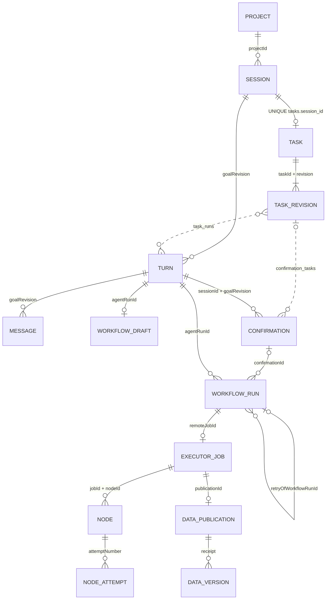

# UI-01 对象关联与恢复审计

字段和 API 缩写见 [合同矩阵](CONTRACT_MATRIX.md)。关系来自持久键；虚线标出通过内部关系表连接的 Task 修订。Session/Turn 均受当前 project 和会话访问范围约束。

| 问题 | 源码结论 |
|---|---|
| 一会话最多一个主任务 | 是。`tasks.session_id NOT NULL UNIQUE REFERENCES sessions`。新会话只创建 sessions 行和事件，goalRevision=0。创建消息和 Task 提交有不同路径。[Task DDL](../../../source/kernel/src/platform_kernel/schema/tasks.py) · [Session persistence](../../../source/kernel/src/platform_kernel/interaction/persistence.py) |
| 普通咨询可无 Task | 是。Task 在有效的 `update_task` 随回复/交互提交时创建，`task_in_connection` 无规格返回 null。既有 Task 会出现在咨询所在的 Session 快照，任务用量只统计 `task_runs` 显式关联轮次。不能把每个咨询自动归入任务。[Task persistence](../../../source/kernel/src/platform_kernel/tasks/persistence.py) · [Task progress](../../../source/kernel/src/platform_kernel/tasks/progress.py) |
| Task 有独立目标修订历史 | 有独立的 **任务规格**修订记录。每个变更保存 spec/evidence/update、提交 AgentRun、工具调用和时间。Task revision 与 Session goalRevision 各自递增；同一 Turn 可提交多个规格修订，未变更的更新可只登记 continuation。目标原文固定，修改会触发 `TASK_OBJECTIVE_IMMUTABLE`。约束、criteria、steps、缺项、证据可演进；HTTP 只读当前上下文，无目标变更链或历史版本读取。[Task persistence](../../../source/kernel/src/platform_kernel/tasks/persistence.py) |
| Turn 能区分普通咨询、澄清、任务交互 | 部分。H 带 `intentDecision, semanticIntent, taskAction, dialoguePolicy, clarificationRequired, clarificationReason`。明确的咨询或路由澄清可标注。显式 DIALOGUE 可为 UNSPECIFIED，任务缺项的追问不一定是 Router 澄清。taskAction 表示路由计划，不能证明 `task_runs` 提交；公开 Turn 无统一分类或实际 Task 绑定。控制型输入另见 `controlMessages`，时间线不能假设所有 request 都对应常规 Turn。[Intent models](../../../source/kernel/src/platform_kernel/intent_routing/models.py) · [History](../../../source/kernel/src/platform_kernel/interaction/history.py) |
| Run 能回溯 Confirmation、数据和参数 | DB 能以 confirmationId、agentRunId、toolCallId 找冻结批次与 action，Run 还保留独立的 arguments 和 input_references_json。H 给出关联 ID、冻结 action 和历史尝试，详情 W 给出 arguments、版本/checksum，但省略 confirmationId/inputReferences/attempt/retryOf。批次可经内部 confirmation_tasks 回溯 Task revision；公开 API 缺此链。受信直连和旧记录可以没有 confirmationId，派发仍核对已批准 action 及适用的既有批准。[Workflow DDL](../../../source/kernel/src/platform_kernel/schema/workflow.py) · [Run API projection](../../../source/kernel/src/platform_kernel/workflow_execution/api_projection.py) · [Task persistence](../../../source/kernel/src/platform_kernel/tasks/persistence.py) |
| Run 能回溯节点和成果 | 可通过 remoteJobId 查 Executor 节点/尝试，Kernel 公开节点诊断和 DAG 拓扑。逐尝试、节点数据和输出细节仍在 Executor。W 给精确 Run 的 Data 引用，R 仅给各 action 最新尝试。版本详情可查 publicationId 和 inputVersions，W/E 无直接 publicationId。关联成果用 runId、versionId、semanticId、objectId、checksum，模型名、文件名都不构成运行或成果身份。[Node proxy](../../../source/kernel/src/platform_kernel/workflow_execution/owner.py) · [Result pagination](../../../source/kernel/src/platform_kernel/agent_runtime/persistence/context.py) · [Protocol](../../../source/packages/protocol-contracts/src/platform_protocol_contracts/execution_v6.py) |

## 状态、历史与恢复

- **Session 目录**按 rowid 倒序分页，按当前 owner、project、标题检索和归档过滤。归档标记来自 archived_at；不会改变执行状态。createdAt 取 session.created；没有目录最近活动时间。新 Session 可以在浏览器草稿带入精确 Data 引用，批准、Task 和旧执行状态不随之复制。证据见 [目录查询](../../../source/kernel/src/platform_kernel/interaction/history.py)、[元数据更新](../../../source/kernel/src/platform_kernel/interaction/access.py)、[Web UI](../../../source/docs/capabilities/webui.md)。
- **Turn 与快照**以 `(sessionId, goalRevision)` 聚合消息，以 agentRunId 连活动、回复、计划、批次和执行。路由或已受理待启动时可先返回 ROUTING/QUEUED。任务缺项也可能伴随 COMPLETE Turn。历史分页按 messageId；同一 Turn 可能横跨分页，当前 Task/停止记录和 eventCursor 始终为该读取事务当前事实。Task Steps 属于交付条件，AgentPlan 是本批计划，Executor DAG 是运行拓扑。证据见 [History](../../../source/kernel/src/platform_kernel/interaction/history.py)、[Agent timeline](../../../source/kernel/src/platform_kernel/agent_runtime/persistence/timeline.py)、[Task progress](../../../source/kernel/src/platform_kernel/tasks/progress.py)。
- **事件与重连**。SSE 记录持久 eventId、type、createdAt、data，支持 `Last-Event-ID` 或 `afterEventId`，连接约 25 秒续接。Turn/Router/Agent、Confirmation、Workflow、Task 和 control 事件推动刷新。快照从同一事务读取水位和各域事实；前端拒绝倒退水位，连接恢复刷新快照，results/drafts 独立读，按项目/会话/请求范围拒绝迟到结果。preview SSE 独立，无重放、无持久化，断线或正式回复到达时清除。浏览器草稿、排队和回执不确定不属于服务端 Turn 状态。证据见 [SSE](../../../source/kernel/src/platform_kernel/api/routes/session_streams.py)、[Web stream](../../../source/web/src/use-session-stream.ts)、[stream cursor](../../../source/web/src/session-stream-state.ts)、[消息提交](../../../source/web/src/use-message-actions.ts)。
- **确认与纠正**。同一 AgentRun 最多一个 PENDING Confirmation。修订后旧批次 SUPERSEDED，新批次有新 ID、revision 和 replacesConfirmationId；冻结参数和绑定保留。新输入或停止可撤销旧待确认决定，REQUESTED/RUNNING 决策异步处理，恢复时重新处理持久请求。分析停止会围栏迟到回复/暂存 Task 更新；已批准执行后的纠正排到后续 Turn。证据见 [Interaction DDL](../../../source/kernel/src/platform_kernel/schema/interaction.py)、[revision](../../../source/kernel/src/platform_kernel/interaction/revisions.py)、[confirmation](../../../source/kernel/src/platform_kernel/interaction/confirmation.py)、[stop persistence](../../../source/kernel/src/platform_kernel/interaction/control_persistence.py)。
- **停止、运行与恢复**。run_controls 的 REQUESTED/PROCESSING/COMPLETE 是停止命令处理记录。Executor 可记录 cancel_requested 且继续处于 RUNNING；已经提交的成果可在取消竞争中胜出。WorkflowRun 终态来自真实 Job 或 Kernel 的派发/阻塞事实。对可恢复的最新失败/超时/取消尝试，提交 recovery 请求创建新的 RECOVERY Confirmation，批准后创建新 Run（attempt 增一并写 retryOf）；旧批次、旧 Run 与成果保留。禁止复用旧批准，禁止从 Stop Receipt 推断取消终态。证据见 [Executor 查询与取消](../../../source/services/executor/src/platform_executor_service/control_components/queries.py)、[Executor 发布终结](../../../source/services/executor/src/platform_executor_service/result_finalization.py)、[Kernel recovery source](../../../source/kernel/src/platform_kernel/workflow_execution/persistence/queue.py)、[recovery](../../../source/kernel/src/platform_kernel/interaction/recovery.py)。
- **发布与科学结论**。当前 Executor 在 Data PUBLISHED 并核对 receipt、生成输出引用后将 Job 标 SUCCEEDED，Kernel 同一终态写入中保存输出。Web 的 H 与 R 独立读取，可能先知道成功、后收到精确成果；这时只能说明成果尚未同步。Data 发布成功和输入准备检查通过都无法证明成果科学验证通过。Data QualityRun 的 PASSED/PASSED_WITH_WARNINGS/FAILED/ERROR 绑定具体 Dataset Version 与质量规则套件，可作独立证据，其作用域是表格数据质量。证据见 [Executor finalizer](../../../source/services/executor/src/platform_executor_service/result_finalization.py)、[Kernel terminal persistence](../../../source/kernel/src/platform_kernel/workflow_execution/persistence/status.py)、[Data publication response](../../../source/services/data/src/platform_data_service/api/responses.py)、[Data quality routes](../../../source/services/data/src/platform_data_service/api/routers/quality.py)。
