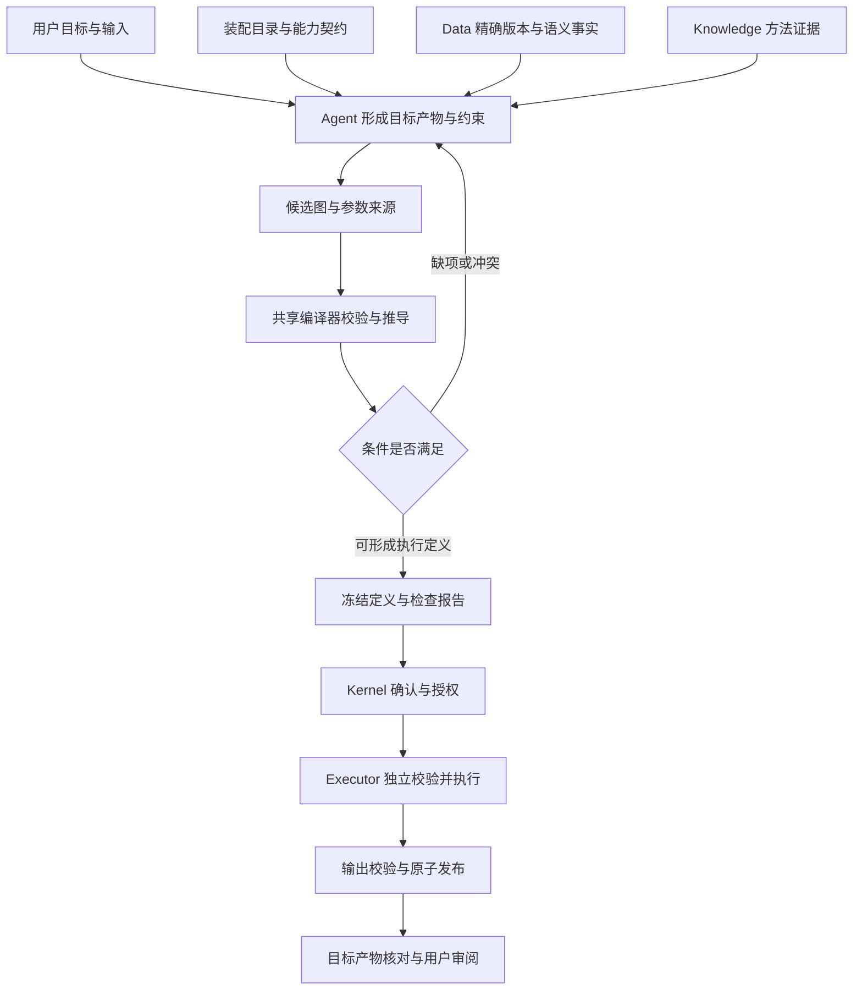

# 通用能力与工作流自主编排设计草案

状态为设计草案，供架构、领域算法和开发人员评审。基础标准覆盖能力发现、精确输入绑定、端口与参数校验，以及确认后的执行和发布。需要比较单位、网格、时序或模型状态时，由相关算子声明扩展约束。[能力与编排契约标准草案](capability-standard.md)

本方案中的“通用模型”涵盖可复用算子、具体算法模型和组合工作流。工程对象继续使用 Operator、Workflow、Executable Model。统一的是发现与组合接口，各对象继续由现有模块持有。

首批表格试点接入 `table.filter@1.0.0`、`table.sort@1.0.0` 和 `table.profile@1.0.0`。三者共用精确版本、单项 artifact 端口和格式检查。筛选规则和排序规则沿用各自的版本化 JSON 输入，字段画像输出 Parquet。[试点执行契约](capability-standard.md#表格试点)

## 当前基础与缺口

调研日期为 2026 年 11 月 13 日，检查的 HEAD 为 `6ceff6004b9ddde00ec3cb0873c6c1170a6a05db`，包含当时工作区内容。目录索引文件 SHA256 为 `ef5f6128158936524624d622f7ee1eaef562ee4ca9c4a02cde3940506689f9e4`。源码统计为 18 个模型、18 条工作流、111 个算子版本，其中 native 84、qgis 15、remote_http 12。下表记录试点前的迁移起点。[能力目录](../../source/packages/operator-pack/catalog/index.json)

| 已具备的机制 | 自主编排仍需补齐的内容 |
| --- | --- |
| 静态目录、精确算子版本和实现摘要 | 可配置能力包选择，解除编译器对目录数量 111 的硬编码 |
| 端口格式、参数 JSON Schema、DAG 和条件输出格式校验 | 字段角色、单位、基准、时间粒度、张量维度和模型状态的组合校验 |
| Agent 查询目录、读取完整算子、绑定本轮数据与知识证据 | 按目标产物和前后条件检索，返回结构化修复建议 |
| Data 保存字段意义、单位、CRS、垂向基准、时区与语义修订 | 增加结构化 quantityKind、字段角色、键、测量口径及事实来源，处理未知与冲突 |
| 草稿缺项清单与 `execution_allowed=false` | 合法草稿形成不可变执行定义、进入确认并提交 Executor 的版本化接口 |
| Executor 按注册模型接收执行、管理重试和发布 | 接收经过验证的组合定义，独立检查目录、授权和执行摘要 |
| 声明 `many` 输入 | Workflow v6 当前拒绝多输入基数，需要集合绑定和完整运行链支持 |

上述事实分别来自[目录校验](../../source/packages/workflow-compiler/src/platform_workflow_compiler/catalog.py)、[图编译](../../source/packages/workflow-compiler/src/platform_workflow_compiler/graph.py)、[草稿处理](../../source/kernel/src/platform_kernel/agent_runtime/workflow_draft.py)、[Data 语义](../../source/services/data/src/platform_data_service/models.py)和[执行准入](../../source/services/executor/src/platform_executor_service/control_components/admission.py)。

## 标准调研与采用范围

| 标准 | 可采用的内容 | 本系统的设计选择 |
| --- | --- | --- |
| CWL 1.2 系列 | 类型化输入输出、步骤连接、子工作流、集合与 scatter 的显式语义 | 借鉴图与端口模型，继续维护可移植子集导出。内部执行仍复用现有 Executor。复杂图能力按已实现 feature 声明启用。[官方规范](https://www.commonwl.org/v1.2/Workflow.html) |
| JSON Schema 2020-12 | JSON 结构、约束、组合与注解 | 校验 manifest、参数和值端口。单位、网格和训练数据泄漏等关系另由确定性校验器验证。`default` 作为注解处理，参数解析另行显式记录。日期等 `format` 检查配置必须固定。[官方规范](https://json-schema.org/draft/2020-12/json-schema-validation) |
| OGC API Processes Part 1 Core 1.0 | 过程描述、输入输出、作业状态和结果资源 | 用于外部服务适配与目录互操作。服务地址和凭据继续由部署绑定持有。[官方规范](https://docs.ogc.org/is/18-062r2/18-062r2.html) |
| W3C PROV-O | Entity、Activity、Agent 和使用、生成、派生关系 | DataVersion、节点执行与执行主体分别映射，先用现有 JSON 和数据库保存，按需导出 PROV。[官方规范](https://www.w3.org/TR/prov-o/) |
| UCUM 2.2 | 单位编码与可换算关系 | 单位使用固定版本词表解析，量纲相容后继续检查量的意义、基准和口径。单位变换形成显式节点。[官方规范](https://ucum.org/ucum) |

当前仓库已有 Workflow v6 到 CWL 1.2 的受限导出，要求明确端口绑定与实现身份。后续沿用该能力并扩展互操作测试。[CWL 导出实现](../../source/scripts/interoperability/cwl_export.py)

## 能力分类与准入

“通用程度”“实现来源”和“能否自主编排”采用独立字段。单一算法结构可以跨领域复用，领域专用算法也可以提供完整的组合契约。六个地下水算子、四个回测处理算子和三个 GRU 注意力算子作为重点审查对象，最终准入依据具体契约和验证结果确定。

| 维度 | 建议取值 | 用途 |
| --- | --- | --- |
| 复用范围 `reuseScope` | `generic`、`domain`、`scenario` | generic 面向数据结构与明确方法，domain 绑定领域概念，scenario 绑定具体场景约定 |
| 能力形态 `kind` | `operator`、`workflow` | 区分单个可调用实现和组合定义 |
| 实现来源 `providerKind` | `platform`、`external` | 展示维护与部署归属 |
| 执行环境 `runtime` | 当前三类及未来显式扩展 | 调度和依赖选择 |
| 编排符合性 | `described`、`composable`、`executable` | 分别表示完整可发现、可校验组合、具备执行验证与运行绑定 |

符合性是按“定义摘要、验证器集合和装配身份”计算的声明。一次具体任务的可执行性还依赖输入、参数、环境和授权。目录标签不会直接使任务就绪。

| 现有能力 | 处理建议 |
| --- | --- |
| 六个 `groundwater.*` 平台执行算子 | 标注 domain，补齐水头、降深、同基准、同网格和指标来源契约 |
| GRU 注意力预训练、微调和预测 | 标注具体方法，明确权重结构、特征顺序、目标、训练范围和设备依赖。跨领域输入验收通过后可归 generic |
| 时间序列宽转长、划分和滑窗 | 保留当前场景契约。新通用版本显式选择顺序、时间轴策略、预测步长、基线与缺失处理 |
| 标准化逆变换 | 现有版本明确“单目标多列恢复”。新增逐字段映射能力时使用新身份，并检查每列与缩放器字段的对应关系 |
| `vector.dissolve` | 通用融合和监测井覆盖诊断分别声明能力，避免业务解释附着在一般 GIS 变换上 |
| `table.classify`、回归指标、窗口提取、范围框 | 用契约明确最不利等级、基线比较、波段掩膜和范围扩展策略，再确定通用性 |

## 推荐架构

Agent 负责理解任务、提出候选与解释方案。共享编译器负责确定性检查、语义传播和生成执行定义。Kernel 持有草稿、准备与确认。Executor 校验并运行冻结定义。Data 和 Knowledge 继续分别提供精确数据事实与方法证据。

算子 manifest 是单个能力的权威声明，Workflow 是组合关系的权威声明，Executable Model 继续负责面向用户的参数绑定、默认配置、最终输出与发布配置。统一目录视图由 Assembler 生成。组合工作流的输入输出语义由内部图推导并与显式声明核对，防止外层包装扩大其实际适用范围。

采用三层契约。

1. **调用契约**描述精确身份、输入输出、参数与运行环境，保证可调用。
2. **组合契约**描述数据语义、前置条件、结果保证、集合与参数来源，保证连接可检查。
3. **执行契约**冻结整个图、数据、环境与授权，规定故障、结果校验和发布，保证方案可以可靠落地。

## 自主编排过程

1. 将用户需求转为目标产物、评价范围、允许的数据处理和尚缺信息。例如“每井月度水位趋势”需要明确水位含义、月份边界和统计方法。
2. 从 Data 获取候选，读取精确版本及语义修订。描述文本可用于搜索，约束检查使用可追溯的结构化事实。
3. 从目标输出反向查找生产该类型的能力，再向前验证当前输入。优先满足硬约束，随后比较新增转换、信息损失、资源和方法适用性。
4. 每条边验证容器类型、文件格式、结构、量与单位、时间和空间语义。能通过明确转换满足的边生成转换节点，目标参数进入方案。
5. 未满足项形成具体问题。数据缺少单位、目标坐标系未选择、训练边界未明确等问题分别指出影响的端口与解决方式。
6. 使用同一编译器验证候选图并推导结果语义。Agent 根据诊断修订草稿，修订次数和搜索预算由产品配置控制，达到预算后交付现有草稿和未决项。
7. 冻结符合条件的图和检查报告。用户确认绑定该摘要后提交执行，Executor 重新核对内容、数据身份和运行支持。
8. 依次执行各节点的输入检查、运算和输出检查，校验最终产物覆盖用户要求，原子发布并附带溯源。

检索提供 capability、输入逻辑类型、目标类型、方法、领域和符合性过滤。第一版复用 `list_operators` 与 `get_operator` 并扩展投影，增加一个纯校验入口返回结构化诊断。转换路径搜索基于已安装、精确版本的适配算子。候选排序不能抵消硬约束失败。

每个用户目标产物绑定期望语义、生产节点和验收方法。选择排序或插值方法时保存采用理由与备选差异。成本依据实际资源估算，估算缺失时标明未知。模型生成的“置信度”仅作为展示信息。小目录首先使用结构化过滤与有界图搜索，目录规模和检索评测出现明确瓶颈后再引入额外索引或规划服务。

## 试点执行路径

Kernel 持久化草稿及冻结的 Workflow v7 定义，把定义摘要绑定到当前会话的确认。确认后使用现有内部作业请求提交，组合请求携带可选的 `composition` 定义。Executor 按同一装配目录重新校验并编译，复用当前调度、Worker 和 Data 原子发布。注册模型沿用原有请求形式。

相同 requestId 和相同规范化请求返回同一 Job，相同 requestId 携带不同内容返回冲突。节点、参数或数据版本发生变化时，需要新草稿及确认。稳定使用的组合可整理成正式领域包模型。

试点使用有限静态 DAG。表格节点使用单项文件连线，逐像元统计支持有序栅格集合。栅格和表格成果走同一发布链路。值端口和其他领域约束按具体任务接入。数据驱动 scatter、条件分支和运行中改图还需要分别规定输出数量、失败汇总和资源边界。

## 契约与模块变更

下表版本名为草案标识，实施前检查版本占用并在同一发布基线中定版。

| 模块 | 拟变更 | 验收重点 |
| --- | --- | --- |
| operator-pack | `operator-manifest.v2`，增加组合元数据、条件和输出语义 | 声明和实现一致，旧身份可解析 |
| workflow-compiler | Workflow 下一主版本与草稿下一版本，支持类型化边、集合、语义检查 | 相同冻结输入产生相同定义与诊断，未知条件处理明确 |
| Data | 版本化扩展语义事实与校验回执 | 旧记录的缺失事实保持未知，语义修订可冻结 |
| Assembler | 能力包选择、锁文件、验证器与词表集合摘要 | 去除固定目录大小，核验精确依赖和已安装实现 |
| Kernel | 目录检索投影、组合校验、不可变定义和确认绑定 | 草稿修订与执行请求互相可追溯，确认失效规则明确 |
| Executor | 支持冻结组合定义的请求、图准入和运行前后检查 | 独立核对图、幂等、恢复和原子发布 |
| UI 与 API 客户端 | 展示每步目的、转换、假设、缺项与输出口径 | 用户可理解并修改影响结果的选择 |
| CWL 导出 | 新图支持能力映射与不支持项诊断 | 可移植子集往返后保留关键身份和语义附件 |

原有 manifest 和模型通过适配器读取，组合语义缺失时标为未知。适配器可以提取旧声明中已有的字段，新增科学含义需要数据或领域声明提供。修改算法、缺失值政策、聚合口径、默认值或输出意义时使用新算子版本。展示标签与语义规范也进入目录身份。

## 实施顺序与完成条件

| 阶段 | 交付 | 完成条件 |
| --- | --- | --- |
| 基础契约 | 最小算子与工作流声明、Schema、正反样例 | 每条基础要求对应校验责任与验收案例 |
| 表格试点 | 筛选、稳定排序、字段画像，覆盖草稿到发布 | 真实算子执行，核验输入版本、确认边界和最终产物 |
| 栅格试点 | 按参考网格重投影或对齐，再逐像元统计与重分类 | 冻结参考版本和重采样方法，核验两个 GeoTIFF 的网格、像元和 NoData |
| 领域扩展 | 选择模型推理和其他栅格代表链 | 按实际需要覆盖字段、单位、集合、模型状态和输出传播 |
| 全目录适配 | 111 个版本的分类、语义与符合性清单，重点 13 个和 5 个候选逐项处理 | 目录由源声明生成，每个未达标项有明确原因 |
| 扩展执行 | 检查器回执、故障恢复、复杂图调度 | 断线、重复提交和局部失败可验证 |
| 互操作与推广 | 扩大可编排能力、CWL 导出、外部服务适配 | 完整支持声明范围内的契约与端到端案例 |

## 表格通用算子接入方案

2026 年 11 月 14 日复核工作区，HEAD 为 `53bde8050042`。接入前，目录共 113 个算子版本，已有 7 个版本可确认执行。接入列投影、去重和行级校验后，产品配置启用了 10 个版本。按版本统计，同一算子的其他版本仍可单独评估。以现有链路的复用价值、结果口径是否明确、是否有可核验的文件产物、接入需要改变哪些组件为排序依据。[产品装配](../../source/products/groundwater/product-manifest.json) [能力清单](../../source/docs/development/current-capability-inventory.md)

| 顺序 | 建议接入版本 | 最小编排范围和准入条件 |
| --- | --- | --- |
| 1 | `table.project@1.0.0` 列选择、排序、重命名和类型转换 | 绑定一份表与一份 `table-project-rules.v1` JSON，发布 `data` Parquet。规则明确字段顺序及目标类型，失败转换保留诊断。输出字段和单位等待后续按规则显式声明，当前以实际 Parquet 结构为准。[实现](../../source/packages/operator-pack/src/moperators/operators/table_project.py) |
| 2 | `table.deduplicate@1.0.0` 按键去重 | 绑定 `table-deduplicate-rules.v1`，冻结 `keep=first/last/error`。按上游输入行序决定 first/last，存在业务时序要求时接入显式排序。组合键中的 NULL 按相等分组。支持独立发布 `unique`、`duplicates` 两个 Parquet 端口。[实现](../../source/packages/operator-pack/src/moperators/operators/table_deduplicate.py) |
| 3 | `table.validate@1.0.0` 行级规则校验 | 绑定 `table-validation-rules.v1`，支持分别消费或发布 `valid`、`invalid`、`violations`。发现数据违规时仍产出报告，违规行不进入有效分支。规则文档无效或算子无法执行时作业失败。范围检查与非空检查各自独立。[实现](../../source/packages/operator-pack/src/moperators/operators/table_validate.py) |
| 条件接入 | `table.join` 表连接 | 复用两个单项数据端口和一个版本化键映射 JSON。冻结连接类型、基数和行数上限。首轮以显式、同类型的连接键为准，按现有等值连接规则，任一键分量为 NULL 的行不匹配。当前实现使用 DuckDB 的隐式比较转换，已经在本地复现文本 `001` 匹配整数 `1`。若改为引擎层强制键类型一致，发布新版本以保留 1.0.0 的调用语义。以新版本通过键类型、空值和基数测试作为启用条件。[实现](../../source/packages/operator-pack/src/moperators/operators/table_join.py) [DuckDB 比较转换](https://duckdb.org/docs/sql/expressions/comparison_operators) |

本批复用现有 Native、精确数据与规则版本、参数来源、冻结图和 Data 文件发布。表连接待独立验证后再启用。下列验收方案包括本批及表连接后续接入条件。

### 验证方案

1. **算子对照测试。** 按精确版本运行仓库 smoke，再用合成反例核验业务结果。统一核对字段类型、顺序、NULL、输出端口和错误码。文件内容及 schema 相同即可满足业务断言，作业内每份文件的校验和仍须与 Data 记录一致。

   | 用例 | 可判定的预期 |
   | --- | --- |
   | 投影与转换 | 保留指定字段和顺序，字符串 ID 保留前导零。可安全转换的值类型与预期一致，非法数值转换报 `TYPE_CAST_FAILED` |
   | 排序后去重 | 两条同键记录按明确的时间和排序方向决定保留行。分别断言 first、last 和 error，重复 NULL 组合键遵循现有分组口径 |
   | 校验后画像 | 同一行可命中两条规则，在 `invalid` 中出现一次，在 `violations` 中保留两个规则 ID。范围边界值通过，空值由显式非空规则报告。只有 `valid` 进入字段画像 |
   | 表连接 | 用同类型复合键验证命中与未命中，NULL 键不匹配。用 `001` 对整数 `1` 验证拒绝隐式匹配，另外断言右侧重复键触发 `JOIN_CARDINALITY_VIOLATION`、超行数触发 `OUTPUT_ROW_LIMIT_EXCEEDED` |

2. **编译与确认。** 编排验收至少包含“投影 → 稳定排序 → 去重 → 行级校验 → 有效数据画像”。草稿准确绑定每份规则、所选分支、保留策略及发布端口。缺少规则版本或必需参数时无确认，选错端口或文件格式时拒绝。确认绑定精确定义摘要，变更规则版本、参数或节点依赖时重新确认。
3. **执行与发布。** 复用现有 PostgreSQL、Native Worker 和 Data 端到端测试。确认前作业数为零，确认后只发布所选 Parquet。逐一下载核对数值、行数、schema、来源版本和定义摘要。同一冻结请求重放返回同一作业。用已知格式但内容违反规则 Schema 的文件，验证 Worker 返回具体诊断且无部分发布。[端到端测试入口](../../source/tests/e2e/test_composed_workflow.py) [开发检查入口](../../source/docs/operations/execution-playbook.md#per-change-checks)
4. **真实 Agent。** 用不同命名的合成表和规则重新跑完整流程，用户描述目标和处理口径，不提供算子 ID 或图结构。另跑一个缺少规则版本的反例。按是否选对端口、是否保留规则与策略、实际成果内容、缺项时是否避免确认来判定，记录模型、用例数、首次通过和修订结果。

本批用 DeepSeek Flash 验证了三个合成场景。完整路径发布五份 Parquet，校验有效行画像只含 3 条有效行，数值列均值为 6。Data 的发布记录包含源表和四份规则的精确版本，且定义摘要与用户确认一致。缺少规则时，校验节点保留未绑定的必需端口，确认接口返回 409。已绑定的 JSON 规则违反 Schema 时，校验节点报 `RULESET_INVALID`，下游画像跳过，Data 无发布请求。实测期间补充了 Agent 对多产物端口的读取指引和超长结论的修订提示。[验收断言](../../source/tests/e2e/test_composed_workflow.py)

### 后续候选

| 候选 | 需要先明确的契约 |
| --- | --- |
| `spreadsheet.extract_table` | 补充 XLSX 输入适配。确认 sheet、表头和公式读取方式，验证源行号与缓存值缺失诊断 |
| `timeseries.aggregate`、`timeseries.completeness`、`timeseries.gap_runs` | 显式绑定分组、时间、观测值、时区、频率和缺测口径。聚合与完整性可共享原始观测并行执行，已有原生实现可复用。时间语义和来源的验收先于接入 |
| `raster.sample_points`、`raster.zonal_statistics` | 补主流矢量格式和 CRS、几何类型、图层选择。先验证固定 Parquet 输出，随后处理按参数切换到矢量输出 |
| `raster.mosaic`、`raster.algebra` | 拼接要求同格网基准但允许不同范围，需声明重叠优先级和输出范围。代数需核对实际参与运算的波段、NoData 与输出类型，再启用集合端口 |
| `statistics.describe`、`raster.statistics` | 两者现有结果是值端口。等组合执行路径支持结果值发布时再接入，沿用现有结果结构 |
| `table.classify`、领域算子与第三方模型 | 指标分类优先核对指标、单位、测量口径、规则来源及无法评价状态。领域与第三方模型按专用契约推进，保留算法输入、权重或外部服务的独立准入 |

## 验收设计

验收集由固定数据版本、固定目录、用户任务和预期约束组成。正确图可以有多个，按目标、约束和产物判定。

| 场景 | 必须观察到的行为 |
| --- | --- |
| 同格式、不同物理量 | 水深与水头直接相连时报语义冲突 |
| 单位可换算 | 明确选择并展示转换节点，转换结果携带来源 |
| 单位或垂向基准未知 | 指出缺失事实和影响，阻止依赖该事实的执行 |
| 栅格 CRS 或网格不一致 | 按指定参考版本补入重投影或对齐节点。缺少参考版本或适用的重采样方法时提示补充 |
| 四个多输入算子 | 集合数量、顺序和逐元素格式均被检查，执行收到完整冻结集合 |
| 标准化与模型推理 | 特征顺序、目标单位、缩放器身份和模型结构匹配，训练范围冲突被发现 |
| 合法数据表更换字段名与单位 | 经显式字段绑定和换算后完成同类任务 |
| 无法满足的目标 | 返回缺口与原因，保留可用部分，避免输出虚构结果 |
| 确认后参数或目录变化 | 已有授权不能绑定变更内容，提示产生新修订 |
| 执行中断与重复请求 | 同请求返回同作业，恢复保留成功节点与来源，结果只发布一次 |

发布门槛要求关键反例全部被预期处理，所声明的正例全部完成结构与结果断言。Agent 自然语言评测报告首次有效图比例、修订后有效图比例、缺项识别正确率、无依据参数填充数和最终产物达标率，并披露样本量、模型、提示词和运行条件。性能阈值依据现有链路基线及资源配置确定。

## 需要定版的设计选择

建议首版接受通用、领域和具体方法三类能力共同编排，按契约与任务适配性筛选。单位采用 UCUM 的明确子集并保存版本，字段概念采用小规模版本化词表，以现有任务驱动扩展。自主性覆盖发现、组合、诊断和生成执行定义，执行权限沿用当前确认机制。

复合图执行需要扩展当前“只执行已装配模型”的准入方式。该变化与架构的显式授权、精确身份和服务职责原则兼容，具体协议和发布门禁需随实施一并更新。若未来要求运行中自动改图或预授权批量任务，应另行定义授权范围和预算的变更规则。[现行架构契约](../../source/docs/architecture/architecture-contract.md)
