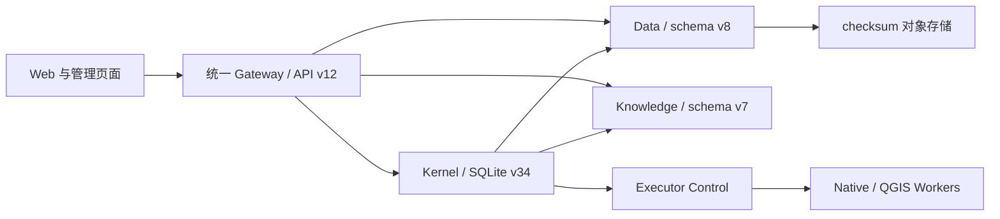

# Groundwater V12 架构总览

V12 是可信单机或小型实验室使用的科研实验与可复现归档平台。

Gateway 是唯一北向入口，默认只绑定 loopback。数据库、Knowledge、Executor 和 Worker 只在 Compose 内网可达。浏览器使用本地密码会话与 CSRF 防护，API 使用可撤销个人 Token；Kernel 保存用户、会话、Token 摘要和项目成员关系。

项目权限只有 `admin`、`researcher`、`viewer`，资源可见性只有 `PRIVATE`、`PROJECT`。owner 用于溯源，非成员访问返回 404，成员权限不足返回 403。

Kernel 拥有交互与编排状态；Data 拥有不可变数据版本、对象 checksum、实验模型和 lineage；Knowledge 拥有证据版本与检索回执；Executor 拥有 Job、尝试、租约和检查点。跨服务通过声明接口通信，不直接打开其他服务存储。

Agent 默认并发 8、等待队列 100；Workflow 并发由 Executor slots 决定；每项目默认 4 个并发上传。队列满返回 429 和 `Retry-After`。Executor readiness 分别报告 control-plane、native、QGIS，单个 runtime 故障形成能力降级。

当前版本矩阵：Public API v12、Kernel SQLite v34、Data schema v8、Knowledge schema v7、Instance manifest/layout v4、Research archive v1。旧 schema 只能经显式 `gw migrate plan/apply` 的逐版本影子迁移升级，普通启动不隐式跨版本写入。

科研归档分别记录 scientific、engineering、agent experience 状态；Agent 体验不阻塞数值模型归档。详细约束见[架构契约](architecture-contract.md)、[协议与存储](../reference/contracts.md)、[HTTP API](../capabilities/http-api.md)和[科研验收](../operations/acceptance-gates.md)。
