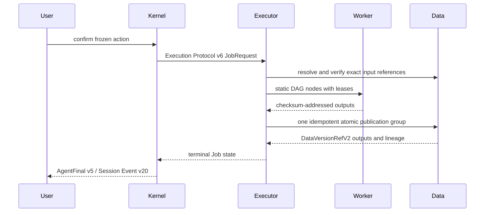

# Groundwater v12 架构结构与运行逻辑

本文说明当前 v12 如何从静态声明装配为服务，以及用户请求如何形成可追溯结果。归档状态以科学、工程和 Agent 体验三份独立报告为准。

## 装配结构

产品清单选择 Groundwater 领域包、Data、Knowledge Next 和 Executor 模块。Assembler 在部署前校验 Schema、引用、算子实现 revision、端口与格式、Worker runtime、输出声明和服务绑定，并生成：

- `kernel-config.json`：Kernel Config v8，包含只读工具、模型投影、固定执行案例和草稿算子目录。
- `executor-config.json`：Executor Config v8，包含七个 Executable Model v4 的完整 Workflow v6 DAG 与部署级远程服务绑定。
- `compose.json`、`nginx.conf` 和 `assembly-lock.json`。

执行相关版本必须分别表述为 **Executor Module v10、Executor Config v8、Executor SQLite v9**。三者是模块合同、生成配置和运行存储的不同身份。

## 运行拓扑

统一 Gateway 是唯一的主机端口入口，默认绑定 loopback 的 `28186`。V12 常驻能力由 Kernel、Data、Knowledge Next、Executor Control、Native/QGIS Worker 及其 PostgreSQL/对象卷组成；初始化和 bootstrap 是一次性任务。常驻服务 readiness 与一次性任务分开判定：Knowledge bootstrap 失败会形成明确的初始化失败状态，但不能阻断 Kernel/Gateway 的登录、状态和诊断接口。

Knowledge bootstrap 先用 preflight 对比当前目录，只对语义内容变化的条目提交带当前版本 CAS 的原子导入；完全一致时返回 `ALREADY_APPLIED`。`expectedVersion` 只属于导入并发控制，不进入不可变知识正文。`gw dev up` 先等待常驻服务，再单独运行 bootstrap；`gw dev status` 同时报告两部分，因此不会把一次性任务误当作常驻容器健康检查。

服务只能通过声明的 HTTP 合同交换身份和数据，不能导入其他服务实现、读取其他服务数据库或挂载其他服务的持久目录。所有公开与内部请求都绑定固定 `project_id`。

## 消息、确认与执行

`POST /api/v12/sessions/{sessionId}/messages` 是统一用户消息入口。无工具 Intent Router 先给出语义和任务动作，Kernel 映射为 READ_ONLY、EXECUTION_PROPOSAL、WORKFLOW_DRAFT 或澄清。Agent 在当前轮使用 Data 和 Knowledge Next 只读工具；旧轮观察正文不能自动成为本轮证据。

每次受管工具调用都形成 `AgentProgressIntent → Kernel RUNNING Activity → ToolOutcome → Kernel
COMPLETE/FAILED Activity`。Agent 提供本次调用的具体目标；能力服务拥有结果语义和摘要模板；
Kernel 校验并渲染唯一的用户可见短语。Web 只投影服务端 Activity，不解释工具名或任意业务字段，
因此进度语义与执行事实、权限边界和工具合同同步演进。

执行提案先通过 Data inventory/discovery 找到紧凑候选，再检查精确版本和必要字段；知识候选必须按精确版本、单元和 checksum 完整读取。`prepare_task_inputs` 重新检查模型合同与版本策略。Kernel 为一个 AgentRun 保存一个 `TaskPreparationV1` head，其 `entries` 覆盖本次提案的全部动作；多动作不会互相覆盖。集合状态从各项汇总，生命周期从 AgentRun、Confirmation、AgentAction 和 goal revision 派生。

`submit_reply` 是统一终态边界。执行提案只有在本轮已持久化可执行 AgentAction 时才能进入 `WAITING_CONFIRMATION`，Confirmation 由 Kernel 投影生成。回复中的执行状态、WorkflowRun 和确认说明必须与持久事实一致；模型文字不能建立执行事实。

确认后链路为：

Executor 不接收动态 DAG。Control 依据静态配置、依赖、容量、租约和绝对截止时间调度。响应丢失时按同一发布组查询或重放相同提交，不创建新版本。恢复、取消和超时都以持久状态为准。

## Data 与 Knowledge

`DataVersionRefV2` 固定版本、语义、对象、格式、MIME、大小和 checksum。Data 只允许 CSV/Parquet 查询，但可以保存 Operator Catalog 已声明的其他格式。XLSX 与 GeoPackage 由隔离 Worker 生成有上限、可过期的只读预览；COG/GeoTIFF 内容端点支持单段字节范围读取。格式与 MIME 不一致时拒绝发布。

Knowledge Next 的证据身份是 `version_id/unit_id/checksum`。数据绑定必须精确匹配 `data-primary/project_id/dataset_id/version_id/semantic_id`；错误版本、错误语义、失效或未完整读取的知识不能引用。Embedding 客户端禁用代理继承。

## Provider 与 readiness

Router 和 Agent 的协议/schema 修复各阶段最多一次；网络、HTTP、超时和业务错误不重试。可选备用端点必须属于同 Provider、同模型。Kernel 在生成前通过 `/v1/models` 零 Token 探测选择端点；请求开始后不切换或重放。

`/api/v12/health` 是轻量存活接口。`/api/v12/ready` 是外部负载均衡器使用的聚合就绪接口，覆盖 Kernel、装配实际选择的能力服务和 Router/Agent Provider；Knowledge 的嵌套状态会投影 Embedding，Executor 会校验 Worker 心跳与 definition digest。未选择的服务不进入 readiness。内部 Compose 健康检查继续使用各组件的 `/internal/health/ready`。

## 代码位置

| 路径 | 内容 |
| --- | --- |
| [`products/groundwater/`](../../products/groundwater/) | Product Manifest v7、Product UI v1 与公开路由。 |
| [`domains/groundwater/`](../../domains/groundwater/) | Groundwater 领域包、六个模型、Workflow 和知识源。 |
| [`platform/assembler/`](../../platform/assembler/) | 静态校验、版本冻结与配置生成。 |
| [`kernel/`](../../kernel/) | Router、Agent、确认、WorkflowRun、Provider 记录和公开 Kernel API。 |
| [`services/data/`](../../services/data/) | Data PostgreSQL schema v8、owner + PRIVATE/PROJECT、质量/模型治理、outbox、只读预览与对象库。 |
| [`services/knowledge-next/`](../../services/knowledge-next/) | Knowledge Next PostgreSQL/pgvector schema v7 与项目角色权限。 |
| [`services/executor/`](../../services/executor/) | Executor Control、SQLite v9 和 Worker v3 协议，含隔离的 `remote_http` Worker。 |
| [`packages/operator-pack/`](../../packages/operator-pack/) | 静态算子合同与实现。 |
| [`packages/workflow-compiler/`](../../packages/workflow-compiler/) | 无 IO 的 Workflow v6 图校验。 |
| [`web/`](../../web/) | v12 会话式 WebUI。 |
