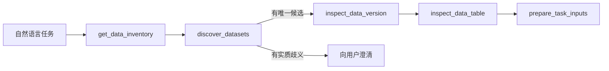

# Agent 发现、理解与任务准备

本文描述 Groundwater v12 当前实现。Agent 不在启动时加载项目全部数据或知识；它从
Kernel 编译的当前 Turn 视图开始，按任务调用所属服务的只读投影，再把执行所需的最小
事实固化到 Kernel。Data、Knowledge 和 Kernel 始终各自拥有自己的状态。

## 信息从哪里来

Kernel 在一次 Agent 调用前编译以下来源：

- 当前用户消息、显式 `DataVersionRefV2` 附件和目标修订；
- 当前 Task 规格、进度、未决项和已验证结果；
- 当前或历史执行状态，以及仍与本轮相关的准备投影；
- 受控的跨轮记忆摘要；
- 产品装配时冻结的工具、模型和工作流草稿能力说明。

这个编译视图是读取模型，不是新的事实所有者。上下文策略可以省略低优先级历史或把它
变成可检索引用，但不能改写 Task、Data、Knowledge、Confirmation、AgentAction 或
WorkflowRun。观察工具的响应正文只存在于当前 Turn；跨轮只保留受控身份、结论和状态。

## Data 发现链

Data 服务直接从自己的当前目录生成两类请求时投影：

1. `get_data_inventory` 返回 Dataset 数量、描述覆盖和 format/tag 分布，用于判断是否有
   值得进一步搜索的目录范围。
2. `discover_datasets` 接受 `query/tags/formats/field_terms/units/after/limit`，返回当前
   DatasetVersion 的紧凑候选、命中字段、确定性分数、匹配理由、缺失元数据和游标。

发现结果故意不携带完整 descriptor 或 semantics。候选命中只能说明目录元数据满足字面
条件，不能证明业务含义、质量或模型适用性。相同请求得到相同确定性结果摘要时，Kernel
把它视为搜索已收敛，避免 Agent 反复调用发现工具。

选定候选后，Agent 必须调用 `inspect_data_version` 读取完整不可变身份，包括
`dataset_id/version_id/semantic_id/object_id/checksum` 和 Dataset 的 `current_version`。
CSV/Parquet 的字段确认再调用 `inspect_data_table`；样本只证明实际物理字段和有限范围，
不证明单位、完整质量或时间空间覆盖。

已知精确版本 ID 时可以直接检查版本，不需要先枚举目录。分页未结束时不能声称已覆盖
整个目录。

## Knowledge 取证链

需要解释字段、单位、方法适用性或项目约定时，Agent 先用 `retrieve_evidence` 检索候选，
再用 `read_evidence` 携带精确 `version_id/unit_id/checksum` 完整读取证据单元。只有当前
Turn 中状态为 `OK` 的完整读取才能引用。数据绑定证据还必须精确匹配
`service/project_id/dataset_id/version_id/semantic_id`。

`STALE`、撤回、过期、checksum 变化或绑定不匹配都要求重新检索或停止；Kernel 不把旧
正文放入统一资源表，也不允许 MemorySummary 把历史文字提升为当前证据。

## 从候选到可执行准备

执行请求在读取必要事实后调用 `prepare_task_inputs`。工具重新解析目标模型的输入合同，
重新检查每个 Data 版本，绑定本轮已读 Knowledge 引用，并记录参数来源。版本策略有两种：

- `CURRENT_REQUIRED`：用户要求“当前/最新”，或任务必须继续使用 Dataset 当前版本；若
  `current_version` 已变化，准备返回 `BLOCKED/DATA_VERSION_NOT_CURRENT`。
- `PINNED`：用户明确指定历史或冻结版本；只要精确身份仍可解析，就保留该版本。

`READY` 只证明身份和可执行合同完整。它不证明科学适用性、数据质量或业务认可。Agent
随后记录计划，并且模型调用参数必须与显式准备完全相同；参数漂移或重复消费同一准备项
会在提案边界被拒绝。

一个提案可以包含多个动作。Kernel 因此为一个 AgentRun 保存一个
`TaskPreparationV1` head，`entries` 完整覆盖动作集合，而不是为每个动作互相覆盖单条
状态。每项包含：

- 目标 kind/id/version 与 `selection_policy`；
- 精确 Data 输入和本轮 Knowledge 引用；
- 参数、参数来源、合同检查和阻塞原因。

集合 `status` 从各项汇总。`fresh_for_current_turn` 由 goal revision 比较得出；
`disposition` 根据 AgentRun、Confirmation 和 AgentAction 派生为 `ACTIVE`、
`WAITING_CONFIRMATION`、`EXECUTING`、`CONSUMED`、`REJECTED`、`FAILED`、
`ABANDONED` 或 `STALE`。调用方不能另写一套生命周期状态。

显式工具调用是首选路径。为兼容 Provider 的合法工具顺序差异，执行提案边界仍会根据
当前 Turn 已检查的精确事实重建同一准备集合；这条兜底不能绕过检查，也不能接受显式
准备之后发生的参数变化。确认后执行使用冻结的 AgentAction/RunState，不再从准备记录
重新构造参数。

## 为什么不使用统一资源状态表

全局复制 Data/Knowledge 目录会产生新鲜度、权限、迁移、冲突仲裁和恢复问题，并形成第
二事实源。当前架构采用“服务内投影 + Kernel 准备集合 + 编译视图”：

| 层 | 保存内容 | 不保存内容 |
| --- | --- | --- |
| Data/Knowledge | 当前目录、不可变版本、语义/证据正文与生命周期 | Agent 任务状态 |
| Kernel TaskPreparation | 本轮选中的精确身份、策略、参数来源、检查和阻塞 | 服务目录副本、观察正文 |
| Kernel compiled view | 按当前目的和预算组合的只读上下文 | 新的权威状态 |

只有在多个服务需要共享一个真正独立、长期存在且有明确写入所有者的业务实体时，才应增加
新的统一状态资源。检索候选和执行准备不满足这个条件。

## 验证与观测

确定性测试覆盖多动作集合、参数漂移、版本策略、跨轮失效、重复发现收敛和正文不落库。
真实模型评测在确认前校验目标、精确 Data 版本和完整参数，单独报告
`preparation_correct`。`report_task_success_metrics.py` 只从 v31 Kernel 数据库读取无正文的
发现、检查、准备、确认和执行漏斗；它设置 `accuracy_claim=false`，因为生产运行状态没有
独立真值，不能直接计算自然语言任务成功率。

跨服务执行、真实 Provider 质量和发布门禁分别按
[执行手册](../operations/execution-playbook.md)与[验收条目](../operations/acceptance-gates.md)验证。
