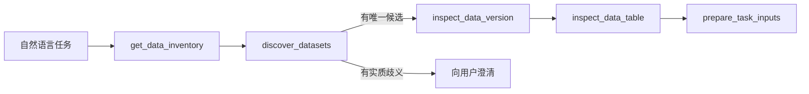

# Agent 发现、理解与任务准备

本文描述 Groundwater v12 当前实现。Agent 不在启动时加载项目全部数据或知识；它从
Kernel 编译的当前 Turn 视图开始，按任务调用所属服务的只读投影，再把执行所需的最小
事实固化到 Kernel。Data、Knowledge 和 Kernel 始终各自拥有自己的状态。

## 信息从哪里来

Kernel 在一次 Agent 调用前编译以下来源：

- 当前用户消息、显式 `DataVersionRefV2` 附件和目标修订；
- 当前 Task 规格、进度、未决项和已验证结果；
- 当前或历史执行状态，以及仍与本轮相关的准备投影；
- 受控的跨轮记忆摘要；
- 产品装配时冻结的工具、模型和工作流草稿能力说明。

这个编译视图是读取模型，不是新的事实所有者。上下文策略可以省略低优先级历史或把它
变成可检索引用，但不能改写 Task、Data、Knowledge、Confirmation、AgentAction 或
WorkflowRun。观察工具的响应正文只存在于当前 Turn；跨轮只保留受控身份、结论和状态。

## 关联业务工作的模型上下文

Kernel 在模型调度前解析当前 AgentRun 对应的 Session、目标修订和项目成员身份，再读取
该 Session 的 WorkItem 关联。意图路由继续根据当前请求和本会话的来源判断。每次模型调用
和协议重试都从权威服务重新读取，确认后最终回复沿用冻结的确认与执行事实。

| 层 | 调度时装配内容 |
| --- | --- |
| L0 | 主体、角色、项目、Session、WorkItem、请求与目标修订、已确定的意图和可用操作范围 |
| L1 | WorkItem 标题、说明和汇总状态，以及单独的当前 Session、Task、准备阻塞、待确认、执行与发布状态 |
| L2 | 按请求需要校验最近至多 8 个关联引用，保留精确的 DataVersion/SemanticRevision、仍有效的 Knowledge version 和发布成果身份。已选业务能力复核当前角色权限及冻结版本 |
| L3 | 续作或复盘时取至多 4 个符合归属且未归档的关联会话事实摘要，标注 Session、观察时间、会话与业务事实的修订及类别 |

调度器把这些内容放在单独的结构化数据消息里。它先保留请求作用域与当前工作状态，
再尝试装入说明、资料及历史。包上限为 4,096 UTF-8 字节和 1,200 token，并受当前模型
输入预算的八分之一及完整模型输入容量约束。关联资料的读取各有 1 秒时限，装配整体有
2.5 秒时限。失效引用被省略，整体超时继续处理原请求。归档或权限失效时省略对应背景。
会话摘要采用 Kernel 可核对的状态事实，留在非权威摘要层；其他会话的消息、记忆正文与
审核 token 不进入该数据消息。上下文清单记录来源、修订、摘要哈希和预算处置，追踪记录
字节和 token 计数。附加消息不会写入 SDK 的续作检查点。

显式只读对话和已分类的只读咨询、比较、状态查询使用只读业务工具。需要登记或调整 Task
时走自动意图路由，由当前请求的业务意图与任务动作共同确定工具范围。WorkItem 内容和历史
摘要只为回复提供背景。被冻结的能力或档位权限失效时，Kernel 在发送模型请求前终止该轮。
确认后的最终回复使用既有执行事实。工作流、Task 和确认授权沿用既有服务端校验。

## 从工作资料到计算输入

在业务工作的「资料与业务对象」中选择资料版本或上传后核对，再确认关联。资料核对显示
数据版本、对象与校验和，可以选择 Data 保存的历史语义修订。界面显示该修订的字段和单位、
时间范围、空间覆盖、坐标参考系及垂向基准。检查记录只匹配同一数据版本与语义修订，
并保留规则版本和检查时间。缺少匹配记录时显示待核验，缺少字段声明时显示未声明。

关联监测井、区域或含水层需要选择来源字段并填写业务键。该业务键在所选资料和字段内解释，
WorkItem 保存这个引用与关联时间。知识按精确文档版本关联，专业计算记录及已发布成果由
Kernel 复核运行和发布身份。访问失效的资料只显示不可用状态。

从关联会话的「准备计算输入」选择分析方法和输入角色。角色选择器提供此工作中仍可读且
格式符合的关联资料，选中后还可核对精确版本。草稿绑定随请求提交，Kernel 返回结构化
准备结果。按缺项补充资料或参数后重新准备。会话里的工作背景分别标明草稿、准备结果、
待确认方案和确认采用状态，最终采用以 Confirmation 的冻结引用为准。

当前准备和执行合同要求该数据版本的当前语义与唯一原始对象。工作中的历史语义和其他对象
可以保留并核对。需用于计算时，用户主动读取该数据版本的当前语义和原始对象，再选择它；
既有历史关联保留其原身份。字段、单位及空间条件仍由该分析方法的准备校验判断。

## 从成果发布到验收与复用

业务工作的「成果中心」从关联会话读取执行记录。执行完成后可单独核对发布。打开具名成果
时按运行、发布记录、Data 版本、语义和原始对象校验身份。通过冻结档位和成果合同核对的成果
可查看合同单位和指定的工作流诊断，也可单独读取 Data 的质量检查。展开运行来源可看执行版本、
时间、参数和可核对的冻结输入。未取得精确来源时相应事实显示待核验。

验收使用工作快照提供的当前候选。确认前可核对交付包含的具名成果和数据版本。Kernel 提交时
重新校验候选、修订及成果权限。连接中断时可重试同一请求，交付变化后从最新候选重新发起。

要继续分析，在成果中心将确认已发布的输出关联到工作，再选择同一工作的另一个可用会话。
成果带着来源运行、输出名、发布记录和精确 Data 版本进入草稿，已有输入和文字可继续编辑。
发送或重试前重新读取目标归属和成果可见性。消息使用现有精确 Data 引用，资料格式、语义和
计算授权继续由准备、确认及执行合同校验。

## 从业务问题进入专业计算

Kernel 按产品装配发现当前身份可用的业务能力，意图路由判断本轮是否需要执行分析。咨询、
资料浏览和状态查询可继续对话。单个合规分析候选进入准备，多个候选先澄清。可在重新描述
分析目标时附上明确的档位标识。当前会话上一轮若因资料或参数阻塞，简短的对应补答可以继续
准备。参数与输入版本在提交确认前仍需核对。

「同一时刻地下水流场」使用一份精确井点观测资料。需要明确井号、时间、X/Y 坐标、以米
表示的参考面高程和向下量取的埋深，并声明共同垂向基准、源坐标系及数据时间范围。原始字符串
时间需先规范化为 UTC 类型的时间戳并声明 UTC 时区。用户还需选择 UTC 观测时刻、适合场地的
米制投影和格网大小，提供米每天的渗透系数及小数形式的
有效孔隙率。例如可在缺参时补充「渗透系数=10 m/day」，具体数值应根据该项目证据提供。

计算按同一时刻匹配观测，以参考面高程减埋深求水头，再插值估计水平梯度、流向、达西通量与
孔隙水流速。成果中心通过具名输出核对估算结果和诊断。模型采用均质、各向同性、统一孔隙率的
二维稳态假设。合成 Golden 证明技术链路，场地适用性和业务验收各有独立依据。

## Data 发现链

Data 服务直接从自己的当前目录生成两类请求时投影：

1. `get_data_inventory` 返回 Dataset 数量、描述覆盖和 format/tag 分布，用于判断是否有
   值得进一步搜索的目录范围。
2. `discover_datasets` 接受 `query/tags/formats/field_terms/units/after/limit`，返回当前
   DatasetVersion 的紧凑候选、命中字段、确定性分数、匹配理由、缺失元数据和游标。

发现结果故意不携带完整 descriptor 或 semantics。候选命中只能说明目录元数据满足字面
条件，不能证明业务含义、质量或模型适用性。相同请求得到相同确定性结果摘要时，Kernel
把它视为搜索已收敛，避免 Agent 反复调用发现工具。

选定候选后，Agent 必须调用 `inspect_data_version` 读取完整不可变身份，包括
`dataset_id/version_id/semantic_id/object_id/checksum` 和 Dataset 的 `current_version`。
CSV/Parquet 的字段确认再调用 `inspect_data_table`；样本只证明实际物理字段和有限范围，
不证明单位、完整质量或时间空间覆盖。



已知精确版本 ID 时可以直接检查版本，不需要先枚举目录。分页未结束时不能声称已覆盖
整个目录。

## Knowledge 取证链

需要解释字段、单位、方法适用性或项目约定时，Agent 先用 `retrieve_evidence` 检索候选，
再用 `read_evidence` 携带精确 `version_id/unit_id/checksum` 完整读取证据单元。只有当前
Turn 中状态为 `OK` 的完整读取才能引用。数据绑定证据还必须精确匹配
`service/project_id/dataset_id/version_id/semantic_id`。

`STALE`、撤回、过期、checksum 变化或绑定不匹配都要求重新检索或停止；Kernel 不把旧
正文放入统一资源表，也不允许 MemorySummary 把历史文字提升为当前证据。

## 从候选到可执行准备

预设工作流的执行请求在读取必要事实后调用 `prepare_task_inputs`。工具重新解析目标模型的输入合同，
重新检查每个 Data 版本，绑定本轮已读 Knowledge 引用，并记录参数来源。版本策略有两种：

- `CURRENT_REQUIRED`：用户要求“当前/最新”，或任务必须继续使用 Dataset 当前版本；若
  `current_version` 已变化，准备返回 `BLOCKED/DATA_VERSION_NOT_CURRENT`。
- `PINNED`：用户明确指定历史或冻结版本；只要精确身份仍可解析，就保留该版本。

`READY` 只证明身份和可执行合同完整。它不证明科学适用性、数据质量或业务认可。Agent
随后记录计划，并且模型调用参数必须与显式准备完全相同；参数漂移或重复消费同一准备项
会在提案边界被拒绝。

一个提案可以包含多个动作。Kernel 因此为一个 AgentRun 保存一个
`TaskPreparationV1` head，`entries` 完整覆盖动作集合，而不是为每个动作互相覆盖单条
状态。每项包含：

- 目标 kind/id/version 与 `selection_policy`；
- 精确 Data 输入和本轮 Knowledge 引用；
- 参数、参数来源、合同检查和阻塞原因。

集合 `status` 从各项汇总。`fresh_for_current_turn` 由 goal revision 比较得出；
`disposition` 根据 AgentRun、Confirmation 和 AgentAction 派生为 `ACTIVE`、
`WAITING_CONFIRMATION`、`EXECUTING`、`CONSUMED`、`REJECTED`、`FAILED`、
`ABANDONED` 或 `STALE`。调用方不能另写一套生命周期状态。

显式工具调用是首选路径。为兼容 Provider 的合法工具顺序差异，执行提案边界仍会根据
当前 Turn 已检查的精确事实重建同一准备集合；这条兜底不能绕过检查，也不能接受显式
准备之后发生的参数变化。确认后执行使用冻结的 AgentAction/RunState，不再从准备记录
重新构造参数。

## 从算子发现到确认执行

执行数据任务时，Agent 可以按操作名称、中文任务词或算子标识调用 `list_operators`。它
用 `get_operator` 读取具体版本的端口、参数和组合条件，并用 `inspect_data_version`
核验每个外部输入。详情分别显示产品确认准入和当前 Worker 心跳状态。Groundwater 装配了 18 个预设之外的 59 个算子版本，以及已有的表筛选
和用于显式转换的格式转换、坐标变换。用户选定预设时走预设准备入口。

能力目录的「算子」页与 `get_operator` 使用相同的版本级元数据，包括引用该版本的工作流和预设、
产品独立调用准入、Worker 就绪状态及开发验收范围。验收记录由产品清单按校验和引用，
实现摘要变化后界面标为需复验。科学适用性取决于对应案例与领域复核。

单步任务使用一个节点，多步任务用具名端口连边。表连接、排序等需要规则的操作绑定已登记的
JSON 规则版本。用户已明确规则但还没有规则文件时，`prepare_task_inputs` 校验规则内容，
并通过 Data 发布可复用的版本。连接键还要匹配已检查的左右源表字段。水文图采用 Data 语义版本中的 `valueKind` 区分高程、D8 流向、汇水格数
和河网掩膜。Agent 调用 `validate_workflow` 预检当前草稿。该工具返回缺失输入或校验结果，
用户确认后由 Executor 调度相应 Worker 并发布选定结果。确认项冻结实际数据、算子实现和
图的摘要，Executor 重新校验后才接收作业。

要锁定输入角色，在消息中另起一行写 `输入角色 target = 《资料标题》`。也可填精确版本 ID，
或用 `vector.spatial_join.target` 指定算子端口。同名版本或多处同名端口应写得足够明确。
Kernel 对照本轮已检查的资料核验这些约定，调换输入会阻止确认。确认卡列出每个端口的冻结资料版本，
内部连线显示对应的上游节点与输出端口。

离线检查已冻结的图可使用同一装配的 Executor 配置。

```sh
python -m platform_workflow_compiler.composition frozen-workflow.json \
  --executor-config executor-config.json --project groundwater-demo
```

逐项验收复用 `tests/e2e/test_composed_workflow.py`。用 `COMPOSITION_E2E_OPERATOR_SCOPE`
按 `native`、`qgis`、`remote_http` 或具体版本选择用例。依赖 GDAL 命令的 Native
用例和 QGIS 用例使用各自锁定的 Worker 镜像。PEST 用例使用隔离服务签发的测试模型包，
并校验首次提交回执丢失后，Executor 能恢复同一个远端作业。

## 为什么不使用统一资源状态表

全局复制 Data/Knowledge 目录会产生新鲜度、权限、迁移、冲突仲裁和恢复问题，并形成第
二事实源。当前架构采用“服务内投影 + Kernel 准备集合 + 编译视图”：

| 层 | 保存内容 | 不保存内容 |
| --- | --- | --- |
| Data/Knowledge | 当前目录、不可变版本、语义/证据正文与生命周期 | Agent 任务状态 |
| Kernel TaskPreparation | 本轮选中的精确身份、策略、参数来源、检查和阻塞 | 服务目录副本、观察正文 |
| Kernel compiled view | 按当前目的和预算组合的只读上下文 | 新的权威状态 |

只有在多个服务需要共享一个真正独立、长期存在且有明确写入所有者的业务实体时，才应增加
新的统一状态资源。检索候选和执行准备不满足这个条件。

## 验证与观测

确定性测试覆盖多动作集合、参数漂移、版本策略、跨轮失效、重复发现收敛和正文不落库。
真实模型评测在确认前校验目标、精确 Data 版本和完整参数，单独报告
`preparation_correct`。`report_task_success_metrics.py` 只从 v31 Kernel 数据库读取无正文的
发现、检查、准备、确认和执行漏斗；它设置 `accuracy_claim=false`，因为生产运行状态没有
独立真值，不能直接计算自然语言任务成功率。

跨服务执行、真实 Provider 质量和发布门禁分别按
[执行手册](../operations/execution-playbook.md)与[验收条目](../operations/acceptance-gates.md)验证。
